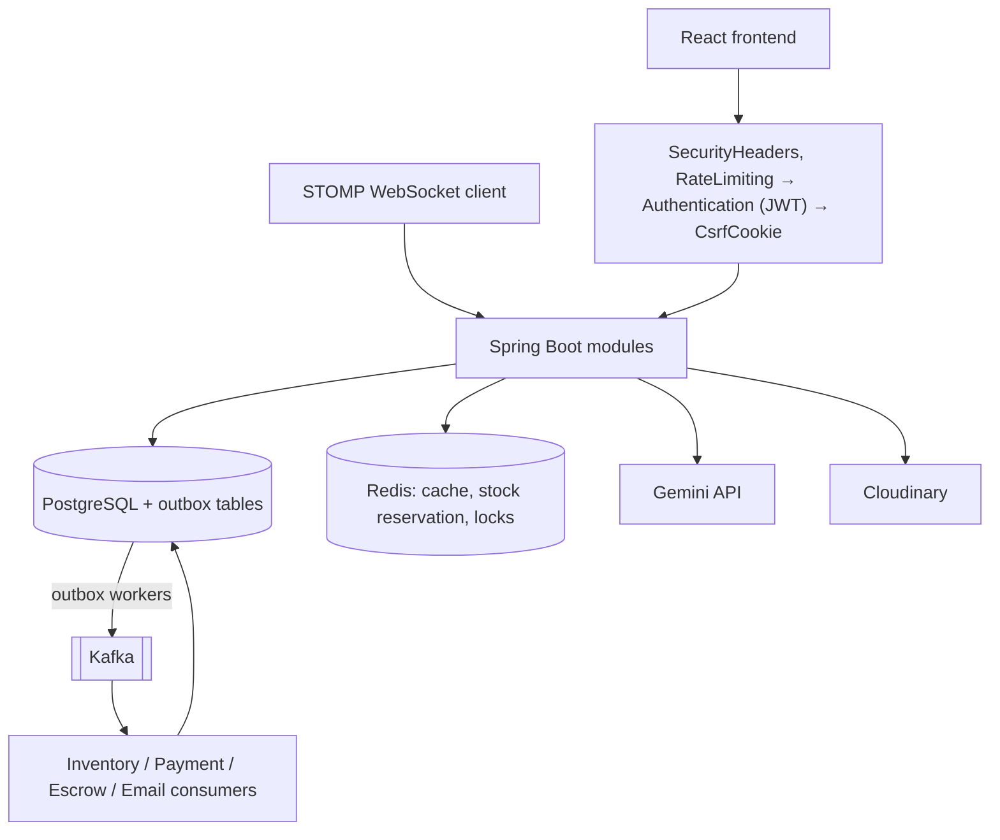

# SecondHand

C2C second-hand marketplace: listings, cart/checkout, escrow-backed payments with an e-wallet, offers/negotiation, real-time chat and "Aura", a Gemini-powered assistant.

**Stack:** Spring Boot 3.5 (Java 17), PostgreSQL 15 + Flyway, Redis 7 (Lua), Apache Kafka 3.7, MapStruct · React 19, Vite 5, Tailwind 3, React Query · Gemini, Cloudinary, Google OAuth2 · Actuator/Prometheus.

**AI agents:** start with [`AGENTS.md`](AGENTS.md).

## Architecture



Most backend modules have a matching folder under `secondhand-frontend/src/`. Business rules live in each module's `README.md`.

| Area | Backend package | Frontend | Notes |
| :--- | :--- | :--- | :--- |
| Auth | `auth`, `core/jwt`, `core/security` | `src/auth` | JWT access/refresh rotation, HttpOnly cookies, Google OAuth2, rate limiting |
| Payment & wallet | `payment`, `ewallet` | `src/payments`, `src/ewallet` | `PaymentProviderPort`, transactional outbox |
| Escrow | `escrow` | `src/ewallet` | Seller wallet credited asynchronously after delivery confirmation |
| Orders | `order`, `checkout` | `src/order`, `src/cart` | State machine, per-item cancel/refund |
| Cart & stock | `cart`, `inventory` | `src/cart` | Redis Lua reservation (15 min TTL), reconciliation |
| Listings | `listing`, `showcase` | `src/listing`, `src/showcase`, one folder per vertical (`src/vehicle`, `electronics`, `realEstate`, `books`, `clothing`, `sports`) | 6 polymorphic verticals with catalog-driven forms (type rules, attributes, catalog snapshots), paid showcase |
| Offers | `offer` | `src/offer` | 24 h Redis lock for an accepted offer |
| Campaign & coupons | `campaign`, `coupon`, `pricing` | `src/campaign`, `src/coupon` | Lua-based redemption limits |
| Chat | `chat` | `src/chat`, `src/inbox` | STOMP, JWT checked on connect |
| Aura AI | `ai` | `src/ai` | Gemini search planning, context adapters, price advice |
| Social | `review`, `forum`, `follow`, `favorite`, `favoritelist`, `complaint` | `src/reviews`, `src/forum`, `src/follow`, `src/favorites`, `src/favoritelist`, `src/complaint` | Reviews, forum, follows, favorite lists, complaints |
| Other | `agreements`, `dashboard`, `shipping`, `exchange`, `cloudinary` | `src/agreements`, `src/dashboard`, `src/comparison` | Agreements, dashboard, carrier and exchange-rate integrations, image storage |
| Notifications & email | `notification`, `email` | `src/notification`, `src/emails` | Event-driven email |

Deep dives (payments, pricing/coupons/campaigns, escrow, orders, stock, Redis/Kafka, cache, auth, offers, chat, notifications, email, catalog, seeding, Aura AI, CI/CD): [`docs/README.md`](docs/README.md).

## Setup

**Requirements:** JDK 17, Maven, Node.js 18+, Docker.

```bash
cp .env.template .env           # first time only: fill JWT_SECRET_KEY, GEMINI_API_KEY, CLOUDINARY_*, GOOGLE_*
./scripts/start_all.sh          # Docker (Postgres 5433, Redis 6379, Kafka 9092), backend (:8080), frontend (:5173)
./scripts/start_all.sh --seed   # also runs catalog seeds; or --seed=<key[,key]|listing|all>
```

Seed keys: `vehicle`, `electronics`, `clothing`, `books`, `sports`, `realestate`, `attributes`, `agreements` (`listing` = all catalog keys). `listings-generate` / `listings-clean` create or remove dev listings and are never part of `all`. Seeds read `src/main/resources/data/`, which is git-ignored, so a fresh clone needs a local copy first (details: [`docs/database-migration-and-seeding-guide.md`](docs/database-migration-and-seeding-guide.md)).

**Running the parts yourself:**
```bash
docker-compose up -d                          # infrastructure
mvn spring-boot:run                           # backend, http://localhost:8080; Flyway migrates on startup
cd secondhand-frontend && npm install && npm run dev   # http://localhost:5173
```
The frontend reads `VITE_API_BASE_URL=http://localhost:8080/api/v1` and `VITE_WS_BASE_URL=ws://localhost:8080/ws` from `.env.local`. Swagger UI (`/swagger-ui.html`) is on by default and disabled in the `prod` profile.

## Tests and checks

- Tests are skipped by default (`maven.test.skip=true`): `mvn test -Dmaven.test.skip=false -Dtest=<Class>`. Unit tests use plain Mockito.
- `ConcurrentStockAndPaymentIntegrationTest` runs against the local services and leaves the first listing's stock at 1; run it deliberately.
- Frontend: `npm run lint`, `npm run build` in `secondhand-frontend/`.
- `python3 scripts/check_docs.py`: docs map, links, class names, stale commands. `python3 scripts/check_api_endpoints.py`: frontend/backend endpoint parity (one known false positive, `/v1/ai/summary/{param}/{param}`).

## Security

- JWT access/refresh tokens in HttpOnly, SameSite cookies (never in response bodies); refresh tokens stored hashed, rotated atomically with token family revocation; logout revokes the used access token.
- Double-submit CSRF cookie (`CsrfCookieFilter`); Redis-backed route rate limits (`RATE_LIMIT_*`, responds `429`) and login throttling per account+IP.
- Google OAuth2 requires a verified email and never takes over a local account.
- STOMP: JWT checked on connect, revoked sessions rejected, subscriptions limited to the user's own `/user/{id}/...` queues and rooms they belong to (`WebSocketSecurityConfig`).
- Money endpoints are idempotent (`Idempotency-Key` for wallet deposit/withdraw).

## Observability

Actuator metrics are exposed at `/actuator/prometheus` for scraping; no dashboards or Prometheus config are shipped in the repo.

> **Flyway:** change the schema only by adding a new `V<N>__description.sql` under [`src/main/resources/db/migration`](src/main/resources/db/migration); never edit existing migrations.
