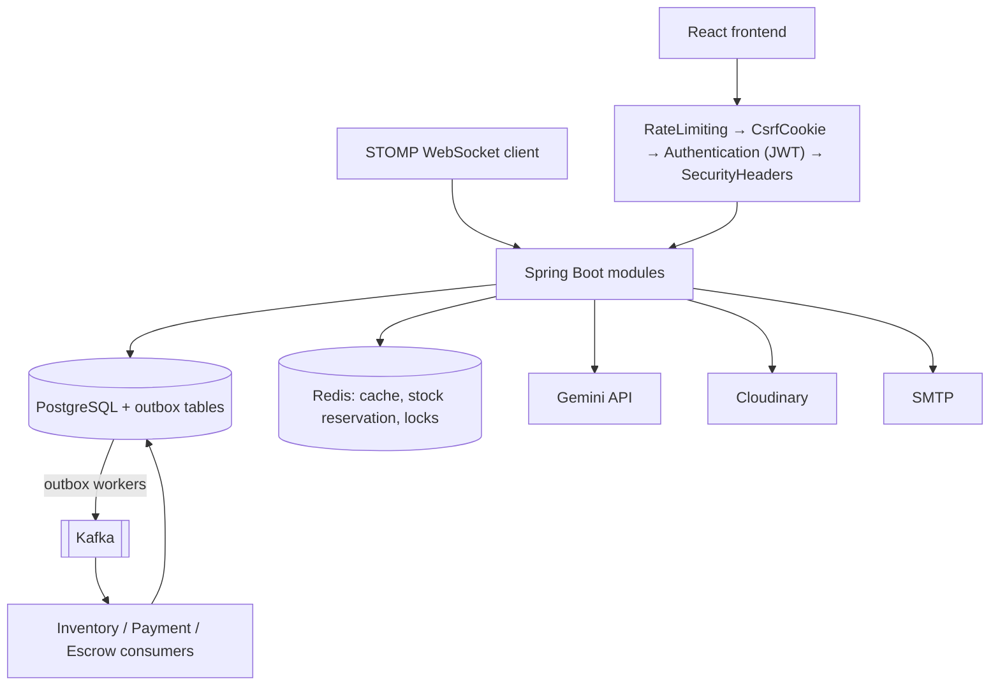

# SecondHand

C2C second-hand marketplace: listings, cart/checkout, escrow-backed payments with an e-wallet, offers/negotiation, real-time chat and "Aura", a Gemini-powered assistant.

**Stack:** Spring Boot 3.5 (Java 17), PostgreSQL 15 + Flyway, Redis 7 (Lua), Apache Kafka 3.7, MapStruct · React 19, Vite 5, Tailwind 3, React Query · Gemini, Cloudinary, Google OAuth2 · Actuator/Prometheus.

**AI agents:** read [`AGENTS.md`](AGENTS.md) first (Claude Code, Codex, Gemini CLI and Cursor all load it; `CLAUDE.md` and `GEMINI.md` just import it).

## Architecture



Most backend modules have a matching folder under `secondhand-frontend/src/`. Business rules live in each module's `README.md`.

| Area | Backend package | Frontend | Notes |
| :--- | :--- | :--- | :--- |
| Auth | `auth`, `core/jwt`, `core/security` | `src/auth` | JWT access/refresh rotation, HttpOnly cookies, Google OAuth2, rate limiting |
| Payment & wallet | `payment`, `ewallet` | `src/payments`, `src/ewallet` | `PaymentProviderPort`, transactional outbox |
| Escrow | `escrow` | `src/ewallet` | Seller wallet credited asynchronously after delivery confirmation |
| Orders | `order`, `checkout` | `src/order`, `src/cart` | State machine, per-item cancel/refund |
| Cart & stock | `cart`, `inventory` | `src/cart` | Redis Lua reservation (15 min TTL), reconciliation |
| Listings | `listing`, `showcase` | `src/listing`, `src/showcase` | Multi-category listings, paid showcase |
| Offers | `offer` | `src/offer` | 24 h Redis lock for an accepted offer |
| Campaign & coupons | `campaign`, `coupon`, `pricing` | `src/campaign`, `src/coupon` | Lua-based redemption limits |
| Chat | `chat` | `src/chat`, `src/inbox` | STOMP, JWT checked on connect |
| Aura AI | `ai` | `src/ai` | Gemini search planning, context adapters, price advice |
| Reviews & forum | `review`, `forum` | `src/reviews` | |
| Notifications & email | `notification`, `email` | `src/notification`, `src/emails` | Event-driven email |

Deep dives (payments, escrow, stock, Redis/Kafka, cache, auth, offers, social proof): [`docs/README.md`](docs/README.md).

## Setup

**Requirements:** JDK 17, Node.js 18+, Docker.

**Quick start (backend + frontend):**
```bash
cp .env.template .env   # first time only: fill required keys
./start_all.sh          # starts backend (:8080) and frontend (:5173)
```

**Manual steps:**
1. Infrastructure (PostgreSQL `5433`, Redis `6379`, Kafka `9092`):
   ```bash
   docker-compose up -d
   ```
2. Backend:
   ```bash
   cp .env.template .env   # fill JWT_SECRET_KEY, GEMINI_API_KEY, CLOUDINARY_*, GOOGLE_*
   ./mvnw spring-boot:run
   ```
   Starts on `http://localhost:8080`; Flyway runs migrations automatically. Swagger UI is configured only for the `prod` profile (`application-prod.yml`); the API spec is `secondhand-openapi.json`.
3. Frontend:
   ```bash
   cd secondhand-frontend && npm install
   # .env.local: VITE_API_BASE_URL=http://localhost:8080/api/v1  VITE_WS_BASE_URL=ws://localhost:8080/ws
   npm run dev   # http://localhost:5173
   ```

## Security

- JWT access/refresh tokens in HttpOnly, SameSite cookies; refresh rotation with token family revocation.
- Double-submit CSRF cookie (`CsrfCookieFilter`); route-based rate limits (`RATE_LIMIT_*`, responds `429`).
- JWT validation on the STOMP connection (`WebSocketSecurityConfig`).

## Observability

Actuator metrics are exposed at `/actuator/prometheus`. Prometheus and Grafana are not part of `docker-compose.yml`; `prometheus.yml` and `grafana/provisioning/` are ready-made configs to run separately.

> **Flyway:** change the schema only by adding a new `V<N>__description.sql` under [`src/main/resources/db/migration`](src/main/resources/db/migration); never edit existing migrations.
