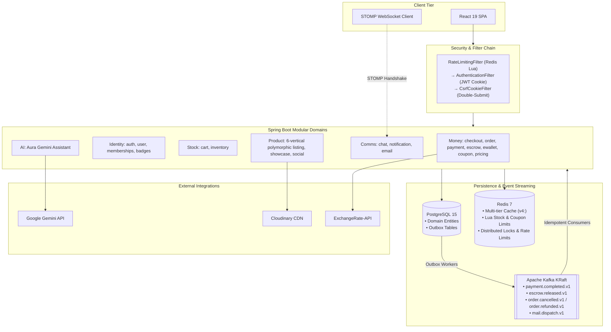

# SecondHand

An enterprise-grade, high-concurrency C2C second-hand marketplace platform featuring polymorphic vertical catalogs, distributed lock-free stock reservations, escrow-backed multi-method payments, in-person safe meetup handovers, real-time STOMP messaging, and **Aura** — an autonomous Gemini-powered AI assistant.

---

## Tech Stack

| Layer | Technologies |
| :--- | :--- |
| **Backend** | Spring Boot 3.5, Java 17, Spring Security 6, Spring Data JPA, MapStruct, Lombok |
| **Database & Cache** | PostgreSQL 15, Flyway Migrations, Redis 7 (Atomic Lua Scripts, Multi-tier Cache) |
| **Messaging** | Apache Kafka 3.7 (KRaft mode, Transactional Outbox, Consumer Idempotency) |
| **Frontend** | React 19, Vite 5, Tailwind CSS 3, React Query (@tanstack), Axios |
| **Real-Time** | Spring WebSocket, STOMP protocol, simple broker fanned out across instances via Redis Pub/Sub |
| **AI & External** | Google Gemini API (Aura AI), Cloudinary CDN, ExchangeRate-API, Google OAuth2 |
| **Observability** | Spring Boot Actuator, Prometheus Metrics endpoint (`/actuator/prometheus`) |

> **AI Agents & Contributors:** Start with [`AGENTS.md`](AGENTS.md) for cross-cutting standards, testing rules, and skill mappings.

## Where to Read Next

| You are... | Start here |
| :--- | :--- |
| A new developer | [`docs/getting-started-and-developer-guide.md`](docs/getting-started-and-developer-guide.md) (setup, workflow, tests, troubleshooting) |
| Curious what the product does | [`docs/product-overview-and-user-journeys.md`](docs/product-overview-and-user-journeys.md) (roles, buyer and seller flows, coupons, offers) |
| Working on one module | The module hub `README.md` under `src/main/java/com/serhat/secondhand/<module>/` or `secondhand-frontend/src/<module>/` |
| Looking for the "why" | [`docs/adr/README.md`](docs/adr/README.md) (six architecture decision records) and the deep dives in [`docs/README.md`](docs/README.md) |
| On call or debugging production | [`docs/operations-runbook.md`](docs/operations-runbook.md) (outbox requeue, DLT, stock drift, Flyway) |

## Key Features

- **Listings:** six verticals (vehicle, electronics, real estate, books, clothing, sports) with rule-driven forms, price history, paid showcases, best sellers on the home page, and bulk status changes in My Listings.
- **Buying:** reserved stock during checkout, per-seller orders, escrow-held payments, cargo or safe meetup delivery, 48-hour refund window.
- **Pricing:** seller campaigns (paid by the seller) and platform coupons (paid by the platform, with remaining uses and total savings shown on the Coupons page).
- **Negotiation:** offers with counter-offers; an accepted offer holds the stock until its payment deadline.
- **Trust:** reviews, follows, complaints with a moderation queue, user blocking, audit trail and security devices page.
- **Communication:** real-time chat, notification feed and in-app inbox, Aura AI search assistant.

---

## Architecture Overview

The backend uses a layered, hexagonal-inspired architecture with Transactional Outbox workers ensuring guaranteed at-least-once event delivery and strictly idempotent Kafka consumers.



---

## Domain & Directory Map

Each backend module has a hub `README.md`; most modules map to a directory under `secondhand-frontend/src/`.

| Domain | Backend Packages | Frontend Directories | Focus |
| :--- | :--- | :--- | :--- |
| **Money** | `checkout`, `order`, `payment`, `escrow`, `ewallet`, `coupon`, `pricing`, `campaign`, `offer` | `payments`, `ewallet`, `order`, `cart`, `coupon`, `campaign`, `offer` | Escrow-backed payments, eWallet, coupons and campaigns |
| **Identity & Users** | `auth`, `user`, `core/jwt`, `core/security` | `auth`, `user` | JWT sessions, Google SSO, addresses, plans |
| **Stock** | `cart`, `inventory` | `cart` | Redis stock reservations, reconciliation |
| **Product** | `listing`, `showcase`, `favorite`, `favoritelist`, `review`, `follow`, `forum` | `listing`, `showcase`, `vehicle`, `electronics`, `realEstate`, `books`, `clothing`, `sports`, `favorites`, `favoritelist`, `reviews`, `follow`, `forum` | Six polymorphic verticals, showcases, social features |
| **Communications** | `chat`, `notification`, `email` | `chat`, `inbox`, `notification`, `emails` | Chat, notification feed, in-app email |
| **AI & Complaints** | `ai`, `complaint` | `ai`, `complaint` | Aura assistant, complaint moderation |
| **Core & Platform** | `core`, `agreements`, `dashboard`, `shipping`, `exchange`, `cloudinary` | `admin`, `audit`, `agreements`, `dashboard`, `comparison` | Result envelope, rate limiting, audit, carriers, currency |

Rules, invariants and APIs of each module live in its hub `README.md`, not here.

> **Deep Dive Documentation:** For architectural blueprints, state machine diagrams, and concurrency guarantees, visit [`docs/README.md`](docs/README.md).

---

## Getting Started

### Prerequisites
- **JDK 17** & **Maven 3.9+**
- **Node.js 18+** & **npm**
- **Docker** & **Docker Compose**

### 1. Environment Setup
```bash
# Clone repository and create local environment file
cp .env.template .env
```
Fill in the required credentials in `.env` (e.g. `JWT_SECRET_KEY`, `GEMINI_API_KEY`, `CLOUDINARY_*`, `GOOGLE_*`).

### 2. One-Command Quickstart
Run the automated bootstrap script to spin up Docker services, compile the backend, apply migrations, seed the catalog, and start the frontend:
```bash
./scripts/start_all.sh --seed
```

| Service | Address | Default Port | Notes |
| :--- | :--- | :--- | :--- |
| **Frontend** | `http://localhost:5173` | `5173` | Vite dev server |
| **Backend API** | `http://localhost:8080/api/v1` | `8080` | Spring Boot API |
| **Swagger UI** | `http://localhost:8080/swagger-ui.html` | `8080` | OpenAPI 3.0 docs (disabled in `prod`) |
| **PostgreSQL** | `localhost:5433` | `5433` | Database: `secondhand` |
| **Redis** | `localhost:6379` | `6379` | Redis 7 standalone |
| **Kafka (KRaft)** | `localhost:9092` | `9092` | Event broker |

---

## Manual Startup & Seed Options

If you prefer running services independently:

```bash
# 1. Start Infrastructure
docker compose up -d

# 2. Run Backend (Flyway runs automatically on startup)
mvn spring-boot:run

# 3. Run Frontend
cd secondhand-frontend
npm install
npm run dev
```

### Seeding Catalog Data
Catalog seeds are idempotent upserts from `src/main/resources/data/**`:
```bash
# Seed all verticals and agreements
mvn spring-boot:run -Dspring-boot.run.arguments="--app.seed=all"

# Or seed specific domains
mvn spring-boot:run -Dspring-boot.run.arguments="--app.seed=vehicle,realestate,attributes"
```
Supported seed keys: `vehicle`, `electronics`, `clothing`, `books`, `sports`, `realestate`, `attributes`, `agreements`, `listing` (all catalog keys), `all`. Dev listing utilities: `listings-generate`, `listings-clean`. (Details: [`docs/database-migration-and-seeding-guide.md`](docs/database-migration-and-seeding-guide.md)).

---

## Security & Concurrency Highlights

- **Stateless Authentication:** Access tokens (15m) and Refresh tokens (7d) transmitted exclusively via `HttpOnly`, `SameSite=Strict`, `Secure` cookies. Token family tracking revokes stolen session trees immediately.
- **CSRF & Rate Limiting:** Double-submit cookie pattern (`CsrfCookieFilter`). Distributed Redis Lua fixed-window limiter (`RateLimitingFilter`) guards public and sensitive auth endpoints against brute force and DDoS.
- **Zero Over-Selling:** Stock is atomically checked and decremented in Redis via Lua scripts (`reserve_stock_with_ttl.lua`) during checkout with a 15-minute auto-release TTL. Database stock is deducted asynchronously via Kafka events.
- **ACID Transactional Outbox:** Events are enqueued in dedicated outbox tables (`payment_outbox_events`, `order_outbox_events`, `escrow_outbox_events`) within the core business transaction and dispatched to Kafka via scheduled polling workers.
- **Safe Meetup Handshake:** Buyers and sellers verify physical delivery via SHA-256 encrypted OTP codes or QR tokens. 3 consecutive failed attempts trigger an automated 15-minute security lock (`VERIFICATION_LOCKED`).

---

## Testing & Verification

Unit tests use plain Mockito with no Spring context startup, so feedback is fast:

```bash
# All unit tests, or one class
mvn test
mvn test -Dtest=CouponServiceTest

# Unit tests plus JaCoCo coverage (what CI runs)
mvn -B verify

# Integration test (needs Docker, mutates dev stock): ask before running
mvn test -Pintegration-tests -Dtest=ConcurrentStockAndPaymentIntegrationTest

# Frontend lint and build
cd secondhand-frontend && npm run lint && npm run build

# Repo consistency: docs drift, API route parity, zero-emoji scan, frontend lint
./scripts/verify.sh
```

GitHub Actions (`.github/workflows/ci.yml`) runs `mvn -B verify`, the frontend build and `./scripts/verify.sh` on every push and pull request.

---

## Troubleshooting

| Symptom | Fix |
| :--- | :--- |
| Flyway checksum error on startup | One-time `flyway repair`, command in [`docs/database-migration-and-seeding-guide.md`](docs/database-migration-and-seeding-guide.md) |
| New migration not applied | Restart the backend; Flyway applies pending versions at startup |
| `connection refused` on 5433, 6379 or 9092 | `docker compose up -d` |
| Aura, image upload or Google sign-in fails | The matching `GEMINI_*`, `CLOUDINARY_*` or `GOOGLE_*` value in `.env` is empty |
| HTTP 429 | Rate limit; tune the `RATE_LIMIT_*` variables |

In dev there is no SMTP: emails are written to the `emails` table and shown in the in-app inbox (`/inbox`).

---

## Database Migrations

Schema changes must strictly be performed by creating a new versioned migration file:
`src/main/resources/db/migration/V<N>__description.sql`.
Never modify existing, already executed migrations.
