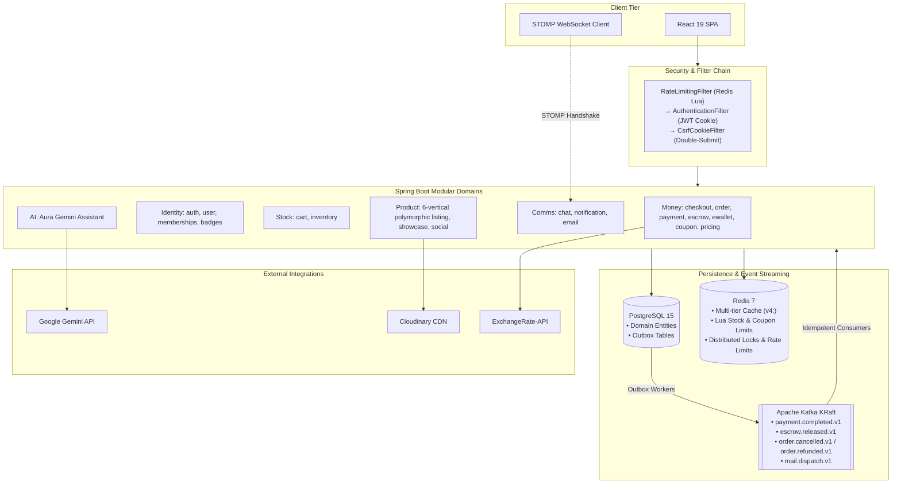

# SecondHand

An enterprise-grade, high-concurrency C2C second-hand marketplace platform featuring polymorphic vertical catalogs, distributed lock-free stock reservations, escrow-backed multi-method payments, in-person safe meetup handovers, real-time STOMP messaging, and **Aura** — an autonomous Gemini-powered AI assistant.

---

## ⚡ Tech Stack

| Layer | Technologies |
| :--- | :--- |
| **Backend** | Spring Boot 3.5, Java 17, Spring Security 6, Spring Data JPA, MapStruct, Lombok |
| **Database & Cache** | PostgreSQL 15, Flyway Migrations, Redis 7 (Atomic Lua Scripts, Multi-tier Cache) |
| **Messaging** | Apache Kafka 3.7 (KRaft mode, Transactional Outbox, Consumer Idempotency) |
| **Frontend** | React 19, Vite 5, Tailwind CSS 3, React Query (@tanstack), Axios |
| **Real-Time** | Spring WebSocket, STOMP protocol, Redis Pub/Sub cross-instance routing |
| **AI & External** | Google Gemini API (Aura AI), Cloudinary CDN, ExchangeRate-API, Google OAuth2 |
| **Observability** | Spring Boot Actuator, Prometheus Metrics endpoint (`/actuator/prometheus`) |

> 🤖 **AI Agents & Contributors:** Start with [`AGENTS.md`](AGENTS.md) for cross-cutting standards, testing rules, and skill mappings.

---

## 🏛️ Architecture Overview

The backend uses a layered, hexagonal-inspired architecture with Transactional Outbox workers ensuring guaranteed at-least-once event delivery and strictly idempotent Kafka consumers.



---

## 🗺️ Domain & Directory Map

Each backend module has a dedicated `README.md` defining its business invariants, state machines, and public APIs. Most modules correspond directly to a directory under `secondhand-frontend/src/`.

| Domain | Backend Packages | Frontend Directories | Responsibilities & Architectural Highlights |
| :--- | :--- | :--- | :--- |
| **Money** | `checkout`, `order`, `payment`, `escrow`, `ewallet`, `coupon`, `pricing`, `campaign`, `offer` | `src/payments`, `src/ewallet`, `src/order`, `src/cart`, `src/coupon`, `src/campaign`, `src/offer` | Escrow-backed payments, internal e-wallet with pessimistic row locks, safe meetup delivery (OTP/QR verification), transactional outbox publishing, Lua-based coupon limiters. |
| **Identity & Users** | `auth`, `user`, `core/jwt`, `core/security` | `src/auth`, `src/user` | Stateless JWT with refresh token rotation (HttpOnly cookies), Google OAuth2 SSO, user addresses, prestige Great Seller badges, subscription plans (`BASIC`, `PLUS`, `PRO`) with daily Aura question quotas. |
| **Stock & Reservations** | `cart`, `inventory` | `src/cart` | Two-tier optimistic shopping cart, atomic Redis Lua stock reservations with 15-minute anti-hoarding TTL, background drift reconciliation scheduler. |
| **Product & Catalogs** | `listing`, `showcase`, `favorite`, `favoritelist`, `review`, `follow`, `forum`, `complaint` | `src/listing`, `src/showcase`, `src/vehicle`, `src/electronics`, `src/realEstate`, `src/books`, `src/clothing`, `src/sports`, `src/favorites`, `src/favoritelist`, `src/reviews`, `src/follow`, `src/forum`, `src/complaint` | 6 polymorphic vertical catalogs (JPA Joined table inheritance), rule-driven forms, attribute engine, paid showcases, private broadcast offers to favoriters, forum threads, and trust/safety complaints. |
| **Communications** | `chat`, `notification`, `email` | `src/chat`, `src/inbox`, `src/notification`, `src/emails` | Dual-channel chat (11 REST endpoints + STOMP WebSocket), hybrid notification feed (personal + system broadcasts), Kafka-dispatched transactional email rendered via Thymeleaf into in-app inboxes. |
| **AI Assistant** | `ai` | `src/ai` | "Aura" intelligent assistant: multi-vertical semantic search planning via Gemini API, live price gauge advisor benchmarked against real DB stats, user memory, and listing generator. |
| **Core & Platform** | `core`, `agreements`, `dashboard`, `shipping`, `exchange`, `cloudinary` | `src/admin`, `src/audit`, `src/agreements`, `src/dashboard`, `src/comparison` | Central `ResultResponses` envelope, dynamic `@PublicEndpoint` registry, Redis rate limiting, audit logging, legal terms consent, carrier adapters (`CargoProviderPort`), and currency conversion. |

> 📚 **Deep Dive Documentation:** For architectural blueprints, state machine diagrams, and concurrency guarantees, visit [`docs/README.md`](docs/README.md).

---

## 🚀 Getting Started

### Prerequisites
- **JDK 17** & **Maven 3.9+**
- **Node.js 18+** & **npm**
- **Docker** & **Docker Compose**

### 1. Environment Setup
```bash
# Clone repository and create local environment file
cp .env.template .env
```
Fill in the required credentials in `.env` (e.g. `JWT_SECRET_KEY`, `GEMINI_API_KEY`, `CLOUDINARY_*`, `GOOGLE_*`).

### 2. One-Command Quickstart
Run the automated bootstrap script to spin up Docker services, compile the backend, apply migrations, seed the catalog, and start the frontend:
```bash
./scripts/start_all.sh --seed
```

| Service | Address | Default Port | Notes |
| :--- | :--- | :--- | :--- |
| **Frontend** | `http://localhost:5173` | `5173` | Vite dev server |
| **Backend API** | `http://localhost:8080/api/v1` | `8080` | Spring Boot API |
| **Swagger UI** | `http://localhost:8080/swagger-ui.html` | `8080` | OpenAPI 3.0 docs (disabled in `prod`) |
| **PostgreSQL** | `localhost:5433` | `5433` | Database: `secondhand` |
| **Redis** | `localhost:6379` | `6379` | Redis 7 standalone |
| **Kafka (KRaft)** | `localhost:9092` | `9092` | Event broker |

---

## 🛠️ Manual Startup & Seed Options

If you prefer running services independently:

```bash
# 1. Start Infrastructure
docker compose up -d

# 2. Run Backend (Flyway runs automatically on startup)
mvn spring-boot:run

# 3. Run Frontend
cd secondhand-frontend
npm install
npm run dev
```

### Seeding Catalog Data
Catalog seeds are idempotent upserts from `src/main/resources/data/**` (local copy required):
```bash
# Seed all verticals and agreements
mvn spring-boot:run -Dspring-boot.run.arguments="--app.seed=all"

# Or seed specific domains
mvn spring-boot:run -Dspring-boot.run.arguments="--app.seed=vehicle,realestate,attributes"
```
Supported seed keys: `vehicle`, `electronics`, `clothing`, `books`, `sports`, `realestate`, `attributes`, `agreements`, `listing` (all catalog keys), `all`. Dev listing utilities: `listings-generate`, `listings-clean`. (Details: [`docs/database-migration-and-seeding-guide.md`](docs/database-migration-and-seeding-guide.md)).

---

## 🔒 Security & Concurrency Highlights

- **Stateless Authentication:** Access tokens (15m) and Refresh tokens (7d) transmitted exclusively via `HttpOnly`, `SameSite=Strict`, `Secure` cookies. Token family tracking revokes stolen session trees immediately.
- **CSRF & Rate Limiting:** Double-submit cookie pattern (`CsrfCookieFilter`). Distributed Redis Lua fixed-window limiter (`RateLimitingFilter`) guards public and sensitive auth endpoints against brute force and DDoS.
- **Zero Over-Selling:** Stock is atomically checked and decremented in Redis via Lua scripts (`reserve_stock_with_ttl.lua`) during checkout with a 15-minute auto-release TTL. Database stock is deducted asynchronously via Kafka events.
- **ACID Transactional Outbox:** Events are enqueued in dedicated outbox tables (`payment_outbox_events`, `order_outbox_events`, `escrow_outbox_events`) within the core business transaction and dispatched to Kafka via scheduled polling workers.
- **Safe Meetup Handshake:** Buyers and sellers verify physical delivery via SHA-256 encrypted OTP codes or QR tokens. 3 consecutive failed attempts trigger an automated 15-minute security lock (`VERIFICATION_LOCKED`).

---

## 🧪 Testing & Verification

Unit tests use plain Mockito with zero Spring context startup overhead for sub-second feedback:

```bash
# Run targeted unit tests
mvn test -Dmaven.test.skip=false -Dtest=ErrorCodeStatusesTest,RateLimitingFilterTest

# Verify documentation consistency (class names, links, Redis keys, terms)
python3 scripts/check_docs.py

# Verify frontend/backend API route contract parity
python3 scripts/check_api_endpoints.py

# Frontend lint & build
cd secondhand-frontend && npm run lint && npm run build
```

---

## 🗄️ Database Migrations

Schema changes must strictly be performed by creating a new versioned migration file:
`src/main/resources/db/migration/V<N>__description.sql`.
Never modify existing, already executed migrations.
