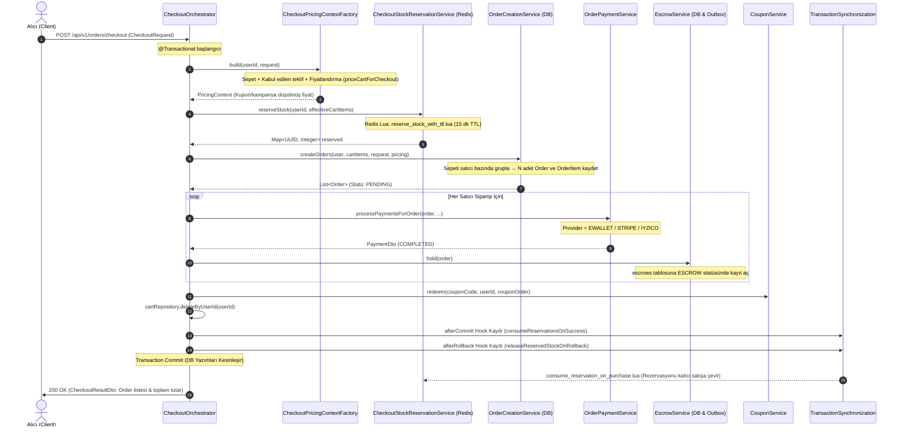

# Checkout Pipeline ve Dağıtık Transaction Mimarisi

Bu doküman, pazaryerinin en yüksek riskli para ve stok hattı olan **Checkout (Satın Alma)** operasyonunun uçtan uca mimarisini, çoklu satıcıya sipariş bölme (*order splitting*) mantığını, Redis Lua atomik stok rezervasyonunu, Transactional Outbox entegrasyonunu ve hata durumundaki compensation (*compensation/rollback*) mekanizmalarını açıklar. Kod referansları: [`CheckoutOrchestrator`](../src/main/java/com/serhat/secondhand/checkout/application/CheckoutOrchestrator.java), [`CheckoutStockReservationService`](../src/main/java/com/serhat/secondhand/checkout/application/CheckoutStockReservationService.java), [`OrderCreationService`](../src/main/java/com/serhat/secondhand/order/application/OrderCreationService.java), [`OrderPaymentService`](../src/main/java/com/serhat/secondhand/payment/application/OrderPaymentService.java).

İlgili dokümanlar: Ödeme stratejisi [payment-strategy-and-provider-extension-guide.md](payment-strategy-and-provider-extension-guide.md), fiyatlandırma ve kuponlar [pricing-coupon-and-campaign-architecture.md](pricing-coupon-and-campaign-architecture.md), escrow döngüsü [escrow-lifecycle-and-state-machine.md](escrow-lifecycle-and-state-machine.md), stok rezervasyonu ve reconciliation [stock-reservation-and-reconciliation.md](stock-reservation-and-reconciliation.md).

---

## 1. Uçtan Uca Checkout Akışı ve Sıralama

Alıcının sepetindeki ürünleri satın alma isteği (`POST /api/v1/orders/checkout`) tek bir Spring `@Transactional` sınırı içerisinde koordine edilir:

---

## 2. Adım Adım İşlem Detayları

### 2.1. Fiyat ve Teklif Bağlamının Hazırlanması (`CheckoutPricingContextFactory`)
- Alıcının aktif sepeti veritabanından getirilir (`cartRepository.findByUserIdWithListing(userId)`).
- Eğer istekte `offerId` varsa, satıcı tarafından kabul edilmiş aktif teklif doğrulanır (`IOfferService.getAcceptedOfferForCheckout`). Teklifteki ürün ve indirimli fiyat sepet satırının yerine geçer.
- Fiyat motoru çalıştırılır: `IPricingService.priceCartForCheckout`.
  > [!IMPORTANT]
  > Sepet önizlemesinde (`priceCart`) geçersiz veya kotası dolmuş kuponlar sessizce düşülerek kalan tutar gösterilebilir; ancak checkout anında **asla sessiz kupon düşümü yapılamaz**. Kupon geçersizse `priceCartForCheckout` doğrudan ilgili hata koduyla (`COUPON_EXPIRED`, `COUPON_USAGE_LIMIT_EXCEEDED` vb.) checkout işlemini durdurur.

### 2.2. Kilitsiz Stok Rezervasyonu (`CheckoutStockReservationService`)
- Her ilanın `ListingStatus.ACTIVE` olduğu teyit edilir.
- PostgreSQL seviyesinde `PESSIMISTIC_WRITE` (satır kilidi) alınmaz; bunun yerine Redis üzerinde çalışan atomik `reserve_stock_with_ttl.lua` script'i çağrılır.
- **15 Dakikalık Anti-Hoarding TTL:** Rezerve edilen adetler `v4:inventory:reservation:{listingId}:{userId}` anahtarında 900 saniye TTL ile tutulur.
- Eğer sepetteki herhangi bir kalemde yetersiz stok çıkarsa, o ana kadar ayrılmış tüm rezervasyonlar `cancel_user_reservation.lua` ile anında serbest bırakılır ve işlem iptal edilir.

### 2.3. Çoklu Satıcı Sipariş Bölme (*Multi-Seller Order Splitting*)
Pazaryerinde bir alıcı, tek bir sepette birden fazla farklı satıcının ürününü aynı anda satın alabilir. `OrderCreationService` bu durumu şu kurallarla yönetir:
1. **Satıcı Gruplaması:** Sepetteki kalemler satıcı ID'sine (`seller.id`) göre `Map<User, List<Cart>>` şeklinde gruplanır.
2. **Bağımsız Sipariş Kayıtları:** Her satıcı için ayrı bir `Order` nesnesi, tekil sipariş numarası (`ORD-YYYYMMDD-XXXX`), teslimat yöntemi (`CARGO` veya `SAFE_MEETUP`) ve teslimat adresi ile üretilir.
3. **Orantılı İndirim Dağıtımı:** Sepete uygulanan genel sepet kuponu veya satıcı kampanyaları, sipariş kalemlerinin alt toplamlarına orantılı olarak (`BigDecimal` yuvarlama kurallarına uygun biçimde) sipariş satırlarına paylaştırılır.
4. **Tek Transaction Garantisi:** Sepetteki 3 satıcının siparişi de aynı `@Transactional` metot içinde oluşturulur. Biri bile veritabanına yazılamazsa hiçbiri kaydedilmez.

### 2.4. Ödeme Yürütme ve Escrow Blokesi
- Her bir sipariş için `OrderPaymentService.processPaymentsForOrder` çalıştırılır.
- Varsayılan ve birincil ödeme yöntemi `EWALLET`'tır. Alıcının bakiyesi kontrol edilir, harcama limitleri denetlenir ve tutar bloke edilerek çekilir.
- Ödeme başarılı olduğunda:
  - Siparişin `paymentStatus` değeri `PaymentStatus.COMPLETED` yapılır.
  - Sipariş statüsü teslimat modeline göre `OrderStatus.CONFIRMED` veya `OrderStatus.MEETUP_PENDING` olarak güncellenir.
  - `EscrowService.hold(order)` çağrılarak her bir sipariş kalemi için `escrows` tablosunda `PaymentStatus.ESCROW` statüsünde bloke kaydı açılır. Para hiçbir koşulda doğrudan satıcıya aktarılmaz.

### 2.5. Post-Payment Finalizasyonu ve Sepet Temizliği
- **Kupon Redemption:** Eğer kupon kullanılmışsa, `couponService.redeem()` çağrılır ve indirimden faydalanan ilk sipariş ile kupon kullanımı mühürlenir (`coupon_redemptions` tablosu).
- **Teklif Kapatma:** Eğer işlem bir pazarlık teklifine dayanıyorsa, `offerService.markCompleted()` ile teklif statüsü `OfferStatus.COMPLETED` yapılır ve teklifin 24 saatlik Redis alıcı kilidi serbest bırakılır.
- **Sepet Sıfırlama:** `cartRepository.deleteByUserId(userId)` ile alıcının sepeti temizlenir.

---

## 3. Dağıtık Transaction Güvenliği ve Rollback Protokolü

Checkout işlemi dağıtık kaynakları (PostgreSQL, Redis in-memory rezervasyonları, harici payment provider'ları ve Kafka) aynı anda yönettiği için çift yönlü compensation (*two-way compensation*) mimarisi uygulanır:

```mermaid
flowchart TD
    subgraph ExecutionPhase ["Çalışma Aşaması (@Transactional)"]
        A["Ödeme veya Escrow Hatası Oluştu"] --> B["rollbackCheckout()<br/>setRollbackOnly() çağrısı"]
        B --> C["checkoutStockReservationService<br/>.releaseReservedStock(userId, reserved)"]
        C --> D["Redis: cancel_user_reservation.lua<br/>Stok anında havuza iade edilir"]
    end

    subgraph CommitPhase ["Commit Sırası (PostgreSQL)"]
        E["DB Commit Hatası (OptimisticLock vb.)"] --> F["TransactionSynchronization<br/>.afterCompletion(STATUS_ROLLED_BACK)"]
        F --> G["releaseReservedStockOnRollback()<br/>Redis stok kilidi serbest kalır"]
    end

    subgraph SuccessPhase ["Başarılı Commit Sonrası (afterCommit)"]
        H["DB Commit Başarılı"] --> I["consumeReservationsOnSuccess()<br/>consume_reservation_on_purchase.lua"]
        I --> J["Kafka: payment.completed.v1 yayınlanır"]
        J --> K["InventoryKafkaConsumer<br/>PostgreSQL listings.stock atomik düşürülür"]
    end
```

### 3.1. Anında İade ve Geri Alma (*Immediate Rollback & Compensation*)
Ödeme adımlarında herhangi bir satıcının ödemesi başarısız olursa (`!paymentResult.isSuccess()`):
1. `TransactionAspectSupport.currentTransactionStatus().setRollbackOnly()` çağrılarak PostgreSQL transaction'ı geri almaya işaretlenir.
2. `releaseReservedStock` çalıştırılarak `cancel_user_reservation.lua` üzerinden Redis'te tutulan ürünler **15 dakikalık sürenin dolması beklenmeden milisaniyeler içinde** diğer alıcıların sepetine açılır.
3. Alıcıya açıklayıcı hata kodu (`PAYMENT_FAILED` veya provider hata mesajı) dönülür.

### 3.2. Commit Esnasındaki Çökmeler (*Fail-Safe Synchronization*)
Eğer tüm adımlar başarılı geçmesine rağmen PostgreSQL `commit` anında bağlantı koparsa veya veritabanı kilitlenirse:
- Spring `TransactionSynchronization` arayüzü ile kayıtlı olan `releaseReservedStockOnRollback` kancası devreye girer ve Redis rezervasyonunu serbest bırakır.

### 3.3. Asenkron Stok Düşümü ve Auto-Healing
1. Transaction başarıyla commit edildikten sonra (`afterCommit`), Transactional Outbox tablosundan okunan `payment.completed.v1` mesajı Kafka'ya gönderilir.
2. `InventoryKafkaConsumer`, `processed_kafka_events` tablosunda idempotency kontrolü yaparak PostgreSQL'deki `listings` tablosunun kalıcı `stock` kolonunu düşürür.
3. Eğer Kafka veya veritabanı tüketicisinde bir gecikme olursa, arka planda çalışan `StockReservationReconciliationScheduler` Redis ve PostgreSQL arasındaki farkları tespit ederek otomatik mutabakat sağlar (*auto-healing*).

---

## 4. Kullanılan Redis Anahtarları ve Lua Scriptleri

| Redis Anahtarı | Tip | TTL | Görevi |
| :--- | :--- | :--- | :--- |
| `v4:inventory:reservation:{listingId}:{userId}` | String / Hash | 900 sn (15 dk) | Kullanıcının checkout ekranında tuttuğu rezerve adedi gösterir. |
| `v4:inventory:stock:{listingId}` | String (Integer) | Kalıcı / Cache | İlanın anlık satılabilir Redis stok bakiyesidir. |
| `v4:inventory:purchased:{listingId}` | Hash | Süresiz | DB mutabakatı öncesi kesinleşen satın alımları tutar. |
| `v4:offer:lock:{listingId}` | String | 86400 sn (24 saat) | Kabul edilen teklifin yalnızca teklif sahibi tarafından satın alınabilmesini garanti eden kilit. |

### Lua Script Görevleri:
- `reserve_stock_with_ttl.lua`: `available_stock >= qty` kontrolünü atomik yapar, stoku düşer ve 15 dk TTL ile rezervasyon anahtarını oluşturur.
- `cancel_user_reservation.lua`: Rezervasyon anahtarını siler ve rezerve edilen miktarı `available_stock` üzerine atomik olarak iade eder.
- `consume_reservation_on_purchase.lua`: Başarılı checkout commit'i sonrasında rezervasyon kaydını kesin satın alma kaydına dönüştürür.

---

## 5. Güvenlik ve Doğrulama Kuralları

1. **Idempotency Header:** Ödeme istekleri mükerrer çekimleri engellemek için `Idempotency-Key` başlığı ve Redis `SET NX` kilidi ile korunur.
2. **Kullanıcı Doğrulama & Sanction Kontrolü:** Hesabı askıya alınmış veya `STOREFRONT_FREEZE` / `EWALLET_HOLD` yaptırımında olan kullanıcıların sipariş vermesi engellenir.
3. **IDOR Koruması:** Alıcı yalnızca kendi sepetindeki ürünleri ve kendisine ait onaylı teslimat adreslerini kullanarak sipariş oluşturabilir.
