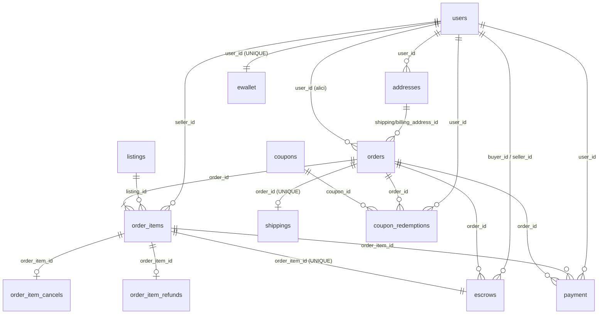
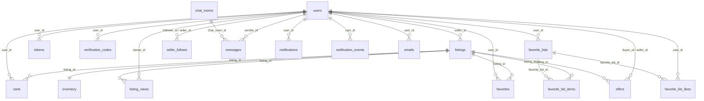

# Veri Modeli ve ER Diyagramı

Bu doküman PostgreSQL şemasının ana varlık ilişkilerini gösterir. Diyagramlar `V1__*.sql` baseline'ındaki foreign key tanımlarından çıkarılmıştır; sonraki migration'lar kolon ve tablo ekler ([database-migration-and-seeding-guide.md](database-migration-and-seeding-guide.md)). Şema kaynağı her zaman `src/main/resources/db/migration` dizinidir; bu doküman özet haritadır, kolon listesi değildir.

> [!NOTE]
> Kimlik tipleri: `users`, `orders`, `order_items`, `addresses`, `escrows`, `ewallet` için `BIGINT`; `listings`, `coupons` ve tüm katalog tabloları için `UUID`.

---

## 1. Para ve Sipariş Hattı

- `escrows` kalem başına tek satırdır ([ADR-0003](adr/0003-item-level-escrow.md)).
- `shippings` siparişle bire bir ilişkilidir (`UNIQUE (order_id)`).
- Para hareketleri `payment` tablosunda; satıcı bakiyesi `ewallet` üzerindedir.

### Outbox ve idempotency tabloları
`payment_outbox_events`, `order_outbox_events`, `escrow_outbox_events` ve `processed_kafka_events` tablolarında diğer tablolara foreign key yoktur; ilgili kaydı `aggregate_type` / `aggregate_id` (ve payload) ile gösterirler. Böylece ana kayıt silinse bile event kaybolmaz. İşleyiş: [ADR-0001](adr/0001-transactional-outbox-with-polling.md), [operasyon runbook'u](operations-runbook.md).

---

## 2. Kullanıcı, İlan ve Etkileşim

> [!NOTE]
> Kullanıcılar arası sohbet `messages` tablosuna yazılır (`chat/entity/Message`). `chat_messages` tablosu ise Aura AI sohbet belleğidir (`ai/memory/ChatMessage`: `user_id`, `role`, `message`, `timestamp`). V1 baseline'ı bu tabloyu yanlışlıkla `chat_rooms`'a bağlı oluşturmuştu; V34 yalnızca `chat_room_id` ve `sender_id` kolonlarını nullable yaptı, foreign key'ler şemada kalmıştır ve kod bunları kullanmaz.

---

## 3. Polymorphic Listing

`listings` ortak üst tablodur. Her vertical kendi alt tablosunu `id UUID PRIMARY KEY REFERENCES listings` ile bağlar (JPA joined inheritance). Alt tablolar kendi katalog (lookup) tablolarına referans verir. Davranış ve kurallar: [catalog-and-category-polymorphism.md](catalog-and-category-polymorphism.md).

```mermaid
erDiagram
    listings ||--o| vehicle_listings : "id"
    listings ||--o| electronic_listings : "id"
    listings ||--o| real_estate_listings : "id"
    listings ||--o| clothing_listings : "id"
    listings ||--o| books_listings : "id"
    listings ||--o| sports_listings : "id"

    car_brands ||--o{ vehicle_models : "car_brand_id"
    vehicle_models ||--o{ vehicle_generations : "vehicle_model_id"
    vehicle_generations ||--o{ vehicle_engines : "vehicle_generation_id"
    vehicle_generations ||--o{ vehicle_trims : "vehicle_generation_id"
    vehicle_types ||--o{ vehicle_listings : "vehicle_type_id"
    vehicle_models ||--o{ vehicle_listings : "vehicle_model_id"
    vehicle_generations ||--o{ vehicle_listings : "vehicle_generation_id"
    vehicle_engines ||--o{ vehicle_listings : "vehicle_engine_id"
    vehicle_trims ||--o{ vehicle_listings : "vehicle_trim_id"

    electronic_types ||--o{ electronic_listings : "electronic_type_id"
    electronic_brands ||--o{ electronic_models : "electronic_brand_id"
    electronic_models ||--o{ electronic_listings : "electronic_model_id"

    real_estate_types ||--o{ real_estate_listings : "real_estate_type_id"
    real_estate_ad_types ||--o{ real_estate_listings : "ad_type_id"
    heating_types ||--o{ real_estate_listings : "heating_type_id"
    listing_owner_types ||--o{ real_estate_listings : "owner_type_id"

    clothing_types ||--o{ clothing_listings : "clothing_type_id"
    clothing_brands ||--o{ clothing_listings : "clothing_brand_id"

    book_genres ||--o{ books_listings : "book_genre_id"
    book_types ||--o{ books_listings : "book_type_id"
    book_languages ||--o{ books_listings : "book_language_id"
    book_formats ||--o{ books_listings : "book_format_id"
    book_conditions ||--o{ books_listings : "book_condition_id"

    sport_disciplines ||--o{ sports_listings : "sport_discipline_id"
    sport_equipment_types ||--o{ sports_listings : "sport_equipment_type_id"
    sport_conditions ||--o{ sports_listings : "sport_condition_id"
```

Katalog verisi `src/main/resources/data` altındaki JSON dosyalarından seed edilir ([database-migration-and-seeding-guide.md](database-migration-and-seeding-guide.md)). Kitap tarafında ayrıca `book_works`, `book_editions`, `book_authors` ve `book_publishers` tabloları vardır; bu diyagramda yoktur.

---

## 4. Diyagramda Olmayan Tablolar

Aşağıdakilerin foreign key yapısı bu dokümanda doğrulanıp çizilmemiştir; gerektiğinde ilgili modül README'sine ve migration'a bakın: `campaigns`, `agreements`, `agreement_requirements`, `agreement_update_events`, `user_agreements`, `audit_logs`, `complaints`, `reviews`, `showcases`, `price_history`, `forum_thread`, `forum_comment`, `forum_comment_reaction`, `forum_thread_reaction`, `user_blocks`, `user_memories`, `chat_room_hides`, `notification_event_reads`, `listing_attribute_definitions`, `listing_attribute_options`.
