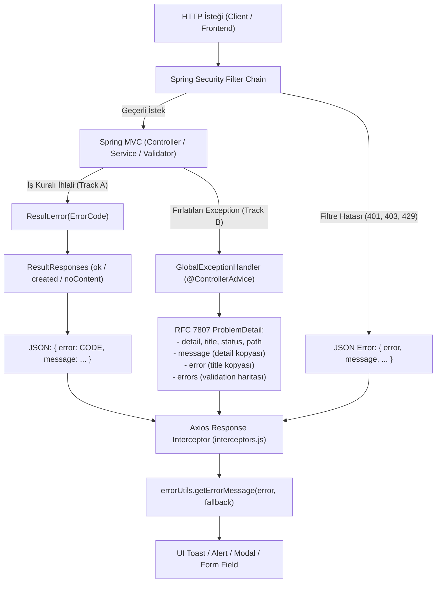

# Hata Yönetimi ve API Sözleşme Mimarisi (`/docs`)

Bu doküman, **secondHand** projesinde backend ile frontend arasındaki hata yönetimini, HTTP status çözümlemesini, RFC 7807 `ProblemDetail` ile `ResultResponses` arasındaki dual-track sözleşmeyi ve frontend güvenli hata ayrıştırma hattını kod ile doğrulanmış haliyle anlatır.

---

## 1. Tasarım ve Mimari Genel Bakış

Backend ve frontend arasındaki hata iletişimi, hem RFC 7807 standardına uyan API client'larını hem de frontend bileşenlerinin beklediği doğrudan hata alanlarını (`message`, `error`) kesintisiz destekleyen **Dual-Track Error Contract** prensibine dayanır:



---

## 2. Dual-Track Backend Hata Modeli

Sistemde iki ana hata üretim yolu bulunur:

### Track A: Domain `Result<T>` Modeli (`ResultResponses`)
* Katmanlı mimaride (`controller -> service -> validator`) beklenen iş kuralı ihlalleri exception fırlatmak yerine `Result.error(ErrorCode)` veya `Result.error(message, code)` döner.
* Controller katmanında [`ResultResponses.java`](../src/main/java/com/serhat/secondhand/core/result/ResultResponses.java) metotları (`ok`, `created`, `noContent`, `of`) ile HTTP yanıtına çevrilir.
* Gövde formatı:
  ```json
  {
    "error": "ORDER_NOT_FOUND",
    "message": "Order not found"
  }
  ```
* **HTTP Status Çözümlemesi:** Status controller'da hardcoded verilmez; [`ErrorCodeStatuses.java`](../src/main/java/com/serhat/secondhand/core/result/ErrorCodeStatuses.java) tarafından, ilgili `ErrorCode` enum'ında deklare edilen status runtime'da taranarak belirlenir (404, 409, 403 vb.). Kod sistemde bulunamazsa güvenli fallback olarak `400 BAD_REQUEST` döner.

### Track B: Exception Modeli (`GlobalExceptionHandler`)
* Beklenmeyen durumlar, Jakarta Validation doğrulamaları (`@Valid`), entity durum geçiş ihlalleri veya yetkilendirme hataları exception olarak fırlatılır.
* [`GlobalExceptionHandler.java`](../src/main/java/com/serhat/secondhand/core/exception/GlobalExceptionHandler.java) tüm MVC exception'larını yakalayarak Spring 6 / Boot 3 standardı olan **RFC 7807 `ProblemDetail`** döner.
* **Çift Yönlü Uyumluluk Garantisi:** `createProblem` metodu, RFC 7807 standart alanlarının yanı sıra frontend'in doğrudan okuduğu alanları extension property olarak ekler:
  ```json
  {
    "type": "about:blank",
    "title": "Validation Failed",
    "status": 400,
    "detail": "Input validation failed",
    "message": "Input validation failed",
    "error": "Validation Failed",
    "path": "/api/v1/auth/register",
    "timestamp": "2026-11-10T12:00:00",
    "errors": {
      "email": "must be a well-formed email address"
    }
  }
  ```
  Bu sayede frontend ister `response.data.detail`, ister `response.data.message`, ister `response.data.error` okusun, hiçbir hata mesajı `undefined` kalmaz ve kaybolmaz.

---

## 3. Explicit Exception Handler Matrisi

İstemci kaynaklı hataların generic `Exception.class` (500 Internal Server Error) handler'ına düşüp sunucu çöküşü gibi loglanmasını engellemek için [`GlobalExceptionHandler.java`](../src/main/java/com/serhat/secondhand/core/exception/GlobalExceptionHandler.java) içinde aşağıdaki explicit handler'lar tanımlıdır:

| Exception Sınıfı | HTTP Status | Title / Error | Açıklama |
| :--- | :--- | :--- | :--- |
| `MethodArgumentNotValidException` | `400 BAD_REQUEST` | `Validation Failed` | DTO `@Valid` anotasyon ihlalleri; field bazlı hatalar `errors` Map'inde döner. |
| `ConstraintViolationException` | `400 BAD_REQUEST` | `Validation Failed` | Parametre veya servis seviyesindeki Jakarta constraint ihlalleri. |
| `IllegalStateException` | `400 BAD_REQUEST` | `Bad Request` | Entity durum geçiş ihlalleri (örn: `Order.java` teslim edilmiş siparişi iptal etme denemesi). Mesaj sanitize edilir. |
| `IllegalArgumentException` | `400 BAD_REQUEST` | `Bad Request` | Hatalı metod parametreleri veya geçersiz formatlar. Mesaj sanitize edilir. |
| `HttpMessageNotReadableException` | `400 BAD_REQUEST` | `Bad Request` | Bozuk veya parse edilemeyen JSON gövdesi. |
| `MissingServletRequestParameterException` | `400 BAD_REQUEST` | `Bad Request` | Eksik zorunlu sorgu parametresi (`@RequestParam`). |
| `MethodArgumentTypeMismatchException` | `400 BAD_REQUEST` | `Bad Request` | Path variable veya query param tip uyuşmazlığı (örn: geçersiz UUID). |
| `BadCredentialsException` | `401 UNAUTHORIZED` | `Authentication Failed` | Hatalı kullanıcı adı / şifre. |
| `AccessDeniedException` | `403 FORBIDDEN` | `Access Denied` | Spring Security rol/yetki yetersizliği (`@PreAuthorize`). |
| `SecurityException` | `403 FORBIDDEN` | `Forbidden` | Servis içi sahiplik ve güvenlik kontrol ihlalleri. |
| `NoResourceFoundException` | `404 NOT_FOUND` | `Not Found` | Tanımsız statik dosya veya route istekleri. |
| `HttpRequestMethodNotSupportedException` | `405 METHOD_NOT_ALLOWED` | `Method Not Allowed` | Desteklenmeyen HTTP fiili (örn: GET rotasına POST atılması). |
| `ObjectOptimisticLockingFailureException` | `409 CONFLICT` | `CONCURRENT_MODIFICATION` | Eşzamanlı çakışma (Optimistic Lock). |
| `DataIntegrityViolationException` | `409 CONFLICT` | `Conflict` | Veritabanı unique constraint veya FK ihlalleri. |
| `MaxUploadSizeExceededException` | `413 PAYLOAD_TOO_LARGE` | `Payload Too Large` | Multipart dosya boyutu sınırı aşıldığında. |
| `HttpMediaTypeNotSupportedException` | `415 UNSUPPORTED_MEDIA_TYPE`| `Unsupported Media Type`| Desteklenmeyen `Content-Type` başlığı. |
| `BusinessException` | Dinamik (`getHttpStatus`) | Dinamik (`getErrorCode`) | Domain iş kuralı fırlatmaları; exception'ın kendi status'ü ile döner. |
| `AsyncRequestNotUsableException` | Yanıt dönmez | — | Client yanıt gitmeden bağlantıyı kopardığında debug loglanır. |
| `ResultFailureException` | `ErrorCodeStatuses` eşlemesi | `Result.error` kaynaklı Track A `{"error": CODE, "message": "..."}` yanıtı |
| `Exception` | `500 INTERNAL_SERVER_ERROR` | `Internal Server Error` | Öngörülemeyen sistem hataları. İstemciye stack trace sızdırılmaz. |

---

## 4. ErrorCode ve Status Çözümleme Disiplini

Tüm hata kodları merkezi [`ErrorCode`](../src/main/java/com/serhat/secondhand/core/exception/ErrorCode.java) interface'ini implement eden `enum` sınıflarında tutulur:

```java
public interface ErrorCode {
    String getCode();
    String getMessage();
    HttpStatus getHttpStatus();
}
```

### Kurallar:
1. **Enum Zorunluluğu:** Static string sabitleri taşıyan `class` tanımı yasaktır (örn: eski `FavoriteListErrorCodes` ve `FollowErrorCodes` enum'a dönüştürülmüştür).
2. **Çakışma Kontrolü (`ErrorCodeStatuses`):**
   - [`ErrorCodeStatuses.java`](../src/main/java/com/serhat/secondhand/core/result/ErrorCodeStatuses.java), uygulama başlarken `com.serhat.secondhand` paketindeki tüm `ErrorCode` enum'larını tarar ve bellek içi bir map (`BY_CODE`) oluşturur.
   - İki farklı enum aynı string kodu farklı HTTP status ile tanımlarsa (`putIfAbsent` kontrolü), uygulama startup aşamasında `IllegalStateException` fırlatarak çöker. Çakışan kodların üretime sızması engellenir.
3. **Özel Exception Sınıfları:** [`BusinessException`](../src/main/java/com/serhat/secondhand/core/exception/BusinessException.java) çekirdek sınıfından türeyen 9 uzmanlaşmış sınıf (`AccountNotActiveException`, `InvalidRefreshTokenException`, `ReservationException`, `VerificationLockedException`, `EmailExistsException`, `UserAlreadyExistsException`, `UserAlreadyLoggedOutException`, `VerificationCodeMismatchException`, `AuthenticationNotFoundException`) bulunur. Bunlar da `HttpStatus` ve `ErrorCode` taşır.

---

## 5. Security Filtre Seviyesi Hata Yakalama

Spring MVC katmanına ulaşmadan önce servlet filtrelerinde oluşan hatalar Spring Security entry point'leri tarafından yakalanır:

* **Kimlik Doğrulama Hatası (401):** [`customAuthenticationEntryPoint`](../src/main/java/com/serhat/secondhand/core/config/SecurityConfig.java) API isteklerinde JSON döner:
  `{"error":"UNAUTHORIZED","message":"Token expired or invalid","timestamp":"...","path":"..."}`
* **Yetki Hatası (403):** [`customAccessDeniedHandler`](../src/main/java/com/serhat/secondhand/core/config/SecurityConfig.java):
  `{"error":"FORBIDDEN","message":"Access denied","timestamp":"...","path":"..."}`
* **Hız Sınırı (429):** [`RateLimitingFilter`](../src/main/java/com/serhat/secondhand/core/security/RateLimitingFilter.java):
  `{"timestamp":"...","status":429,"error":"TOO_MANY_REQUESTS","message":"...","retryAfter":X}`
* **Oturum / Token İptali (401):** [`AuthenticationFilter`](../src/main/java/com/serhat/secondhand/core/jwt/AuthenticationFilter.java): Token revoked veya expired ise `SESSION_REVOKED` / `SESSION_EXPIRED` kodları ile 401 yazar.

---

## 6. Asenkron, Kuyruk ve Arka Plan Hata Yönetimi

* **Kafka Listener Hataları:** [`KafkaConfig.java`](../src/main/java/com/serhat/secondhand/core/config/KafkaConfig.java) içinde `ConcurrentKafkaListenerContainerFactory`'ye `DefaultErrorHandler` ve `DeadLetterPublishingRecoverer` tanımlıdır. 1 saniye aralıkla 2 tekrar denemesi sonrası hata devam ederse mesaj ilgili konunun `.DLT` topic'ine (Dead Letter Topic) aktarılır.
* **Transactional Outbox Worker'lar:** ([`PaymentOutboxWorker`](../src/main/java/com/serhat/secondhand/payment/outbox/PaymentOutboxWorker.java), `OrderOutboxWorker`, `EscrowOutboxWorker`) Scheduled task içinde try-catch ile çalışır. Hata durumunda `attemptCount` artırılır, `lastError` kaydedilir ve üst sınıra ulaşınca `FAILED` statüsüne alınır; ana thread çökmez.
* **`@Async` ThreadPool Hataları:** [`AsyncConfig.java`](../src/main/java/com/serhat/secondhand/core/config/AsyncConfig.java) üzerinde `CustomAsyncExceptionHandler` tanımlıdır; dönüş tipi `void` olan asenkron metotların fırlattığı hatalar unhandled kalmaz, loglanır.
* **Redis Cache Hataları:** [`CacheErrorHandlerConfig.java`](../src/main/java/com/serhat/secondhand/core/config/CacheErrorHandlerConfig.java) ile Redis deserialization veya bağlantı hataları yutulur (fail-safe), bozuk key temizlenir ve istek PostgreSQL veritabanına yönlendirilir.

---

## 7. Frontend Hata Normalizasyonu ve Gösterim Mimarisi

Frontend, gelen HTTP hatalarını üç aşamalı bir süzgeçten geçirerek ekrana yansıtır:

```
[Axios Hata Yanıtı]
         │
         ▼
1. interceptors.js (Hata Zenginleştirme)
   - errorData.message yoksa detail atanır
   - errorData.error yoksa title atanır
   - error.userMessage = detail || message
         │
         ▼
2. errorUtils.getErrorMessage(error, fallback)
   - Öncelik: userMessage -> data.message -> data.detail -> data.error
   - Axios teknik mesajı ("Request failed with status code...") filtrelenir
         │
         ▼
3. UI Gösterimi (NotificationContext / Alert / Modal)
   - Kullanıcıya temiz, anlaşılır ve lokalize hata metni sunulur
```

### 1. Interceptor Seviyesi Normalizasyon (`interceptors.js`)
[`interceptors.js`](../secondhand-frontend/src/common/services/api/interceptors.js) response interceptor'ı, backend'den gelen gövdeyi zenginleştirir:
```javascript
if (errorData) {
  if (!errorData.message && errorData.detail) errorData.message = errorData.detail;
  if (!errorData.error && errorData.title) errorData.error = errorData.title;
  error.userMessage = errorData.detail || errorData.message || null;
  error.errorCode = errorData.errorCode || errorData.title || errorData.error || errorData.code;
  error.validationErrors = errorData.validationErrors ?? errorData.errors;
}
```

### 2. Güvenli Mesaj Çözümleyici (`errorUtils.js`)
[`errorUtils.js`](../secondhand-frontend/src/common/utils/errorUtils.js) içindeki `getErrorMessage(error, fallback)` fonksiyonu, kullanıcıya ham teknik hataların yansımasını önler:
* Öncelik: `error.userMessage` -> `error.response?.data?.message` -> `error.response?.data?.detail` -> `error.response?.data?.error`.
* **Axios Filtresi:** `error.message` alanı yalnızca `"Request failed with status code"` ile **başlamıyorsa** kullanılır. Böylece kullanıcılar ekranda `"Request failed with status code 409"` yerine gerçek hata sebebini veya fallback metnini görür.

### 3. Merkezi Bildirim Entegrasyonu (`errorHandler.js`)
[`errorHandler.js`](../secondhand-frontend/src/common/errorHandler.js) içindeki `showError` çağrıları `showError(titleToShow, messageToShow)` olarak iki parametreyle çalışır; mesajın başlık alanına kayması engellenir.

---

## 8. Güvenlik ve Hata Sanitization Kuralları

1. **Stack Trace ve SQL Sızıntısı Engeli:** `GlobalExceptionHandler.sanitizeMessage` fonksiyonu ile `java.`, `org.`, `com.serhat`, `SQLException`, `Caused by` içeren metinler filtrelenir ve kullanıcıya `"Invalid request. Please check your input."` generic mesajı verilir.
2. **Karakter Sınırı:** 200 karakterden uzun hata mesajları otomatik kırpılır.
3. **URL Parametresi Yansıtma Yasağı:** `OAuthErrorPage` gibi harici yönlendirme sayfalarında URL `message` parametresi doğrudan okunup ekrana basılmaz (XSS ve phishing koruması).

