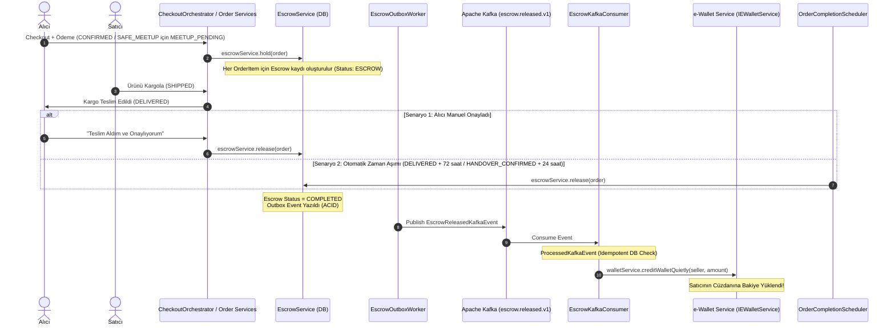

# Escrow Yaşam Döngüsü ve Durum Makinesi Rehberi

Bu doküman, **secondHand** platformunun finansal güvenliğini ve güvenli ticaret altyapısını oluşturan **Escrow Durum Makinesi**, **Asenkron Cüzdan Aktarımı (Kafka & Outbox)**, **İptal/İade Compensation Mekanizmaları** ve **Zaman Aşımı Otomasyonunu** uçtan uca açıklamaktadır.

---

## 1. Problem Tanımı ve Escrow Çözümü

C2C (Tüketiciden Tüketiciye) ikinci el e-ticarette iki taraf da risk altındadır:
* **Alıcı Riski:** "Parayı ödersem satıcı ürünü göndermezse veya bozuk/farklı ürün gönderirse ne olacak?"
* **Satıcı Riski:** "Ürünü kargolarsam alıcı parayı ödemezse veya sahte bildirim yaparsa ne olacak?"

### secondHand Escrow Modeli:
1. Alıcı ödemeyi yaptığında para doğrudan satıcının hesabına aktarılmaz; sistemin güvenli escrow havuzunda (`ESCROW` statüsünde) bloke edilir.
2. Satıcı ürünü kargolar veya güvenli buluşma ile teslim eder.
3. Alıcı ürünü teslim alıp inceledikten sonra onay verir (veya yasal onay süresi dolunca sistem otomatik onaylar).
4. Havuzdaki para satıcının **e-Cüzdanına (`eWallet`)** aktarılır.

---

## 2. Uçtan Uca Escrow Durum Makinesi ve Sıralama Diyagramı



---

## 3. Escrow Durumları (State Machine)

Escrow kaydı (`escrows` tablosu, [`Escrow.java`](../src/main/java/com/serhat/secondhand/escrow/domain/entity/Escrow.java)) ayrı bir enum kullanmaz; `PaymentStatus` değerlerinin bir alt kümesini taşır. Kayıt her zaman `ESCROW` ile açılır.

| Durum (`PaymentStatus`) | Açıklama | Paranın Konumu | Geçişi Yapan Metot |
| :--- | :--- | :--- | :--- |
| **`ESCROW`** | Ödeme alındı; para escrow'da tutuluyor. | Sistem Havuzu | `EscrowService.hold` |
| **`COMPLETED`** | Alıcı onayladı veya otomatik tamamlama süresi doldu. | Satıcı Cüzdanı (`eWallet`) — Kafka consumer ile asenkron | `EscrowService.release` |
| **`CANCELLED`** | Sipariş (kalem) iptal edildi. | Alıcı Cüzdanı (`REFUND`) | `EscrowService.cancel` |
| **`REFUNDED`** | Teslimat sonrası iade onaylandı. | Alıcı Cüzdanı (`REFUND`) | `EscrowService.refund` |

`COMPLETED`, `CANCELLED` ve `REFUNDED` terminaldir; `cancel`/`refund` yalnızca `ESCROW` durumundaki kayıtlara uygulanır.

---

## 4. Kritik İş Mantığı ve Teknik Mekanizmalar

### A. Çoklu Sepetlerde Oransal Tutar Bölüştürme (`calculateEscrowAmounts`)
Siparişe kupon/indirim uygulandığında (`order.totalAmount` < kalem toplamı), her ürün kaleminin (`OrderItem`) escrow tutarı 2 basamak hassasiyetinde (`RoundingMode.HALF_UP`) oransal olarak hesaplanır ([`EscrowService.java`](../src/main/java/com/serhat/secondhand/escrow/application/EscrowService.java)):

$$\text{Escrow Tutarı} = \text{Toplam Ödenen Tutar} \times \frac{\text{Ürün Fiyatı}}{\text{Sepet Ürün Toplamı}}$$

* Kalemler `OrderItem.id` sırasına dizilir; yuvarlama farkının havuzda açık yaratmaması için son kalem `remaining` bakiyeyi alır.
* Ödenecek tutar negatifse 0'a, kalem toplamından büyükse kalem toplamına çekilir; kalem toplamı 0 veya altındaysa tüm kalemler 0 tutarlı escrow alır.
* `hold` idempotent'tir: `order_item_id` için zaten escrow varsa o kalem atlanır. `hold`, `CheckoutOrchestrator` içinde ödeme başarılı olduktan sonra çağrılır; hata dönerse checkout transaction'ı `IllegalStateException` ile geri alınır.

---

### B. Otomatik Serbest Bırakma Mekanizması ([`OrderCompletionScheduler.java`](../src/main/java/com/serhat/secondhand/order/application/OrderCompletionScheduler.java))

Alıcı ürünü teslim almasına rağmen panelden onay vermeyi unutursa satıcının mağdur olmaması için **Otomatik Mutabakat Scheduler'ı** devrededir:
1. **Kargolu Gönderimler:** `shipping.deliveredAt` üzerinden `OrderBusinessConstants.AUTO_COMPLETION_HOURS` (72 saat) geçtiyse scheduler `escrowService.release(order)` çağırır. (İade penceresi `REFUND_WINDOW_HOURS` = 48 saattir; yani iade hakkı otomatik tamamlamadan önce biter.)
2. **Güvenli Buluşma (`SAFE_MEETUP`):** `meetupVerifiedAt` üzerinden 24 saat geçtiyse (`HANDOVER_CONFIRMED`) aynı şekilde release edilir.
3. **Kargolanmayan sipariş:** `CONFIRMED`/`PROCESSING` durumundaki `CARGO` siparişi 72 saatte (`SHIP_DEADLINE_HOURS`) kargolanmazsa `OrderCancellationService.cancelUnshippedOrder` çağrılır; escrow `CANCELLED` olur.
4. **Bayat buluşma:** `MEETUP_PENDING` siparişi 7 gün içinde tamamlanmazsa scheduler doğrudan `escrowService.cancel` çağırır ve siparişi `CANCELLED` yapar.

Release hata dönerse sipariş `COMPLETED` yapılmaz ve bir sonraki scheduler çalışmasında tekrar denenir.

---

### C. Financial Resilience: Transactional Outbox & Kafka Pipeline

Doğrudan `escrowService.release()` içinde üçüncü parti cüzdan/banka servisine senkron HTTP veya doğrudan Kafka çağrısı yapmak **Dual-Write** riski taşır (DB commit olup Kafka çökerse para buharlaşır; tersi durumda satıcıya çifte para gider).

Bu nedenle **Transactional Outbox** mimarisi uygulanmıştır:
1. `escrowService.release(order)` (`findByOrderIdAndStatusForUpdate` ile satırlar kilitlenir) escrow'u `COMPLETED` yapar, `releasedAt` yazar, satıcı tarafındaki `ITEM_SALE`/`ITEM_PURCHASE` `Payment` kaydını `COMPLETED` yapıp `PaymentCompletedEvent` yayınlar ve aynı transaction içinde `escrow_outbox_events` tablosuna `ESCROW_RELEASED` event'i yazar ([`EscrowOutboxService`](../src/main/java/com/serhat/secondhand/escrow/outbox/EscrowOutboxService.java)). `payment:stats` cache'i `allEntries` ile evict edilir.
2. [`EscrowOutboxWorker.java`](../src/main/java/com/serhat/secondhand/escrow/outbox/EscrowOutboxWorker.java) her 5 sn'de (`app.escrow.outbox.fixed-delay-ms`) zamanı gelmiş en fazla 50 `PENDING` event'i alır; her event `REQUIRES_NEW` transaction'da satır kilidiyle işlenir ve `escrow.released.v1` topic'ine gönderilir (broker ack bekleme limiti `app.outbox.publish-timeout-seconds`, varsayılan 15 sn).
3. [`EscrowKafkaConsumer.java`](../src/main/java/com/serhat/secondhand/escrow/application/EscrowKafkaConsumer.java) mesajı tüketir (group: `escrow-released-consumers`).
4. **Idempotency Kilidi:** `ProcessedKafkaEventRepository.insertIfNotExists` ile `escrow:release:{escrowId}` anahtarı `INSERT ... ON CONFLICT DO NOTHING` ile yazılır; 0 satır eklendiyse event mükerrer sayılır ve atlanır.
5. Satıcının cüzdanına `IEWalletService.creditWalletQuietly` ile bakiye eklenir. Dedupe kaydı ve cüzdan kredisi aynı transaction'dadır; hata olursa dedupe kaydı da geri alınır.

`release` tarafı ([`EscrowService`](../src/main/java/com/serhat/secondhand/escrow/application/EscrowService.java)):

```java
List<Escrow> escrows = escrowRepository.findByOrderIdAndStatusForUpdate(order.getId(), PaymentStatus.ESCROW);
if (escrows.isEmpty()) { return Result.success(); }        // ikinci çağrı no-op

for (Escrow escrow : escrows) {
    escrow.setStatus(PaymentStatus.COMPLETED);
    escrow.setReleasedAt(LocalDateTime.now());
    escrowRepository.save(escrow);
    ...                                                     // satıcı tarafındaki Payment kaydı COMPLETED yapılır
    escrowOutboxService.enqueueEscrowReleased(escrow);      // aynı transaction'da outbox satırı
}
```

Consumer tarafı ([`EscrowKafkaConsumer`](../src/main/java/com/serhat/secondhand/escrow/application/EscrowKafkaConsumer.java)):

```java
if (event.escrowId() == null || event.sellerId() == null || event.amount() == null) {
    throw new BusinessException(PaymentErrorCodes.ESCROW_RELEASE_EVENT_INVALID);   // atlanmaz, DLT'ye gider
}
String dedupeKey = "escrow:release:" + event.escrowId();
int inserted = processedKafkaEventRepository.insertIfNotExists(dedupeKey, "escrow-released-consumers");
if (inserted == 0) { return; }                                                      // mükerrer mesaj

User seller = userRepository.findById(event.sellerId())
        .orElseThrow(() -> new BusinessException(PaymentErrorCodes.ESCROW_RELEASE_SELLER_NOT_FOUND));
walletService.creditWalletQuietly(seller, event.amount());
```

---

### D. Cancellation & Refund Compensation

* Sipariş henüz kargolanmadan iptal edilirse (`cancel`) veya iade onaylanırsa (`refund`), para satıcıdan **çekilmez** (çünkü satıcıya henüz para geçmemiştir).
* Sistem escrow'daki bloke bakiyeyi, escrow'u `CANCELLED`/`REFUNDED` yaptıktan sonra aynı transaction içinde doğrudan alıcının e-cüzdanına `REFUND` işlem türüyle senkron olarak yazar (Kafka/outbox kullanılmaz):
  ```java
  walletService.creditToUser(order.getUser(), escrow.getAmount(), escrow.getListingId(), ... PaymentTransactionKind.REFUND, null);
  ```

---

## 5. Escrow Denetim ve Güvenlik Snapshot'ı (Audit Snapshot)

Olası yasal uyuşmazlıklar ve denetimler için `Escrow` entity'si ilişkisel foreign key'lerin yanı sıra işlemin yapıldığı andaki ilan başlığını, ilan numarasını ve tarih loglarını snapshot olarak saklar:
* `listingTitle`, `listingNo`, `listingId`
* `blockedAt` (Bloke Tarihi)
* `releasedAt` (Satıcıya Aktarım Tarihi; `release` set eder)
* `refundedAt` (Alıcıya İade Tarihi; yalnızca `refund` set eder, `cancel` set etmez)
* Tek kolonlu indeksler: `idx_escrow_order (order_id)`, `idx_escrow_seller (seller_id)`, `idx_escrow_status (status)`.

---

## 6. Hata ve Uç Durumlar (Edge Cases) Matrisi

| Senaryo | Risk | Sistem Nasıl Önler? |
| :--- | :--- | :--- |
| **Mükerrer Teslimat Onayı** | Alıcı butona arka arkaya basarsa çift para aktarımı. | `EscrowRepository.findByOrderIdAndStatusForUpdate` (`PESSIMISTIC_WRITE`) ile satırlar kilitlenir; ilk işlemden sonra status `COMPLETED` olduğu için `release` `ESCROW` kaydı bulamaz ve no-op `Result.success()` döner. |
| **Çifte Cancel / Refund** | Aynı kalem için ikinci iptal/iade çift iade yaratır. | `cancel`/`refund` `findByOrderItemIdInForUpdate` ile kilitler; escrow kaydı yoksa `ESCROW_NOT_FOUND`, `ESCROW` dışındaysa `ESCROW_STATUS_INVALID` döner. Çağıran servis transaction'ı rollback-only yapar ve `REFUND_FAILED` döner. |
| **Eksik / Bozuk Event** | `escrowId`, `sellerId` veya `amount` null; ya da satıcı bulunamıyor. | Consumer sessizce atlamaz: `ESCROW_RELEASE_EVENT_INVALID` / `ESCROW_RELEASE_SELLER_NOT_FOUND` (`BusinessException`) fırlatır; dedupe kaydı geri alınır, `DefaultErrorHandler` 2 kez daha dener (1 sn aralık) ve event `escrow.released.v1.DLT` topic'ine düşer. |
| **Kafka Rebalancing / Retry** | Kafka aynı mesajı consumer'a 2 kez iletirse mükerrer cüzdan bakiyesi. | `processed_kafka_events` tablosundaki `escrow:release:{escrowId}` kaydı ikinci mesajı atlatır. Bu kayıtlar 3 gün sonra temizlenir (`OutboxHousekeepingScheduler`); daha eski bir mesajın yeniden teslimi tekrar işlenir. |
| **Outbox Gönderim Hatası** | Kafka broker geçici olarak kapalıysa. | Worker `attemptCount`'u artırır ve `next_attempt_at`'ı `min(300, 2^attempt × 5)` sn sonrasına ayarlar (exponential backoff, üst sınır 5 dk). `maxAttempts` (varsayılan 10) dolunca event `FAILED` olur ve otomatik retry edilmez; para escrow'da `COMPLETED` görünür ama satıcı cüzdanına yansımaz, bu yüzden `FAILED` event'ler izlenmelidir. |
