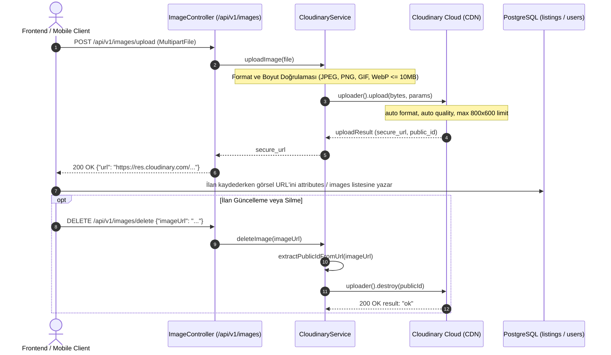
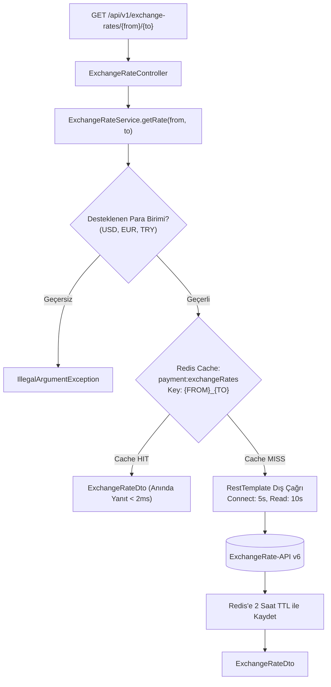

# Dış Entegrasyonlar: Cloudinary & ExchangeRate-API Mimari Kılavuzu

Bu doküman, **secondHand** platformunun dış dünya ile entegre olduğu iki temel servis katmanını ayrıntılandırmaktadır:
1. **Cloudinary:** İlan fotoğrafları ve kullanıcı profil avatarlarının saklandığı, optimize edildiği ve global CDN üzerinden sunulduğu bulut medya altyapısı.
2. **ExchangeRate-API (v6):** Çoklu para birimi desteği (USD, EUR, TRY) için 2 saatlik Redis cache ile korunan döviz kuru entegrasyonu.

---

## 1. Cloudinary Entegrasyonu (Medya Depolama & CDN)

İlan görselleri ve kullanıcı profil resimleri kesinlikle yerel dosya sisteminde veya PostgreSQL veritabanında saklanmaz. Yükleme akışı doğrudan Cloudinary bulut servisine aktarılır ve veri tabanında yalnızca HTTPS `secure_url` adresi tutulur.

### 1.1 Mimari Akış ve Yaşam Döngüsü



### 1.2 Yükleme Parametreleri ve Optimizasyon Kuralları
[`CloudinaryService.java`](../src/main/java/com/serhat/secondhand/cloudinary/application/CloudinaryService.java) içinde tanımlı yükleme kuralları:
- **İzole Klasör:** İlan görselleri `secondhand-listings` klasöründe toplanır.
- **Dinamik Format Adaptasyonu (`fetch_format: auto`):** İstemci tarayıcısının desteğine göre en verimli format (WebP veya AVIF) otomatik sunulur.
- **Kalite Optimizasyonu (`quality: auto`):** Görsel netliğini bozmadan minimum dosya boyutu hesaplanır.
- **Boyut Sınırlandırması:** Maksimum boyut $800 \times 600$ piksel ile sınırlandırılmıştır (`crop: limit`), böylece sunucu ve CDN bant genişliği korunur.
- **İzin Verilen Formatlar:** Yalnızca `image/jpeg`, `image/png`, `image/gif` ve `image/webp`. MIME type ve uzantı birlikte denetlenir.
- **Dosya Boyutu Tavanı:** Maksimum 10 MB ($10 \times 1024 \times 1024$ byte).

### 1.3 Yetim Dosya Önleme (Orphan Cleanup)
Görsel silindiğinde URL yapısından `public_id` regex ile çıkarılır ve Cloudinary API'sine `destroy` çağrısı yapılır:
```java
public void deleteImage(String imageUrl) {
    String publicId = extractPublicIdFromUrl(imageUrl);
    if (publicId != null) {
        cloudinary.uploader().destroy(publicId, ObjectUtils.emptyMap());
    }
}
```

---

## 2. ExchangeRate-API Entegrasyonu (Döviz Kuru Çevirici)

Platform genelinde TRY, USD ve EUR arasındaki dinamik değerleme ve yabancı alıcı para birimi gösterimi için **ExchangeRate-API (v6)** servisi kullanılır.

### 2.1 İki Saatlik Redis Cache Stratejisi
Dış servis maliyetlerini sıfırlamak, kota tüketimini sınırlandırmak ve harici servis kesintilerinde platformun çalışmaya devam etmesini sağlamak amacıyla **2 saatlik Redis önbelleği** (`payment:exchangeRates`) uygulanır.



### 2.2 Dayanıklılık ve Zaman Aşımı Yönetimi
[`ExchangeRateService.java`](../src/main/java/com/serhat/secondhand/exchange/application/ExchangeRateService.java):
- **Bağlantı Zaman Aşımı (Connect Timeout):** 5.000 ms.
- **Okuma Zaman Aşımı (Read Timeout):** 10.000 ms.
- **Normalizasyon:** Para birimleri büyük harfe çevrilir (`#from.toUpperCase() + '_' + #to.toUpperCase()`).
- **Hata Yönetimi:** Dış servis erişilemez olduğunda `EXCHANGE_SERVICE_UNAVAILABLE` (HTTP 503) fırlatılır; böylece kullanıcı istekleri takılı kalmaz.

---

## 3. Konfigürasyon ve Ortam Değişkenleri

[`application-core.yml`](../src/main/resources/config/application-core.yml) ve `.env` üzerinden yönetilir:

```yaml
cloudinary:
  cloud-name: ${CLOUDINARY_CLOUD_NAME}
  api-key: ${CLOUDINARY_API_KEY}
  api-secret: ${CLOUDINARY_API_SECRET}

exchange:
  api:
    key: ${EXCHANGE_API_KEY}
```

---

## 4. Dış Entegrasyon Karşılaştırma Matrisi

| Servis | Protokol & Kütüphane | Cache Mekanizması | Hata / Kesinti Politikası |
|---|---|---|---|
| **Cloudinary** | HTTPS REST / Cloudinary Java SDK | Cloudinary Global Edge CDN (Tarayıcı Cache) | `BusinessException("IMAGE_UPLOAD_FAILED", HTTP 400/500)` |
| **ExchangeRate-API** | HTTPS REST / Spring `RestTemplate` | **Redis Tier-2 (2 Saat TTL, Key: `{FROM}_{TO}`)** | `BusinessException("EXCHANGE_SERVICE_UNAVAILABLE", HTTP 503)` |
