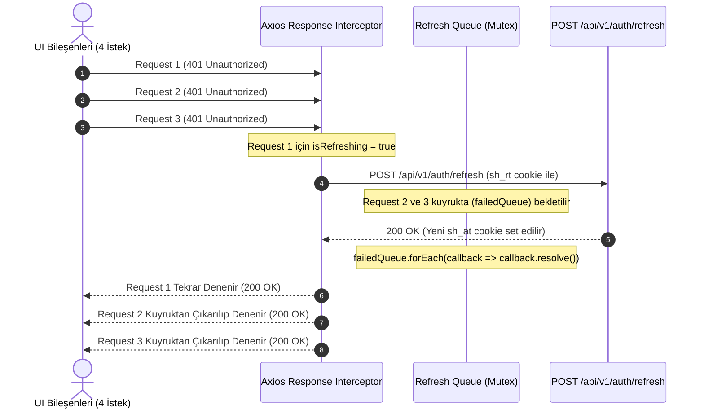

# Frontend Mimari, Durum Yönetimi ve Client Güvenliği

Bu doküman, `secondhand-frontend/` tek sayfa uygulamasının (SPA) mimari katmanlarını, TanStack React Query v5 sunucu durumu (server-state) yönetimini, Axios ağ katmanını, 401 sessiz token yenileme kuyruğunu (silent refresh queue), client depolama güvenliğini ve tasarım sistemi entegrasyonunu açıklar. Kod referansları: [`AppRoutes`](../secondhand-frontend/src/common/routes/AppRoutes.jsx), [`interceptors.js`](../secondhand-frontend/src/common/services/api/interceptors.js), [`tokenStorage.js`](../secondhand-frontend/src/common/services/storage/tokenStorage.js), [`AuthProvider`](../secondhand-frontend/src/auth/AuthProvider.jsx), [`theme.js`](../secondhand-frontend/src/common/theme/theme.js).

İlgili dokümanlar: Hata yönetimi ve frontend sözleşmesi [error-handling-and-contract-architecture.md](error-handling-and-contract-architecture.md), kimlik ve JWT mimarisi [auth-jwt-and-security-architecture.md](auth-jwt-and-security-architecture.md), WebSocket STOMP mimarisi [websocket-stomp-and-chat-architecture.md](websocket-stomp-and-chat-architecture.md).

---

## 1. Mimari Genel Bakış ve Teknoloji Stack'i

Uygulama, modern tarayıcı standartları ve yüksek performans hedefleri doğrultusunda şu teknoloji bileşenleri üzerine inşa edilmiştir:

```
[Kullanıcı Tarayıcısı]
         │
         ▼
[React 19 Core + Vite SPA]
   ├── Routing Katmanı:          React Router 7 (Route Guards: Protected, Public, Admin)
   ├── Sunucu Durumu (Async):    TanStack React Query v5 (Cache, Invalidation, Stale-Time)
   ├── Client Ağ Katmanı:        Axios Singleton (CSRF injection, 401 refresh queue)
   ├── Güvenlik & Oturum:        HttpOnly Cookies (sh_at, sh_rt) + Sanitized tokenStorage
   ├── Gerçek Zamanlı İletişim:  STOMP over SockJS (/ws) + Dual-Sync REST mutabakatı
   └── Tasarım Sistemi:          Tailwind CSS v3 + theme.js (Restrained Design Standard)
```

- **React 19:** Eşzamanlı render (concurrent rendering), Suspense sınırları ve modern Hook tabanlı durum yönetimi.
- **Vite:** Hızlı Hot Module Replacement (HMR) ve optimize edilmiş production bundle bölümleme (chunk splitting).
- **React Router 7:** Bildirimsel (declarative) rota tanımları, yetki korumalı sarmalayıcılar (`ProtectedRoute`, `PublicRoute`, `AdminRoute`) ve rota düzeyinde lazy-loading.

---

## 2. Rota Güvenliği ve Sayfa Sarmalayıcıları (Route Guards)

Uygulamadaki tüm rotalar erişim izinlerine göre üç temel guard bileşeni ile izole edilmiştir:

| Guard | Hedef Kitle | Davranış | Korunan Örnek Rotalar |
| :--- | :--- | :--- | :--- |
| `ProtectedRoute` | Giriş yapmış üyeler | Oturum yoksa isteği durdurur; mevcut URL'i `returnUrl` state'i ile saklayarak `/login` sayfasına yönlendirir. | `/cart`, `/checkout`, `/orders/*`, `/inbox`, `/account`, `/favorites` |
| `PublicRoute` | Yalnızca misafirler | Kullanıcı zaten oturum açmışsa gereksiz login/register ekranlarını engelleyip ana sayfaya (`/`) yönlendirir. | `/login`, `/register`, `/forgot-password` |
| `AdminRoute` | Yöneticiler | `user.role === 'ADMIN'` şartını arar; yetkisiz kullanıcıları doğrudan ana sayfaya veya login'e yönlendirir. | `/admin/coupons` |

Sayfa bileşenleri ilk açılış süresini (First Contentful Paint) minimize etmek için rota bazında `React.lazy` ile dinamik olarak yüklenir; yalnızca ana sayfa (`HomePage`) ve kurumsal bilgi sayfası (`AboutPage`) bundle içine eager olarak dahil edilir.

---

## 3. Sunucu Durumu Yönetimi: TanStack React Query v5

Frontend mimarisinde sunucu verileri (server-state) ile arayüz durumları (UI-state) kesin sınırlarla ayrılmıştır:
- **Kural:** Sunucudan dönen veriler hiçbir zaman yerel `useState` veya React Context içine kopyalanmaz. Tüm sunucu etkileşimi React Query üzerinden yürütülür.

### 3.1. Query Key Disiplini
Query key'leri tutarlılık için daima dizi tuple formatında yapılandırılır:
- Varlık koleksiyonları: `['<entity>', 'list', filters]` (ör. `['listings', 'category', 'electronics']`)
- Tekil detay kayıtları: `['<entity>', 'detail', id]` (ör. `['listings', id]`)
- Kullanıcıya özel kaynaklar: `['<entity>', 'my']` veya `['user', userId, 'addresses']`

### 3.2. Cache Süreleri (Stale Time & GC Time)
Backend `CacheConfig` Redis süreleriyle uyumlu olarak frontend cache süreleri normalize edilmiştir:
- **Statik / Nadir Değişen Veriler (Katalog & Enum):** `staleTime: 60 * 60 * 1000` (60 dk), `gcTime: 24 * 60 * 60 * 1000`.
- **Dinamik Varlıklar (İlanlar, Yorumlar, Favoriler):** `staleTime: 60 * 1000` (1 dk), `gcTime: 5 * 60 * 1000` (5 dk).
- **Gerçek Zamanlı Kritik Veriler (Sepet, Bildirim Sayaçları, Teklifler):** `staleTime: 0` veya `30 * 1000` (30 sn).

### 3.3. Mutasyon ve Invalidation Matrisi
Veri değiştiren (`POST`, `PUT`, `DELETE`, `PATCH`) her mutasyon sonrasında ilgili cache alanları `queryClient.invalidateQueries` ile tazelenir:

```
[İlan Satın Alındı (Checkout)]
        │
        ├──► invalidate: ['cart']                         (Sepet sıfırlanır)
        ├──► invalidate: ['orders', 'my']                 (Sipariş listesi güncellenir)
        ├──► invalidate: ['user', 'badges']               (Bekleyen sipariş badge'i artar)
        └──► invalidate: ['listings', listingId]          (İlan stok/satıldı durumu yenilenir)
```

---

## 4. Ağ İletişimi, Güvenlik ve Sessiz Token Yenileme (Silent Refresh)

Tüm HTTP çağrıları `src/common/services/api/request.js` içerisindeki merkezi Axios sarmalayıcısından geçer. Doğrudan bileşen içinden kontrolsüz `fetch` veya `axios` çağrısı yapılması yasaktır.

### 4.1. CSRF ve Kimlik Doğrulama Koruması
- İstemci `withCredentials = true` ile çalışır.
- Tarayıcıya sunucu tarafından gönderilen `XSRF-TOKEN` cookie değeri, Axios interceptor tarafından okunarak her yazma isteğinde `X-XSRF-TOKEN` HTTP başlığına dönüştürülür.
- Ham JWT access token veya refresh token dizgileri `localStorage` içinde **asla tutulmaz**. Oturum yönetimi sunucu taraflı `HttpOnly`, `SameSite=Lax` cookie'ler (`sh_at` ve `sh_rt`) üzerinden yürütülür.

### 4.2. Eşzamanlı 401 İsteklerini Yöneten Sessiz Refresh Kuyruğu (*Mutex Promise Queue*)
Bir kullanıcının 15 dakikalık access token'ı dolduğunda ve ekranda aynı anda 4 farklı API isteği tetiklendiğinde, her isteğin ayrı ayrı refresh uç noktasına gitmesi ve yarış durumu (*race condition / token rotation failure*) yaratması engellenir:



Eğer refresh isteği başarısız olursa (`401` veya `403` dönerse), tüm kuyruk temizlenir, `tokenStorage.clearUser()` çağrılır ve kullanıcı güvenli biçimde `/login` rotasına sevk edilir.

---

## 5. İstemci Depolama Güvenliği (`tokenStorage.js`)

`localStorage` yalnızca sayfa yenilendiğinde anlık ekran yanıp sönmesini (FOUC) engellemek amacıyla **yalnızca sanitize edilmiş genel profil metaverilerini** saklar:
- Saklanan alanlar: `id`, `email`, `role`, `firstName`, `lastName`, `plan`, `planExpiry`.
- Kesinlikle yasaklı alanlar: Şifreler, token'lar, API anahtarları veya kredi kartı verileri `tokenStorage.setUser` fonksiyonunda katı bir filtreleme süzgecinden geçirilir ve depolama alanına sızması engellenir.

---

## 6. Tasarım Sistemi ve Dört Durumlu UX Disiplini (4-State UX)

Uygulamanın görsel dili `.agents/skills/restrained-ui-design-standard/SKILL.md` ve `src/common/theme/theme.js` ile tanımlanan Apple/Spotify seviyesi kısıtlı tasarım standartlarına dayanır:

1. **Köşe Yuvarlama Tavanı (Radius Ceiling):** Tüm kartlar, paneller, butonlar ve form elemanlarında mutlak tavan `rounded-md` (en fazla 12px) değeridir. Balonvari `rounded-2xl` veya hap şeklindeki devasa ovallikler yasaktır.
2. **Geliştirici Arayüzünde Sıfır Emoji:** Butonlarda, toast bildirimlerinde, alert kutularında veya boş durumlarda dekoratif emoji kullanılmaz; semboller için `lucide-react` (16px/20px, stroke 1.5) kullanılır. (Kullanıcıların sohbet mesajları bu kısıtlamadan muaftır).
3. **Zorunlu 4 Veri Durumu (Four-State UX):**
   - **Loading State:** Tam ekranı bloke eden yükleme çarkları yerine, içeriğin nihai geometrisine tam oturan `Skeleton` bileşenleri (`SkeletonCard`, `SkeletonList`, `SkeletonGrid`).
   - **Empty State:** Nötr bir simge, kısa başlık, açıklama ve tek bir aksiyon butonu içeren standart `EmptyState`.
   - **Error State:** Sayfa yapısını bozmayan, `errorUtils.getErrorMessage` ile açılmış hata metni ve yeniden deneme butonu barındıran `Alert` bileşeni.
   - **Data State:** Tabular sayılar ve para birimleri için `tabular-nums` kullanan, temiz tipografik hiyerarşiye sahip içerik düzeni.

---

## 7. Çift Kanallı Gerçek Zamanlı Senkronizasyon (Dual Sync)

Gerçek zamanlı bildirim ve mesajlaşma süreçleri WebSocket STOMP bağlantısı üzerinden yürütülür:
- **WebSocket Push:** Gelen anlık mesajlar `/topic/chat/{roomId}` ve bildirimler `/user/queue/notifications` üzerinden arayüzdeki badge sayaçlarını ve sohbet ekranını anında günceller.
- **REST Mutabakatı:** Mobil cihaz uyku modundan çıktığında veya internet kesintisi sonrası WebSocket yeniden bağlandığında, bağlantı kopukluğu esnasında kaybolmuş olabilecek paketleri kompanse etmek için arka planda `/v1/user/badges` uç noktasına sessiz bir REST sorgusu atılarak gerçek sayaç verileri eşitlenir (*dual-sync reconciliation*).
