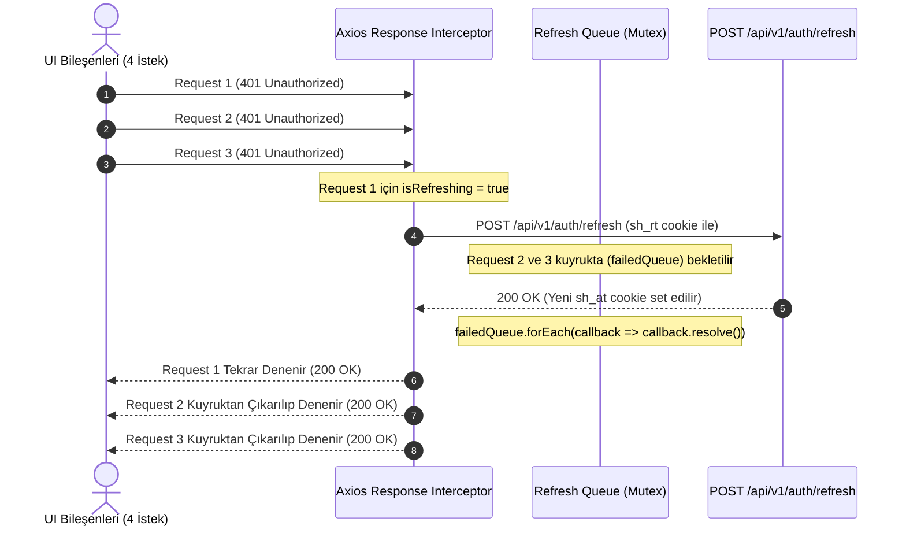

# Frontend Mimari, Durum Yönetimi ve Client Güvenliği

Bu doküman, `secondhand-frontend/` tek sayfa uygulamasının (SPA) mimari katmanlarını, TanStack React Query v5 sunucu durumu (server-state) yönetimini, Axios ağ katmanını, 401 sessiz token yenileme kuyruğunu (silent refresh queue), client depolama güvenliğini ve tasarım sistemi entegrasyonunu açıklar. Kod referansları: [`AppRoutes`](../secondhand-frontend/src/common/routes/AppRoutes.jsx), [`interceptors.js`](../secondhand-frontend/src/common/services/api/interceptors.js), [`tokenStorage.js`](../secondhand-frontend/src/common/services/storage/tokenStorage.js), [`AuthProvider`](../secondhand-frontend/src/auth/AuthProvider.jsx), [`theme.js`](../secondhand-frontend/src/common/theme/theme.js).

İlgili dokümanlar: Hata yönetimi ve frontend sözleşmesi [error-handling-and-contract-architecture.md](error-handling-and-contract-architecture.md), kimlik ve JWT mimarisi [auth-jwt-and-security-architecture.md](auth-jwt-and-security-architecture.md), WebSocket STOMP mimarisi [websocket-stomp-and-chat-architecture.md](websocket-stomp-and-chat-architecture.md).

---

## 1. Mimari Genel Bakış ve Teknoloji Stack'i

Uygulama, modern tarayıcı standartları ve yüksek performans hedefleri doğrultusunda şu teknoloji bileşenleri üzerine inşa edilmiştir:

```
[Kullanıcı Tarayıcısı]
         │
         ▼
[React 19 Core + Vite SPA]
   ├── Routing Katmanı:          React Router 7 (Route Guards: Protected, Public, Admin)
   ├── Sunucu Durumu (Async):    TanStack React Query v5 (Cache, Invalidation, Stale-Time)
   ├── Client Ağ Katmanı:        Axios Singleton (CSRF injection, 401 refresh queue)
   ├── Güvenlik & Oturum:        HttpOnly Cookies (sh_at, sh_rt) + Sanitized tokenStorage
   ├── Gerçek Zamanlı İletişim:  STOMP over native WebSocket (/ws, VITE_WS_BASE_URL)
   └── Tasarım Sistemi:          Tailwind CSS v3 + theme.js (Restrained Design Standard)
```

- **React 19:** Eşzamanlı render (concurrent rendering), Suspense sınırları ve modern Hook tabanlı durum yönetimi.
- **Vite:** Hızlı Hot Module Replacement (HMR) ve optimize edilmiş production bundle bölümleme (chunk splitting).
- **React Router 7:** Bildirimsel (declarative) rota tanımları, yetki korumalı sarmalayıcılar (`ProtectedRoute`, `PublicRoute`, `AdminRoute`) ve rota düzeyinde lazy-loading.

---

## 2. Rota Güvenliği ve Sayfa Sarmalayıcıları (Route Guards)

Uygulamadaki tüm rotalar erişim izinlerine göre üç temel guard bileşeni ile izole edilmiştir:

| Guard | Hedef Kitle | Davranış | Korunan Örnek Rotalar |
| :--- | :--- | :--- | :--- |
| `ProtectedRoute` | Giriş yapmış üyeler | Oturum yoksa login prompt'u açar (`useLoginPrompt`); iptal edilirse `/` adresine döner. | `/cart`, `/checkout`, `/profile/orders`, `/inbox`, `/dashboard`, `/favorites` |
| `PublicRoute` | Yalnızca misafirler | Oturum açıksa `location.state.from` adresine, yoksa `/` adresine yönlendirir. | `/login`, `/register`, `/forgot-password` |
| `AdminRoute` | Yöneticiler | Misafiri `/login`'e (`state.from` ile), admin olmayanı (`isAdminUser`) `/` adresine yönlendirir. | `/admin/coupons` |

Sayfa bileşenleri ilk açılış süresini (First Contentful Paint) minimize etmek için rota bazında `React.lazy` ile dinamik olarak yüklenir; yalnızca ana sayfa (`HomePage`) ve kurumsal bilgi sayfası (`AboutPage`) bundle içine eager olarak dahil edilir.

---

## 3. Sunucu Durumu Yönetimi: TanStack React Query v5

Frontend mimarisinde sunucu verileri (server-state) ile arayüz durumları (UI-state) kesin sınırlarla ayrılmıştır:
- **Kural:** Sunucudan dönen veriler hiçbir zaman yerel `useState` veya React Context içine kopyalanmaz. Tüm sunucu etkileşimi React Query üzerinden yürütülür.

### 3.1. Query Key Disiplini
Query key'leri dizi tuple formatındadır; yeni modüllerde `['<entity>', 'list', filters]`, `['<entity>', 'detail', id]`, `['<entity>', 'my']` biçimi ve modül sabitleri (ör. `ORDER_QUERY_KEYS`, `COMPLAINT_KEYS`) tercih edilir. Mevcut kodda düz key'ler de vardır (`['cartItems', userId]`, `['badgeCounts', userId]`, `['favoriteLists', ...]`); her modülün gerçek key listesi kendi README'sindeki "React Query Keys" tablosundadır.

### 3.2. Cache Süreleri (Stale Time & GC Time)
- **Global varsayılan (`App.jsx`):** `staleTime` 5 dk, `retry: 1`, `refetchOnWindowFocus`, `refetchOnMount` ve `refetchOnReconnect` kapalı.
- Hook bazında override edilir (en sık: 5 dk, 1 dk, 30 sn, 2 dk); badge sayaçları (`useBadgeCounts`) 2 dk `staleTime`, polling yok.

### 3.3. Mutasyon ve Cache Güncelleme
Her mutasyon `onSuccess` içinde ilgili key'leri `invalidateQueries` veya `setQueryData` ile günceller. Checkout örneği (`useCheckout` -> `resetCartState` in `useCart.js`): `['cartItems']` boş diziye set edilip invalidate edilir, sepet sayacı 0'lanır ve `/orders/success` sayfasına geçilir. Sipariş ve bakiye ekranları kendi query'leri açıldığında yeniden çekilir.

---

## 4. Ağ İletişimi, Güvenlik ve Sessiz Token Yenileme (Silent Refresh)

Tüm HTTP çağrıları `src/common/services/api/request.js` içerisindeki merkezi Axios sarmalayıcısından geçer. Doğrudan bileşen içinden kontrolsüz `fetch` veya `axios` çağrısı yapılması yasaktır.

### 4.1. CSRF ve Kimlik Doğrulama Koruması
- İstemci `withCredentials = true` ile çalışır (`config.js`).
- `XSRF-TOKEN` cookie değeri, request interceptor tarafından her istekte `X-XSRF-TOKEN` başlığına yazılır (header yoksa). CSRF kaynaklı 403'ler `CSRF_ERROR` koduyla işaretlenir, refresh denenmez.
- Ham JWT access token veya refresh token dizgileri `localStorage` içinde **asla tutulmaz**. Oturum yönetimi sunucu taraflı `HttpOnly`, `SameSite=Lax` cookie'ler (`sh_at` ve `sh_rt`) üzerinden yürütülür.

### 4.2. Eşzamanlı 401 İsteklerini Yöneten Sessiz Refresh Kuyruğu (*Mutex Promise Queue*)
Bir kullanıcının 15 dakikalık access token'ı dolduğunda ve ekranda aynı anda 4 farklı API isteği tetiklendiğinde, her isteğin ayrı ayrı refresh uç noktasına gitmesi ve yarış durumu (*race condition / token rotation failure*) yaratması engellenir:



Login, register, OAuth complete, forgot/reset password ve refresh endpoint'lerinin kendi 401'leri refresh tetiklemez. Refresh başarısız olursa kuyruktaki tüm istekler reject edilir ve `AuthProvider.handleTokenRefreshFailure` çalışır: `clearUser()`, `queryClient.clear()` ve oturum state'i sıfırlanır; korumalı sayfadaki kullanıcı `ProtectedRoute` üzerinden login prompt'u görür.

---

## 5. İstemci Depolama Güvenliği (`tokenStorage.js`)

`localStorage` (`user` key'i) sayfa yenilendiğinde oturum state'ini hızlı göstermek için kullanıcı nesnesini saklar. `tokenStorage.setUser` bir whitelist değil, blacklist uygular: `password`, `accessToken`, `refreshToken`, `token` alanlarını ve adında `password`, `token`, `secret` veya `key` geçen her alanı siler; geri kalan tüm alanlar saklanır. Yeni hassas alan eklerken bu isim kuralına uyun.

---

## 6. Tasarım Sistemi

Kurallar (radius tavanı, token'lar, emoji yasağı, dört veri durumu) tek yerde tutulur: `restrained-ui-design-standard` skill'i ve `src/common/theme/theme.js`. Bu doküman onları tekrar etmez.

---

## 7. Gerçek Zamanlı İletişim

- **Bağlantı:** `useWebSocket` (chat) ve `useNotificationWebSocket` ayrı STOMP client'ları açar; hata sonrası exponential backoff ile `MAX_RECONNECT_ATTEMPTS` kadar yeniden bağlanır.
- **Abonelikler:** chat `/user/{userId}/queue/messages`; bildirimler `/user/{userId}/notifications` ve broadcast `/topic/notifications`. Gönderim `/app/chat.sendMessage`, `/app/chat.joinRoom`, `/app/chat.leaveRoom`.
- **Sayaçlar:** `useBadgeCounts` `/v1/user/badges` endpoint'ini okur (`['badgeCounts', userId]`); reconnect sonrası otomatik REST senkronu yoktur. Bildirim ve e-posta okuma akışları bu key'i invalidate eder (`useInAppNotifications`, `EmailsPage`).
