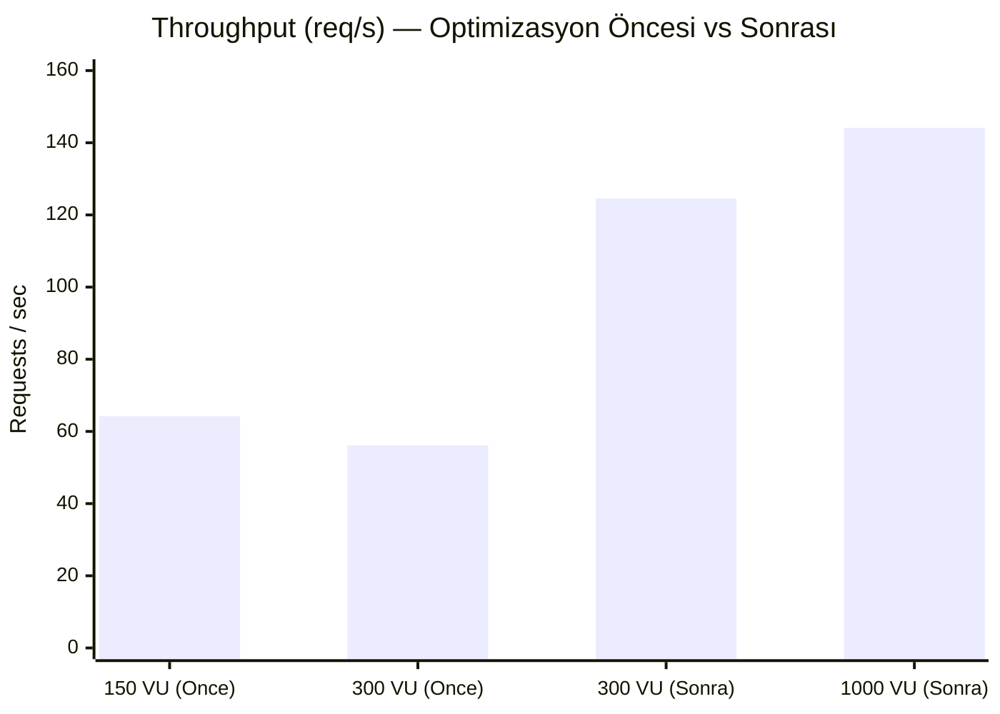

# API, Concurrency ve Yük Testi Raporu

**Tarih:** 26 Kasım 2026  
**Ortam:** Tek lokal node — Spring Boot 3.5.4 (Java 21), PostgreSQL 15 (`:5433`, HikariCP `maximum-pool-size=20`), Redis 7 (`:6379`), Kafka 3.7 (`:9092`)  
**Araçlar:** `curl`, Python paralel yarış koşusu harness'i, `k6` (150 / 300 / 1000 VU)

> [!IMPORTANT]
> **Özet Karar:** Uygulama tüm finansal yarış durumu (overselling, double-spend, idempotency, token replay) testlerinden **%100 veri tutarlılığı** ile geçti. Test sırasında yakalanan **1 transactional rollback bug'ı** düzeltildi ve **3 okuma darboğazı** giderildi. Optimizasyon sonrası 300 VU throughput **2.22x** (`56.15 -> 124.54 req/s`) arttı; tek node **1.000 eşzamanlı VU** ve **144.11 req/s** altında **%0.00 hata** ile ayakta kaldı.

---

## 1. Fonksiyonel ve Güvenlik Testleri (`curl`)

| Test Alanı | Senaryo | Sonuç | Durum |
| :--- | :--- | :--- | :--- |
| **E2E Mock Checkout** | Register -> Login (`HttpOnly` cookie `sh_at`, `sh_rt`) -> Adres -> eWallet -> `Idempotency-Key` Deposit -> Sepet -> `POST /api/checkout/initiate` (900s TTL) -> `POST /api/v1/payments/initiate-verification` -> `POST /api/v1/orders/checkout` (`EWALLET` + `CARGO`) | `HTTP 200` (`191 ms`), sipariş `CONFIRMED`, escrow tutuldu, cüzdan `-1100.00 TL`, sepet `0`, Kafka sonrası DB ve Redis stok birebir eşit | PASS |
| **CSRF Koruması** | `X-XSRF-TOKEN` olmadan `POST /api/v1/cart/items` | `HTTP 403 Forbidden` | PASS |
| **RTR ve Replay Theft** | 1. refresh -> eski `sh_rt` tekrar gönder -> yeni `sh_rt` dene | 1. refresh `200`; replay `401 REVOKED_REFRESH_TOKEN`; yeni token `401 REVOKED_REFRESH_TOKEN` (tüm aile iptal) | PASS |
| **General Rate Limit (150/60s)** | 20 paralel worker ile 160 istek (tek IP) | Tam **150 x `200`**, **10 x `429`** (`X-RateLimit-*`, `Retry-After`) | PASS |
| **Payment Rate Limit (10/60s)** | 13 istek (tek IP) | Tam **10 geçti**, **3 x `429`** | PASS |
| **Brute-Force İzolasyonu** | Saldırgan IP'den 6 hatalı şifre + aynı anda meşru IP'den doğru şifre | Saldırgan IP 6. denemede `429 ACCOUNT_LOCKED`; meşru IP `200` ile giriş yaptı (hesap bazlı DoS yok) | PASS |

---

## 2. Concurrency ve Race-Condition Testleri

Tüm yarış testlerinde eşzamanlı `curl` süreçleri barrier ile **aynı milisaniyede** serbest bırakıldı.

| Senaryo | Yük | Beklenen Invariant | Gerçekleşen Sonuç | Durum |
| :--- | :--- | :--- | :--- | :--- |
| **Deposit Idempotency Race** | 15 paralel `POST /api/v1/e-wallets/deposit` (aynı `Idempotency-Key`, 1.000 TL) | Bakiye yalnızca `+1000.00 TL` artmalı | `15 x HTTP 200`, bakiye `8900 -> 9900 TL` (`+1000.00 TL`), çift kayıt yok | PASS |
| **Stock Oversell Race** | 12 farklı alıcı aynı anda **stok = 5** ilana checkout | Tam 5 başarı, 7 red; negatif stok yok; ilan `SOLD` | **5 x `200`**, **7 x `409 INVENTORY_INSUFFICIENT_STOCK`** (`p50=617 ms`, `max=664 ms`). 3 sn sonra: DB stok `0`, Redis `0`, ilan `SOLD`, pending key `0` | PASS |
| **Same-User Double-Spend** | Aynı kullanıcı (bakiye `1500 TL`, ürün `1100 TL`) 8 paralel checkout | En fazla 1 başarı, bakiye `>= 0` | **1 x `200`**, **7 x `400`** (`INVALID_VERIFICATION_CODE` / `INSUFFICIENT_EWALLET_BALANCE`), son bakiye **`400.00 TL`** | PASS |
| **Concurrent RTR Race** | Aynı `sh_rt` cookie ile 6 paralel `POST /api/v1/auth/refresh` | Replay algılanıp aile iptal edilmeli | **1 x `200`**, **5 x `401`**; DB token ailesi: **`ACTIVE: 0, REVOKED: 2`** | PASS |
| **25-Buyer Checkout Write Storm** | 25 yeni alıcı aynı anda tam transactional checkout (stok = 1000) | Deadlock/5xx olmadan %100 başarı ve outbox/Kafka tutarlılığı | **25/25 `HTTP 200`** (`2.42 s`, **10.3 checkout/sn**, `p50=1910 ms`, `p95=2204 ms`). Kafka sonrası: PostgreSQL `975`, Redis `975`, pending `0`, tüm DB'de negatif stok `0` | PASS |

---

## 3. Yakalanan Bug ve Çözümü

> [!WARNING]
> **Bulgu (`PAYMENT_VERIFICATION_REQUIRED` HTTP 428 Rollback Bug'ı):**  
> Kullanıcı `paymentVerificationCode` göndermeden doğrudan `POST /api/v1/orders/checkout` çağırdığında, [`CheckoutOrchestrator.java`](../src/main/java/com/serhat/secondhand/checkout/application/CheckoutOrchestrator.java) `@Transactional` içindeyken `PaymentVerificationService.generateAndSendVerification(...)` kodu DB'ye yazıp e-posta gönderiyor ve `428 PAYMENT_VERIFICATION_REQUIRED` dönüyordu. Ancak `CheckoutOrchestrator` hata sonucu üzerine `rollbackCheckout()` çağırdığı için `verification_codes` tablosuna yazılan satır **rollback oluyor** ve kullanıcıya giden kod geçersiz kalıyordu.

- **Düzeltme:** [`VerificationService.java`](../src/main/java/com/serhat/secondhand/core/verification/VerificationService.java) içindeki `generateVerification(...)` metoduna `@Transactional(propagation = Propagation.REQUIRES_NEW)` eklendi. Böylece doğrulama kodu kendi bağımsız transaction'ında commit ediliyor; bildirim/e-posta gönderimi transaction dışında kalıyor.
- **Test ve Canlı Doğrulama:**
  - [`PaymentVerificationServiceTest.java`](../src/test/java/com/serhat/secondhand/payment/application/PaymentVerificationServiceTest.java) içine `generateVerificationUsesRequiresNewSoCodeSurvivesCheckoutRollback` unit testi eklendi.
  - Canlı backend'de kod olmadan atılan `POST /api/v1/orders/checkout` -> `HTTP 428` ve `verification_codes` satır sayısı **`0 -> 1`** olarak doğrulandı.

---

## 4. Performans Darboğaz Analizi ve Uygulanan Optimizasyonlar

İlk 150 VU ve 300 VU testlerinde throughput ~`56-64 req/s` tavanına takıldı (`p50=3.95 s`). Kök neden analiziyle 3 somut darboğaz giderildi:

1. **N+1 Redis Write-on-Read -> Tek Turluk Pipelined Okuma:**
   - [`ListingViewService.java`](../src/main/java/com/serhat/secondhand/listing/application/common/ListingViewService.java) eskiden her ilan için ayrı ayrı `ZREMRANGEBYSCORE` (yazma) + `ZCARD` (okuma) çalıştırıyordu (12 ilanlık sayfada 24 sıralı Redis round-trip).
   - Saf okuma olan `ZCOUNT` + `executePipelined` kullanan `getActiveViewerCounts(List<UUID>)` metodu eklendi (24 tur -> **1 pipelined tur**).
2. **Duplicate PostgreSQL Favori Sorgusunun Kaldırılması:**
   - [`ListingSocialProofService.java`](../src/main/java/com/serhat/secondhand/listing/application/common/ListingSocialProofService.java), `ListingEnrichmentService` içinde `ListingFavoriteStatsUtil` tarafından az önce doldurulmuş `favoriteCount` bilgisini yok sayıp `favoriteRepository.countByListingIds(...)` sorgusunu ikinci kez çalıştırıyordu. Mevcut `favoriteStats` yeniden kullanılacak şekilde güncellendi.
3. **Public Liste Redis Cache (60 sn TTL + Mutation Eviction):**
   - [`CacheConfig.java`](../src/main/java/com/serhat/secondhand/core/config/CacheConfig.java) içine `listing:bestSellers:public` ve `showcase:active:public` (60 sn TTL) eklendi.
   - [`ListingBestSellerService.java`](../src/main/java/com/serhat/secondhand/listing/application/query/ListingBestSellerService.java), [`ShowcaseService.java`](../src/main/java/com/serhat/secondhand/showcase/application/ShowcaseService.java) ve [`ShowcaseController.java`](../src/main/java/com/serhat/secondhand/showcase/api/ShowcaseController.java) üzerinden anonim (`userId == null`) istekler Redis'ten doğrudan dönüyor; showcase mutasyonları `@CacheEvict` ile cache'i temizliyor.

---

## 5. Yük ve Stres Testi Benchmark Sonuçları (`k6`)

Test karması: `%25 listings/search`, `%20 listings/{id}`, `%20 showcases/active`, `%15 listings/best-sellers`, `%10 catalog/locations/cities`, `%10 agreements` (dönen `X-Forwarded-For` IP'leri ile saf uygulama kapasitesi ölçüldü).

| Test Senaryosu | Süre | Toplam İstek | Throughput (RPS) | p50 Latency | p95 Latency | Max Latency | Hata Oranı |
| :--- | :---: | :---: | :---: | :---: | :---: | :---: | :---: |
| **150 VU (Öncesi)** | 30 sn | 1.929 | 64.25 req/s | 1.28 s | 2.04 s | 3.35 s | %0.00 |
| **300 VU (Öncesi)** | 35 sn | 2.075 | 56.15 req/s | 3.95 s | 6.02 s | 7.77 s | %0.00 |
| **300 VU (Sonrası)** | 35 sn | **4.435** | **124.54 req/s (+122%)** | **1.66 s (-58%)** | **3.14 s (-48%)** | **5.44 s (-30%)** | **%0.00** |
| **1000 VU (Sonrası)** | 35 sn | **5.832** | **144.11 req/s** | **3.95 s** | **7.72 s** | **9.86 s** | **%0.00** |

---

## 6. Doğrulama ve İleri Ölçekleme Notları

- **Unit Testler:** `ListingSocialProofServiceTest`, `ListingViewServiceTest`, `ListingBestSellerServiceTest`, `ShowcaseCreateEligibilityTest`, `PaymentVerificationServiceTest` -> **22/22 PASS**.
- **Repo Doğrulama:** `./scripts/verify.sh --no-lint` -> **PASS** (0 emoji, 0 dokümantasyon sapması, 205/205 API uç noktası eşleşti).
- **Tek Node Sınırı ve Sonraki Adımlar:**
  - Tek lokal Spring Boot instance'ı için kırılma noktası ~**1.000-1.100 eşzamanlı VU** (`max = 9.86 s`, HikariCP `connection-timeout = 10 s` sınırına dayandı).
  - Mimari (Redis Lua stok/rate-limit, Redis cache, PostgreSQL outbox + Kafka) stateless olduğu için yük artışı durumunda:
    1. En ağır kalan okuma ucu olan `/api/v1/listings/search` için popüler sorgulara kısa TTL'li (15-30 sn) Redis cache veya read-replica eklenebilir.
    2. Reverse proxy / load balancer arkasında 2+ backend instance ile yatay ölçekleme doğrudan yapılabilir.
