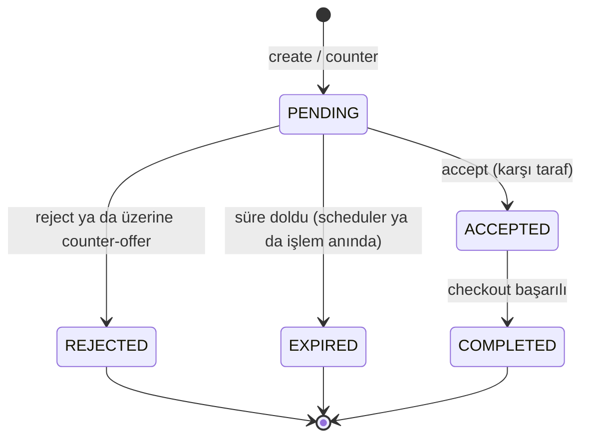

# Teklif (Offer) Sistemi ve Eşzamanlılık Kontrolleri

Bu doküman teklif yaşam döngüsünü, counter-offer zincirini, kabul anındaki kilitleri ve kabul edilmiş teklifle checkout'u anlatır. Kod blokları projeden alınmıştır. Modül özeti: [offer/README.md](../src/main/java/com/serhat/secondhand/offer/README.md).

İlgili dokümanlar: fiyat hesabında teklif [pricing-coupon-and-campaign-architecture.md](pricing-coupon-and-campaign-architecture.md), sohbet içi teklif [websocket-stomp-and-chat-architecture.md](websocket-stomp-and-chat-architecture.md).

---

## 1. Çözülen problemler

1. **Çifte kabul:** Satıcı aynı ilan için iki teklifi aynı anda kabul ederse tek ürün kime satılır?
2. **Cevabı kimin vereceği:** Teklifi veren taraf kendi teklifini kabul edememeli.
3. **Askıda kalan teklifler:** Cevaplanmayan teklif sonsuza kadar `PENDING` kalmamalı.
4. **Aynı teklifle iki checkout:** Kabul edilmiş teklif yalnızca bir kez kullanılabilmeli.

## 2. Durumlar



| Durum (`OfferStatus`) | Anlamı | Sonraki durumlar |
| :--- | :--- | :--- |
| `PENDING` | Karşı tarafın cevabı bekleniyor. Geçerlilik `app.offer.expiration-hours` (varsayılan **24 saat**). | `ACCEPTED`, `REJECTED`, `EXPIRED` |
| `ACCEPTED` | Kabul edildi; alıcı teklif fiyatıyla checkout yapabilir. | `COMPLETED` |
| `REJECTED` | Reddedildi ya da üzerine counter-offer verildi. | terminal |
| `EXPIRED` | Süresinde cevaplanmadı. | terminal |
| `COMPLETED` | Alıcı teklif fiyatıyla ödemeyi tamamladı. | terminal |

Teklif verilemeyen durumlar ([`OfferValidator`](../src/main/java/com/serhat/secondhand/offer/validator/OfferValidator.java)): ilan `ACTIVE` değil (`LISTING_NOT_ACTIVE`), ilan tipi `VEHICLE` ya da `REAL_ESTATE` (`LISTING_TYPE_NOT_ALLOWED`), kendi ilanına teklif (`SELF_OFFER_NOT_ALLOWED`), adet < 1 (`INVALID_QUANTITY`), fiyat ≤ 0 (`INVALID_TOTAL_PRICE`), adet stoktan fazla (`OFFER_QUANTITY_EXCEEDS_STOCK`).

## 3. API

| Endpoint | Kim | Açıklama |
| :--- | :--- | :--- |
| `POST /api/v1/offers` | Alıcı | Teklif verir (`listingId`, `quantity`, `totalPrice`). |
| `GET /api/v1/offers/{offer-id}` | Alıcı ya da satıcı | Teklif detayı. |
| `POST /api/v1/offers/{offer-id}/accept` | Teklifin alıcısı (receiver) | Kabul. |
| `POST /api/v1/offers/{offer-id}/reject` | Receiver | Ret. |
| `POST /api/v1/offers/{offer-id}/counter` | Receiver | Counter-offer. |
| `POST /api/v1/chats/rooms/{chat-room-id}/offers` | Oda katılımcısı | Sohbet içinden teklif; aynı `OfferService.create`'i çağırır. |

---

## 4. Kim cevap verebilir?

Her teklif kimin oluşturduğunu taşır (`createdBy`: `BUYER` ya da `SELLER`). Kabul, ret ve counter yalnızca **karşı taraf** tarafından yapılabilir:

```java
// OfferService.getOfferForAction
if (!offerValidator.isBuyerOrSeller(user, offer) || !offerValidator.isReceiver(user, offer)) {
    return Result.error(OfferErrorCodes.OFFER_NOT_ALLOWED);
}

// OfferValidator
public boolean isReceiver(User user, Offer offer) {
    return offer.getCreatedBy() != resolveActor(user, offer);
}
```

Alıcının verdiği teklifi satıcı, satıcının counter-offer'ını alıcı cevaplar. Teklifin tarafı olmayan kullanıcı `OFFER_NOT_ALLOWED` alır.

## 5. Counter-offer zinciri

[`OfferService.counter`](../src/main/java/com/serhat/secondhand/offer/application/OfferService.java) tek transaction'da iki iş yapar:

```java
previous.setStatus(OfferStatus.REJECTED);
offerRepository.save(previous);

OfferActor actor = offerValidator.resolveActor(user, previous);
Offer counter = offerMapper.toCounterOffer(request, previous, actor);   // parentOffer = previous
Offer saved = offerRepository.save(counter);
offerEmailNotificationService.notifyCounterReceived(saved);
```

- Önceki teklif `REJECTED` olur; yeni teklif `parentOffer` ile ona bağlanır. Pazarlık geçmişi bu zincirden okunur.
- Yeni teklifin `createdBy` değeri counter'ı veren taraftır; sıra karşı tarafa geçer.
- Counter verilirken ilan uygunluğu ve stok yeniden kontrol edilir.

## 6. Kabul anındaki kilitler

`accept` sırasıyla şunları yapar:

```java
if (isExpired(offer)) { processManualExpiration(offer); return Result.error(OfferErrorCodes.OFFER_EXPIRED); }
if (requirePending(offer).isError()) return Result.error(OfferErrorCodes.OFFER_NOT_PENDING);

Listing lockedListing = listingService.findByIdWithLock(offer.getListing().getId()).orElse(null);  // satır kilidi
...
if (offerRepository.existsByListingAndStatusAndIdNot(lockedListing, OfferStatus.ACCEPTED, offer.getId())) {
    return Result.error(OfferErrorCodes.OFFER_ALREADY_ACCEPTED_FOR_LISTING);
}
offer.setStatus(OfferStatus.ACCEPTED);
saved = offerRepository.save(offer);
offerRedisReservationService.lockAcceptedOffer(lockedListing.getId(), offer.getBuyer().getId(), offer.getId());
```

| Katman | Ne sağlar |
| :--- | :--- |
| İlan satır kilidi (`findByIdWithLock`) | Aynı ilan için iki `accept` sıraya girer. |
| `existsByListingAndStatusAndIdNot(ACCEPTED)` | Kilidi ikinci alan istek, ilk kabulü görür ve `OFFER_ALREADY_ACCEPTED_FOR_LISTING` döner. **Çifte kabulü asıl engelleyen kontrol budur.** |
| `@Version` (optimistic lock) | Aynı teklif satırına eşzamanlı yazma `OFFER_CONCURRENT_MODIFICATION` döner. |
| Redis `v4:offer:lock:{listingId}` | Aşağıya bakın. |

### Redis kilidi: `v4:offer:lock:{listingId}`

[`OfferRedisReservationService`](../src/main/java/com/serhat/secondhand/offer/application/OfferRedisReservationService.java):

```java
private static final String OFFER_LOCK_KEY_PREFIX = "v4:offer:lock:";
private static final Duration DEFAULT_OFFER_TTL = Duration.ofHours(24);

Boolean acquired = redisTemplate.opsForValue().setIfAbsent(key, buyerId + ":" + offerId, DEFAULT_OFFER_TTL);
// Redis hatasında true döner: kabul akışı DB kilidine güvenerek devam eder
```

Kodda doğrulanan davranış:

- Key kabul anında `SET NX` ile yazılır, değeri `buyerId:offerId`, TTL 24 saattir.
- `accept`, `lockAcceptedOffer`'ın dönüş değerine **bakmaz**; kilit alınamasa da kabul tamamlanır.
- Key'i **okuyan bir kod yoktur** ve `releaseAcceptedOffer` hiçbir yerden çağrılmaz; key yalnızca TTL ile silinir.

Sonuç: bu key şu an bir işaretten ibarettir. Başka bir alıcının ilanı liste fiyatından satın almasını ya da yeni teklif vermesini **engellemez**; bu yönde bir kontrol checkout ya da `create` akışında bulunmaz.

## 7. Süre dolması

- [`OfferScheduler`](../src/main/java/com/serhat/secondhand/offer/scheduler/OfferScheduler.java) dakikada bir (`app.offer.scheduler-cron`, varsayılan `0 * * * * *`) `expiresAt`'ı geçmiş `PENDING` teklifleri `EXPIRED` yapar ve iki tarafa bildirim gönderir.
- Scheduler çalışmadan önce bir işlem gelirse (`accept`, `reject`, `counter`) teklif o anda `EXPIRED` yapılır ve `OFFER_EXPIRED` döner.
- Süre kontrolü yalnızca `PENDING` için vardır:
  ```java
  private boolean isExpired(Offer offer) {
      return offer != null && offer.getStatus() == OfferStatus.PENDING
              && offer.getExpiresAt() != null && LocalDateTime.now().isAfter(offer.getExpiresAt());
  }
  ```
  `ACCEPTED` bir teklifin ödeme için süre sınırı **yoktur**. Alıcı ödeme yapmazsa teklif `ACCEPTED` kalır ve aynı ilan için başka bir teklifin kabulü `OFFER_ALREADY_ACCEPTED_FOR_LISTING` ile reddedilmeye devam eder.

## 8. Kabul edilmiş teklifle checkout

1. Alıcı checkout isteğinde `offerId` gönderir. `CheckoutPricingContextFactory`, `getAcceptedOfferForCheckout(buyerId, offerId)` çağırır: teklif alıcıya ait ve `ACCEPTED` olmalı (`OFFER_NOT_FOUND`, `OFFER_NOT_ACCEPTED`), ilan kilitlenir, uygunluk ve stok yeniden kontrol edilir.
2. Fiyat motoru teklif ilanının satırını `offer.quantity` ve `offer.totalPrice` ile hesaplar; o satıra kampanya uygulanmaz ([pricing dokümanı §2](pricing-coupon-and-campaign-architecture.md#2-hesaplama-sırası)).
3. Ödeme ve escrow başarılı olduktan sonra `CheckoutOrchestrator.handleSuccessfulCheckout` teklifi kapatır:
   ```java
   // OfferService.markCompleted
   int updated = offerRepository.completeIfAccepted(offer.getId(), offer.getVersion(), LocalDateTime.now());
   if (updated == 0) {
       return Result.error(OfferErrorCodes.OFFER_CONCURRENT_MODIFICATION);
   }
   ```
   Güncelleme koşulludur (durum `ACCEPTED` ve `version` aynı). Aynı teklifle eşzamanlı ikinci checkout `0` satır günceller; `CheckoutOrchestrator` o checkout'un tamamını (sipariş, ödeme) geri alır ve stok rezervasyonunu bırakır.

## 9. Bildirimler

`OfferEmailNotificationService` her adımda `NotificationEventPublisher.publishDispatch(..., "offer", ...)` ile uygulama içi bildirim üretir: teklif alındı, kabul edildi, reddedildi, counter-offer geldi, süresi doldu (iki tarafa). Bildirim altyapısı: [notification dokümanı](notification-feed-and-broadcast-architecture.md).

## 10. Hata kodları

| Kod | Ne zaman |
| :--- | :--- |
| `OFFER_NOT_FOUND`, `LISTING_NOT_FOUND` | Kayıt yok ya da teklif bu alıcıya ait değil (checkout). |
| `OFFER_NOT_ALLOWED` | Kullanıcı teklifin tarafı değil ya da cevap sırası onda değil. |
| `OFFER_NOT_PENDING` | Teklif zaten cevaplanmış. |
| `OFFER_EXPIRED` | Süresi dolmuş. |
| `OFFER_NOT_ACCEPTED` | Checkout'ta teklif `ACCEPTED` değil. |
| `OFFER_ALREADY_ACCEPTED_FOR_LISTING` | İlanın kabul edilmiş başka bir teklifi var. |
| `OFFER_CONCURRENT_MODIFICATION` | Optimistic lock çakışması ya da eşzamanlı `markCompleted`. |
| `OFFER_QUANTITY_EXCEEDS_STOCK` | İstenen adet stoktan fazla. |

## 11. Bilinen sınırlar

- Redis kilidi okunmadığı için kabul edilmiş teklif, ilanı başka alıcılara karşı rezerve etmez (§6).
- `ACCEPTED` teklif için ödeme süresi ve otomatik iptal yoktur (§7).
- `createSellerOffer` (satıcının doğrudan teklif oluşturması) süre verilmezse 48 saat kullanır; diğer yollar `app.offer.expiration-hours` değerini kullanır.
