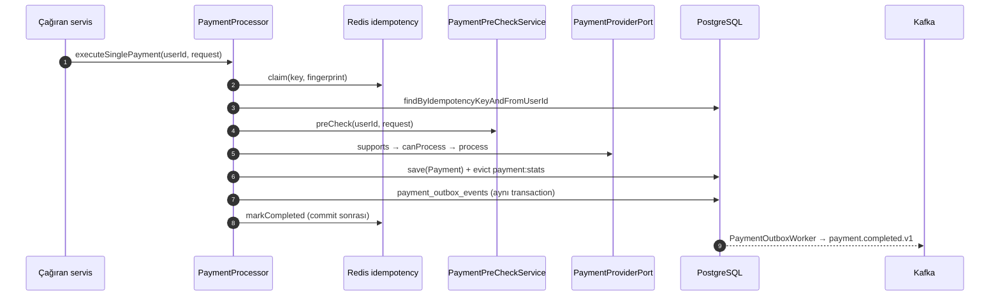

# Payment Strategy Pattern & Yeni Provider Ekleme Rehberi

Bu doküman, ödeme altyapısının **Hexagonal Architecture (Port & Adapter)** ve **Strategy Pattern** ile nasıl kurulduğunu, bir ödemenin baştan sona hangi durumlardan geçtiğini ve yeni bir payment provider'ın nasıl ekleneceğini anlatır. Kod blokları projeden alınmıştır; ayrıntılar için ilgili sınıfa bakın.

İlgili dokümanlar: Redis ve Kafka tarafı [redis-and-kafka-architecture.md](redis-and-kafka-architecture.md), escrow [escrow-lifecycle-and-state-machine.md](escrow-lifecycle-and-state-machine.md), fiyat hesabı [pricing-coupon-and-campaign-architecture.md](pricing-coupon-and-campaign-architecture.md).

---

## 1. Neden Strategy Pattern?

Ödeme servisinde provider'a göre `if-else` zinciri büyüdükçe her yeni provider mevcut kodu değiştirmeyi gerektirir (regression riski, SRP ihlali, zor test). secondHand'de bunun yerine her provider bir **adapter**'dır ve `PaymentProcessor` hangi adapter'ın çalışacağını runtime'da seçer.

```java
// Kötü yaklaşım (anti-pattern, projede yok)
if ("EWALLET".equals(provider)) { processWallet(); }
else if ("CREDIT_CARD".equals(provider)) { processCreditCard(); }
```

## 2. Mimari

```
[PaymentController, OrderPaymentService, MembershipService, ShowcaseService, PaymentModuleAdapter (ilan ücreti)]
                              │  executeSinglePayment(userId, PaymentRequest)
                              ▼
                       [PaymentProcessor] ── List<PaymentProviderPort> inject edilir
                              │
                              └──► [EWalletPaymentProviderAdapter]  supports("EWALLET")   (tek mevcut provider)
```

`PaymentProcessor`'ı çağıran beş yer vardır: `PaymentController`, `OrderPaymentService` (checkout), `MembershipService`, `ShowcaseService` ve `PaymentModuleAdapter` (ilan oluşturma ücreti).

### 2.1 Port: `PaymentProviderPort`

[`PaymentProviderPort.java`](../src/main/java/com/serhat/secondhand/payment/port/out/PaymentProviderPort.java)

```java
public interface PaymentProviderPort {
    boolean supports(String providerName);
    boolean canProcess(User fromUser, User toUser, BigDecimal amount);
    PaymentResult process(User fromUser, User toUser, BigDecimal amount, UUID listingId, PaymentRequest request);
}
```

### 2.2 Tek mevcut adapter: `EWalletPaymentProviderAdapter`

[`EWalletPaymentProviderAdapter.java`](../src/main/java/com/serhat/secondhand/ewallet/adapter/in/EWalletPaymentProviderAdapter.java) ödemeyi `EWalletService`'e devreder:

```java
@Component
@RequiredArgsConstructor
public class EWalletPaymentProviderAdapter implements PaymentProviderPort {
    private final IEWalletService eWalletService;
    private final EWalletValidator eWalletValidator;

    @Override
    public boolean supports(String providerName) {
        return "EWALLET".equalsIgnoreCase(providerName);
    }

    @Override
    public boolean canProcess(User fromUser, User toUser, BigDecimal amount) {
        return eWalletValidator.hasSufficientBalance(fromUser, amount);
    }

    @Override
    public PaymentResult process(User fromUser, User toUser, BigDecimal amount, UUID listingId, PaymentRequest request) {
        return eWalletService.processEWalletPayment(fromUser, toUser, amount, listingId);
    }
}
```

`EWalletService.processEWalletPayment` yalnızca **ödeyenin** cüzdanını kilitleyip düşer; alıcı satıcıya para burada geçmez (escrow akışı bunu sonradan yapar). Başarıda ve hatada `PaymentResult` döner, exception fırlatmaz:

```java
EWallet fromWallet = getEWalletOrThrowWithLock(fromUser);
ensureValid(eWalletValidator.validateSufficientBalance(fromWallet, amount));
fromWallet.setBalance(EWalletBalanceUtil.subtract(fromWallet.getBalance(), amount));
eWalletRepository.save(fromWallet);

return PaymentResult.success(UUID.randomUUID().toString(), amount, "EWALLET",
        listingId, fromUser.getId(), toUser != null ? toUser.getId() : null);
// catch (Exception e) -> PaymentResult.failure(e.getMessage(), amount, "EWALLET", ...)
```

### 2.3 `PaymentResult` ve `PaymentRequest`

[`PaymentResult`](../src/main/java/com/serhat/secondhand/payment/entity/PaymentResult.java) bir record'dur ve iki fabrikası vardır:

```java
PaymentResult.success(String transactionId, BigDecimal amount, String providerName,
                      UUID listingId, Long fromUserId, Long toUserId)
PaymentResult.failure(String errorMessage, BigDecimal amount, String providerName,
                      UUID listingId, Long fromUserId, Long toUserId)
```

[`PaymentRequest`](../src/main/java/com/serhat/secondhand/payment/dto/PaymentRequest.java) provider seçimini `providerName` ile, ne tür bir ödeme olduğunu `transactionType` ile (`PaymentTransactionType`: `LISTING_CREATION`, `ITEM_PURCHASE`, `ITEM_SALE`, `REFUND`, `EWALLET_DEPOSIT`, `EWALLET_WITHDRAWAL`, `EWALLET_PAYMENT_RECEIVED`, `SHOWCASE_PAYMENT`, `MEMBERSHIP_PAYMENT`) taşır. Diğer alanlar: `amount`, `listingId`, `orderItemId`, `orderId`, `verificationCode`, `acceptedAgreementIds`, `idempotencyKey`.

---

## 3. Uçtan Uca Akış

[`PaymentProcessor.executeSinglePayment`](../src/main/java/com/serhat/secondhand/payment/application/PaymentProcessor.java) şu sırayı izler:



### 3.1 Idempotency key

Çağıran `idempotencyKey` göndermezse `PaymentIdempotencyHelper.buildIdempotencyKey` üretir. Redis kaydı `v4:payment:idempotency:{key}` anahtarındadır ve değeri `PENDING:{fingerprint}` ya da `DONE:{fingerprint}` biçimindedir. Fingerprint şudur:

```java
userId + "|" + providerName + "|" + amount + "|" + listingId + "|" + orderItemId
```

TTL değerleri [`PaymentProcessingConstants`](../src/main/java/com/serhat/secondhand/payment/util/PaymentProcessingConstants.java) içindedir: bekleyen kilit **1 saat**, tamamlanmış sonuç **24 saat**.

### 3.2 `claim` sonuçları

[`PaymentRedisIdempotencyService.claim`](../src/main/java/com/serhat/secondhand/payment/util/PaymentRedisIdempotencyService.java) `SET NX` ile kilidi almaya çalışır:

```java
Boolean acquired = redisTemplate.opsForValue()
        .setIfAbsent(redisKey, pendingValue, Duration.ofHours(IDEMPOTENCY_LOCK_TTL_HOURS));
if (Boolean.TRUE.equals(acquired)) return ClaimResult.ACQUIRED;

String existing = redisTemplate.opsForValue().get(redisKey);
if (existing == null) return ClaimResult.IN_PROGRESS;          // kayıt tam o anda silindi
if (!Objects.equals(parsed.fingerprint(), fingerprint)) return ClaimResult.CONFLICT;
return STATE_DONE.equals(parsed.state()) ? ClaimResult.ALREADY_COMPLETED : ClaimResult.IN_PROGRESS;
```

| `ClaimResult` | Anlamı | `PaymentProcessor`'ın cevabı |
| :--- | :--- | :--- |
| `ACQUIRED` | Kilit alındı, ilk istek. | Ödemeyi yürütür. |
| `IN_PROGRESS` | Aynı key ve aynı fingerprint ile bir istek hâlâ işleniyor. | `IDEMPOTENCY_KEY_CONFLICT` (409), mesaj "Payment request is already being processed." |
| `ALREADY_COMPLETED` | Aynı istek daha önce tamamlandı. | `findByIdempotencyKeyAndFromUserId` ile kayıtlı `Payment` döner (200); kayıt bulunamazsa `IDEMPOTENCY_KEY_CONFLICT`. |
| `CONFLICT` | Aynı key farklı parametrelerle kullanıldı. | `IDEMPOTENCY_KEY_CONFLICT` (409), mesaj "Processed already." |

Redis'in kendisi down ise `claim` exception fırlatır; bu yolda tanımlı bir fallback yoktur.

### 3.3 İki çalışma modu

```java
if (TransactionSynchronizationManager.isActualTransactionActive()) {
    return executeInCallerTransaction(userId, requestWithIdempotency, idempotencyKey, fingerprint);
}
return executeWithRetry(userId, requestWithIdempotency, idempotencyKey, fingerprint);
```

**a) Çağıranın transaction'ı yoksa: `executeWithRetry`.** `executePaymentWithTransaction` kendi transaction'ında commit olur, ardından Redis işareti güncellenir. `OptimisticLockingFailureException` olursa en fazla **3 deneme** yapılır, bekleme doğrusaldır (`50 ms × deneme`, exponential değil):

```java
catch (OptimisticLockingFailureException | OptimisticLockException e) {
    attempt++;
    if (attempt >= maxRetries) {
        paymentRedisIdempotencyService.releaseIfPending(idempotencyKey, fingerprint);
        return Result.error("Concurrent Update", PaymentErrorCodes.CONCURRENT_UPDATE.toString());
    }
    sleepBeforeRetry(attempt);   // Thread.sleep(BASE_RETRY_BACKOFF_MS * attempt)
}
```

**b) Çağıran zaten transaction içindeyse: `executeInCallerTransaction`.** Checkout (`OrderPaymentService`), vitrin, üyelik ve ilan ücreti bu yoldadır. Ödeme satırı çağıranın transaction'ı commit olunca kalıcı olur, bu yüzden Redis işareti commit sonucuna bağlanır. Bu modda optimistic lock çakışması **yeniden denenmez**; transaction zaten rollback-only olduğundan hata çağırana yayılır.

```java
TransactionSynchronizationManager.registerSynchronization(new TransactionSynchronization() {
    @Override
    public void afterCompletion(int status) {
        if (status == STATUS_COMMITTED && succeeded[0]) {
            paymentRedisIdempotencyService.markCompleted(idempotencyKey, fingerprint);
        } else if (status == STATUS_UNKNOWN) {
            log.warn("Payment transaction outcome unknown ...; marker kept until TTL");
        } else {
            paymentRedisIdempotencyService.releaseIfPending(idempotencyKey, fingerprint);
        }
    }
});
```

Rollback olursa `PENDING` işareti silinir, aynı key ile yeniden deneme mümkün olur. Sonuç bilinmiyorsa işaret TTL dolana kadar kalır.

### 3.4 `executePaymentWithTransaction`

```java
Payment existingPayment = paymentRepository.findByIdempotencyKeyAndFromUserId(idempotencyKey, userId).orElse(null);
if (existingPayment != null) {
    Result<Void> validationResult = validateIdempotencyKeyMatch(existingPayment, paymentRequest, userId);
    if (validationResult.isError()) return Result.error(validationResult.getMessage(), validationResult.getErrorCode());
    return Result.success(paymentMapper.toDto(existingPayment));   // DB seviyesinde ikinci savunma
}

Result<PaymentPreCheckService.PreCheckContext> preCheckResult = paymentPreCheckService.preCheck(userId, paymentRequest);
if (preCheckResult.isError()) return Result.error(preCheckResult.getMessage(), preCheckResult.getErrorCode());

PaymentProviderPort strategy = providers.stream()
        .filter(p -> p.supports(paymentRequest.providerName()))
        .findFirst()
        .orElseThrow(() -> new IllegalArgumentException("No provider for: " + paymentRequest.providerName()));

if (!strategy.canProcess(context.fromUser(), context.toUser(), paymentRequest.amount())) {
    return Result.error("Payment Method is not eligible.", PaymentErrorCodes.PAYMENT_ERROR.toString());
}

PaymentResult result = strategy.process(...);
Payment payment = paymentRepository.save(paymentMapper.fromPaymentRequest(paymentRequest, from, to, result));
evictUserPaymentStatsCache(userId);

if (!result.success()) {
    return Result.error(result.errorMessage() != null ? result.errorMessage() : "Payment failed.",
            PaymentErrorCodes.PAYMENT_ERROR.toString());
}
paymentOutboxService.enqueuePaymentCompleted(payment);
return Result.success(paymentMapper.toDto(payment));
```

Bilmeniz gereken noktalar:

- **Provider seçimi** `stream().filter().findFirst()` ile yapılır (O(n), liste küçüktür). İki adapter aynı `providerName` için `true` dönerse hangisinin seçileceği bean sırasına bağlıdır; her provider adı tek adapter'a ait olmalıdır.
- **Bilinmeyen `providerName`** `IllegalArgumentException` fırlatır; `GlobalExceptionHandler` bunu 400 (Bad Request, ProblemDetail gövdesi) yapar, yani `PaymentErrorCodes` içinde bir hata kodu taşımaz ve `Result` zarfı dönmez. İstenirse `UNSUPPORTED_PAYMENT_TYPE` gibi bir kodla `Result.error` döndürmek daha tutarlı olur.
- **Başarısız provider sonucu da kaydedilir:** `Payment` satırı `result` ile birlikte `save` edilir, `payment:stats` temizlenir; **outbox event'i yalnızca başarıda** yazılır. `Payment.status` varsayılan olarak `COMPLETED`'dir (`PaymentMapper`), request `status` taşıyorsa o kullanılır (checkout `ESCROW` gönderir).
- **Idempotency eşleşmesi** `validateIdempotencyKeyMatch` ile tutar, listing, orderItem, providerName ve kullanıcıyı karşılaştırır; biri farklıysa `IDEMPOTENCY_KEY_CONFLICT`.
- **Cache:** temizlenen cache adı `payment:stats`'tır ve tamamı silinir, çünkü bir ödeme hem ödeyenin hem alıcının istatistiğini değiştirir.

### 3.5 `PaymentPreCheckService`

[`PaymentPreCheckService.preCheck`](../src/main/java/com/serhat/secondhand/payment/application/PaymentPreCheckService.java) provider'dan önce çalışır:

```java
User toUser = paymentValidationHelper.resolveToUser(paymentRequest, userService);  // yalnızca ITEM_PURCHASE / ITEM_SALE'de dolu

boolean isAutoRenewal = paymentRequest.transactionType() == PaymentTransactionType.MEMBERSHIP_PAYMENT
        && "AUTO_RENEWAL".equals(paymentRequest.verificationCode());
if (!isAutoRenewal) {
    paymentValidator.validatePaymentAgreements(paymentRequest);                  // sözleşmeler
    if (paymentVerificationService.isVerificationRequired(paymentRequest.verificationCode())) {
        paymentVerificationService.generateAndSendVerification(fromUser);        // OTP e-postası
        return Result.error(PaymentErrorCodes.PAYMENT_VERIFICATION_REQUIRED.toString(), "Verification code is required.");
    }
    paymentVerificationService.validateCode(fromUser, paymentRequest.verificationCode());
}
paymentValidationHelper.validatePaymentRequest(paymentRequest, fromUser, toUser);  // tutar > 0, kendine ödeme yok
```

Kontroller sırasıyla: kullanıcı, sözleşmeler (`AGREEMENTS_NOT_ACCEPTED`, `REQUIRED_AGREEMENTS_NOT_ACCEPTED`), OTP (`PAYMENT_VERIFICATION_REQUIRED` 428, `INVALID_VERIFICATION_CODE`), tutar (`INVALID_AMOUNT`) ve kendine ödeme (`SELF_PAYMENT`; ilan, vitrin ve üyelik ödemeleri hariç). Üyelik otomatik yenilemesi sözleşme ve OTP adımını atlar.

### 3.6 Hata kodları

Hepsi [`PaymentErrorCodes`](../src/main/java/com/serhat/secondhand/payment/util/PaymentErrorCodes.java) içindedir; HTTP durumu enum'dan gelir (`ResultResponses`):

| Kod | HTTP | Nerede |
| :--- | :--- | :--- |
| `IDEMPOTENCY_KEY_CONFLICT` | 409 | `claim` sonucu `CONFLICT`/`IN_PROGRESS`, DB eşleşme hatası |
| `CONCURRENT_UPDATE` | 409 | 3 optimistic lock denemesi bitti |
| `PAYMENT_ERROR` | 400 | `canProcess` false ya da provider başarısız |
| `PAYMENT_VERIFICATION_REQUIRED` | 428 | OTP gerekli |
| `INSUFFICIENT_EWALLET_BALANCE`, `WALLET_LIMIT_EXCEEDED` | 400 | cüzdan kuralları |

---

## 4. Ödeme Sonrası: Event ve Handler'lar

Başarılı ödemeden sonra iki ayrı yol vardır.

**a) `PaymentProcessor` yolu (outbox).** `payment_outbox_events` satırı `PaymentOutboxWorker` ile `payment.completed.v1` olarak yayınlanır. [`PaymentCompletedKafkaConsumer`](../src/main/java/com/serhat/secondhand/payment/application/PaymentCompletedKafkaConsumer.java) mesajı `processed_kafka_events` ile tekilleştirir, handler'ı çalıştırır ve ödeyene bildirim gönderir:

```java
String dedupeKey = "payment:completed:" + event.paymentId();
int inserted = processedKafkaEventRepository.insertIfNotExists(dedupeKey, "payment-completed-consumers");
if (inserted == 0) { return; }   // mükerrer mesaj
paymentRepository.findById(event.paymentId()).ifPresent(payment -> {
    handlerRegistry.handle(payment);
    ...
    paymentNotificationService.sendPaymentSuccessNotification(sender, paymentDto);
});
```

**b) Cüzdan yolu (in-process).** `EWalletService` deposit, withdraw ve benzeri işlemlerde `PaymentCompletedEvent` yayınlar; [`PaymentCompletedEventListener`](../src/main/java/com/serhat/secondhand/payment/application/PaymentCompletedEventListener.java) `AFTER_COMMIT` fazında `PaymentCompletionDispatcher`'ı çağırır. Dispatcher `ITEM_PURCHASE` ve `ITEM_SALE` için handler'ı atlar (bu ödemeler yukarıdaki Kafka yolundan geçer) ve satıcıya `ITEM_SALE / INCOMING` bildirimi hazırlar.

### 4.1 Handler sözleşmesi

```java
public interface PaymentCompletedHandler {
    boolean supports(Payment payment);
    PaymentCompletedHandleResult handle(Payment payment);
}
```

[`PaymentCompletedHandlerRegistry`](../src/main/java/com/serhat/secondhand/payment/application/PaymentCompletedHandlerRegistry.java) `supports` eden ilk handler'ı çalıştırır, yoksa varsayılanı:

```java
return handlers.stream()
        .filter(h -> h != defaultHandler && h.supports(payment))
        .findFirst()
        .orElse(defaultHandler)
        .handle(payment);
```

| Handler | `@Order` | `supports` | Ne yapar |
| :--- | :--- | :--- | :--- |
| `ListingCreationPaymentCompletedHandler` | 1 | `transactionType == LISTING_CREATION` | `listingPaymentHandler.handleListingCreation(payment)`: ilanı yayına alır, ilan başlığını sonuca koyar |
| `ItemPurchasePaymentCompletedHandler` | 2 | `transactionType == ITEM_PURCHASE` | `listingPaymentHandler.handleItemPurchase(payment)` |
| `DefaultPaymentCompletedHandler` | yok | her zaman `false` | boş sonuç döner (`PaymentCompletedHandleResult.empty()`); hiçbiri eşleşmezse devreye girer |

Vitrin ve üyelik ödemeleri için ayrı handler yoktur; bu işlemler kendi servislerinde (`ShowcaseService`, `MembershipService`) `PaymentProcessor` sonucuna göre ilerler.

---

## 5. Yeni Provider Nasıl Eklenir?

Aşağıdaki adapter **projede yoktur**, gerçek imzalara göre yazılmış bir örnektir (İyzico entegrasyon çağrısı temsilidir).

```java
package com.serhat.secondhand.payment.creditcard;

@Slf4j
@Component
@RequiredArgsConstructor
public class IyzicoPaymentProviderAdapter implements PaymentProviderPort {

    @Override
    public boolean supports(String providerName) {
        return "IYZICO".equalsIgnoreCase(providerName);
    }

    @Override
    public boolean canProcess(User fromUser, User toUser, BigDecimal amount) {
        return amount != null && amount.compareTo(BigDecimal.ZERO) > 0;
    }

    @Override
    public PaymentResult process(User fromUser, User toUser, BigDecimal amount, UUID listingId, PaymentRequest request) {
        Long toUserId = toUser != null ? toUser.getId() : null;
        try {
            String externalTransactionId = iyzicoClient.charge(request, amount);   // dış çağrı
            return PaymentResult.success(externalTransactionId, amount, "IYZICO",
                    listingId, fromUser.getId(), toUserId);
        } catch (Exception ex) {
            log.error("Iyzico payment failed", ex);
            return PaymentResult.failure(ex.getMessage(), amount, "IYZICO",
                    listingId, fromUser.getId(), toUserId);
        }
    }
}
```

### Kontrol listesi

1. Adapter'ı `@Component` olarak ekleyin; `PaymentProcessor`'a dokunmanız gerekmez, Spring onu `List<PaymentProviderPort>` içine alır. `supports` değeri başka adapter'la çakışmamalı.
2. `process` exception **fırlatmamalı**, `PaymentResult.failure(...)` dönmeli (`EWalletService` de böyle yapar).
3. Idempotency, outbox ve cache işi adapter'a yazılmaz; `PaymentProcessor` yapar. Adapter yalnızca provider'a özgü işi yürütür.
4. Dış API çağrısı `process` içinde yapılırsa, çağıranın transaction'ı (checkout, vitrin, üyelik, ilan ücreti) çağrı süresince açık kalır. Yavaş ya da kesintiye açık provider'larda bunu tasarımda ele alın; Kafka'ya doğrudan yazmayın (bkz. outbox kuralı).
5. Yeni bir işlem türü gerekiyorsa `PaymentTransactionType` (`payment/entity`) ve ödeme sonrası iş için bir `PaymentCompletedHandler` ekleyin; yönlendirme `supports` ile yapılır.
6. Para akışı etkileniyorsa (escrow, iade) `escrow` ve `order` dokümanlarına bakın; bu adapter yalnızca tahsilatı yapar.
7. Test: adapter için plain Mockito unit test; `PaymentProcessor` akışı için ilgili provider'ı mock'layın (`mvn test -Dmaven.test.skip=false -Dtest=<Class>`).

---

## 6. Provider'ın Otomatik Kazandığı Güvenceler

| Katman | Nasıl çalışır? | Provider'a faydası |
| :--- | :--- | :--- |
| Redis idempotency | `claim` ile `SET NX`, TTL 1 saat, tamamlanınca 24 saat. | Çift çekim kontrolü yazmak gerekmez. |
| DB idempotency | `findByIdempotencyKeyAndFromUserId` + parametre eşleşmesi. | Redis kaydı olmasa da aynı ödeme ikinci kez oluşmaz. |
| Optimistic lock retry | Yalnızca çağıranın transaction'ı yoksa, 3 deneme, `50 ms × deneme`. | Eşzamanlı çakışmalarda otomatik tekrar. |
| Transactional outbox | Ödeme ile aynı transaction'da `payment_outbox_events`, worker `payment.completed.v1` yayınlar. | Bildirim ve handler işleri asenkron ve tekilleştirilmiş çalışır. |
| Cache eviction | `payment:stats` tamamen temizlenir. | İstatistikler anında güncellenir. |
