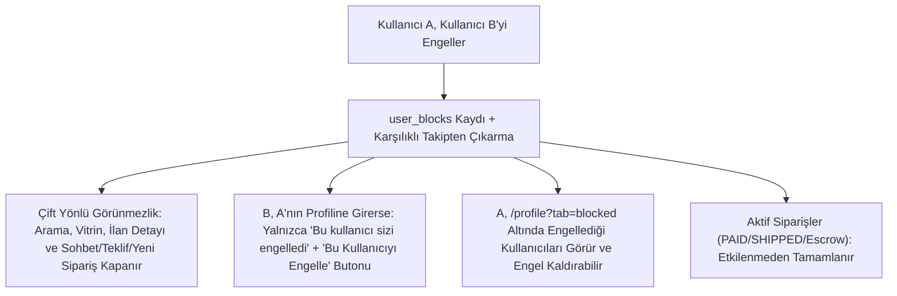

# Sohbet Moderasyonu, Kısıtlama UI Kilidi, Karşılıklı Engelleme ve Mesajlaşma Ayarları

> [!WARNING]
> **Durum: Uygulandı (V54, kontrol: 2026-11-14); modül kuralları `user/README.md` ve `chat/README.md` içindedir.** Bu doküman; moderasyon sonrası sohbet mesajlarının gizlenmesi (tombstone), yaptırım (`UserRestrictionService`) altındaki kullanıcılar için frontend aksiyon kilidi, karşılıklı kullanıcı engelleme ve hem kullanıcı (`User`) hem de ilan (`Listing`) bazında `canSendMessage` tercihinin yönetilmesini tanımlar. Güncel çalışan moderasyon kuralları için [`complaint/README.md`](../../src/main/java/com/serhat/secondhand/complaint/README.md) ve [`aura-trust-safety-and-complaint-moderation.md`](aura-trust-safety-and-complaint-moderation.md) dosyalarına bakınız.

---

## Kesinleşen Tasarım Kararları

1. **`canSendMessage` Varsayılan Değeri:** Hem `users.can_send_message` hem de `listings.can_send_message` varsayılan olarak **açık (`TRUE`)** başlar. Kullanıcı [`ProfilePage`](../../secondhand-frontend/src/user/pages/ProfilePage.jsx) üzerinden global mesaj ayarını kapattığında, yeni ilan oluşturma (`ListingBasics`) ekranında `canSendMessage` kutucuğu varsayılan olarak kapalı (`false`) gelir; satıcı oluşturma esnasında veya sonradan [`EditListingPage`](../../secondhand-frontend/src/listing/pages/EditListingPage.jsx) ile değiştirebilir.
2. **Karşılıklı Engelleme ve Karşı-Engelleme:** Bir kullanıcı diğerini engellediğinde engelleme **çift yönlü tam görünmezlik** uygular; iki taraf da birbirinin ilanlarını (vitrin, arama, kategori, kullanıcı profili, detay) veya profil bilgilerini göremez; sohbet, teklif ve yeni sipariş akışları kapatılır. Ancak engellenen kullanıcı, kendisini engelleyenin `/users/:userId` profil sayfasını açtığında yalnızca *"Bu kullanıcı sizi engelledi."* uyarısını ve **kendisini engelleyen kişiyi de engelleyebilmesi** için **"Bu Kullanıcıyı Engelle"** aksiyonunu görür (karşı engelleme yapmışsa *"Engeli Kaldır"* butonu sunulur).
3. **`canSendMessage` Sonradan Kapatıldığında Mevcut Sohbetler:** Satıcı bir ilanın `canSendMessage` ayarını sonradan `false` yaparsa (veya direkt profil sohbeti için global `canSendMessage = false` ise) **hiç kimse artık mesaj gönderemez** — önceden açılmış mevcut sohbet odaları da kilitlenir.
4. **Devam Eden Aktif Siparişler:** Engelleme anında iki taraf arasında henüz tamamlanmamış aktif bir sipariş (`PAID`, `PROCESSING`, `SHIPPED`, `DELIVERED` / aktif `Escrow`) varsa mevcut sipariş süreci etkilenmeden tamamlanır; yeni sipariş, teklif ve mesajlaşma kapatılır.
5. **Profil Ayarları ve Engellenen Kullanıcılar Endpoint'leri:** Backend'de `GET/PATCH /api/v1/users/me/settings` (global `canSendMessage` yönetimi) ve `GET /api/v1/users/me/blocked-users` (engellenen kullanıcılar listesi) endpoint'leri eklenerek [`ProfilePage`](../../secondhand-frontend/src/user/pages/ProfilePage.jsx) arayüzüne bağlanır.

---

## 1. Moderasyon Sonucu Sohbet Mesajının Kaldırılması (Tombstone / Soft-Redact)

Şikayet bir sohbet mesajıyla ilgiliyse (`reportedMessageId != null`) ve Aura incelemesi sonucunda ihlal (`RESOLVED`) kararı verilirse mesaj satırı veritabanından fiziksel olarak silinmez; içeriği `client`lardan gizlenir ve sohbette sistem uyarısı gösterilir. Böylece olası itiraz (`Appeal`) incelemesinde [`ChatTranscriptService`](../../src/main/java/com/serhat/secondhand/chat/application/ChatTranscriptService.java) orijinal metni Aura'ya sunmaya devam edebilir ve itiraz onaylanırsa (`APPROVED`) mesaj geri açılabilir.

### 1.1. Veritabanı ve Domain Değişiklikleri

```sql
-- V54__chat_moderation_user_blocks_and_message_preferences.sql
ALTER TABLE messages
    ADD COLUMN IF NOT EXISTS removed_by_moderation BOOLEAN NOT NULL DEFAULT FALSE,
    ADD COLUMN IF NOT EXISTS removed_at TIMESTAMP NULL;
```

* [`Message`](../../src/main/java/com/serhat/secondhand/chat/entity/Message.java): `removedByModeration` (`boolean`, varsayılan `false`) ve `removedAt` (`LocalDateTime`) alanları eklenir.
* [`ChatMessageDto`](../../src/main/java/com/serhat/secondhand/chat/dto/ChatMessageDto.java): `removedByModeration` (`boolean`) alanı eklenir.
* [`ChatMessageMapper`](../../src/main/java/com/serhat/secondhand/chat/mapper/ChatMessageMapper.java): `message.isRemovedByModeration()` `true` ise `dto.setRemovedByModeration(true)` atanır ve **`dto.setContent(null)`** yapılır; ihlal içeren ham metin ağ üzerinden frontend'e gönderilmez.

### 1.2. Yaptırım ve İtiraz Akışı (`SanctionExecutor`)

* [`SanctionExecutor`](../../src/main/java/com/serhat/secondhand/complaint/review/SanctionExecutor.java) `apply(...)` içinde: `penalty != PenaltyAction.NONE` (`WARNING` dahil) ve `complaint.getReportedMessageId() != null` olduğunda ilgili [`Message`](../../src/main/java/com/serhat/secondhand/chat/entity/Message.java) kaydı `removedByModeration = true` ve `removedAt = now` olarak güncellenir.
* `SanctionExecutor.reverse(...)` içinde: İtiraz `APPROVED` olup yaptırım kaldırıldığında `complaint.getReportedMessageId() != null` ise `removedByModeration = false` ve `removedAt = null` yapılarak mesaj sohbet geçmişine geri yüklenir.
* [`ChatTranscriptService`](../../src/main/java/com/serhat/secondhand/chat/application/ChatTranscriptService.java): İtiraz incelemesinde Aura'nın tam bağlamı değerlendirebilmesi için veritabanındaki ham `message.getContent()` değerini okumaya devam eder.

### 1.3. Frontend Görünümü

* [`MessageList`](../../secondhand-frontend/src/chat/components/MessageList.jsx): `message.removedByModeration === true` olan mesajlarda standart mesaj balonu ve Sil / Şikayet Et butonları yerine soluk uyarı kutusu içinde ShieldAlert ikonuyla *"Bu mesaj topluluk kuralları ihlali nedeniyle sistem tarafından silindi."* metni gösterilir.
* [`ChatRoomListItem`](../../secondhand-frontend/src/chat/components/ChatRoomListItem.jsx) ve [`ChatList`](../../secondhand-frontend/src/chat/components/ChatList.jsx): Oda listesi son mesaj önizlemesinde moderasyonla kaldırılmış mesajlar *"Bu mesaj sistem tarafından silindi."* olarak özetlenir.

---

## 2. Kısıtlanan Özelliklerin Frontend'de Tıklanamaz (`disabled`) Olması

Backend'deki `GET /api/v1/users/me/restriction` ucu ([`UserController`](../../src/main/java/com/serhat/secondhand/user/api/UserController.java)) [`RestrictionStatusDto`](../../src/main/java/com/serhat/secondhand/user/application/UserRestrictionService.java) üzerinden `canSendMessage`, `canCreateListing`, `canMakeOffer`, `canCheckout` ve `bannedUntil` alanlarını döndürür. [`useComplaints`](../../secondhand-frontend/src/complaint/hooks/useComplaints.js) içindeki `useMyRestriction()` hook'u şu yüzeylere bağlanır:

| Kısıtlama Alanı | Etkilenen Frontend Bileşenleri | Davranış |
| :--- | :--- | :--- |
| `canSendMessage === false` | [`ChatInput`](../../secondhand-frontend/src/chat/components/ChatInput.jsx), [`ContactSellerButton`](../../secondhand-frontend/src/chat/components/ContactSellerButton.jsx) | Mesaj kutusu ve iletişim butonları `disabled` yapılır; kısıtlama açıklaması gösterilir. |
| `canCreateListing === false` | [`UserProfileHeader`](../../secondhand-frontend/src/user/components/UserProfileHeader.jsx), [`CreateListingPage`](../../secondhand-frontend/src/listing/pages/CreateListingPage.jsx) | İlan oluşturma butonları `disabled` olur; sayfaya doğrudan gidilirse form yerine [`RestrictionBanner`](../../secondhand-frontend/src/complaint/components/RestrictionBanner.jsx) gösterilir. |
| `canMakeOffer === false` | [`ListingBuyBox`](../../secondhand-frontend/src/listing/components/ListingBuyBox.jsx), [`ChatHeader`](../../secondhand-frontend/src/chat/components/ChatHeader.jsx), [`InChatOfferCard`](../../secondhand-frontend/src/chat/components/InChatOfferCard.jsx) | *"Teklif Ver"* ve *"Karşı Teklif"* butonları `disabled` olur. |
| `canCheckout === false` | [`ListingBuyBox`](../../secondhand-frontend/src/listing/components/ListingBuyBox.jsx), sepet ve ödeme adımları | *"Sepete Ekle"* / *"Hemen Al"* ve checkout aksiyonları `disabled` olur. |

---

## 3. Karşılıklı Kullanıcı Engelleme ve Profil Listesi



### 3.1. Veritabanı Şeması ve Yeni Bileşenler

```sql
-- V54__chat_moderation_user_blocks_and_message_preferences.sql
CREATE TABLE IF NOT EXISTS user_blocks (
    id BIGSERIAL PRIMARY KEY,
    blocker_id BIGINT NOT NULL REFERENCES users(id) ON DELETE CASCADE,
    blocked_id BIGINT NOT NULL REFERENCES users(id) ON DELETE CASCADE,
    created_at TIMESTAMP NOT NULL DEFAULT CURRENT_TIMESTAMP,
    CONSTRAINT uq_user_blocks_pair UNIQUE (blocker_id, blocked_id),
    CONSTRAINT chk_user_blocks_not_self CHECK (blocker_id <> blocked_id)
);

CREATE INDEX IF NOT EXISTS idx_user_blocks_blocker ON user_blocks (blocker_id);
CREATE INDEX IF NOT EXISTS idx_user_blocks_blocked ON user_blocks (blocked_id);
```

`user` modülü altına eklenecek bileşenler (henüz oluşturulmadı):
* **UserBlock** entity ve **UserBlockRepository**.
* **UserBlockService**:
  * `blockUser(blockerId, blockedId)`: Kendini engellemeyi reddeder, idempotent kayıt oluşturur ve varsa iki yönlü [`SellerFollow`](../../src/main/java/com/serhat/secondhand/follow/entity/SellerFollow.java) ilişkisini kaldırır.
  * `unblockUser(blockerId, blockedId)`: Kullanıcının kendi engelleme kaydını siler (karşı tarafın ayrıca attığı engel varsa bağımsız olarak kalır).
  * `getBlockStatus(viewerId, targetUserId)`: `blockedByMe`, `blockedMe` ve `eitherBlocked` alanlarını içeren **BlockStatusDto** döner.
  * `getBlockedUsers(blockerId)`: Kullanıcının engellediği hesapları (`id`, `name`, `surname`, `profileImageUrl`, `blockedAt`) **BlockedUserDto** listesi olarak döner.
  * `getMutuallyHiddenUserIds(viewerId)`: Kullanıcının engellediği ve kullanıcıyı engelleyen tüm satıcı/alıcı ID'lerini birleştirerek sorgu filtrelerine verir.

### 3.2. API Uçları (`UserController`)

* `POST /api/v1/users/{userId}/block` — Kullanıcıyı engelle.
* `DELETE /api/v1/users/{userId}/block` — Engeli kaldır.
* `GET /api/v1/users/{userId}/block-status` — İki yönlü engel durumunu (**BlockStatusDto**) döner.
* `GET /api/v1/users/me/blocked-users` — Engellediğim kullanıcılar listesini (**BlockedUserDto**) döner.

### 3.3. Görünürlük, İletişim ve Aktif Sipariş Kuralları

* **Profil Erişimi ([`UserController`](../../src/main/java/com/serhat/secondhand/user/api/UserController.java) & [`ListingQueryService`](../../src/main/java/com/serhat/secondhand/listing/application/common/ListingQueryService.java)):** `GET /api/v1/users/{id}` ve `GET /api/v1/users/{id}/listings` çağrılarında iki kullanıcı arasında herhangi bir yönde engel varsa profil verisi ve ilan listesi döndürülmez; `403 Forbidden` (engel yönünü ayırt eden hata kodu ile) dönülür.
* **İlan Arama, Vitrin ve Detay ([`ListingSearchService`](../../src/main/java/com/serhat/secondhand/listing/application/query/ListingSearchService.java), [`GenericListingFilterService`](../../src/main/java/com/serhat/secondhand/listing/application/filter/GenericListingFilterService.java), [`ShowcaseService`](../../src/main/java/com/serhat/secondhand/showcase/application/ShowcaseService.java)):** Oturum açmış kullanıcının `getMutuallyHiddenUserIds(viewerId)` kümesindeki satıcılara ait ilanlar arama, kategori filtresi ve vitrin sonuçlarından hariç tutulur; tekil ilan detayında (`GET /api/v1/listings/{id}`) erişim engellenir.
* **Sohbet, Teklif ve Yeni Sipariş ([`ChatService`](../../src/main/java/com/serhat/secondhand/chat/application/ChatService.java), [`OfferService`](../../src/main/java/com/serhat/secondhand/offer/application/OfferService.java), [`CartService`](../../src/main/java/com/serhat/secondhand/cart/application/CartService.java), [`CheckoutOrchestrator`](../../src/main/java/com/serhat/secondhand/checkout/application/CheckoutOrchestrator.java)):** İki taraf arasında engel varsa yeni sohbet odası açma, mesaj gönderme, teklif verme/kabul etme, sepete ekleme ve yeni checkout işlemleri reddedilir.
* **Devam Eden Aktif Siparişlerin Korunması:** Mevcut `PAID`, `PROCESSING`, `SHIPPED`, `DELIVERED` aşamasındaki siparişler ve aktif [`Escrow`](../../src/main/java/com/serhat/secondhand/escrow/domain/entity/Escrow.java) süreçleri ([`OrderShippingService`](../../src/main/java/com/serhat/secondhand/order/application/OrderShippingService.java), [`OrderCompletionService`](../../src/main/java/com/serhat/secondhand/order/application/OrderCompletionService.java), [`OrderQueryService`](../../src/main/java/com/serhat/secondhand/order/application/OrderQueryService.java), [`OrderRefundService`](../../src/main/java/com/serhat/secondhand/order/application/OrderRefundService.java), [`EscrowService`](../../src/main/java/com/serhat/secondhand/escrow/application/EscrowService.java)) engellemeden etkilenmeden normal şekilde tamamlanır.

### 3.4. Frontend Yüzeyleri

* [`UserProfilePage`](../../secondhand-frontend/src/user/pages/UserProfilePage.jsx):
  * Arada engel varsa hedef kullanıcının hiçbir profil verisi, `badge`'i veya ilanı render edilmez.
  * **Engellenen kullanıcı (`blockedMe === true`) ziyaret ederse:** Ekranda yalnızca sade bir kart içinde *"Bu kullanıcı sizi engelledi."* mesajı gösterilir; ayrıca kullanıcının kendisini engelleyeni de engelleyebilmesi için **"Bu Kullanıcıyı Engelle"** butonu (zaten karşılıklı engellemişse **"Engeli Kaldır"**) sunulur.
  * **Sadece engelleyen (`blockedByMe === true && !blockedMe`) ziyaret ederse:** *"Bu kullanıcıyı engellediniz."* bilgisi ve *"Engeli Kaldır"* butonu gösterilir.
* [`ProfilePage`](../../secondhand-frontend/src/user/pages/ProfilePage.jsx):
  * **"Engellediğim Kullanıcılar (`blocked`)"** sekmesi ve **BlockedUsersList** bileşeni eklenir; `GET /api/v1/users/me/blocked-users` listesini gösterip tek tıkla engel kaldırma aksiyonu sunar.
* [`UserProfileHeader`](../../secondhand-frontend/src/user/components/UserProfileHeader.jsx) ve [`ChatHeader`](../../secondhand-frontend/src/chat/components/ChatHeader.jsx):
  * *"Kullanıcıyı Engelle"* aksiyonu eklenir; engelleme sonrası ilgili odada [`ChatInput`](../../secondhand-frontend/src/chat/components/ChatInput.jsx) kilitlenir.

---

## 4. Global (`User`) ve İlan Bazlı (`Listing`) `canSendMessage` Ayarı

```mermaid
flowchart LR
    P["ProfilePage -> Hesap & Güvenlik (GET/PATCH /api/v1/users/me/settings)"] -->|users.can_send_message (Default TRUE)| G["Global Mesaj Ayarı"]
    G -->|İlan Oluştururken Varsayılan Değer| C["ListingBasics (canSendMessage)"]
    C -->|Satıcı Değiştirebilir| L["listings.can_send_message"]
    L -->|Sonradan Düzenlenebilir| E["EditListingPage"]
    L -->|false Olursa| K["Mevcut + Yeni Tüm Sohbetler & İletişim Butonu Kilitlenir"]
```

### 4.1. Veritabanı ve Kullanıcı Ayarları Endpoint'i

```sql
-- V54__chat_moderation_user_blocks_and_message_preferences.sql
ALTER TABLE users
    ADD COLUMN IF NOT EXISTS can_send_message BOOLEAN NOT NULL DEFAULT TRUE;

ALTER TABLE listings
    ADD COLUMN IF NOT EXISTS can_send_message BOOLEAN NOT NULL DEFAULT TRUE;
```

* [`User`](../../src/main/java/com/serhat/secondhand/user/domain/entity/User.java), [`UserDto`](../../src/main/java/com/serhat/secondhand/user/domain/dto/UserDto.java) ve [`PublicUserProfileDto`](../../src/main/java/com/serhat/secondhand/user/domain/dto/PublicUserProfileDto.java): `canSendMessage` (`boolean`, varsayılan `true`) alanı eklenir.
* [`UserController`](../../src/main/java/com/serhat/secondhand/user/api/UserController.java):
  * `GET /api/v1/users/me/settings` — Kullanıcının global ayarlarını (**UserSettingsDto**: `canSendMessage`) döner.
  * `PATCH /api/v1/users/me/settings` — **UpdateUserSettingsRequest** (`{ canSendMessage }`) ile global mesajlaşma tercihini günceller ve güncel ayar nesnesini döner.

### 4.2. İlan Modeli (`allowMeetup` Mimarisi ile Aynı Akış)

* [`Listing`](../../src/main/java/com/serhat/secondhand/listing/domain/entity/Listing.java): `canSendMessage` (`boolean`, varsayılan `true`) kolonu eklenir.
* [`BaseListingCreateRequest`](../../src/main/java/com/serhat/secondhand/listing/domain/dto/request/common/BaseListingCreateRequest.java): `Boolean canSendMessage` eklenir (alan gönderilmezse satıcının global `user.isCanSendMessage()` değeri devralınır).
* [`BaseListingUpdateRequest`](../../src/main/java/com/serhat/secondhand/listing/domain/dto/request/common/BaseListingUpdateRequest.java): `Boolean canSendMessage` eklenir ([`EditListingPage`](../../secondhand-frontend/src/listing/pages/EditListingPage.jsx) üzerinden sonradan açılıp kapatılabilir).
* [`ListingDto`](../../src/main/java/com/serhat/secondhand/listing/domain/dto/response/listing/ListingDto.java) & [`ListingMapper`](../../src/main/java/com/serhat/secondhand/listing/domain/mapper/ListingMapper.java): 6 vertical'ın `toEntity` metotları ve `updateBaseFields` metodu `canSendMessage` alanını eşler.

### 4.3. Sohbet ve Frontend Kilit Kuralları

* **Backend ([`ChatService`](../../src/main/java/com/serhat/secondhand/chat/application/ChatService.java)):**
  * Yeni ilan sohbeti (`createListingChatRoom`) açılırken `listing.isCanSendMessage()` kontrol edilir (`false` ise reddedilir).
  * Yeni direkt sohbet (`createDirectChatRoom`) açılırken hedef kullanıcının `canSendMessage` ayarı kontrol edilir (`false` ise reddedilir).
  * Mesaj gönderiminde (`sendMessage`, hem REST hem WebSocket STOMP `/app/chat.send`): Odanın bağlı olduğu ilan varsa `listing.isCanSendMessage()`; direkt sohbet ise alıcı/katılımcı global `canSendMessage` durumu doğrulanır. Sonradan `false` yapılmışsa mevcut açık odalarda da **hiç kimse mesaj atamaz**.
  * [`ChatRoomDto`](../../src/main/java/com/serhat/secondhand/chat/dto/ChatRoomDto.java): Sohbet odasının kilitli olup olmadığını frontend'e bildiren `messagingDisabled` ve `messagingDisabledReason` alanları eklenir.
* **Frontend:**
  * [`ProfilePage`](../../secondhand-frontend/src/user/pages/ProfilePage.jsx) / [`ProfileAccountStatus`](../../secondhand-frontend/src/user/components/ProfileAccountStatus.jsx): *"Mesaj Almaya İzin Ver (Global)"* anahtarı `GET/PATCH /api/v1/users/me/settings` ucuyla senkronize çalışır.
  * [`ListingBasics`](../../secondhand-frontend/src/common/components/forms/ListingBasics.jsx) ve [ilan tipleri](../../secondhand-frontend/src/listing/types/index.js): `allowMeetup` seçeneğinin yanına **`canSendMessage` (*"Alıcılar bu ilan için mesaj gönderebilsin"*)** onay kutusu eklenir. İlan oluşturma başlangıcında kullanıcının global ayarı (`user?.canSendMessage ?? true`) varsayılan değer olarak yüklenir; kullanıcı global ayarını kapattıysa kutucuk varsayılan kapalı gelir ve oluşturma veya [`EditListingPage`](../../secondhand-frontend/src/listing/pages/EditListingPage.jsx) adımında serbestçe değiştirilebilir.
  * [`ContactSellerButton`](../../secondhand-frontend/src/chat/components/ContactSellerButton.jsx) & [`ChatInput`](../../secondhand-frontend/src/chat/components/ChatInput.jsx): İlan veya profil mesajlaşması kapalıysa iletişim butonu ve açık sohbet girişi `disabled` hale getirilir.
