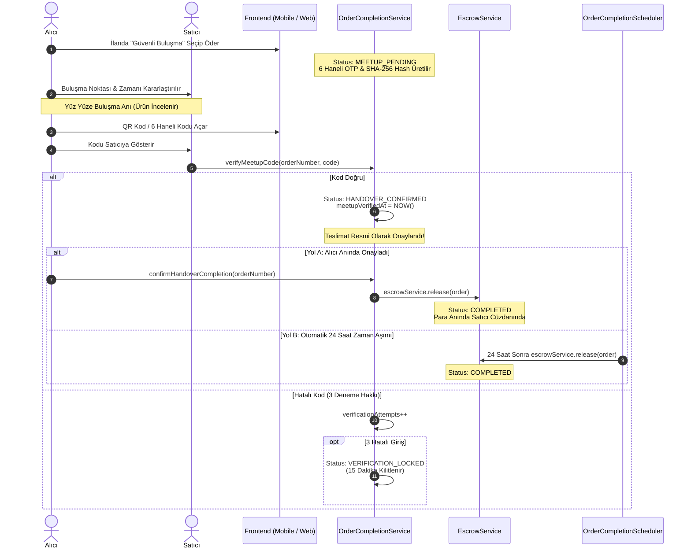

# Güvenli Buluşma (Safe Meetup) ve Yüz Yüze Teslimat Doğrulama Rehberi

Bu doküman, **secondHand** platformundaki **Güvenli Buluşma (Safe Meetup)** teslimat modelini, **SHA-256 Kriptografik OTP & QR Doğrulama Sistemini**, **Brute-Force Kilit Mekanizmasını (`VERIFICATION_LOCKED`)** ve **24 Saatlik Otomatik Tamamlama Yaşam Döngüsünü** detaylandırmaktadır.

---

## 1. Problem Tanımı ve Safe Meetup Güvenlik Modeli

İkinci el alışverişte kargo masrafından kaçınmak veya ürünü görerek almak isteyen kullanıcılar yüz yüze buluşmayı tercih eder. Ancak geleneksel elden teslimatta şu riskler oluşur:
1. **Nakit / Sahte Para Riski:** Elden nakit alışverişte sahte para veya gasp tehlikesi.
2. **"Ürünü Aldım Ama Almadım Dedi" Çelişkisi:** Kargo takip numarası olmadığı için alıcının teslim aldığı ürünü inkar etmesi veya satıcının ürünü vermeden "teslim ettim" demesi.
3. **Escrow Kilidi:** Kargo belgesi olmayan bir işlemde havuzdaki paranın satıcıya ne zaman ve nasıl aktarılacağı belirsizliği.

### secondHand Güvenli Buluşma Çözümü:
* **Ödeme Önceden Escrow'da:** Alıcı ödemeyi platform üzerinden yapar; para escrow'da bloke edilir (`MEETUP_PENDING`).
* **Alıcıya Özel Kod / QR:** Alıcıya 6 haneli, 5 dakika geçerli bir teslimat doğrulama kodu ve aynı kodu taşıyan QR verilir; süresi dolan kodu alıcı yeniler.
* **Fiziksel Teslim Anında Doğrulama:** Buluşma anında alıcı ürünü inceler, beğenirse kodu satıcıya gösterir. Satıcı kodu sisteme girdiğinde teslimat kesinleşir (`HANDOVER_CONFIRMED`).
* **Escrow'un Serbest Bırakılması:** Kod doğrulandıktan sonra alıcı ya da satıcı tamamlamayı onaylar; onay gelmezse 24 saat sonra sistem tamamlar. Para satıcının cüzdanına bu adımda aktarılır.

---

## 2. Uçtan Uca Güvenli Buluşma Sıralama Diyagramı



---

## 3. Durum Makinesi ve Güvenlik Seviyeleri

| Durum | Açıklama | Alıcı / Satıcı Aksiyonu |
| :--- | :--- | :--- |
| **`MEETUP_PENDING`** | Ödeme alındı, buluşma bekleniyor. | Alıcı kodu görüntüler ve yeniler. Yalnızca **alıcı** iptal edebilir. Alıcı kod olmadan da tamamlamayı onaylayabilir. 7 gün içinde tamamlanmazsa sistem iptal eder. |
| **`VERIFICATION_LOCKED`** | Satıcı 3 kez üst üste yanlış kod girdi. | Doğrulama 15 dakika reddedilir. |
| **`HANDOVER_CONFIRMED`** | Kod doğrulandı; ürün el değiştirdi. | İptal edilemez. Alıcı ya da satıcı tamamlamayı onaylar; onay gelmezse 24 saat sonra sistem tamamlar. |
| **`COMPLETED`** | Escrow serbest bırakıldı; para satıcının e-cüzdanına aktarılır. | Terminal. |

### Endpoint'ler (`/api/v1/orders`)

| Endpoint | Kim | Açıklama |
| :--- | :--- | :--- |
| `POST /{order-number}/verify-meetup` | Satıcı | Kodu doğrular → `HANDOVER_CONFIRMED`. |
| `POST /{order-number}/confirm-handover-completion` | Alıcı ya da satıcı (`MEETUP_PENDING`'de yalnızca alıcı) | Siparişi tamamlar, escrow'u serbest bırakır. |
| `GET /{order-number}/qr-code` | Alıcı | Kodu içeren 250×250 PNG. |
| `POST /{order-number}/regenerate-meetup-code` | Alıcı | Yeni kod üretir (en erken 30 sn sonra). |

Siparişin tarafı olmayan kullanıcı `NOT_AUTHORIZED_FOR_ORDER` alır.

---

## 4. Kritik Güvenlik ve Teknik Mekanizmalar

### A. Kodun Üretimi ve Saklanması
[`Order.generateVerificationCode`](../src/main/java/com/serhat/secondhand/order/entity/Order.java):

```java
String raw = String.format("%06d", VERIFICATION_CODE_RANDOM.nextInt(1000000));
this.meetupVerificationCode = raw;                       // alıcıya gösterilen kod
this.meetupVerificationCodeHash = hashSha256(raw);       // doğrulamada kullanılan hash
this.verificationAttempts = 0;
this.verificationLockedUntil = null;
this.meetupVerificationCodeGeneratedAt = LocalDateTime.now();
```

* Doğrulama hash üzerinden yapılır: satıcının girdiği kod `Order.hashSha256` ile hash'lenir ve `meetupVerificationCodeHash` ile karşılaştırılır.
* Kod ayrıca `meetup_verification_code` kolonunda **açık metin** olarak da durur; alıcıya kodu ve QR'ı tekrar gösterebilmek için kullanılır. Yani hash, veritabanına erişen birine karşı kodu gizlemez.

---

### B. Zaman Aşımı & Yenileme Sınırları (Throttling)
* **Kod Geçerlilik Süresi:** Kod üretildikten sonra **5 dakika** içinde kullanılmalıdır (`MEETUP_CODE_EXPIRED`).
* **Yeniden Üretim Sınırı:** Alıcı yeni kod üretmek isterse (`regenerateMeetupCode`) son üretimden itibaren en az **30 saniye** geçmiş olmalıdır; aksi halde `RATE_LIMIT_EXCEEDED` döner.
* Süre kontrolü kilit kontrolünden önce yapılır: süresi dolmuş kodla gelen deneme `MEETUP_CODE_EXPIRED` alır ve deneme sayacını artırmaz.

---

### C. Brute-Force Kaba Kuvvet Koruması (`VERIFICATION_LOCKED`)
[`OrderCompletionService.java`](../src/main/java/com/serhat/secondhand/order/application/OrderCompletionService.java) üzerinde:
```java
// Kilit süresi dolduysa sayaç sıfırlanır ve sipariş MEETUP_PENDING'e döner
if (order.getVerificationLockedUntil() != null) {
    if (order.getVerificationLockedUntil().isAfter(LocalDateTime.now())) {
        return Result.error("Verification is locked until " + order.getVerificationLockedUntil(),
                OrderErrorCodes.VERIFICATION_LOCKED.getCode());
    } else {
        order.setVerificationAttempts(0);
        order.setVerificationLockedUntil(null);
        if (order.getStatus() == OrderStatus.VERIFICATION_LOCKED) {
            order.setStatus(OrderStatus.MEETUP_PENDING);
        }
    }
}
...
int newAttempts = order.getVerificationAttempts() + 1;
order.setVerificationAttempts(newAttempts);
if (newAttempts >= 3) {
    order.setStatus(OrderStatus.VERIFICATION_LOCKED);
    order.setVerificationLockedUntil(LocalDateTime.now().plusMinutes(15));
    ...
    return Result.error("Too many failed attempts. Verification locked for 15 minutes.", OrderErrorCodes.VERIFICATION_LOCKED.getCode());
} else {
    return Result.error("Meetup verification code is incorrect. Attempts left: " + (3 - newAttempts),
            OrderErrorCodes.MEETUP_VERIFICATION_FAILED.getCode());
}
```
* 3. hatalı denemede sipariş `VERIFICATION_LOCKED` olur ve 15 dakika boyunca her deneme `VERIFICATION_LOCKED` hatası alır.
* Kilit süresi dolduktan sonraki ilk denemede sayaç sıfırlanır ve durum `MEETUP_PENDING`'e döner.
* **Dikkat:** `generateVerificationCode` sayacı ve `verificationLockedUntil`'ı sıfırlar. Alıcı kilit sırasında kodu yenilerse 15 dakikalık kilit kalkar (durum `VERIFICATION_LOCKED` kalır ama doğrulama bu durumda da kabul edilir). Kilit, satıcının tek başına deneme yapmasını sınırlar; alıcıyla birlikte hareket eden satıcıyı sınırlamaz.

---

### D. QR Kod ile Hızlı Doğrulama
* [`generateMeetupQrCode`](../src/main/java/com/serhat/secondhand/order/application/OrderCompletionService.java) yalnızca alıcıya, içeriği 6 haneli kodun kendisi olan 250×250 PNG üretir (ZXing `QRCodeWriter`). Kod henüz yoksa o anda üretilir.
* QR bir URL ya da imza taşımaz; satıcı okuduğu kodu `verify-meetup` endpoint'ine gönderir.

---

### E. Otomatik Serbest Bırakma (24 Saatlik Garanti)
* Ürün elden teslim edilip `HANDOVER_CONFIRMED` statüsüne geçtikten sonra, alıcı eve gidip onay vermeyi unutursa satıcı mağdur edilmez.
* [`OrderCompletionScheduler.java`](../src/main/java/com/serhat/secondhand/order/application/OrderCompletionScheduler.java) `meetupVerifiedAt` üzerinden 24 saat geçtiyse siparişi tamamlar ve `escrowService.release` çağırır; para `escrow_outbox_events` → `escrow.released.v1` yoluyla satıcının cüzdanına aktarılır ([escrow dokümanı](escrow-lifecycle-and-state-machine.md)). Scheduler 5 dakikada bir çalıştığı için tamamlanma 24 saatten birkaç dakika sonra olabilir.
* `MEETUP_PENDING` siparişi 7 gün içinde tamamlanmazsa aynı scheduler escrow'u iptal eder ve parayı alıcıya iade eder.

---

## 5. Hata ve Uyuşmazlık Senaryoları Matrisi

| Senaryo | Ne Olur? | Sistemin Çözümü |
| :--- | :--- | :--- |
| **Alıcı Buluşmaya Gelmedi** | Ürün teslim edilmedi, kod verilmedi. | Sipariş `MEETUP_PENDING` kalır. Alıcı iptal edebilir; satıcının iptal yetkisi yoktur. Kimse işlem yapmazsa 7 gün sonra sistem iptal eder ve para alıcıya döner. |
| **Alıcı Ürünü Beğenmedi** | Fiziksel kontrolde kusur tespit edildi. | Alıcı kodu satıcıya **vermez**. Siparişi iptal eder; escrow havuzundaki para alıcı cüzdanına döner, satıcı ürününü geri alır. |
| **Satıcı Kodu Tahmin Etmeye Çalıştı** | Art arda denemeler yaptı. | 3. yanlış denemede sistem 15 dakika kilitlenir (`VERIFICATION_LOCKED`). |
| **Kodun Süresi Doldu** | Kod 5 dakikadan eski. | Doğrulama `MEETUP_CODE_EXPIRED` döner; alıcı `regenerate-meetup-code` ile yeni kod üretir. Kod 5 dakika geçerli olduğu için önceden alınan ekran görüntüsü buluşma anında geçersiz olabilir. |
