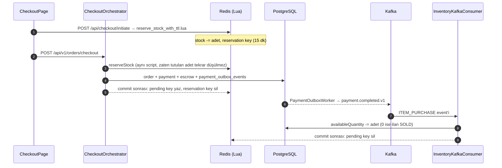
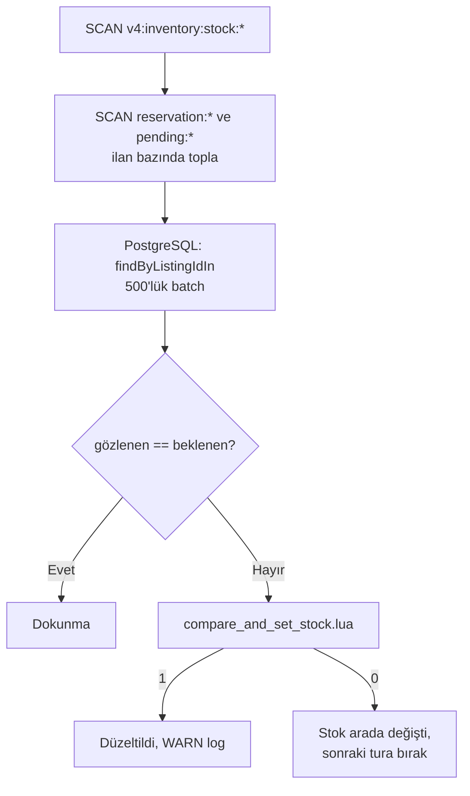

# Stok Rezervasyonu ve Reconciliation Rehberi

Bu doküman stoğun Redis'te nasıl rezerve edildiğini, ödeme sonrası PostgreSQL'e nasıl yansıdığını ve iki taraf arasındaki farkın (drift) nasıl onarıldığını anlatır. Kod blokları projeden alınmıştır. Modül özeti: [inventory/README.md](../src/main/java/com/serhat/secondhand/inventory/README.md).

İlgili dokümanlar: [redis-and-kafka-architecture.md](redis-and-kafka-architecture.md), [order-lifecycle-and-compensation-management.md](order-lifecycle-and-compensation-management.md).

---

## 1. Neden iki ayrı stok kaydı var?

| Kayıt | Nerede | Görevi |
| :--- | :--- | :--- |
| Satılabilir stok | Redis, `v4:inventory:stock:{listingId}` | Checkout anında hızlı ve atomik kontrol. Satır kilidi (`SELECT ... FOR UPDATE`) beklenmez. |
| Kalıcı stok | PostgreSQL, `Inventory.availableQuantity` | Asıl kayıt. Ödeme tamamlandıktan sonra Kafka consumer'ı ile düşülür. |

İki kayıt aynı anda güncellenmediği için aralarında kısa süreli fark olması normaldir. Bu farkın **kimin elinde olduğu** Redis'teki iki yardımcı key ile takip edilir; reconciliation job'u yalnızca bu key'lerle açıklanamayan farkı düzeltir.

## 2. Redis key'leri

Sabitler [`InventoryRedisReservationService`](../src/main/java/com/serhat/secondhand/inventory/application/InventoryRedisReservationService.java) içindedir:

```java
public static final String STOCK_KEY_PREFIX = "v4:inventory:stock:";
public static final String RESERVATION_KEY_PREFIX = "v4:inventory:reservation:";
public static final String PENDING_PURCHASE_KEY_PREFIX = "v4:inventory:pending:";
static final Duration PENDING_PURCHASE_TTL = Duration.ofHours(24);
```

| Key | Değer | TTL | Anlamı |
| :--- | :--- | :--- | :--- |
| `v4:inventory:stock:{listingId}` | adet | yok | Şu an kimsenin tutmadığı, satılabilir adet. |
| `v4:inventory:reservation:{userId}:{listingId}` | adet | 15 dk (`app.checkout.reservation-ttl-seconds`, varsayılan 900) | Kullanıcının checkout sırasında tuttuğu adet. |
| `v4:inventory:pending:{orderItemId}:{listingId}` | adet | 24 saat (yalnızca emniyet) | Ödemesi alınmış ama PostgreSQL'den henüz düşülmemiş adet. |

Rezervasyon ve pending key'lerinin son parçası her zaman `listingId`'dir; reconciliation ikisini aynı yöntemle toplar.

---

## 3. Uçtan uca akış



### 3.1 Rezervasyon: `reserve_stock_with_ttl.lua`

[`CheckoutStockReservationService.reserveStock`](../src/main/java/com/serhat/secondhand/checkout/application/CheckoutStockReservationService.java) sepetteki her satır için script'i çağırır. Bir satır başarısız olursa o ana kadar alınan rezervasyonlar geri bırakılır:

```java
redisReservationService.reserveStockWithTtl(userId, listingId, requestedQty, reservationTtlSeconds);
reserved.merge(listingId, requestedQty, Integer::sum);
// catch (BusinessException e) -> releaseReservedStock(userId, reserved); return Result.error(...)
```

Script'in üç önemli davranışı vardır ([`reserve_stock_with_ttl.lua`](../src/main/resources/scripts/reserve_stock_with_ttl.lua)):

```lua
-- 1) Kullanıcının zaten tuttuğu adet tekrar düşülmez
local held = tonumber(redis.call('GET', reservationKey)) or 0
local delta = requestedQty - held
if held > 0 and delta <= 0 then
    return tonumber(redis.call('GET', stockKey)) or 0
end

-- 2) Stok key'i yoksa PostgreSQL'deki adetle ilk kez oluşturulur (lazy init)
if not currentStock then
    if defaultStock ~= nil and defaultStock > 0 then
        currentStock = defaultStock
        redis.call('SET', stockKey, currentStock)
    else
        return -1
    end
end

-- 3) Yeterliyse stok düşer, rezervasyon TTL ile yazılır
if currentStock >= delta then
    local remaining = redis.call('DECRBY', stockKey, delta)
    redis.call('SET', reservationKey, requestedQty, 'EX', ttlSeconds)
    return remaining
else
    return -1
end
```

- `-1` dönerse servis `INSUFFICIENT_STOCK` (`BusinessException`) fırlatır.
- Aynı adetle tekrar çağrı (sayfa yenileme, checkout'un ikinci çağrısı) erken döner; **TTL sıfırlanmaz**, sayaç kaldığı yerden devam eder. Adet artırılırsa yalnızca fark düşülür ve TTL yeniden başlar.
- `initiate` cevabındaki `remainingTtlSeconds`, kullanıcının rezervasyonları arasındaki en küçük kalan süredir.

### 3.2 Vazgeçme ve süre dolması

- **Açık iptal:** `DELETE /api/checkout/reservation/{listingId}` → [`cancel_user_reservation.lua`](../src/main/resources/scripts/cancel_user_reservation.lua) rezervasyondaki adedi okur, stoğa geri ekler, key'i siler. Stok key'i yoksa yeniden oluşturmaz.
- **Checkout hatası:** `CheckoutOrchestrator` sipariş, ödeme ya da kupon adımı hata verirse `releaseReservedStock` çağırır; commit'in kendisi başarısız olursa `releaseReservedStockOnRollback` devreye girer.
- **TTL doldu:** Rezervasyon key'i Redis tarafından silinir, ancak **stok sayacı kendiliğinden geri artmaz**. Bu adetleri geri veren mekanizma reconciliation job'udur (§4). Yani terk edilen bir checkout'un stoğu en geç 15 dk + bir job turu sonra tekrar satılabilir olur.

### 3.3 Satın alma: rezervasyon → pending işareti

Checkout transaction'ı commit olduktan sonra rezervasyon, pending işaretine çevrilir. Redis stoğu değişmez; adet hâlâ "alınmış" sayılır:

```java
public void consumeReservationOnPurchase(Long userId, UUID listingId, Long orderItemId, int quantity) {
    String reservationKey = getReservationKey(userId, listingId);
    String pendingKey = getPendingPurchaseKey(orderItemId, listingId);
    stringRedisTemplate.opsForValue().set(pendingKey, String.valueOf(quantity), PENDING_PURCHASE_TTL);
    stringRedisTemplate.delete(reservationKey);
}
```

İşaret, rezervasyon silinmeden **önce** yazılır; böylece job hiçbir anda "ne rezervasyon ne pending" görüp adedi yanlışlıkla geri vermez. Bu çağrı hata verirse rezervasyon key'i TTL'ine kadar kalır (oversell olmaz).

### 3.4 PostgreSQL düşümü: `InventoryKafkaConsumer`

[`InventoryKafkaConsumer`](../src/main/java/com/serhat/secondhand/inventory/application/InventoryKafkaConsumer.java) `payment.completed.v1` topic'ini dinler (group `inventory-sync-consumers`):

```java
if (!PaymentTransactionType.ITEM_PURCHASE.name().equals(event.transactionType())) {
    return;   // ilan ücreti, vitrin vb. ödemeler stok düşmez
}
clearPendingPurchaseAfterCommit(event);

String dedupeKey = "inventory:payment:" + event.paymentId();
int inserted = processedKafkaEventRepository.insertIfNotExists(dedupeKey, "inventory-sync-consumers");
if (inserted == 0) { return; }   // mükerrer mesaj

inventoryService.reserveQuantity(event.listingId(), quantityToDeduct);
if (inventoryService.getAvailableQuantity(event.listingId()) <= 0) {
    listing.setStatus(ListingStatus.SOLD);
}
```

- Düşüm `InventoryRepository.deductIfAvailable` ile koşullu yapılır; stok yetmezse `INSUFFICIENT_STOCK` fırlar, Kafka 2 kez daha dener ve mesaj `payment.completed.v1.DLT`'ye düşer.
- Pending işareti yalnızca transaction commit olursa silinir. Rollback'te işaret kalır ve adet tutulmaya devam eder.
- Mesaj 24 saatten uzun süre DLT'de kalırsa pending işareti TTL ile silinir; bu durumda stok elle düzeltilmelidir.

### 3.5 İptal ve iade

Sipariş iptal/iade edildiğinde stok senkron geri alınır: PostgreSQL'de `InventoryService.restoreQuantity` (aynı transaction), commit sonrası Redis'te [`release_stock.lua`](../src/main/resources/scripts/release_stock.lua). Script stok key'i yoksa oluşturmaz (`-1` döner); bir sonraki rezervasyon key'i PostgreSQL'den yükler. Ayrıntı: [order dokümanı](order-lifecycle-and-compensation-management.md).

---

## 4. Reconciliation job'u

[`StockReservationReconciliationScheduler`](../src/main/java/com/serhat/secondhand/inventory/application/StockReservationReconciliationScheduler.java) varsayılan olarak 5 dakikada bir çalışır (`app.inventory.reconciliation.fixed-delay-ms`, ilk çalışma açılıştan 60 sn sonra).

**Kural:**

```
beklenen Redis stoğu = PostgreSQL availableQuantity − aktif rezervasyonlar − pending satın almalar
```



```java
int held = heldByListing.getOrDefault(listingIdStr, 0);
int expected = inventory.getAvailableQuantity() - held;
if (expected < 0) { expected = 0; }          // tutulan adet DB'den fazlaysa 0'a çekilir
if (observedStock == expected) { return; }
boolean written = redisReservationService.compareAndSetStock(listingId, observed, expected);
```

Dikkat edilen noktalar:

- **`KEYS` kullanılmaz.** Key'ler `SCAN` ile (count 500) gezilir; Redis bloklanmaz.
- **Okuma sırası:** önce stok değeri, sonra rezervasyonlar, sonra pending işaretleri, en son PostgreSQL. Bu okumalar arasında yer değiştiren bir adet en kötü ihtimalle iki kez sayılır (düzeltme eksik kalır, sonraki turda tamamlanır); hiç sayılmaması mümkün değildir.
- **Yazma compare-and-set'tir.** [`compare_and_set_stock.lua`](../src/main/resources/scripts/compare_and_set_stock.lua) değeri yalnızca job'un okuduğu değer hâlâ duruyorsa yazar. Job çalışırken yapılan bir rezervasyon ya da iptal ezilmez:
  ```lua
  local current = redis.call('GET', KEYS[1])
  if current == ARGV[1] then
      redis.call('SET', KEYS[1], ARGV[2])
      return 1
  end
  return 0
  ```
- **Sayısal olmayan değer:** Bir ilanın rezervasyon/pending değeri okunamıyorsa o ilan atlanır; eksik sayımla düzeltme yapılmaz.
- Stok key'i olmayan ilanlar job'un kapsamında değildir; key ilk rezervasyonda oluşur.

---

## 5. Senaryo tablosu

| Senaryo | Redis'te ne olur | Kim düzeltir |
| :--- | :--- | :--- |
| Ödeme başarılı | Rezervasyon → pending; consumer düşümü commit edince pending silinir. | Düzeltme gerekmez; beklenen = gözlenen. |
| Kullanıcı checkout'tan çıktı (iptal çağrısı geldi) | `cancel_user_reservation.lua` adedi geri ekler. | Anında. |
| Kullanıcı sekmeyi kapattı | Rezervasyon 15 dk sonra silinir, stok düşük kalır. | Reconciliation, sonraki turda. |
| Checkout commit oldu ama pending yazılamadı | Rezervasyon TTL'ine kadar adedi tutar; bu sırada consumer DB'yi düşer. | Rezervasyon bitince beklenen = gözlenen olur. |
| Consumer hata aldı (retry/DLT) | Pending işareti kalır, adet tutulur. | Mesaj yeniden işlenince; 24 saati geçerse elle. |
| DB stoğu elle değişti | Redis eski değerde kalır. | Reconciliation, en geç bir tur sonra. |
| Redis stok key'i silindi | Key yok. | İlk rezervasyon PostgreSQL'den yükler. |

## 6. Bilinen sınırlar

- Job tek instance varsayımıyla yazılmıştır; dağıtık kilit (ShedLock vb.) yoktur. Birden fazla instance aynı anda çalışırsa compare-and-set sayesinde yanlış değer yazılmaz, yalnızca iş tekrarlanır.
- `reserve_stock.lua` (TTL'siz rezervasyon) ve `syncStockToRedis` serviste tanımlıdır; checkout akışı bunları kullanmaz.
- `POST /api/checkout/initiate` hata durumunda da `ResultResponses` zarfıyla döner; frontend rezervasyon alınamazsa checkout'u durdurur (`CheckoutPage`).
