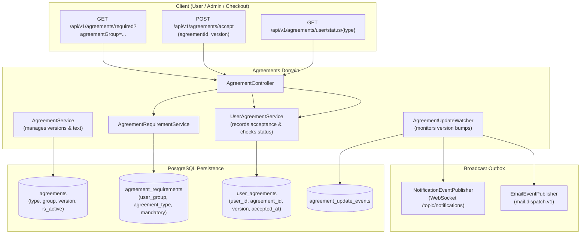

# Agreements Domain

## 1. Executive Summary & Purpose
The `agreements` domain governs legal terms, user consent policies, mandatory regulatory disclosures (KVKK, Distance Sales Contracts), version progression, and automated platform-wide notification broadcasts upon policy updates.

> [!NOTE]
> **Related Documentation & Runbooks:**
> - **Frontend Module:** [`secondhand-frontend/src/agreements/README.md`](../../../../../../../secondhand-frontend/src/agreements/README.md)
> - **Task Runbooks:**
>   - [`modify-agreement-rules.md`](.docs/runbooks/modify-agreement-rules.md) — Modify agreement validation and versioning rules

### Core Architectural Features
- **Semantic Versioning & Audit Trail:** Legal agreements track version strings (e.g. "1.0", "1.1"). Historical user acceptances are permanently preserved in `user_agreements` for legal auditing.
- **Dynamic Group Requirements:** Evaluates mandatory agreements based on user operational stage (`AgreementRequirement`: registration, checkout, seller onboarding).
- **Asynchronous Update Broadcasting:** `AgreementUpdateWatcher` tracks version increments and triggers platform-wide WebSocket notifications (`NotificationEventPublisher.publishBroadcast`) and transactional emails (`mail.dispatch.v1`).
- **Schema Startup Verification:** `AgreementSchemaStartupRunner` validates database column integrity at boot time.

---

## 2. Architecture & Lifecycle Flow

---

## 3. Core Entities & Database Schema

### 3.1 `agreements` Table
- `id` (UUID, PK)
- `type` (VARCHAR(50), maps to `AgreementType`: `TERMS_OF_SERVICE`, `PRIVACY_POLICY`, `DISTANCE_SALES_CONTRACT`, `BUYER_AGREEMENT`, `SELLER_AGREEMENT`, `KVKK_EXPLICIT_CONSENT`)
- `agreement_group` (VARCHAR(50), maps to `AgreementGroup`: `ALL_USERS`, `BUYER_ONLY`, `SELLER_ONLY`)
- `version` (VARCHAR(20), not null, e.g. `'1.0'`)
- `title` (VARCHAR(255), not null)
- `content` (TEXT, not null)
- `is_active` (BOOLEAN, default `true`)
- `created_at` / `updated_at` (Timestamps)
- *Unique Constraint:* `UNIQUE (type, version)`

### 3.2 `user_agreements` Table
- `id` (UUID, PK)
- `user_id` (BIGINT, FK -> `users.id`, not null)
- `agreement_id` (UUID, FK -> `agreements.id`, not null)
- `version` (VARCHAR(20), not null)
- `accepted_at` (TIMESTAMP, not null)
- *Indexes:* `idx_user_agreements_user`, `idx_user_agreements_agreement`

### 3.3 `agreement_requirements` Table
- `id` (UUID, PK)
- `user_group` (VARCHAR(50), e.g. `'REGISTRATION'`, `'CHECKOUT'`, `'SELLER_ONBOARDING'`)
- `agreement_type` (VARCHAR(50), maps to `AgreementType`)
- `is_mandatory` (BOOLEAN, default `true`)

---

## 4. Business Invariants & Lifecycle Rules

### 4.1 Acceptance Verification (`hasUserAcceptedAgreement`)
- Compares the latest active version in `agreements` against the maximum accepted version in `user_agreements` for that user.
- If the agreement version has incremented (e.g. from 1.0 to 1.1), `hasUserAcceptedAgreement` evaluates to `false` until the user submits a new acceptance.

### 4.2 Version Increment & Broadcast Flow
1. When an agreement text or version is bumped, an `AgreementUpdateEvent` is registered.
2. `AgreementUpdateWatcher` detects pending update events.
3. Dispatches a broadcast notification via `NotificationTemplateCatalog.agreementUpdatedBroadcast(...)`.
4. Dispatches informational notification emails via `EmailEventPublisher`.
5. Frontend clients display an unclosable acceptance modal for mandatory agreements before permitting further navigation or checkout operations.

---

## 5. Public REST API Specifications

| Method | Endpoint | Auth | Purpose | Response |
|---|---|---|---|---|
| `GET` | `/api/v1/agreements` | Public | List all active platform agreements | `List<AgreementDto>` |
| `POST` | `/api/v1/agreements/initialize` | Admin | Seed default agreements and requirements | `List<AgreementDto>` |
| `GET` | `/api/v1/agreements/required` | Public | List required agreements for a group (e.g. `REGISTRATION`) | `List<AgreementDto>` |
| `GET` | `/api/v1/agreements/{agreement-type}` | Public | Retrieve active text of specific agreement | `AgreementDto` |
| `POST` | `/api/v1/agreements/accept` | Bearer | Accept specific version of an agreement | `UserAgreementDto` |
| `GET` | `/api/v1/agreements/user/agreements` | Bearer | List of agreements accepted by current user | `List<UserAgreementDto>` |
| `GET` | `/api/v1/agreements/user/status/{agreement-type}` | Bearer | Check if user accepted the latest version | `Boolean` |
| `GET` | `/api/v1/agreements/user/acceptance-history/{agreement-id}` | Bearer | User's historical acceptances for an agreement | `List<UserAgreementDto>` |

---

## 6. Error Codes

Defined in `AgreementErrorCodes`:
- `AGREEMENT_NOT_FOUND`: Agreement record does not exist.
- `AGREEMENT_ALREADY_ACCEPTED`: User has already accepted this exact version.
- `INVALID_AGREEMENT_VERSION`: Version format or value is invalid.
- `USER_NOT_FOUND`: Authenticated user could not be found.
