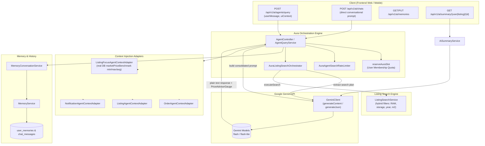

# AI (Aura) Domain

## 1. Executive Summary & Purpose
The `ai` domain orchestrates interactions with **Aura**, the marketplace's multimodal conversational assistant powered by Google Gemini LLMs. Aura bridges natural language intent with core transactional systems to provide:
1. **Semantic Multi-Vertical Search:** Translates natural language inquiries into structured multi-vertical search queries with category, location, and specification filters.
2. **Context-Aware Aligned Advice:** Injects live UI page context, user memory profiles, and real-time database market price benchmarks (`marketPriceBenchmark`) to render dynamic `<PriceAdvisorGauge>` widgets.
3. **Conversational Memory:** Extracts and updates persistent user preferences (budget, preferred categories, sizing, brands) across multi-turn sessions.
4. **Automated Review Summaries:** Synthesizes buyer feedback for sellers and individual listings into concise, actionable summaries.

---

## 2. Architecture & Pipeline



---

## 3. Aura Search Orchestration & Rate Limiting

### 3.1 Search Intent Planning (`AuraListingSearchOrchestrator`)
1. **Fast Bypass:** Simple greetings and generic conversational phrases matching `BYPASS_SEARCH_INTENT` bypass LLM planning immediately without invoking Gemini or hitting the search index.
2. **Rate Limiting:** `AuraAgentSearchRateLimiter.tryAcquire(userId)` enforces an adaptive sliding-window token bucket to prevent abuse.
3. **Structured Plan Extraction:** Prompts Gemini with JSON mode (`responseMimeType: "application/json"`) to parse the user prompt into a `SearchPlan` object containing:
   - `mode`: `SEARCH`, `DIRECT`, or `NONE`
   - `listingType`: Category enum (`VEHICLE`, `ELECTRONIC`, `REAL_ESTATE`, `BOOK`, `CLOTHING`, `SPORTS`)
   - `queryText`: Extracted search terms
   - `city` / `district`: Geographic constraints
   - Specs: `minPrice`, `maxPrice`, `minRam`, `minStorage`, `minYear`, `maxYear`, `maxMileage`, `minRoomCount`
4. **Execution & Fallback:** If `mode == NONE` and explicitly indicated, search is skipped. Otherwise, executes dynamic JPA Specification queries via `ListingSearchService` and appends live catalog results into the prompt.

---

## 4. Context Adapters & The Price Advisor Gauge

### 4.1 Granular Context Ingestion
- **`ListingFocusAgentContextAdapter`:** When the user is viewing a listing detail page, fetches specifications across all 6 verticals and computes real database market price benchmarks (`marketPriceBenchmark` min, max, average).
- **`OrderAgentContextAdapter`:** Injects recent active deliveries and orders for delivery-related queries.
- **`ListingAgentContextAdapter`:** Injects the seller's active catalog when managing inventory.
- **`NotificationAgentContextAdapter`:** Injects unread alert summaries.

### 4.2 `<PriceAdvisorGauge>` Single-Line Tag
Aura generates interactive UI widgets by emitting a specialized single-line XML tag:
```xml
<PriceAdvisorGauge min="120" max="180" avg="150" current="130" currency="TRY" status="Good Deal" />
```
The values are derived directly from the database `marketPriceBenchmark` when available, providing mathematically sound valuation advice to buyers and sellers.

---

## 5. Daily Aura Quotas & Membership Entitlements

Aura questions are gated by membership tiers:
- **`BASIC` Plan:** 5 daily queries.
- **`PLUS` Plan:** 25 daily queries.
- **`PRO` Plan:** Unlimited daily queries.

### Quota Mechanics (`GeminiAiService.reserveAuraSlot`)
- Executes an atomic conditional database update: `UPDATE users SET daily_aura_usage = daily_aura_usage + 1 WHERE id = :userId AND daily_aura_usage < :limit`.
- If the daily reset date (`daily_aura_reset_date`) has lapsed, resets the counter to 1 and stamps `now()`.
- If the limit is exceeded, throws `403 Forbidden` with error code `AURA_LIMIT_EXCEEDED`.
- If the downstream Gemini network call fails, releases the reserved slot to avoid penalizing the user.
- Review summary endpoints (`/api/v1/ai/summary/*`) are exempt from quota consumption.

---

## 6. Public REST API Specifications

| Method | Endpoint | Auth | Purpose | Response |
|---|---|---|---|---|
| `POST` | `/api/v1/ai/agents/query` | Bearer | Unified conversational search and advisor endpoint | `AgentQueryResponse` |
| `POST` | `/api/v1/ai/chats` | Bearer | Direct chat message with memory tracking | `AiResponse` |
| `POST` | `/api/v1/ai/chats/new` | Bearer | Clear chat session history and start fresh | `200 OK` |
| `DELETE` | `/api/v1/ai/chats/history` | Bearer | Purge conversation message logs | `200 OK` |
| `GET` | `/api/v1/ai/memories` | Bearer | Retrieve learned user interests and profile data | `UserMemoryDto` |
| `PUT` | `/api/v1/ai/memories` | Bearer | Update user preferences and memory profile | `UserMemoryDto` |
| `DELETE` | `/api/v1/ai/memories` | Bearer | Clear all saved user memory tags | `200 OK` |
| `GET` | `/api/v1/ai/summary/user/{user-id}` | Public | AI review summary for a seller | `AiResponse` |
| `GET` | `/api/v1/ai/summary/listing/{listing-id}` | Public | AI review summary for a listing | `AiResponse` |

---

## 7. Security & IDOR Safeguards
- **Context Isolation:** Context adapters verify that injected order, notification, and favorite data belongs exclusively to the authenticated user ID (`currentUser.getId()`).
- **Data Truncation:** Large text payloads are clamped to prevent token window overflow and prompt injection tampering.
- **Strict Read-Only Persona:** Aura's system instructions strictly prohibit claiming to perform mutations (cancellations, refunds, profile updates) on behalf of the user.
