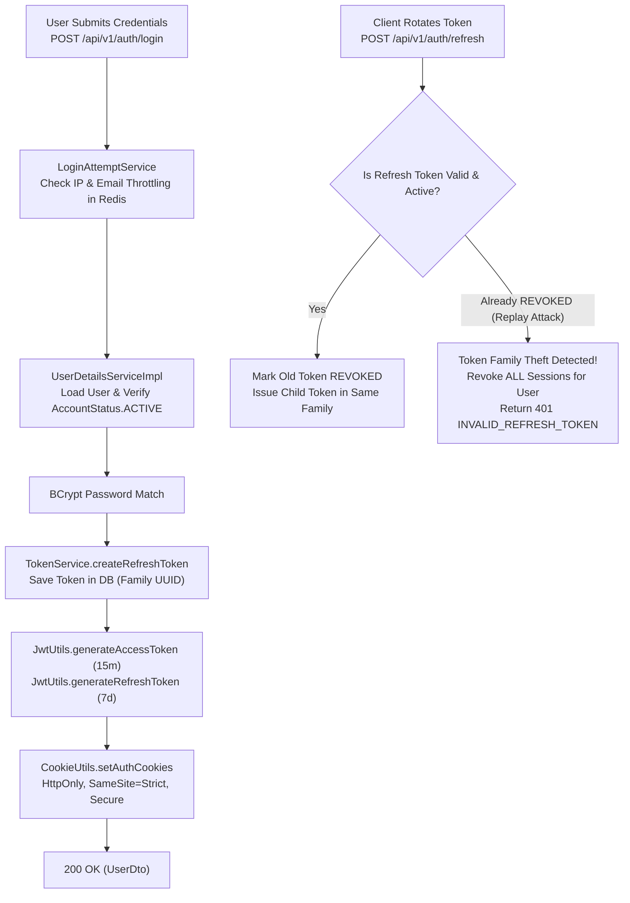

# Auth Domain

## 1. Domain Scope & Purpose
The `auth` domain governs user authentication, cryptographic session issuance, Refresh Token Rotation (RTR), session revocation, two-tier brute-force login throttling, password lifecycle, and Google OAuth2 Single Sign-On (SSO). It implements strict token family tracking to detect and defend against token theft and replay attacks.

---

## 2. Step-by-Step Authentication & Session Lifecycles

### 2.1. Registration & Login
1. **User Registration (`POST /api/v1/auth/register`):**
   - Validates uniqueness of email and phone number via `RegistrationValidator`.
   - **Legal Agreement Invariant:** Enforces mandatory consent (`agreementsAccepted == true`).
   - Hashes password using `BCryptPasswordEncoder` (strength: 12).
   - Publishes `UserRegisteredEvent` triggering welcome and verification emails.
2. **Credential Authentication (`POST /api/v1/auth/login`):**
   - **Two-Tier Rate Limiting (`LoginAttemptService`):** Checks both client IP and user email. Exceeding thresholds enforces progressive backoff and temporary account locking.
   - Verifies that `user.getAccountStatus() == AccountStatus.ACTIVE`. Blocked or deactivated users receive `AccountNotActiveException`.
   - Verifies credentials. On success, clears failed attempt counters in Redis.

### 2.2. Refresh Token Rotation (RTR) & Replay Attack Defense
Platform security strictly adheres to OAuth 2.0 RTR specifications:
1. **Access Token:** Short-lived JWT (15 minutes / 900s) containing user claims, permissions, and roles. Stored in an `HttpOnly`, `SameSite=Strict`, `Secure` cookie named `access_token`.
2. **Refresh Token:** Long-lived JWT (7 days / 604,800s) backed by a database row in the `tokens` table. Stored in cookie `refresh_token`.
3. **Rotation Protocol (`POST /api/v1/auth/refresh`):**
   - Reads the cookie and parses the JWT signature.
   - Verifies that the corresponding database `Token` row has `status == TokenStatus.ACTIVE`.
   - **Replay Attack / Theft Detection:** If an incoming token has `status == TokenStatus.REVOKED`, the system recognizes a token replay attack (a stolen token being reused). It immediately revokes the **entire token family** (`tokenRepository.revokeAllByFamilyId`), terminating all active sessions for that user across all devices.
   - On legitimate rotation, the parent token is marked `TokenStatus.REVOKED`, and a new child token is minted with the same `familyId` and an updated expiry.

### 2.3. Google OAuth2 Single Sign-On (SSO)
1. User authenticates via `/api/v1/auth/oauth2/google`.
2. Handled by `OAuth2LoginSuccessHandler`, which verifies Google claims and resolves or registers the user in `OAuthService`.
3. If new, generates a secure random password and marks the account verified.
4. Generates initial session cookies and redirects to the frontend dashboard.

---

## 3. Business Invariants & Security Guarantees

* **Zero Plaintext Tokens:** Refresh token entities store SHA-256 hashes or cryptographic random UUIDs; access tokens are verified statelessly by signature.
* **HttpOnly Cookie Enforcement:** Tokens are never returned in JSON response bodies to prevent XSS exfiltration. All session cookies set `HttpOnly`, `SameSite=Strict`, and `Secure` (in production).
* **Account Status Guard:** Login is strictly forbidden for accounts in `AccountStatus.BLOCKED`, `SUSPENDED`, or `DELETED`.
* **Automated Housekeeping:** `TokenCleanupScheduler` runs daily at midnight (`cron = "0 0 0 * * *"`) to physically purge expired and revoked tokens older than 30 days (`tokenRepository.deleteAllExpiredOrRevokedBefore`).

---

## 4. Redis Keys & Throttling Limits

| Redis Key Pattern | Type | TTL | Purpose |
| :--- | :--- | :--- | :--- |
| `v4:auth:login_attempts:ip:{clientIp}` | Integer | 900s (15 min) | Tracks consecutive failed logins from an IP address. |
| `v4:auth:login_attempts:email:{email}` | Integer | 900s (15 min) | Tracks consecutive failed logins against a specific user account. |

---

## 5. Database Schema & Flyway Structure

Stored in the `tokens` table:
* `id`: UUID primary key.
* `user_id`: Foreign key to `users`.
* `token`: Cryptographic token value.
* `family_id`: UUID grouping tokens issued within the same device session.
* `status`: `TokenStatus` enum (`ACTIVE`, `REVOKED`, `EXPIRED`).
* `expires_at`: Timestamp when the refresh token expires.
* `created_at`: Creation timestamp.
* Indexed on `(user_id, status)` and `(family_id)`.

---

## 6. Public REST API Contracts (`AuthController` & `PasswordController`)

* **`POST /api/v1/auth/register`:** Creates a new buyer/seller account (`RegisterRequest`).
* **`POST /api/v1/auth/login`:** Validates credentials and sets `access_token` and `refresh_token` cookies.
* **`POST /api/v1/auth/logout`:** Revokes the current session token in PostgreSQL and clears browser cookies.
* **`POST /api/v1/auth/refresh`:** Atomically rotates refresh token, returning a refreshed access cookie.
* **`POST /api/v1/auth/revoke-all-sessions`:** Invalidates all active tokens for the user, forcing re-login across all devices.
* **`POST /api/v1/auth/passwords/forgot`:** Dispatches a password reset OTP verification code.
* **`POST /api/v1/auth/passwords/reset`:** Resets password using the verified code and updates user credentials.
* **`PUT /api/v1/auth/passwords/change`:** Allows an authenticated user to change their current password.
