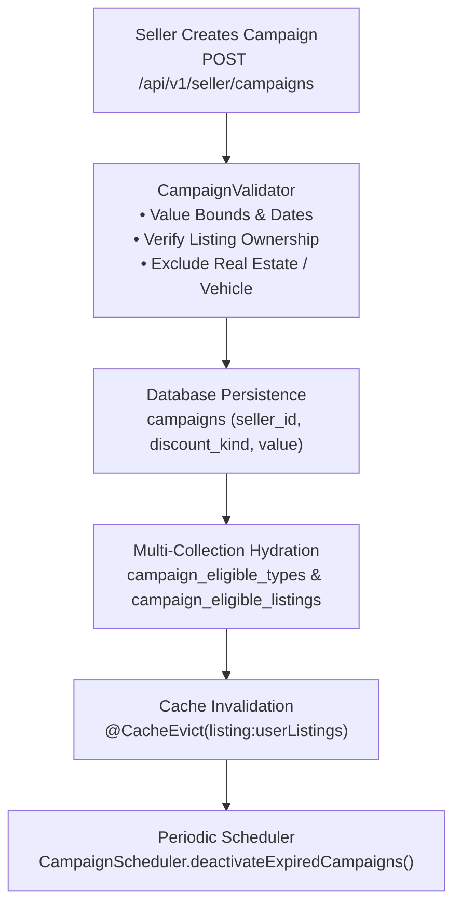

# Campaign Domain

## 1. Domain Scope & Purpose
The `campaign` domain enables marketplace sellers to configure and manage targeted promotional discounts across their active inventory. It supports both percentage and fixed-amount price cuts, enforces category-level eligibility restrictions, manages time-based activation and automated expiration, and integrates with the pricing engine to calculate buyer discounts during cart review and checkout.

---

## 2. Step-by-Step Execution Lifecycle

1. **Campaign Creation & Scope Definition (`create`):**
   - The authenticated seller submits a `CreateCampaignRequest` containing discount specifications and target rules:
     - Specific listing selection: `eligibleListingIds` (explicit UUID whitelist).
     - Vertical type selection: `eligibleTypes` (category-level discount).
     - Blanket store promotion: Empty listing/type filters target all eligible goods owned by the seller.
     - `applyToFutureListings`: When true on type-level campaigns, automatically applies the discount to newly published listings created after campaign launch.
   - Evicts user listing caches (`listing:userListings`) so search and profile views display updated strike-through pricing immediately.
2. **Cart & Checkout Pricing Hydration (`loadActiveCampaignsForSellers`):**
   - When a buyer previews a cart or checks out, `PricingService` passes the distinct seller IDs to `loadActiveCampaignsForSellers`.
   - **Cartesian Product Prevention:** Instead of executing a single SQL join across multiple element collections (which would cause exponential row multiplication), `CampaignService` executes optimized projection queries (`findEligibleTypesByCampaignIds`, `findEligibleListingIdsByCampaignIds`) and assembles the sets in-memory via `hydrateEligibleCollections`.
3. **Automated Expiration Lifecycle (`CampaignScheduler`):**
   - A Spring `@Scheduled` background worker runs periodically according to `campaignConfigProperties.schedulerDeactivateFixedDelayMs`.
   - Executes an atomic bulk update (`deactivateAllExpired(LocalDateTime.now())`), setting `active = false` for all records where `endsAt < NOW() && active = true`.

---

## 3. Business Invariants & Constraints

* **Seller Listing Ownership:** A seller may only associate listings that they explicitly own (`assertOwnedBySeller`). Attempting to discount another seller's inventory halts with `CampaignErrorCodes.CAMPAIGN_NOT_OWNED`.
* **Prohibited Categories:** Campaigns cannot be established on `ListingType.REAL_ESTATE` or `ListingType.VEHICLE` items.
* **Discount Value Bounds:**
  - `CampaignDiscountKind.PERCENTAGE`: Value must be $> 0$ and $\le 100$.
  - `CampaignDiscountKind.FIXED_AMOUNT`: Value must be $> 0$.
* **Temporal Ordering:** `startsAt` must precede `endsAt`.
* **Scope Hierarchy (`ListingCampaignPricingUtil.isApplicable`):**
  - If specific listings are chosen, the discount applies *only* to those listings. `applyToFutureListings = true` never widens an explicit listing-whitelist campaign.
  - If listing types are selected, all matching listings (current and future) qualify.
* **Soft Delete Lifecycle:** Deleted campaigns are softly marked using `@SQLDelete(sql = "UPDATE campaigns SET deleted_at = now() WHERE id = ?")` and filtered with `@SQLRestriction("deleted_at IS NULL")`.

---

## 4. Cache & Concurrency Matrix

* **Cache Key:** `listing:userListings`
* **Invalidation Trigger:** Any call to `create()`, `update()`, or `delete()` triggers `@CacheEvict(value = "listing:userListings", allEntries = true)`. This ensures that seller showcase grids and product detail views do not serve stale prices after promotional changes.

---

## 5. Database Schema & Flyway Structure

Stored in three PostgreSQL tables:
* **`campaigns`:** Core campaign entity (`id`, `seller_id`, `name`, `active`, `starts_at`, `ends_at`, `discount_kind`, `value`, `min_quantity`, `apply_to_future_listings`, `created_at`, `deleted_at`).
  - Indexed on `(seller_id, created_at)`, `(active, ends_at)`, and `(seller_id, active, starts_at, ends_at)`.
* **`campaign_eligible_types`:** Maps `campaign_id` to targeted `listing_type` enums.
* **`campaign_eligible_listings`:** Maps `campaign_id` to explicit `listing_id` UUIDs.

---

## 6. Public REST API Contracts

### Seller Control Plane (`CampaignController` — `/api/v1/seller/campaigns`)
* **`POST /`:** Creates a new seller campaign (`@PreAuthorize("isAuthenticated()")`).
* **`PUT /{id}`:** Modifies an existing owned campaign.
* **`DELETE /{id}`:** Soft-deletes a campaign and invalidates pricing caches.
* **`GET /?page=0&size=10`:** Paginated overview of campaigns owned by the current seller.

### Public Shopper Endpoints (`PublicCampaignController` — `/api/v1/campaigns`)
* **`GET /active?sellerIds=1,2,3`:** Public endpoint returning currently active campaigns for a given list of seller IDs, powering seller storefront badge displays.
