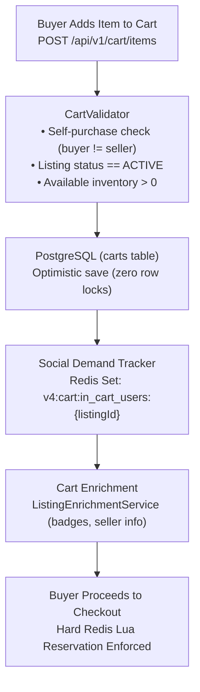

# Cart Domain

## 1. Domain Scope & Purpose
The `cart` domain provides an optimistic shopping cart service for buyers. It manages cart additions, quantity updates, item deletions, and listing enrichments without acquiring relational database locks. It decouples casual cart browsing from atomic stock deductions, deferring hard stock locks to the checkout phase while feeding real-time social proof demand metrics into Redis.

---

## 2. Step-by-Step Cart Lifecycle

1. **Two-Tier Stock Model (Browsing vs. Checkout):**
   - **Tier 1 — Optimistic Browsing (Cart Domain):** When a user adds an item to the cart or updates quantities, the system validates that current inventory is positive but **does not lock or hold stock in Redis or PostgreSQL**. Multiple users may place the same item in their carts concurrently.
   - **Tier 2 — Atomic Reservation (Checkout Domain):** When the user transitions from cart to checkout (`/api/checkout/initiate` or `/api/v1/orders/checkout`), `CheckoutStockReservationService` executes the atomic Lua script (`reserve_stock_with_ttl.lua`), holding inventory for exactly 15 minutes.
2. **Item Addition & Validation (`processCartAction`):**
   - Validates that the buyer is not the seller of the listing (`CANNOT_ADD_OWN_LISTING`).
   - Ensures the listing is in `ListingStatus.ACTIVE`.
   - Validates that requested quantity is available in PostgreSQL inventory (`AVAILABLE_STOCK_INSUFFICIENT`).
   - Saves or updates the `Cart` record. Handles race conditions (`DataIntegrityViolationException`, `ObjectOptimisticLockingFailureException`) gracefully by translating them into clean business results.
3. **Social Demand Metrics (`CartSocialMetricService`):**
   - On addition, adds the user ID to the Redis Set `v4:cart:in_cart_users:{listingId}` with a 7-day TTL.
   - On item removal, removes the user ID from the Redis Set.
   - Drives real-time urgency metrics (*"In X people's cart"*) displayed across catalog cards and listing detail views without running expensive database aggregate queries.
4. **Cart Retrieval & Metadata Enrichment (`getCartItems`):**
   - Loads paginated cart records with eager listing joins (`findByUserIdWithListing`).
   - Passes loaded listings through `ListingEnrichmentService` to attach active showcase flags, seller reputation badges, and favorite status for the viewing buyer.

---

## 3. Business Invariants & Concurrency Guarantees

* **Zero DB Lock Contention:** Adding an item to the cart never executes `PESSIMISTIC_WRITE` locks on `listings` or `inventory` tables. This guarantees high throughput during flash sales and prevents "Cart Hoarding" Denial-of-Service attacks.
* **Self-Purchase Prevention:** Users are strictly blocked from adding their own items to the cart (`CANNOT_ADD_OWN_LISTING`).
* **Active Status Constraint:** Only listings in `ListingStatus.ACTIVE` can reside in the cart. If a seller archives or deletes an item while it sits in a buyer's cart, subsequent checkout attempts cleanly fail.
* **Deterministic Quantity Floors:** Cart quantities must be positive integers ($\ge 1$). Setting quantity to 0 triggers automatic item deletion.

---

## 4. Redis Key Standards

| Redis Key Pattern | Type | TTL | Purpose |
| :--- | :--- | :--- | :--- |
| `v4:cart:in_cart_users:{listingId}` | Set (User IDs) | 7 Days | Tracks distinct user IDs holding the listing in their active cart for social proof metrics. |

---

## 5. Database Schema & Flyway Structure

Stored in the `carts` table:
* `id`: BigInt primary key.
* `user_id`: Foreign key to `users` (buyer).
* `listing_id`: Foreign key to `listings`.
* `quantity`: Integer requested quantity (default: 1).
* `is_reserved`: Boolean indicating low-stock warning flag.
* `reserved_at`, `reservation_end_time`: Timestamps for cart reservation tracking.
* `created_at`, `updated_at`: Audit timestamps.
* Indexed on `(user_id, listing_id)` with unique constraint.

---

## 6. Public REST API Contracts (`CartController` — `/api/v1/cart`)

* **`GET /`:** Retrieves paginated items in the user's cart enriched with seller badges and pricing.
* **`POST /items`:** Adds a listing item to the cart (`AddToCartRequest`).
* **`PUT /items/{listingId}`:** Updates requested quantity for an item (`UpdateCartItemRequest`).
* **`DELETE /items/{listingId}`:** Removes a specific item from the cart.
* **`DELETE /items`:** Clears all items from the current user's cart.
* **`GET /count`:** Fast integer endpoint returning total count of items in the user's cart (powers header cart badge).
* **`GET /check/{listingId}`:** Quick boolean check verifying whether a listing is already in the user's cart.
* **`GET /reservations/count/{listingId}`:** Returns active reservation count for a listing.
