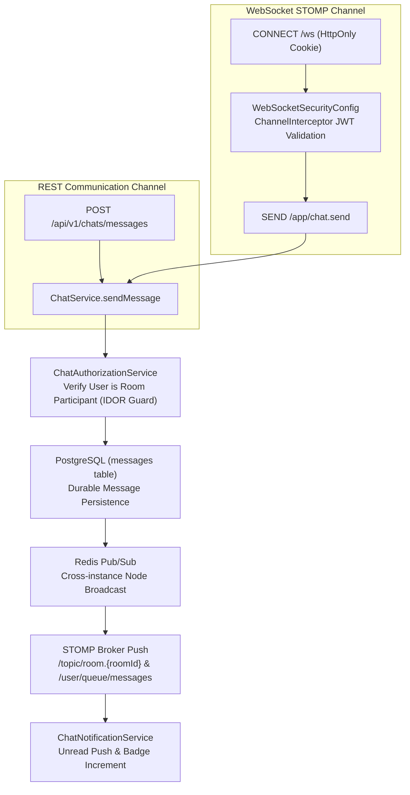

# Chat Domain

## 1. Domain Scope & Purpose
The `chat` domain provides dual-channel, real-time messaging between marketplace users. It supports standard REST APIs alongside full-duplex WebSocket connections using the STOMP protocol, orchestrates cross-instance message routing via Redis Pub/Sub, enforces strict participant-level authorization (IDOR prevention), and provides integrated in-chat bargaining offers.

> [!NOTE]
> **Related Documentation & Runbooks:**
> - **Architecture Deep Dive:** [`docs/websocket-stomp-and-chat-architecture.md`](../../../../../../../docs/websocket-stomp-and-chat-architecture.md)
> - **Frontend Module:** [`secondhand-frontend/src/chat/README.md`](../../../../../../../secondhand-frontend/src/chat/README.md)

---

## 2. Step-by-Step Execution Lifecycle

### 2.1. Handshake & Security Authentication
* **WebSocket Handshake:** Initiated at `/ws` using SockJS.
* **Authentication:** Unlike standard REST filters, WebSocket frames traverse the `WebSocketSecurityConfig` channel interceptor. On the `CONNECT` frame, the interceptor parses the `access_token` cookie or Bearer token, validates the cryptographic JWT signature, and attaches the authenticated principal to the WebSocket session.
* **Subscription Authorization:** When a client attempts to subscribe to `/topic/room.{roomId}`, the interceptor verifies that the principal is an active participant in `ChatRoom(id == roomId)`. Unauthorized subscriptions are immediately aborted with an `ACCESS_DENIED` frame.

### 2.2. Message Dispatch & Durability
1. **Intake:** Messages arrive via REST (`POST /api/v1/chats/messages`) or STOMP (`/app/chat.send`).
2. **Participant Validation (`ChatAuthorizationService`):**
   - Verifies that `currentUser.getId()` matches either `room.getUser1().getId()` or `room.getUser2().getId()`.
   - Rejects unauthorized sender attempts (`CHAT_NOT_PARTICIPANT`).
3. **Database Persistence:**
   - Inserts the message into `messages` (`sender_id`, `chat_room_id`, `content`, `is_read = false`, `created_at`).
   - Updates `chat_rooms.last_message_at` to sort inbox conversation views chronologically.
4. **Real-Time Distribution:**
   - Publishes the message frame to the destination room topic (`/topic/room.{roomId}`).
   - If the recipient is not actively viewing the room, `ChatNotificationService` sends an in-app push notification and increments the recipient's unread counter.

### 2.3. In-Chat Offer Negotiation
* Buyers and sellers can negotiate price directly inside a chat room via `POST /api/v1/chats/rooms/{id}/offers`.
* This action simultaneously records an official `Offer` in `offers` and renders an interactive bargaining card in the chat transcript.

---

## 3. Business Invariants & Concurrency Guarantees

* **Strict Participant Privacy (Zero IDOR):** Only the two designated participants of a conversation room can view transcript histories, subscribe to room events, or send messages.
* **Durable Source of Truth:** While Redis Pub/Sub distributes real-time packets across horizontally scaled backend pods, PostgreSQL is the immutable source of truth for message histories.
* **Listing Context Binding:** A room may be tied to a specific `Listing` (inquiry about an item) or created as a direct user-to-user room (`direct`).

---

## 4. WebSocket & STOMP Protocol Standards

* **WebSocket Endpoint:** `/ws` (with SockJS fallback).
* **Application Inbound Prefix:** `/app`
  - Send message: `/app/chat.send` (`ChatMessageDto`)
* **Broker Outbound Destination Prefixes:**
  - Room transcript stream: `/topic/room.{roomId}`
  - Personal message notifications: `/user/queue/messages`

---

## 5. Database Schema & Flyway Structure

* **`chat_rooms` Table:**
  - `id`: BigInt primary key.
  - `user1_id`: Foreign key to `users`.
  - `user2_id`: Foreign key to `users`.
  - `listing_id`: Optional foreign key to `listings`.
  - `last_message_at`, `created_at`: Timestamps.
  - Indexed on `(user1_id, user2_id)` and `(listing_id)`.
* **`messages` Table:**
  - `id`: BigInt primary key.
  - `chat_room_id`: Foreign key to `chat_rooms`.
  - `sender_id`: Foreign key to `users`.
  - `content`: Text message body.
  - `is_read`: Boolean read status flag.
  - `offer_id`: Optional foreign key to linked `offers`.
  - `created_at`: Audit timestamp.

---

## 6. Public REST API Contracts (`ChatRestController` — `/api/v1/chats`)

* **`GET /rooms/user`:** Returns active chat conversations for the current user.
* **`POST /rooms/direct`:** Opens or retrieves an existing 1-on-1 direct conversation with a target user.
* **`POST /rooms/listing/{listingId}`:** Opens or retrieves a chat room bound to a specific listing.
* **`GET /rooms/{roomId}/messages?page=0&size=20`:** Paginated message history for a conversation.
* **`POST /messages`:** Sends a message via REST.
* **`PUT /rooms/{roomId}/messages/read`:** Marks all unread incoming messages in the room as read.
* **`POST /rooms/{roomId}/offers`:** Submits an offer directly inside the chat conversation (`SendInChatOfferRequest`).
* **`GET /messages/unread-count`:** Returns total unread chat message badge count.
* **`DELETE /rooms/{roomId}`:** Soft-closes a chat room for the user.
* **`DELETE /messages/{messageId}`:** Deletes a specific message.
