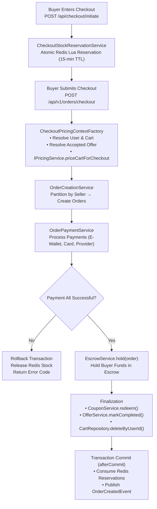

# Checkout Domain

## 1. Domain Scope & Purpose
The `checkout` domain is the central orchestration hub of the purchasing lifecycle. It coordinates the conversion of ephemeral shopping carts and accepted bargaining offers into immutable legal orders, executes multi-provider payments, establishes escrow protection, and enforces non-blocking, lock-free stock reservations.

> [!NOTE]
> **Related Documentation & Runbooks:**
> - **Architecture Deep Dive:** [`docs/checkout-pipeline-and-distributed-transaction-flow.md`](../../../../../../../docs/checkout-pipeline-and-distributed-transaction-flow.md)
> - **Architecture Deep Dive:** [`docs/stock-reservation-and-reconciliation.md`](../../../../../../../docs/stock-reservation-and-reconciliation.md)
> - **Frontend Module:** [`secondhand-frontend/src/cart/README.md`](../../../../../../../secondhand-frontend/src/cart/README.md)
> - **Frontend Module:** [`secondhand-frontend/src/payments/README.md`](../../../../../../../secondhand-frontend/src/payments/README.md)



---

## 2. Step-by-Step Execution Lifecycle

The main entry point is `CheckoutOrchestrator.executeCheckout(userId, request)`, executed within a single `@Transactional` boundary:

1. **Pricing Context Assembly (`CheckoutPricingContextFactory`):**
   - Fetches the active `User` and cart items (`cartRepository.findByUserIdWithListing(userId)`).
   - If an `offerId` is supplied, validates and resolves the accepted offer via `IOfferService.getAcceptedOfferForCheckout`. The offered listing replaces any existing cart quantity for that item.
   - Calculates the exact payable breakdown using `IPricingService.priceCartForCheckout`. If a requested coupon is invalid, expired, or depleted, checkout immediately halts with a specific `ErrorCode` (coupons are never silently discarded).
2. **Atomic Stock Reservation (`CheckoutStockReservationService`):**
   - Validates that each listing is in `ListingStatus.ACTIVE`.
   - Invokes `InventoryRedisReservationService.reserveStockWithTtl` via Redis Lua script (`reserve_stock_with_ttl.lua`) with a 15-minute anti-hoarding TTL (`app.checkout.reservation-ttl-seconds: 900`).
   - If any item has insufficient stock, already reserved stock is released and the flow aborts.
3. **Multi-Seller Order Creation (`OrderCreationService`):**
   - Groups effective cart items by seller.
   - Generates an independent `Order` for each seller, assigning unique order numbers (`ORD-...`), line items (`OrderItem`), shipping allocations, and proportional coupon/campaign discounts.
4. **Payment Processing (`OrderPaymentService`):**
   - For each order, executes the required payment via the specified provider (`EWALLET`, `STRIPE`, `IYZICO`, etc.).
   - If any payment step fails, `rollbackCheckout()` is invoked (`TransactionAspectSupport.currentTransactionStatus().setRollbackOnly()`), held Redis stock is cancelled, and an error is returned.
5. **Escrow Guarantee (`EscrowService`):**
   - Upon successful payment, each order is placed into escrow protection (`escrowService.hold(order)`). Buyer funds are locked and never directly credited to the seller during checkout.
   - Order status moves to `OrderStatus.MEETUP_PENDING` (if delivery is `DeliveryMethod.SAFE_MEETUP`) or `OrderStatus.CONFIRMED`.
6. **Post-Payment Finalization:**
   - **Coupon Redemption:** If a coupon was applied, `couponService.redeem()` binds the coupon redemption to the first order that received part of the discount.
   - **Offer Completion:** If an offer was checked out, `offerService.markCompleted(acceptedOffer)` transitions the offer to `OfferStatus.COMPLETED`.
   - **Cart Cleansing:** `cartRepository.deleteByUserId(userId)` clears the buyer's shopping cart.
7. **Post-Commit Hook & Event Emission:**
   - On successful transaction commit (`TransactionSynchronization.afterCommit`), Redis reservations are converted to pending purchase records (`consumeReservationsOnSuccess`).
   - If the commit fails (`STATUS_ROLLED_BACK`), a rollback synchronization hook guarantees that Redis stock holds are released immediately rather than lingering until TTL expiration.
   - Publishes `OrderCreatedEvent` for async notifications, seller alerts, and audit streaming.

---

## 3. Business Invariants & Concurrency Guarantees

* **Single Transaction Multi-Seller Atomicity:** Cart items from multiple distinct sellers are purchased simultaneously. Either all seller orders succeed, are paid, and enter escrow together, or the entire transaction rolls back cleanly without partial charges.
* **No Silent Coupon Dropping:** `priceCartForCheckout` strictly fails checkout if a coupon code was explicitly requested but cannot be applied.
* **Lock-Free Anti-Hoarding Stock Reservation:** Stock is held in Redis memory via atomic Lua scripts with a 900-second TTL. Database rows are not locked pessimistically during checkout browsing.
* **Immediate Rollback Stock Restoration:** If a payment or order step fails, stock holds are released immediately via `releaseReservedStock`, preventing legitimate buyers from being blocked by abandoned checkouts.
* **Default Escrow Invariant:** Money never flows directly from buyer to seller at checkout. All funds are deposited into platform escrow accounts awaiting shipment and delivery verification.

---

## 4. Redis Keys, TTLs & Lua Scripts

| Redis Key / Pattern | Type | TTL | Purpose |
| :--- | :--- | :--- | :--- |
| `v4:inventory:reservation:{listingId}:{userId}` | String / Hash | 900s (15 min) | Tracks held reservation quantity for a user. |
| `v4:inventory:stock:{listingId}` | String (Integer) | Managed | Available in-memory stock count. |
| `v4:inventory:purchased:{listingId}` | Hash | None / Permanent | Reconciled purchase markers before DB synchronization. |

### Stock Reservation Lifecycle & Lua Scripts:
* **`reserve_stock_with_ttl.lua`:** Atomically validates `available_stock >= requested_qty`, decrements available stock, creates the reservation key, and sets the 15-minute expiration.
* **`cancel_user_reservation.lua`:** Atomically deletes the user's reservation key and restores the held quantity back to `available_stock` (on abandonment, cart removal, or rollback).
* **Purchase Finalization (`consumeReservationOnPurchase`):** Upon transaction commit (`afterCommit`), `InventoryRedisReservationService` converts the temporary reservation into a pending purchase marker (`v4:inventory:pending:`) and deletes the reservation key before Kafka consumer DB deduction.

---

## 5. Public REST API Contracts

### Initiate Checkout Reservation
* **Endpoint:** `POST /api/checkout/initiate`
* **Security:** `@PreAuthorize("isAuthenticated()")`
* **Response:**
  ```json
  {
    "success": true,
    "data": {
      "reserved": {
        "8a2b3c4d-5e6f-7a8b-9c0d-1e2f3a4b5c6d": 1
      },
      "remainingTtlSeconds": 900
    }
  }
  ```

### Cancel Stock Reservation
* **Endpoint:** `DELETE /api/checkout/reservation/{listingId}`
* **Security:** `@PreAuthorize("isAuthenticated()")`
* **Response:** `200 OK` with confirmation message.

### Execute Order Checkout
* **Endpoint:** `POST /api/v1/orders/checkout`
* **Security:** `@PreAuthorize("isAuthenticated()")`
* **Request Payload (`CheckoutRequest`):**
  ```json
  {
    "deliveryMethod": "CARGO",
    "shippingAddressId": 102,
    "paymentMethod": "EWALLET",
    "providerName": "EWALLET",
    "couponCode": "SUMMER2026",
    "offerId": null
  }
  ```
* **Response Payload (`CheckoutResultDto`):**
  ```json
  {
    "success": true,
    "data": {
      "orders": [
        {
          "id": 501,
          "orderNumber": "ORD-20261111-A8F2",
          "status": "CONFIRMED",
          "totalAmount": 1450.00,
          "paymentStatus": "COMPLETED"
        }
      ],
      "totalAmount": 1450.00
    }
  }
  ```
