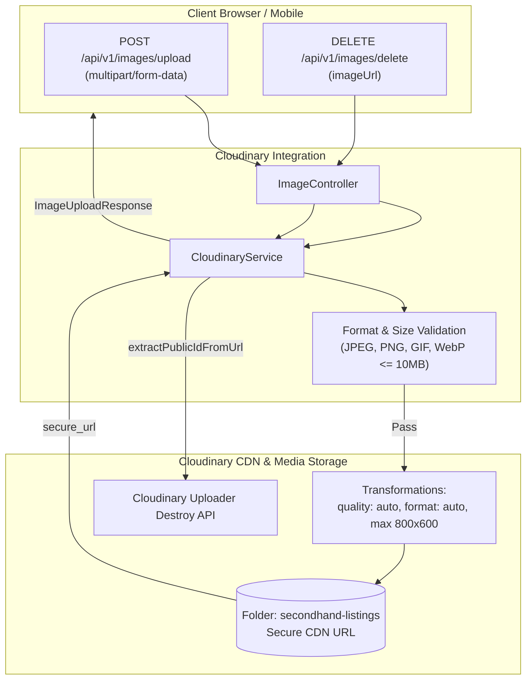

# Cloudinary Domain

## 1. Executive Summary & Purpose
The `cloudinary` domain manages external media storage, automated format and quality optimization, responsive image resizing, and remote asset lifecycle cleanup for listing photo galleries and user profile avatars.

> [!NOTE]
> **Related Documentation & Runbooks:**
> - **Architecture Deep Dive:** [`docs/external-integrations-cloudinary-and-exchange.md`](../../../../../../../docs/external-integrations-cloudinary-and-exchange.md)

### Core Architectural Features
- **Stateless Cloud Storage:** Image binaries are never stored on the local application filesystem or inside PostgreSQL. Upload streams are piped directly to Cloudinary and tracked via HTTPS `secure_url`.
- **Dynamic Optimization Pipeline:** Assets are ingested with `quality: auto` and `fetch_format: auto`, allowing Cloudinary's edge CDN to deliver modern image formats (WebP, AVIF) tailored to client browser capabilities.
- **Dimensional Boundaries:** Automatically scales uploaded images down to a maximum of 800x600 pixels (`crop: limit`), reducing bandwidth consumption without sacrificing image clarity.
- **Orphan Prevention:** Deleting an image parses the unique `public_id` from the stored URL and issues a remote destroy call to prevent dangling cloud assets.

---

## 2. Architecture & Upload Lifecycle

---

## 3. Business Invariants & File Validation

1. **Allowed MIME Types:** Strictly limited to `image/jpeg`, `image/png`, `image/gif`, and `image/webp`. Both the `Content-Type` header and the filename extension are validated.
2. **File Size Ceiling:** Maximum file size is strictly capped at 10 MB ($10 \times 1024 \times 1024$ bytes).
3. **Dedicated Folder Scoping:** Listing images are isolated within the `secondhand-listings` namespace.
4. **Resilient Failure Handling:** Upload failures throw structured `BusinessException` (`IMAGE_UPLOAD_FAILED`), whereas cleanup failures log errors without failing calling domain transactions.

---

## 4. Public REST API Specifications

| Method | Endpoint | Auth | Purpose | Response |
|---|---|---|---|---|
| `POST` | `/api/v1/images/upload` | Bearer | Upload multipart image file | `{"url": "https://res.cloudinary.com/..."}` |
| `DELETE` | `/api/v1/images/delete` | Bearer | Remote cleanup of image by URL | `Result<String>` |

---

## 5. Security & Resource Safeguards
- **File Injection Defense:** Extensions and MIME types are double-checked to prevent executable script uploads.
- **CDN Offloading:** Images are served exclusively via Cloudinary's global CDN with HTTPS caching, eliminating server bandwidth load.
