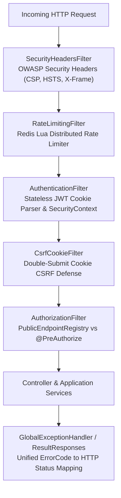

# Core Domain

## 1. Domain Scope & Purpose
The `core` domain provides the cross-cutting infrastructural foundation of the entire backend. It implements the Spring Security filter chain, distributed Redis Lua rate limiting, dynamic public route discovery, stateless JWT resolution, transactional outbox housekeeping, deterministic database catalog seeding, unified error handling, and asynchronous audit logging.

> [!NOTE]
> **Related Documentation & Runbooks:**
> - **Architecture Deep Dive:** [`docs/redis-and-kafka-architecture.md`](../../../../../../../docs/redis-and-kafka-architecture.md)
> - **Architecture Deep Dive:** [`docs/multi-tier-redis-caching-and-invalidation.md`](../../../../../../../docs/multi-tier-redis-caching-and-invalidation.md)
> - **Architecture Deep Dive:** [`docs/rate-limiting-and-throttling-architecture.md`](../../../../../../../docs/rate-limiting-and-throttling-architecture.md)
> - **Architecture Deep Dive:** [`docs/error-handling-and-contract-architecture.md`](../../../../../../../docs/error-handling-and-contract-architecture.md)
> - **Architecture Deep Dive:** [`docs/database-migration-and-seeding-guide.md`](../../../../../../../docs/database-migration-and-seeding-guide.md)
> - **Architecture Deep Dive:** [`docs/ci-cd-and-deployment-guide.md`](../../../../../../../docs/ci-cd-and-deployment-guide.md)
> - **Frontend Module:** [`secondhand-frontend/src/common/README.md`](../../../../../../../secondhand-frontend/src/common/README.md)

---

## 2. Security Filter Chain & Request Lifecycle

Every incoming HTTP request traverses the core filter pipeline in strict order:

1. **Security Headers Filter (`SecurityHeadersFilter`):**
   - Injects enterprise OWASP security headers: `Content-Security-Policy`, `X-Content-Type-Options: nosniff`, `X-Frame-Options: DENY`, `Strict-Transport-Security`, `Referrer-Policy: strict-origin-when-cross-origin`.
2. **Distributed Redis Rate Limiter (`RateLimitingFilter`):**
   - Resolves trusted client IP via `ClientIpResolver` (guards against spoofed `X-Forwarded-For` headers).
   - Executes atomic Redis Lua script (`src/main/resources/scripts/rate_limit_window.lua`) enforcing fixed-window rate limits per IP or authenticated user.
   - Public auth endpoints (`/login`, `/register`) carry tighter burst limits than read-only endpoints. Exceeded limits immediately return `429 Too Many Requests`.
3. **JWT Authentication Filter (`AuthenticationFilter`):**
   - Extracts the JWT access token from the `access_token` `HttpOnly` cookie (or fallback `Authorization: Bearer` header).
   - Verifies cryptographic signature using `JwtUtils`.
   - Populates Spring Security's `SecurityContextHolder` with authenticated user principal and roles without touching the database.
4. **CSRF Cookie Filter (`CsrfCookieFilter`):**
   - Enforces Double-Submit Cookie pattern, setting the `XSRF-TOKEN` cookie required on state-mutating requests (`POST`, `PUT`, `DELETE`).
5. **Dynamic Public Endpoint Resolution (`PublicEndpointRegistry`):**
   - Scans controller methods at application startup for `@PublicEndpoint`.
   - Populates `PublicRouteRequestMatcher`. Requests matching registered public routes bypass authentication without fragile hardcoded path strings in `SecurityConfig`.

---

## 3. Error Handling & The Result Envelope

Platform APIs strictly reject raw runtime exceptions and hand-rolled JSON responses in favor of a dual-track unified response standard:

* **Unified Result Envelope (`Result<T>`):**
  - **Success:** `{"success": true, "data": ...}`
  - **Failure:** `{"success": false, "message": "Human readable message", "errorCode": "RESOURCE_NOT_FOUND"}`
* **HTTP Status Resolution (`ErrorCodeStatuses`):**
  - `ResultResponses` resolves HTTP status codes by inspecting the declaring `ErrorCode` enum definition:
    - Domain not found codes $\rightarrow$ `404 Not Found`.
    - Authorization/ownership violations $\rightarrow$ `403 Forbidden`.
    - Concurrency/conflict codes $\rightarrow$ `409 Conflict`.
    - Rate limit exceeded codes $\rightarrow$ `429 Too Many Requests`.
    - General business constraint failures $\rightarrow$ `400 Bad Request`.
* **Global Exception Handler (`GlobalExceptionHandler`):**
  - Catches `BusinessException`, validation failures (`MethodArgumentNotValidException`), access denied errors, and unhandled runtime exceptions, translating them into standard Result payloads with RFC-7807 ProblemDetail compatibility.

---

## 4. Infrastructural Subsystems

### 4.1. Transactional Outbox Housekeeping (`OutboxHousekeepingScheduler`)
* Runs periodically purges historical `PROCESSED` events older than 7 days from `payment_outbox_events`, `order_outbox_events`, and `escrow_outbox_events` to prevent unbounded table bloat.

### 4.2. Catalog Seeding Engine
* **`CatalogSeedStartupRunner` & `SeedTask`:** Executed on startup when `--app.seed` argument is supplied. Reads deterministic JSON data from `resources/data/**` and performs idempotent upserts across categories, attributes, and agreements.
* **`CatalogLegacyPruner`:** Prunes obsolete seed records without compromising existing user-created items.

### 4.3. Audit Logging (`AuditAspect`)
* Intercepts sensitive operations annotated with `@Auditable`.
* Asynchronously records user ID, IP address, action type, execution duration, and payload snapshot into the `audit_logs` table.

### 4.4. OTP Verification Service (`VerificationService`)
* Issues and validates time-limited 6-digit numeric codes for email confirmation, phone verification, and payment authorizations (`CodeType`).
* Enforces maximum attempt limits; 3 consecutive incorrect codes trigger `VerificationLockedException` (15-minute cooldown).

---

## 5. Redis Key Standards

| Redis Key Pattern | Type | TTL | Purpose |
| :--- | :--- | :--- | :--- |
| `v4:ratelimit:ip:{clientIp}` | Integer | 60s | Fixed-window request counter per IP address. |
| `v4:ratelimit:user:{userId}` | Integer | 60s | Fixed-window request counter per authenticated user. |

---

## 6. Public REST API Contracts

* **`GET /api/v1/enums/all`:** Master cached dictionary of all system enums, vehicle types, carrier definitions, and validation rules (`@PublicEndpoint`).
* **`GET /api/v1/admin/audit-logs`:** Paginated administrative search over system audit logs (`@PreAuthorize("hasRole('ADMIN')")`).
* **`GET /api/v1/test/rate-limits/ping`:** Diagnostic endpoint to verify IP and client rate limit headers.
