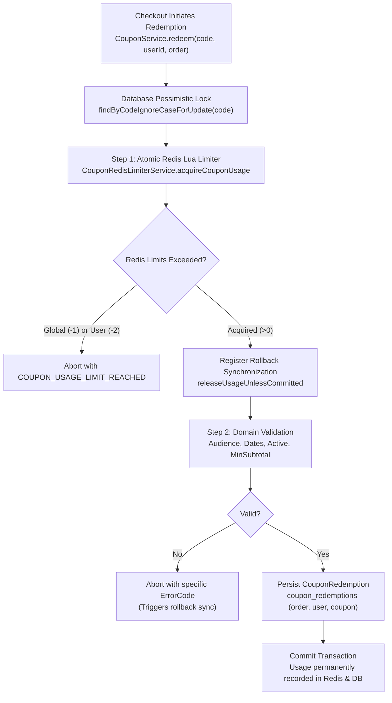

# Coupon Domain

## 1. Domain Scope & Purpose
The `coupon` domain governs platform-wide promotional discounts, audience-targeted marketing campaigns, atomic high-concurrency usage quotas, and single-redemption checkout guarantees. It combines sub-millisecond Redis Lua pre-checks with PostgreSQL pessimistic row locks (`SELECT ... FOR UPDATE`) to eliminate overselling and race conditions during high-volume flash sales.

---

## 2. Step-by-Step Redemption & Preview Lifecycle

1. **Coupon Discovery & Audience Eligibility (`listActiveForUser`):**
   - Fetches all active coupons valid at current timestamp (`findActiveNow(now)`).
   - Filters out coupons already redeemed by the user (`findDistinctCouponIdsByUser_Id`).
   - Evaluates audience eligibility (`validateUserEligible`):
     - `ALL_USERS`: Accessible to all authenticated users.
     - `USER_ID_LIST`: Restricted to specific user IDs in `coupon_eligible_users`.
     - `NEVER_ORDERED_FIRST_ORDER`: Restricted to new buyers who have never completed a paid order (`payment_status = COMPLETED`).
2. **Pricing Preview (`previewPricing`):**
   - Calculates the net discount against the user's cart without altering reservation counters.
   - If the coupon is invalid or inapplicable during preview, the cart subtotal is returned without the discount (graceful degradation).
3. **Atomic Checkout Redemption (`redeem`):**
   - **Step 1 — Row-Level Lock:** Queries `coupons` table with `SELECT ... FOR UPDATE` via `findByCodeIgnoreCaseForUpdate`, serializing concurrent redemptions on the same coupon.
   - **Step 2 — Redis Lua Rate Limiting:** Executes `apply_coupon_with_limit.lua` to atomically inspect and increment global (`v4:coupon:usage:global:{code}`) and per-user (`v4:coupon:usage:user:{code}:{userId}`) counters. If either limit is reached, returns an immediate error without writing to the database.
   - **Step 3 — Compensating Rollback Hook:** If Redis counter acquisition succeeds, registers a `TransactionSynchronization` hook (`releaseUsageUnlessCommitted`). If the database transaction rolls back (e.g. payment gateway failure or order creation error), `release_coupon_usage.lua` atomically decrements the Redis counter.
   - **Step 4 — Domain Rule Validation:** Evaluates active dates, minimum spend thresholds, and eligible category sets.
   - **Step 5 — Audit Persistence:** Inserts an immutable `CouponRedemption` record associating the coupon, user, order, and `redeemedAt` timestamp.

---

## 3. Discount Kinds & Business Invariants

### Supported Discount Kinds (`CouponDiscountKind`):
* `ORDER_PERCENT`: Percentage deduction applied across the qualifying order subtotal.
* `ORDER_FIXED`: Fixed monetary amount deducted from the qualifying order subtotal.
* `TYPE_PERCENT`: Percentage discount applied exclusively to items belonging to `eligibleTypes`.
* `TYPE_FIXED`: Fixed discount applied to items of specified `eligibleTypes`.
* `THRESHOLD_FIXED`: Fixed discount triggered only when order value exceeds `minSubtotal`.
* `THRESHOLD_PERCENT`: Percentage discount triggered only when order value exceeds `minSubtotal`.

### Core Business Invariants:
* **Strict Vertical Exclusion:** Coupons cannot target or be redeemed against `ListingType.REAL_ESTATE` or `ListingType.VEHICLE` items. Attempting to create or apply a coupon with these types returns `COUPON_NOT_APPLICABLE`.
* **Single Redemption Per Checkout:** In multi-seller carts, the coupon discount is apportioned across all seller orders, but redeemed exactly once and bound to the primary order.
* **Post-Campaign Subtotal Base:** A coupon's `minSubtotal` requirement is evaluated against the cart value *after* seller campaign discounts have been subtracted.
* **Fail-Safe DB Fallback:** If Redis is down, `CouponRedisLimiterService` returns `NOT_COUNTED (0)`. The transaction continues safely under PostgreSQL row-level locks, checking `usageLimitGlobal` against `coupon_redemptions` table counts.

---

## 4. Redis Key Standards & Lua Scripts

| Redis Key Pattern | Type | TTL | Purpose |
| :--- | :--- | :--- | :--- |
| `v4:coupon:usage:global:{CODE}` | String (Integer) | 30 Days | Global total redemptions for coupon `{CODE}`. |
| `v4:coupon:usage:user:{CODE}:{userId}` | String (Integer) | 30 Days | Individual redemption count for `{userId}` on coupon `{CODE}`. |

### Lua Scripts:
* **`scripts/apply_coupon_with_limit.lua`:** Atomically reads current global and user counts. If `globalLimit > 0 && currentGlobal >= globalLimit`, returns `-1`. If `userLimit > 0 && currentUser >= userLimit`, returns `-2`. Otherwise increments both keys and applies TTL.
* **`scripts/release_coupon_usage.lua`:** Compensating script that atomically decrements both keys if the checkout transaction fails.

---

## 5. Database Schema & Flyway Structure

Coupons are stored across three relational tables:
* **`coupons`:** Primary definition table (`id`, `code`, `title`, `description`, `for_all_users`, `audience`, `active`, `starts_at`, `ends_at`, `discount_kind`, `value`, `min_subtotal`, `max_discount`, `usage_limit_global`, `usage_limit_per_user`, `created_at`).
* **`coupon_eligible_users`:** Element collection table mapping targeted user IDs for `CouponAudience.USER_ID_LIST`.
* **`coupon_eligible_types`:** Element collection table mapping allowed `ListingType` enums.
* **`coupon_redemptions`:** Audit log of all completed redemptions (`id`, `coupon_id`, `user_id`, `order_id`, `redeemed_at`).

---

## 6. Public REST API Contracts

### User Endpoints (`CouponController` — `/api/v1/coupons`)
* **`POST /preview`:** Calculates real-time discount for the authenticated user's cart.
* **`GET /active`:** Returns eligible active coupons not yet consumed by the authenticated user.
* **`GET /redemptions`:** Returns user's historical redemption ledger.

### Admin Endpoints (`AdminCouponController` — `/api/v1/admin/coupons`)
* **`GET /`:** Lists all platform coupons.
* **`POST /`:** Creates a new coupon with audience and type restrictions (`@PreAuthorize("hasRole('ADMIN')")`).
* **`PUT /{id}`:** Updates existing coupon attributes.
* **`GET /audience-stats?audience={AUDIENCE}`:** Computes eligible recipient count for targeted audience rules.
