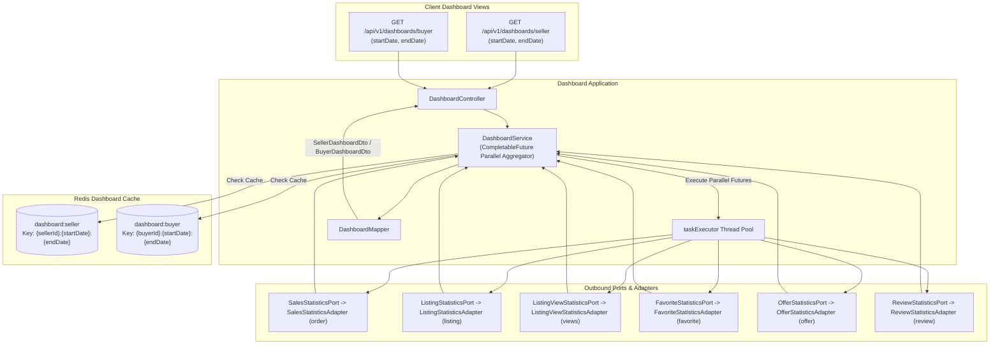

# Dashboard Domain

## 1. Executive Summary & Architecture
The `dashboard` domain provides real-time operational intelligence, sales funnel analytics, conversion tracking, and delivery timelines for marketplace sellers and buyers using **Hexagonal Architecture (Ports & Adapters)**.

> [!NOTE]
> **Related Documentation & Runbooks:**
> - **Architecture Deep Dive:** [`docs/multi-tier-redis-caching-and-invalidation.md`](../../../../../../../docs/multi-tier-redis-caching-and-invalidation.md)
> - **Frontend Module:** [`secondhand-frontend/src/dashboard/README.md`](../../../../../../../secondhand-frontend/src/dashboard/README.md)

### Architectural Highlights
- **Strict Hexagonal Decoupling:** `DashboardService` depends strictly on outbound abstraction ports rather than coupling directly to entities or repositories of external domains.
- **Concurrent Non-Blocking Aggregation:** Executes multi-metric queries in parallel using Java `CompletableFuture.allOf(...)` bounded by the dedicated `taskExecutor` pool, dropping query latency from sequential $\sum t_i$ to $\max(t_i)$.
- **Multi-Tier Redis Caching:** Dashboard payloads are cached in Redis (`dashboard:seller`, `dashboard:buyer`) partitioned by user ID and date boundaries to prevent redundant full-table aggregation scans.
- **Read-Only Invariant:** The domain strictly performs read-only projections; it never modifies order, financial, or listing records.

---

## 2. Architecture & Data Aggregation Flow

---

## 3. Metrics & Outbound Port Topology

| Outbound Port | Adapter Implementation | Target Domain | Aggregated Metrics |
|---|---|---|---|
| `SalesStatisticsPort` | `SalesStatisticsAdapter` | `order` | Total gross revenue, revenue trend, orders by status, revenue by category |
| `ListingStatisticsPort` | `ListingStatisticsAdapter` | `listing` | Total listings count, active/inactive breakdown, stock distribution |
| `ListingViewStatisticsPort` | `ListingViewStatisticsAdapter` | `listing` | Total page views, unique viewers, daily view velocity |
| `FavoriteStatisticsPort` | `FavoriteStatisticsAdapter` | `favorite` | Total listing favorites count, price drop alerts on favorited items |
| `OfferStatisticsPort` | `OfferStatisticsAdapter` | `offer` | Offer acceptance rate, pending offer count, counter-offer ratios |
| `ReviewStatisticsPort` | `ReviewStatisticsAdapter` | `review` | Average seller rating, review counts, 5-star distribution |
| `UserQueryPort` | `UserQueryAdapter` | `user` | User registration age and profile metadata |

---

## 4. Business Invariants & Lifecycle Mechanics

### 4.1 Date Range Bounding (`DateRangeHelper`)
- End dates default to `LocalDateTime.now()` if omitted.
- Start dates default to 30 days prior to end date if omitted.
- Normalizes date boundaries to prevent unbounded database table scans.

### 4.2 Parallel Future Assembly
When compiling the `SellerDashboardDto`, `DashboardService` launches parallel asynchronous tasks on `taskExecutor`:
1. Total revenue for current period.
2. Historical revenue for preceding period (to compute period-over-period percentage growth).
3. Daily revenue trend timeline.
4. Active, inactive, and sold listing counts.
5. Listing views and unique visitor metrics.
6. Favorite counts and popularity signals.
7. Offer bargaining conversion funnel.
8. Seller review averages.
All futures are joined using `CompletableFuture.allOf(...)` before mapping to DTOs.

---

## 5. Public REST API Specifications

| Method | Endpoint | Auth | Purpose | Response |
|---|---|---|---|---|
| `GET` | `/api/v1/dashboards/seller` | Bearer | Seller analytics (revenue, listings, views, funnel) | `SellerDashboardDto` |
| `GET` | `/api/v1/dashboards/buyer` | Bearer | Buyer analytics (active deliveries, pending offers, price drops) | `BuyerDashboardDto` |

---

## 6. Caching Topology

- `dashboard:seller`: Keyed by `#sellerId + ':' + #startDate.toLocalDate() + ':' + #endDate.toLocalDate()`.
- `dashboard:buyer`: Keyed by `#buyerId + ':' + #startDate.toLocalDate() + ':' + #endDate.toLocalDate()`.
- Caches are automatically bypassed when date ranges change, ensuring accurate chronological comparisons.
