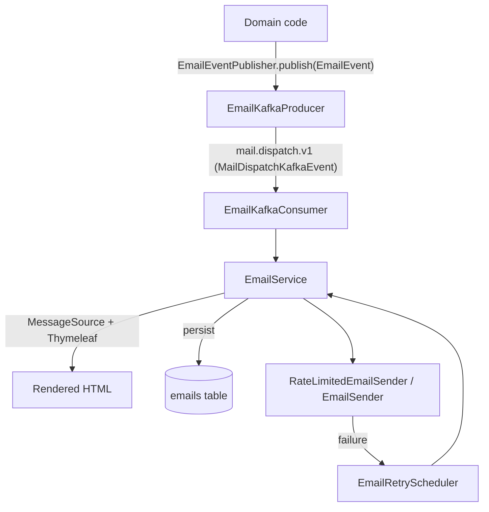

# Email Domain

## Purpose
Creates, localizes (i18n), renders (Thymeleaf), sends and tracks every outbound email. Dispatch is Kafka-based; see `docs/email-architecture-and-event-driven-dispatch.md` for the full design.

## Flow

## Rules
- **Adding an email:** add an `EmailType` value, an `EmailEvent` subclass in `application/event/impl`, the Thymeleaf template under `resources/templates/emails/`, and its subject/text keys in both `messages.properties` (TR) and `messages_en.properties` (EN).
- **No hardcoded texts:** subjects, greetings and labels live only in the message bundles; `application-email.yml` holds only infrastructure settings (`spring.mail.*`, `app.email.mock`, `app.email.sender`). Subjects resolve from the user's locale.
- **Delivery tracking:** every email is stored in `emails` with a status (`EmailStatus`) and priority (`EmailPriority`). The consumer is idempotent and transactional (group `mail-dispatch-consumers`).
- **Retry:** `EmailRetryScheduler` runs every 5 minutes and retries failed emails (`retryCount < 3`) with backoff `2^retryCount * 5` minutes. Every day at 02:00 it purges email logs older than 30 days.
- **Sending is async:** business transactions must never wait on SMTP; publish an event instead of calling `EmailSender` directly.

The list of email types is the `EmailType` enum (`domain/entity/enums/EmailType.java`); templates are grouped by `orders/`, `offers/`, `payments/`, `notifications/`, `system/`.
