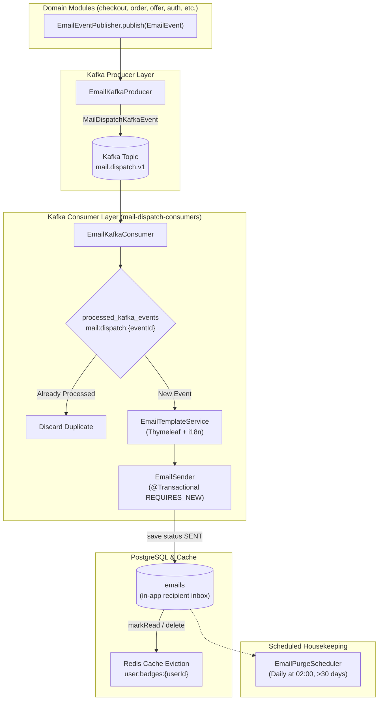

# Email Domain

## 1. Executive Summary & Architecture
The `email` domain handles transactional notifications, order lifecycle communications, authentication codes, offer bargaining alerts, and system notices.

> [!NOTE]
> **Related Documentation & Runbooks:**
> - **Architecture Deep Dive:** [`docs/email-architecture-and-event-driven-dispatch.md`](../../../../../../../docs/email-architecture-and-event-driven-dispatch.md)
> - **Frontend Module:** [`secondhand-frontend/src/emails/README.md`](../../../../../../../secondhand-frontend/src/emails/README.md)
> - **Frontend Module:** [`secondhand-frontend/src/inbox/README.md`](../../../../../../../secondhand-frontend/src/inbox/README.md)

### Key Architectural Characteristics
- **In-App Inbox Delivery:** By deliberate design, outbound emails are delivered to the recipient's personal in-app inbox (persisted in the `emails` table, read via `GET /api/v1/emails/my-emails`). There is no external SMTP relay dependency in dev/staging.
- **Asynchronous Kafka Pipeline:** Core domain transactions never execute email rendering or persistence synchronously. Instead, they publish events consumed by `EmailKafkaProducer` to the topic `mail.dispatch.v1`.
- **Atomic Consumer Idempotency:** `EmailKafkaConsumer` uses the centralized `processed_kafka_events` table (`mail:dispatch:{eventId}`) with `insertIfNotExists` to guarantee that duplicated Kafka deliveries are safely discarded.
- **Thymeleaf Template Engine & i18n:** Templates are rendered dynamically from `resources/templates/emails/` with localized subject bundles from `messages.properties` (TR) and `messages_en.properties` (EN).
- **Automated Data Retention Purge:** `EmailPurgeScheduler` runs nightly at 02:00 to purge email history older than 30 days.

---

## 2. Architecture & Event Pipeline

---

## 3. Core Entities & Database Schema

### `emails` Table
Represents an in-app email message delivered to a user:
- `id` (UUID, PK)
- `user_id` (BIGINT, FK -> `users.id`, nullable for guest/system communications)
- `recipient_email` (VARCHAR(255), not null, indexed)
- `sender_email` (VARCHAR(255), not null)
- `subject` (VARCHAR(255), not null)
- `content` (TEXT, rendered HTML or plain text body)
- `email_type` (VARCHAR(50), maps to `EmailType`)
- `status` (VARCHAR(20), maps to `EmailStatus`: `PENDING`, `SENT`, `FAILED`, `DELIVERED`, `BOUNCED`, `CANCELLED`)
- `retry_count` (INT, default `0`)
- `priority` (VARCHAR(20), maps to `EmailPriority`: `CRITICAL`, `HIGH`, `NORMAL`, `LOW`)
- `read_at` (TIMESTAMP, nullable, marks read status)
- `sent_at` (TIMESTAMP, nullable)
- `deleted_at` (TIMESTAMP, nullable, soft-delete timestamp)
- `created_at` (TIMESTAMP, not null)

---

## 4. Lifecycle Mechanics & Business Invariants

### 4.1 Dispatch & Rendering Pipeline
1. **Event Publishing:** Domain services construct an `EmailEvent` and emit it via `EmailEventPublisher`.
2. **Kafka Serialization:** `EmailKafkaProducer` converts the domain event into a `MailDispatchKafkaEvent` containing `eventId`, `recipientUserId`, `recipientEmail`, `subject`, `templatePath`, `templateVariables`, `customHtmlBody`, `emailType`, and `priority`.
3. **Consumer Idempotency:** `EmailKafkaConsumer` intercepts the message on topic `mail.dispatch.v1` under consumer group `mail-dispatch-consumers`:
   - Checks `processedKafkaEventRepository.insertIfNotExists("mail:dispatch:" + eventId, "mail-dispatch-consumers")`.
   - If `0` rows inserted, the event is acknowledged and discarded.
4. **Body Rendering:**
   - If `customHtmlBody` is provided, it takes precedence.
   - Otherwise, `EmailTemplateService.render(templatePath, templateVariables)` executes the Thymeleaf engine to generate the HTML content.
5. **Isolated Persistence (`EmailSender`):**
   - Runs in `@Transactional(propagation = Propagation.REQUIRES_NEW)`.
   - Sets status to `SENT`, records `sentAt = LocalDateTime.now()`, clears error messages, and saves to the `emails` table.
   - Updates `EmailMetrics` for operational monitoring.
   - Any runtime exception is re-thrown so Kafka consumer error handling or DLQ policies can trigger retry.

### 4.2 In-App Mailbox & Soft Deletion
- **User Mailbox Feed:** Users view their delivered emails via `GET /api/v1/emails/my-emails`. Soft-deleted emails (`deleted_at IS NOT NULL`) are omitted.
- **Mark As Read:** Calling `PATCH /api/v1/emails/{id}/read` or `PATCH /api/v1/emails/read-all` updates `read_at = LocalDateTime.now()` and evicts the badge cache: `@CacheEvict(value = "user:badges", key = "#userId")`.
- **Soft Deletion:** Calling `DELETE /api/v1/emails/{id}` or `DELETE /api/v1/emails` sets `deleted_at = LocalDateTime.now()` rather than executing a hard SQL deletion, preserving audit logs.

### 4.3 Retention & Automated Cleanup (`EmailPurgeScheduler`)
- Executes daily at 02:00 via `@Scheduled(cron = "0 0 2 * * *")`.
- Calculates cutoff threshold: `LocalDateTime.now().minusDays(30)`.
- Calls `emailRepository.deleteOldEmails(cutoffDate)` to permanently prune historical email logs older than 30 days.

---

## 5. Email Types & Classification

Defined in `EmailType`:
- **Auth & Account:** `VERIFICATION`, `VERIFICATION_CODE`, `PASSWORD_RESET`, `WELCOME`, `PHONE_UPDATE`, `AUDIT_ALERT`
- **Orders & Shipping:** `ORDER_CONFIRMATION`, `ORDER_CANCELLED`, `ORDER_COMPLETED`, `ORDER_REFUNDED`, `SALE_NOTIFICATION`, `SHIPPING_NOTIFICATION`
- **Offers:** `OFFER_RECEIVED`, `OFFER_COUNTER_RECEIVED`, `OFFER_ACCEPTED`, `OFFER_REJECTED`, `OFFER_EXPIRED`, `OFFER_COMPLETED`
- **Payments & Escrow:** `PAYMENT_VERIFICATION`, `PAYMENT_SUCCESS`, `PAYMENT_RECEIPT`, `ESCROW_RELEASED`
- **Memberships & Listings:** `MEMBERSHIP_ACTIVATED`, `MEMBERSHIP_UPGRADE`, `MEMBERSHIP_EXPIRING`, `NEW_LISTING`, `NEW_LISTING_NOTIFICATION`, `PRICE_CHANGE`, `LISTING_APPROVED`
- **Social & Legal:** `GREAT_SELLER`, `GREAT_SELLER_ACHIEVEMENT`, `REVIEW_SUBMITTED`, `AGREEMENT_UPDATE`, `AGREEMENT_UPDATED`, `NOTIFICATION`, `PROMOTIONAL`, `SYSTEM`

---

## 6. Public REST API Specifications

| Method | Endpoint | Auth | Purpose | Response |
|---|---|---|---|---|
| `GET` | `/api/v1/emails/my-emails` | Bearer | Paginated list of emails in recipient inbox | `Page<EmailDto>` |
| `GET` | `/api/v1/emails/my-emails/{email-type}` | Bearer | Paginated emails filtered by `EmailType` | `Page<EmailDto>` |
| `GET` | `/api/v1/emails/unread-count` | Bearer | Total count of unread emails (`readAt IS NULL`) | `{"unreadCount": number}` |
| `PATCH` | `/api/v1/emails/{id}/read` | Bearer | Marks a single email as read | `EmailDto` |
| `PATCH` | `/api/v1/emails/read-all` | Bearer | Marks all inbox emails as read | `{"markedCount": number}` |
| `DELETE` | `/api/v1/emails/{email-id}` | Bearer | Soft-deletes a single email | `Result<String>` |
| `DELETE` | `/api/v1/emails` | Bearer | Soft-deletes all emails in user inbox | `String` |

---

## 7. Security & IDOR Safeguards
- **Ownership Verification:** Every inbox query and mutation filters strictly by authenticated user ID (`currentUser.getId()`) and recipient email address (`currentUser.getEmail()`).
- **Badge Cache Consistency:** Every state-altering endpoint (`read`, `read-all`, `delete`, `delete-all`) issues `@CacheEvict(value = "user:badges", key = "#userId")` to prevent badge counter drift.
