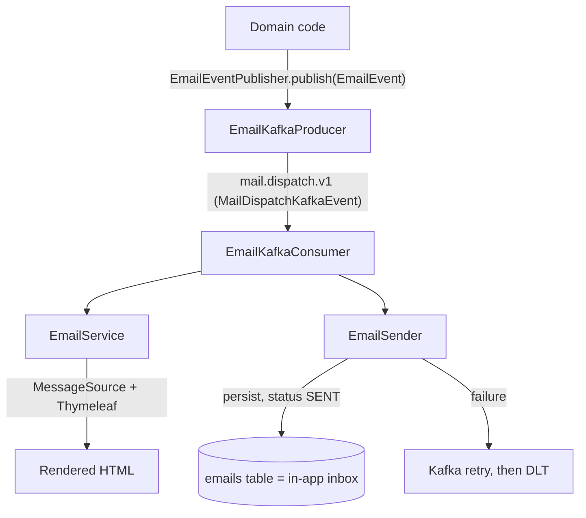

# Email Domain

## Purpose
Creates, localizes (i18n), renders (Thymeleaf) and stores every email in the recipient's in-app inbox (`emails` table, `/api/v1/emails/my-emails`). There is no SMTP delivery. Dispatch is Kafka-based; see `docs/email-architecture-and-event-driven-dispatch.md` for the full design.

## Flow

## Rules
- **Adding an email:** add an `EmailType` value, an `EmailEvent` subclass in `application/event/impl`, the Thymeleaf template under `resources/templates/emails/`, and its subject/text keys in both `messages.properties` (TR) and `messages_en.properties` (EN).
- **No hardcoded texts:** subjects, greetings and labels live only in the message bundles; `application-email.yml` holds only `app.email.sender`. Subjects resolve from the user's locale.
- **Delivery tracking:** every email is stored in `emails` with a status (`EmailStatus`) and priority (`EmailPriority`). The consumer is idempotent and transactional (group `mail-dispatch-consumers`).
- **Failures:** a failed write is rethrown, so Kafka retries the event and then sends it to the DLT. `EmailPurgeScheduler` deletes emails older than 30 days every day at 02:00.
- **Sending is async:** business transactions must never write emails themselves; publish an event instead of calling `EmailSender` directly.

The list of email types is the `EmailType` enum (`domain/entity/enums/EmailType.java`); templates are grouped by `orders/`, `offers/`, `payments/`, `notifications/`, `system/`.
