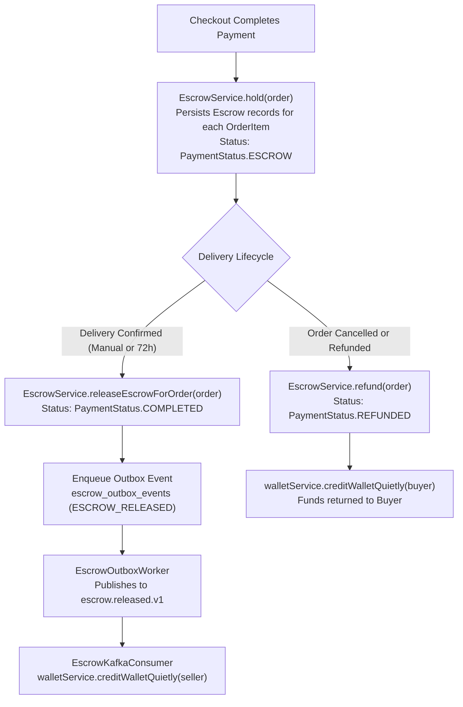

# Escrow Domain

## 1. Domain Scope & Purpose
The `escrow` domain implements the platform's "Safe Trade" fiduciary guarantee. It holds buyer funds in custody upon checkout and releases them to the seller's eWallet only after delivery handover has been verified (or returns them to the buyer if an order is cancelled or refunded). Fund releases are decoupled via the Transactional Outbox pattern and Apache Kafka.

> [!NOTE]
> **Related Documentation & Runbooks:**
> - **Architecture Deep Dive:** [`docs/escrow-lifecycle-and-state-machine.md`](../../../../../../../docs/escrow-lifecycle-and-state-machine.md)
> - **Architecture Deep Dive:** [`docs/checkout-pipeline-and-distributed-transaction-flow.md`](../../../../../../../docs/checkout-pipeline-and-distributed-transaction-flow.md)
> - **Frontend Module:** [`secondhand-frontend/src/payments/README.md`](../../../../../../../secondhand-frontend/src/payments/README.md)
> - **Frontend Module:** [`secondhand-frontend/src/order/README.md`](../../../../../../../secondhand-frontend/src/order/README.md)
> - **Task Runbooks:**
>   - [`modify-escrow-behavior.md`](.docs/runbooks/modify-escrow-behavior.md) — Modify escrow state rules and release conditions

---

## 2. Step-by-Step Execution Lifecycle

1. **Escrow Intake & Locking (`hold`):**
   - Triggered by `CheckoutOrchestrator` immediately following successful payment.
   - Computes the exact monetary allocation for each `OrderItem` (proportional coupon and campaign discounts subtracted).
   - Persists a dedicated `Escrow` record for each item in the `escrows` table linking `buyer`, `seller`, `order`, `orderItem`, `amount`, and audit snapshot fields (`listingTitle`, `listingNo`).
   - Status is set to `PaymentStatus.ESCROW`.
   - Evicts `payment:stats` cache to ensure dashboards reflect newly locked escrow amounts.
2. **Escrow Release (`releaseEscrowForOrder`):**
   - Triggered when the buyer confirms delivery (`PUT /api/v1/orders/{id}/complete`) or when `OrderCompletionScheduler` triggers auto-completion after 72 hours (cargo) or 24 hours (meetup).
   - Updates each linked `Escrow` entity's status to `PaymentStatus.COMPLETED` and sets `releasedAt = NOW()`.
   - Enqueues an `ESCROW_RELEASED` event into `escrow_outbox_events` within the same transaction.
3. **Asynchronous Seller Crediting (Kafka Outbox Pipeline):**
   - `EscrowOutboxWorker` dispatches the event to Kafka topic `escrow.released.v1`.
   - `EscrowKafkaConsumer` intercepts the message, checks idempotency via `processed_kafka_events`, and invokes `walletService.creditWalletQuietly(...)` to safely transfer the net earnings into the seller's eWallet.
4. **Escrow Reversal & Refund (`refund`):**
   - Triggered upon valid order cancellation or approved 48-hour return request.
   - Updates `Escrow` status to `PaymentStatus.REFUNDED` and records `refundedAt = NOW()`.
   - Refunds the held funds back into the buyer's eWallet ledger.

---

## 3. Business Invariants & Fiduciary Guarantees

* **Item-Level Escrow Ledger:** Escrow is tracked at the individual `OrderItem` level within the `escrows` table, enabling granular partial returns or multi-item order compensations without ambiguous pooling.
* **Pre-Release Refund Window:** Funds can only be refunded or reversed while in `PaymentStatus.ESCROW`. Once released to `PaymentStatus.COMPLETED`, the money is the legal property of the seller and cannot be clawed back via automated escrow operations.
* **Asynchronous Wallet Crediting:** Escrow releases do not execute synchronous wallet mutations inside the order completion request; the credit is guaranteed asynchronously via Kafka with consumer idempotency.
* **Zero Direct P2P Transfers:** Buyers never transfer purchase money directly to seller bank accounts; platform escrow acts as the intermediary for all non-cash trades.

---

## 4. Transactional Outbox & Kafka Architecture

* **Outbox Table:** `escrow_outbox_events` (`id`, `aggregate_type`, `aggregate_id`, `event_type`, `payload`, `status`, `created_at`, `processed_at`).
* **Scheduled Worker:** `EscrowOutboxWorker` (runs every 5000ms with Redis distributed lock).
* **Published Kafka Topic:** `escrow.released.v1` (`EscrowReleasedKafkaEvent`).
* **Consumer:** `EscrowKafkaConsumer` (processes `escrow.released.v1`, `order.cancelled.v1`, `order.refunded.v1`).

---

## 5. Database Schema & Flyway Structure

* **`escrows` Table:**
  - `id`: BigInt primary key.
  - `order_item_id`: Unique foreign key to `order_items`.
  - `order_id`: Foreign key to `orders`.
  - `seller_id`: Foreign key to `users` (seller).
  - `buyer_id`: Foreign key to `users` (buyer).
  - `amount`: Decimal(10, 2) held amount.
  - `status`: `PaymentStatus` enum (`ESCROW`, `COMPLETED`, `REFUNDED`, `CANCELLED`).
  - `listing_title`, `listing_no`, `listing_id`: Audit snapshot fields.
  - `blocked_at`, `released_at`, `refunded_at`: State timestamps.
  - Indexed on `(order_id)`, `(seller_id)`, and `(status)`.
