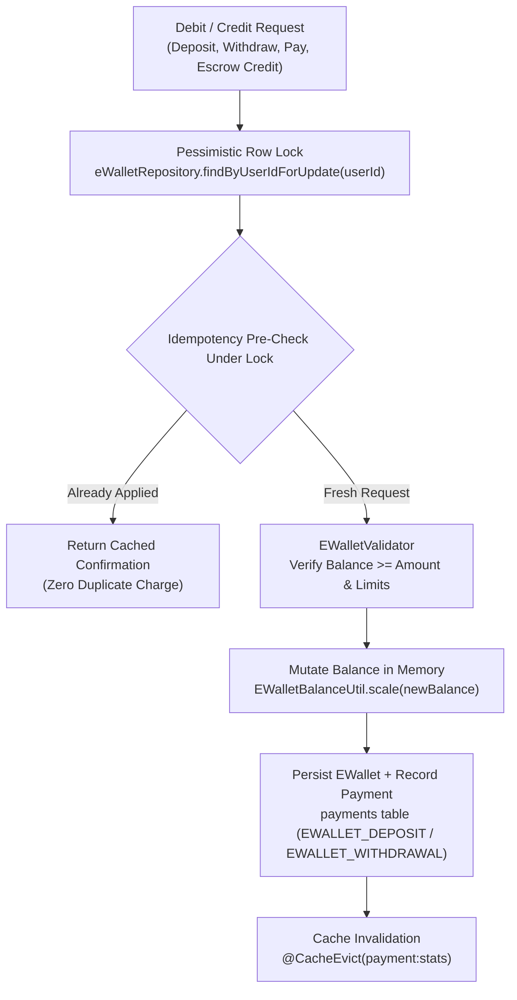

# EWallet Domain

## 1. Domain Scope & Purpose
The `ewallet` domain manages the internal virtual stored-value accounts of platform users. It provides deposit, withdrawal, and peer-to-peer settlement facilities, implements pessimistic database locking (`SELECT ... FOR UPDATE`) to prevent race conditions and double-spending, monitors proactive spending warning thresholds, and serves as an integrated payment method via `EWalletPaymentProviderAdapter`.

---

## 2. Step-by-Step Execution Lifecycle

1. **Pessimistic Concurrency Acquisition (`getEWalletOrThrowWithLock`):**
   - Every balance-modifying action (deposit, withdrawal, order payment, escrow payout) queries `e_wallets` using `findByUserIdForUpdate(userId)`.
   - This places a PostgreSQL exclusive row-level lock (`FOR UPDATE`), serializing concurrent transactions on that user's wallet.
2. **Atomic Idempotency Verification (`alreadyApplied`):**
   - Executed *under* the acquired wallet row lock.
   - Queries `payments` to see if the given `idempotencyKey` has already been recorded for this user and transaction type.
   - If a concurrent thread submitted the identical key, it waits on the lock, wakes up, detects `alreadyApplied = true`, and returns immediately without applying duplicate balance modifications.
3. **Domain Validation (`EWalletValidator`):**
   - Verifies that `amount > 0`.
   - On debit/withdrawal, validates that current balance $\ge$ requested amount.
   - Validates user-defined limits (`walletLimit`, `spendingWarningLimit`).
4. **Balance Mutation & Financial Precision:**
   - Computes new balance using `EWalletBalanceUtil.scale(...)` (strictly 2 decimal places with `RoundingMode.HALF_UP`).
   - Updates `e_wallets` row.
5. **Ledger Synchronisation & Cache Eviction:**
   - Automatically inserts a corresponding `Payment` record into the central payment ledger (`EWALLET_DEPOSIT`, `EWALLET_WITHDRAWAL`, `EWALLET_TRANSFER`).
   - Invalidates user dashboard metrics via `@CacheEvict(value = "payment:stats", allEntries = true)`.

---

## 3. Business Invariants & Concurrency Guarantees

* **Non-Negative Balance Floor:** A wallet balance can never drop below zero under any circumstance.
* **Pessimistic Concurrency Invariant:** Balance calculations are strictly prohibited in-memory without an active database row lock.
* **Proactive Monthly Spending Warnings:** Users can configure a `spendingWarningLimit`. When checking out or calling `/spending-warning/check`, the service aggregates all outgoing completed payments within the current calendar month:
  $$\text{MonthlySpend} = \sum \text{Outgoing Completed Payments this Month}$$
  If $\text{MonthlySpend} + \text{RequestedAmount} > \text{SpendingWarningLimit}$, a proactive alert is returned to the client without blocking the transaction.
* **Quiet Escrow Payouts (`creditWalletQuietly`):** Used by asynchronous Kafka consumers (`EscrowKafkaConsumer`). If crediting fails, errors are caught, logged, and retried without crashing the consumer container.

---

## 4. Integration with Payment Engine (`PaymentProviderPort`)

The `ewallet` domain integrates directly into the central payment pipeline through `EWalletPaymentProviderAdapter`:
* Implements `PaymentProviderPort.supports("EWALLET")`.
* During multi-seller checkout, `OrderPaymentService` delegates order payment to the adapter, which locks the wallet, debits the order amount, and links the payment reference.

---

## 5. Database Schema & Flyway Structure

Stored in the `e_wallets` table:
* `id`: BigInt primary key.
* `user_id`: Unique foreign key to `users`.
* `balance`: Decimal(19, 2) current available balance.
* `currency`: VarChar(3) currency code (default: `"TRY"`).
* `spending_warning_limit`: Decimal(19, 2) optional user warning threshold.
* `limit`: Decimal(19, 2) optional wallet capacity limit.
* `created_at`, `updated_at`: Audit timestamps.

---

## 6. Public REST API Contracts (`EWalletController` — `/api/v1/e-wallets`)

* **`POST /`:** Initializes an e-wallet for the authenticated user (`EwalletRequest`).
* **`GET /`:** Retrieves current wallet balance, currency, and limit settings.
* **`POST /deposit`:** Deposits funds into wallet (requires `Idempotency-Key` header).
* **`POST /withdraw`:** Withdraws funds from wallet to bank account (requires `Idempotency-Key` header).
* **`PUT /update/spending-warning`:** Configures monthly spending alert threshold.
* **`DELETE /update/spending-warning`:** Removes spending alert threshold.
* **`GET /balance/check?amount={AMOUNT}`:** Fast boolean check verifying whether balance covers an amount.
* **`GET /spending-warning/check?amount={AMOUNT}`:** Returns whether a pending amount triggers the monthly budget warning.
* **`GET /transactions?page=0&size=10`:** Paginated transaction history for the user's wallet.
