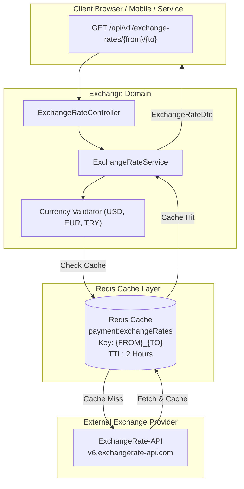

# Exchange Domain

## 1. Executive Summary & Purpose
The `exchange` domain provides real-time and cached currency exchange rates between supported currencies (`USD`, `EUR`, and `TRY`) for multi-currency conversion displays, international buyer price approximations, and escrow valuation.

### Core Architectural Features
- **Third-Party API Integration:** Connects to ExchangeRate-API via Spring's `RestTemplate` configured with strict 5-second connection and 10-second read timeouts.
- **Two-Hour Redis Caching:** Exchange pairs are cached via `@Cacheable(value = "payment:exchangeRates")` with a 2-hour TTL to guard against remote downtime, eliminate redundant outbound HTTP requests, and prevent vendor rate-limit exhaustion.
- **Resilient Fallback Policy:** Network disconnects throw a structured `EXCHANGE_SERVICE_UNAVAILABLE` error (`503 Service Unavailable`) rather than causing hanging threads.
- **Case-Insensitive Normalization:** Currency keys are automatically capitalized (e.g. `USD_TRY`).

---

## 2. Architecture & Data Flow



---

## 3. Business Invariants & Constraints

1. **Supported Currency Set:** Validates currency pairs strictly against `USD`, `EUR`, and `TRY`. Unsupported ISO codes are rejected immediately with `IllegalArgumentException`.
2. **Normalized Cache Keys:** Cache keys follow the strict uppercase pattern `#from.toUpperCase() + '_' + #to.toUpperCase()` (e.g. `payment:exchangeRates:USD_TRY`).
3. **Graceful Timeout Bounds:** Connection timeouts are bounded at 5,000 ms; read timeouts are bounded at 10,000 ms.

---

## 4. Public REST API Specifications

| Method | Endpoint | Auth | Purpose | Response |
|---|---|---|---|---|
| `GET` | `/api/v1/exchange-rates/{from}/{to}` | Public | Get real-time or cached conversion rate | `ExchangeRateDto` |

### Sample Response (`GET /api/v1/exchange-rates/USD/TRY`)
```json
{
  "from": "USD",
  "to": "TRY",
  "rate": 34.25
}
```

---

## 5. Error Codes
- `EXCHANGE_SERVICE_UNAVAILABLE`: External exchange rate provider is unreachable (`503 Service Unavailable`).
- `EXCHANGE_SERVICE_ERROR`: Remote provider returned a non-success response (`502 Bad Gateway`).
- `EXCHANGE_UNEXPECTED_ERROR`: Internal processing or JSON parse error (`500 Internal Server Error`).
