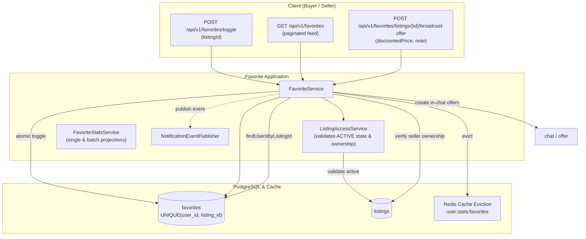

# Favorite Domain

## 1. Executive Summary & Architecture
The `favorite` domain allows users to bookmark active listings, query social proof metrics, aggregate cross-platform popularity analytics, and empowers sellers to broadcast targeted, private discounted offers to users who have bookmarked their listings.

### Architectural Highlights
- **Active State Validation:** Bookmarking requires the listing to be in the `ACTIVE` state (`ListingAccessService.validateActive`).
- **Self-Favorite Prevention:** Users cannot favorite their own listings (`OWN_LISTING`).
- **Idempotency & Concurrency:** Protected by a composite database unique constraint `(user_id, listing_id)` on the `favorites` table.
- **Fail-Safe Notifications:** Favorite creation alerts to sellers are dispatched asynchronously via `NotificationEventPublisher`; notification failures never roll back the primary bookmark transaction.
- **Broadcast Private Offers:** Enables sellers to broadcast discounted offers directly to all active favoriters through in-chat negotiations (`broadcastOfferToFavoriters`).
- **Cache Invalidation:** Any favorite mutation triggers `@CacheEvict(value = "user:stats:favorites", allEntries = true)`.

---

## 2. Architecture & Event Flow

---

## 3. Core Entities & Database Schema

### `favorites` Table
- `id` (UUID, PK)
- `user_id` (BIGINT, FK -> `users.id`, not null)
- `listing_id` (UUID, FK -> `listings.id`, not null)
- `created_at` (TIMESTAMP, not null)
- *Unique Constraint:* `UNIQUE (user_id, listing_id)`
- *Indexes:* `idx_favorites_user_id`, `idx_favorites_listing_id`

---

## 4. Business Invariants & Lifecycle Mechanics

### 4.1 Adding & Toggling Favorites
1. **Listing Resolution & Status:** Verifies listing existence and validates status is `ACTIVE`.
2. **Self-Favorite Check:** If `listing.getSeller().getId().equals(userId)`, rejects with `CANNOT_FAVORITE_OWN_LISTING`.
3. **Atomic Persistence:** Saves `Favorite` entity. If a duplicate insert occurs concurrently, catches `DataIntegrityViolationException` and handles gracefully or returns `ALREADY_FAVORITED`.
4. **Seller Notification:** Emits a notification to the seller (`LISTING_FAVORITED`) via `NotificationTemplateCatalog`. Any exception in notification dispatch is caught and logged, ensuring the favorite persists.

### 4.2 Batch Projections & Social Proof
- `FavoriteStatsService` computes total favorite count and whether the caller has favorited the listing.
- Supports batch lookups (`POST /api/v1/favorites/stats`) for search result pages to prevent $N+1$ queries.
- Top favorited listings across the platform are calculated using database aggregations (`findTopFavoritedListings`) and enriched with current viewer context.

### 4.3 Seller Broadcast Offers (`broadcastOfferToFavoriters`)
1. Only the verified listing seller can trigger this action.
2. Retrieves all users who favorited the listing (`favoriteRepository.findUsersByListingId(listingId)`), excluding the seller.
3. Iterates through favoriters and initiates or sends an in-chat offer for each buyer with the discounted price.
4. Returns a summary `FavoriterBroadcastResponseDto` containing the count of successfully notified favoriters.

---

## 5. Public REST API Specifications

| Method | Endpoint | Auth | Purpose | Response |
|---|---|---|---|---|
| `POST` | `/api/v1/favorites` | Bearer | Add listing to user favorites | `FavoriteDto` |
| `DELETE` | `/api/v1/favorites/{listing-id}` | Bearer | Remove listing from favorites | `200 OK` |
| `POST` | `/api/v1/favorites/toggle` | Bearer | Toggle favorite status | `Map<String, Object>` |
| `GET` | `/api/v1/favorites` | Bearer | Paginated list of favorited listings | `Page<FavoriteDto>` |
| `GET` | `/api/v1/favorites/stats/{listing-id}` | Public/Auth | Favorite count and caller status | `FavoriteStatsDto` |
| `POST` | `/api/v1/favorites/stats` | Public/Auth | Batch favorite stats for list of UUIDs | `Map<UUID, FavoriteStatsDto>` |
| `GET` | `/api/v1/favorites/check/{listing-id}` | Bearer | Boolean check if user favorited listing | `Boolean` |
| `GET` | `/api/v1/favorites/count/{listing-id}` | Public | Total favorite count for a listing | `Long` |
| `GET` | `/api/v1/favorites/ids` | Bearer | List of all listing UUIDs favorited by user | `List<UUID>` |
| `GET` | `/api/v1/favorites/top` | Public | Top favorited listing IDs across platform | `Page<Object[]>` |
| `GET` | `/api/v1/favorites/top-listings` | Public/Auth | Top favorited listings enriched with details | `List<ListingDto>` |
| `POST` | `/api/v1/favorites/listings/{listing-id}/broadcast-offer` | Bearer | Seller broadcasts private discount to favoriters | `FavoriterBroadcastResponseDto` |

---

## 6. Error Codes

Defined in `FavoriteErrorCodes`:
- `LISTING_NOT_FOUND`: Listing does not exist.
- `LISTING_NOT_ACTIVE`: Listing is not in `ACTIVE` status.
- `OWN_LISTING`: User attempted to favorite their own listing.
- `ALREADY_FAVORITED`: Listing is already in user favorites.
- `FAVORITE_NOT_FOUND`: Favorite record does not exist to remove.
- `USER_NOT_FOUND`: Authenticated user could not be resolved.
