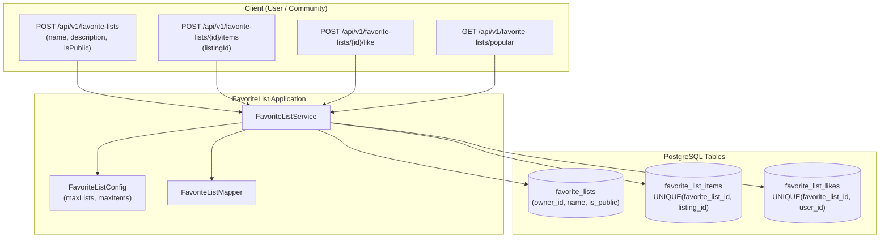

# FavoriteList Domain

## 1. Executive Summary & Purpose
The `favoritelist` domain enables users to curate custom, named collections of listings (e.g. "Dream Cars", "Living Room Makeover", "Tech Gadgets"), configure visibility permissions (Public vs. Private), and allows community users to discover and like public collections.

> [!NOTE]
> **Related Documentation & Runbooks:**
> - **Architecture Deep Dive:** [`docs/social-proof-and-urgency-metrics-architecture.md`](../../../../../../../docs/social-proof-and-urgency-metrics-architecture.md)
> - **Frontend Module:** [`secondhand-frontend/src/favoritelist/README.md`](../../../../../../../secondhand-frontend/src/favoritelist/README.md)
> - **Task Runbooks:**
>   - [`modify-favoritelist-behavior.md`](.docs/runbooks/modify-favoritelist-behavior.md) — Modify favorite list and collection behavior

### Core Architectural Features
- **Configurable Capacity Limits:** Enforces maximum collections per user (`maxListsPerUser`) and maximum items per list (`maxItemsPerList`) via `FavoriteListConfig`.
- **Database-Level Projections:** Endpoints utilize `FavoriteListSummaryProjection` to calculate collection size and like counts directly in PostgreSQL, avoiding expensive in-memory collection hydration.
- **Privacy & Authorization:** Private lists are strictly isolated to their creator. Public lists can be viewed and liked by any authenticated community member.
- **Self-Like Protection:** Users are strictly forbidden from liking their own public lists.

---

## 2. Architecture & Data Flow

---

## 3. Core Entities & Database Schema

### 3.1 `favorite_lists` Table
- `id` (BIGINT, PK)
- `user_id` (BIGINT, FK -> `users.id`, list owner)
- `name` (VARCHAR(100), not null)
- `description` (VARCHAR(500), nullable)
- `is_public` (BOOLEAN, default `false`)
- `cover_image_url` (VARCHAR(500), nullable)
- `created_at` / `updated_at` (Timestamps)
- *Unique Constraint:* `UNIQUE (user_id, name)`

### 3.2 `favorite_list_items` Table
- `id` (BIGINT, PK)
- `favorite_list_id` (BIGINT, FK -> `favorite_lists.id`, not null)
- `listing_id` (UUID, FK -> `listings.id`, not null)
- `created_at` (TIMESTAMP, not null)
- *Unique Constraint:* `UNIQUE (favorite_list_id, listing_id)`

### 3.3 `favorite_list_likes` Table
- `id` (BIGINT, PK)
- `favorite_list_id` (BIGINT, FK -> `favorite_lists.id`, not null)
- `user_id` (BIGINT, FK -> `users.id`, not null)
- `created_at` (TIMESTAMP, not null)
- *Unique Constraint:* `UNIQUE (favorite_list_id, user_id)`

---

## 4. Business Invariants & Lifecycle Rules

### 4.1 Collection Creation & Limits
- **User List Limit:** `favoriteListRepository.countByOwner(currentUser) >= maxListsPerUser` triggers `FAVORITE_LIST_LIMIT_EXCEEDED`.
- **Name Uniqueness:** A user cannot have two lists with identical names (`FAVORITE_LIST_NAME_EXISTS`).
- **Item Capacity:** Adding an item when `countByFavoriteList(favoriteList) >= maxItemsPerList` triggers `FAVORITE_LIST_ITEM_LIMIT_EXCEEDED`.
- **Item Uniqueness:** A listing cannot be added twice to the same list (`FAVORITE_LIST_ITEM_ALREADY_EXISTS`).

### 4.2 Privacy & Permissions
- **Private Lists (`is_public = false`):**
  - Visible only to the owner (`currentUser.getId().equals(favoriteList.getOwner().getId())`).
  - Third-party access returns `FAVORITE_LIST_PRIVATE`.
  - Cannot be liked by anyone (including the owner).
- **Public Lists (`is_public = true`):**
  - Visible to all authenticated and anonymous viewers.
  - Can be liked by any authenticated user except the owner (`CANNOT_LIKE_OWN_LIST`).

---

## 5. Public REST API Specifications

| Method | Endpoint | Auth | Purpose | Response |
|---|---|---|---|---|
| `POST` | `/api/v1/favorite-lists` | Bearer | Create a new favorite list | `FavoriteListDto` |
| `GET` | `/api/v1/favorite-lists/my` | Bearer | Paginated lists created by authenticated user | `Page<FavoriteListSummaryDto>` |
| `GET` | `/api/v1/favorite-lists/user/{user-id}` | Public/Auth | Paginated public lists for a specific user | `Page<FavoriteListSummaryDto>` |
| `GET` | `/api/v1/favorite-lists/popular` | Public | Popular public lists ordered by like count | `Page<FavoriteListSummaryDto>` |
| `GET` | `/api/v1/favorite-lists/{list-id}` | Public/Auth | Full details of a list and its contained items | `FavoriteListDto` |
| `PUT` | `/api/v1/favorite-lists/{list-id}` | Bearer | Update list metadata (name, description, privacy) | `FavoriteListDto` |
| `DELETE` | `/api/v1/favorite-lists/{list-id}` | Bearer | Delete a favorite list and its items | `204 No Content` |
| `POST` | `/api/v1/favorite-lists/{list-id}/items` | Bearer | Add a listing to a favorite list | `FavoriteListItemDto` |
| `DELETE` | `/api/v1/favorite-lists/{list-id}/items/{listing-id}` | Bearer | Remove an item from a favorite list | `204 No Content` |
| `POST` | `/api/v1/favorite-lists/{list-id}/like` | Bearer | Like a public favorite list | `200 OK` |
| `DELETE` | `/api/v1/favorite-lists/{list-id}/like` | Bearer | Remove like from a public list | `200 OK` |
| `GET` | `/api/v1/favorite-lists/listing/{listing-id}/lists` | Bearer | List of user's list IDs containing this listing | `List<Long>` |

---

## 6. Error Codes

Defined in `FavoriteListErrorCodes`:
- `FAVORITE_LIST_NOT_FOUND`: Target list does not exist.
- `FAVORITE_LIST_FORBIDDEN`: Attempt to modify another user's list.
- `FAVORITE_LIST_PRIVATE`: Target list is private and inaccessible.
- `FAVORITE_LIST_LIMIT_EXCEEDED`: User list quota reached.
- `FAVORITE_LIST_ITEM_LIMIT_EXCEEDED`: List item capacity reached.
- `FAVORITE_LIST_NAME_EXISTS`: User already has a list with this name.
- `FAVORITE_LIST_ITEM_ALREADY_EXISTS`: Listing is already in this list.
- `FAVORITE_LIST_ITEM_NOT_FOUND`: Listing does not exist in this list.
- `CANNOT_LIKE_OWN_LIST`: Owner cannot like their own list.
- `CANNOT_LIKE_PRIVATE_LIST`: Private lists cannot receive likes.
- `ALREADY_LIKED`: User already liked this list.
- `NOT_LIKED`: User has not liked this list.
