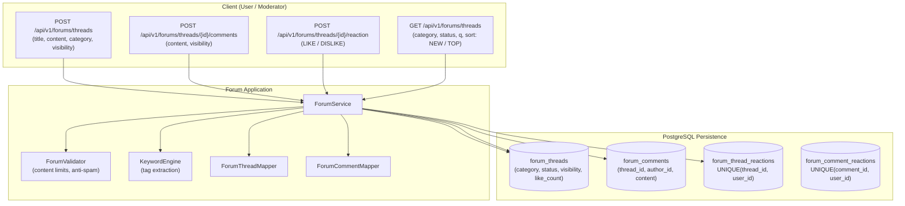

# Forum Domain

## 1. Executive Summary & Purpose
The `forum` domain powers community discussions, feature suggestions, complaint topics, and interactive feedback across the marketplace.

> [!NOTE]
> **Related Documentation & Runbooks:**
> - **Frontend Module:** [`secondhand-frontend/src/forum/README.md`](../../../../../../../secondhand-frontend/src/forum/README.md)

### Architectural Features
- **Hierarchical Discussion:** Supports root topics (`ForumThread`) with categorized domains (`ForumCategory`: `SUGGESTIONS`, `COMPLAINTS`) and nested replies (`ForumComment`).
- **Granular Author Privacy:** `ForumAuthorVisibility` allows authors to choose between anonymous posting (`ANONYMOUS`), display nickname (`DISPLAY_NAME`), or full name (`FULL_NAME`).
- **Atomic Reaction Engine:** Bidirectional reactions (`ForumReactionType`: `LIKE`, `DISLIKE`) with automatic single-active-reaction enforcement. Clicking the same reaction toggles it off; clicking the opposite reaction toggles and swaps counters atomically.
- **Search & Tagging:** `KeywordEngine` automatically extracts meaningful tags from thread content for search indexing and categorization.

---

## 2. Architecture & Data Flow

---

## 3. Core Entities & Database Schema

### 3.1 `forum_threads` Table
- `id` (BIGINT, PK)
- `author_id` (BIGINT, FK -> `users.id`, not null)
- `title` (VARCHAR(200), not null)
- `content` (TEXT, not null)
- `category` (VARCHAR(50), maps to `ForumCategory`: `SUGGESTIONS`, `COMPLAINTS`)
- `status` (VARCHAR(30), maps to `ForumThreadStatus`: `OPEN`, `IN_PROGRESS`, `RESOLVED`)
- `visibility` (VARCHAR(30), maps to `ForumAuthorVisibility`: `ANONYMOUS`, `DISPLAY_NAME`, `FULL_NAME`)
- `like_count` / `dislike_count` / `comment_count` / `view_count` (INT counters)
- `tags` (JSONB / text array of extracted keywords)
- `created_at` / `updated_at` (Timestamps)

### 3.2 `forum_comments` Table
- `id` (BIGINT, PK)
- `thread_id` (BIGINT, FK -> `forum_threads.id`, not null)
- `author_id` (BIGINT, FK -> `users.id`, not null)
- `content` (TEXT, not null)
- `visibility` (VARCHAR(30), maps to `ForumAuthorVisibility`)
- `like_count` / `dislike_count` (INT counters)
- `created_at` (TIMESTAMP, not null)

### 3.3 Reaction Tables
- **`forum_thread_reactions`:** `id`, `thread_id`, `user_id`, `reaction_type` (`LIKE`, `DISLIKE`), `created_at`. Unique: `UNIQUE (thread_id, user_id)`.
- **`forum_comment_reactions`:** `id`, `comment_id`, `user_id`, `reaction_type` (`LIKE`, `DISLIKE`), `created_at`. Unique: `UNIQUE (comment_id, user_id)`.

---

## 4. Business Invariants & Lifecycle Mechanics

### 4.1 Thread Lifecycle & Moderation
- **Creation:** Authors define title, content, category, and desired author visibility. `KeywordEngine` extracts normalized tags.
- **Status Progression (`ForumThreadStatus`):**
  - `OPEN`: Initial active state; open to replies and votes.
  - `IN_PROGRESS`: Marked by moderators or support staff as under review.
  - `RESOLVED`: Suggestion implemented or complaint resolved.
- **Ownership Verification:** Only the author or platform moderators can edit thread content or delete the thread.

### 4.2 Atomic Reaction State Machine
1. A user can submit `LIKE` or `DISLIKE`.
2. **Toggle Off:** If the user previously submitted `LIKE` and sends `LIKE` again, the reaction record is deleted and `like_count` is decremented by 1.
3. **Swap Reaction:** If the user previously submitted `LIKE` and sends `DISLIKE`, the record is updated to `DISLIKE`, `like_count` is decremented by 1, and `dislike_count` is incremented by 1 in a single transaction.
4. **New Reaction:** If no prior reaction exists, a new record is created and the corresponding counter is incremented.

### 4.3 Author Privacy & Anonymity
- `ANONYMOUS`: Author details are masked in API responses (displaying generic "Anonymous" badge and null avatar).
- `DISPLAY_NAME`: Shows user's chosen pseudonym or public handle.
- `FULL_NAME`: Shows user's full name.

---

## 5. Public REST API Specifications

| Method | Endpoint | Auth | Purpose | Response |
|---|---|---|---|---|
| `GET` | `/api/v1/forums/threads` | Public/Auth | Paginated thread search with filters & sorting | `Page<ForumThreadDto>` |
| `GET` | `/api/v1/forums/threads/{thread-id}` | Public/Auth | Detailed thread view with user-specific reactions | `ForumThreadDto` |
| `POST` | `/api/v1/forums/threads` | Bearer | Publish new forum thread | `ForumThreadDto` |
| `PATCH` | `/api/v1/forums/threads/{thread-id}` | Bearer | Edit thread title and content (author only) | `ForumThreadDto` |
| `PATCH` | `/api/v1/forums/threads/{thread-id}/status` | Bearer | Update thread status (`OPEN`, `IN_PROGRESS`, `RESOLVED`) | `ForumThreadDto` |
| `DELETE` | `/api/v1/forums/threads/{thread-id}` | Bearer | Delete a thread (author/admin only) | `204 No Content` |
| `POST` | `/api/v1/forums/threads/{thread-id}/reaction` | Bearer | Add, swap, or toggle reaction on thread | `ForumThreadDto` |
| `GET` | `/api/v1/forums/threads/{thread-id}/comments` | Public/Auth | Paginated list of comments on a thread | `Page<ForumCommentDto>` |
| `POST` | `/api/v1/forums/threads/{thread-id}/comments` | Bearer | Add a comment reply to a thread | `ForumCommentDto` |
| `POST` | `/api/v1/forums/threads/{thread-id}/comments/{comment-id}/reaction` | Bearer | Add, swap, or toggle reaction on a comment | `ForumCommentDto` |

---

## 6. Error Codes

Defined in `ForumErrorCodes`:
- `THREAD_NOT_FOUND`: Forum thread does not exist.
- `COMMENT_NOT_FOUND`: Comment does not exist.
- `UNAUTHORIZED_ACCESS`: User is not permitted to mutate this thread or comment.
- `INVALID_CATEGORY`: Invalid category specified.
- `INVALID_STATUS`: Invalid thread lifecycle status transition.
- `INVALID_REACTION`: Invalid reaction type provided.
