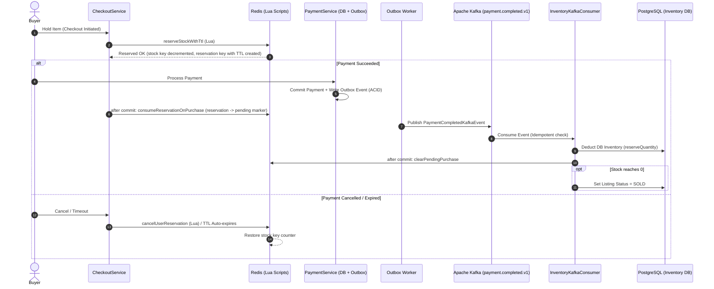

# Inventory Domain

## 1. Purpose & Problem Statement
In high-concurrency second-hand e-commerce environments, standard relational database row-locking (`SELECT FOR UPDATE`) causes database connection starvation, latency spikes, and deadlocks when multiple buyers attempt to purchase or hold the same product simultaneously.

The `inventory` domain implements a **High-Performance Distributed Stock Reservation Engine** combining:
- **Redis In-Memory Lua Scripting** for sub-millisecond atomic checks, reservations, and anti-hoarding TTLs.
- **Transactional Outbox & Apache Kafka** for reliable, asynchronous eventual consistency to PostgreSQL.
- **Background Reconciliation** for drift prevention and fault recovery.

---

## 2. Architecture & Component Roles

### Core Components
1. **[InventoryRedisReservationService](application/InventoryRedisReservationService.java):**
   - Coordinates in-memory stock states.
   - Executes atomic Lua scripts so that balance check, decrement, and user reservation binding occur in a single atomic Redis operation.
2. **[InventoryService](application/InventoryService.java):**
   - Manages physical PostgreSQL `inventory` entity state, reserved quantities, and available balances.
3. **[InventoryKafkaConsumer](application/InventoryKafkaConsumer.java):**
   - Asynchronously consumes `payment.completed.v1`.
   - Performs DB-level idempotency via `ProcessedKafkaEventRepository`.
   - Finalizes stock deduction in PostgreSQL and transitions listings to `SOLD` if stock hits zero.
4. **[StockReservationReconciliationScheduler](application/StockReservationReconciliationScheduler.java):**
   - Scheduled watchdog (every 5 minutes) that heals Redis stock drift, mainly units of reservations that expired without purchase or cancellation.
   - Expected Redis stock = PostgreSQL `availableQuantity` − active reservations − pending purchases. It reads the stock value first, then reservations, pending markers and PostgreSQL, and writes with `compare_and_set_stock.lua`, so a reservation made during the run is never overwritten.

---

## 3. Redis Key Structure & Lua Scripts

### Key Namespaces
- **Stock Counter:** `v4:inventory:stock:{listingId}` — Stores the currently unreserved available stock in Redis.
- **User Reservation:** `v4:inventory:reservation:{userId}:{listingId}` — Stores the quantity reserved by a specific user with an explicit TTL (default 15 minutes / 900s).
- **Pending Purchase:** `v4:inventory:pending:{orderItemId}:{listingId}` — Quantity paid but not yet deducted in PostgreSQL. Written after the checkout commit (before the reservation is deleted), removed by `InventoryKafkaConsumer` after its deduction commits. 24h TTL only as a safety net for a lost removal; an event stuck in `payment.completed.v1.DLT` longer than that needs manual stock correction.

### Lua Scripts ([src/main/resources/scripts/](../../../../../resources/scripts/))
| Script | Purpose | Arguments / Logic |
| :--- | :--- | :--- |
| `reserve_stock_with_ttl.lua` | Atomically verifies stock $\ge$ requested quantity. Initializes from DB fallback if Redis key is missing. Decrements `stock:{listingId}` and writes `reservation:{userId}:{listingId}` with `EXPIRE`. | Returns remaining stock or `-1` if insufficient. |
| `cancel_user_reservation.lua` | Reads reserved quantity from `reservation:{userId}:{listingId}`, deletes the key, and atomically increments `stock:{listingId}` back. A missing stock key is not recreated. | Returns `1` if a reservation was removed, else `0`. |
| `release_stock.lua` | Atomic increment of `stock:{listingId}` (order cancel/refund). A missing stock key is not created; the next reservation loads it from PostgreSQL. | Returns new stock count or `-1` if the key is absent. |
| `compare_and_set_stock.lua` | Reconciliation write: sets the stock only if it still holds the value observed by the job. | Returns `1` if written, `0` if the stock changed concurrently. |
| `reserve_stock.lua` | Simple non-TTL reservation fallback. | Returns remaining stock or `-1`. |

---

## 4. Invariants & Guarantees

1. **Zero Over-Selling Guarantee:** Stock checks and decrements are single-threaded atomic operations inside Redis via Lua scripts.
2. **Anti-Hoarding / TTL Expiration:** In-memory holds automatically expire after 15 minutes, freeing the item for other buyers if checkout is abandoned.
3. **At-Least-Once Delivery & Idempotent Consumption:** Kafka delivers events with at-least-once semantics. Consumer utilizes `ProcessedKafkaEvent` (`INSERT ON CONFLICT DO NOTHING`) to guarantee strictly exactly-once stock deductions.
4. **Automatic Sold-Out Transition:** If stock reaches `0` after DB deduction, the listing status is automatically flipped to `ListingStatus.SOLD`.

- **Stock deduction filter:** `InventoryKafkaConsumer` deducts stock only for `PaymentCompletedKafkaEvent.transactionType == ITEM_PURCHASE`. Listing fee (`LISTING_CREATION`), showcase and other payments also carry a `listingId` but never touch inventory.
