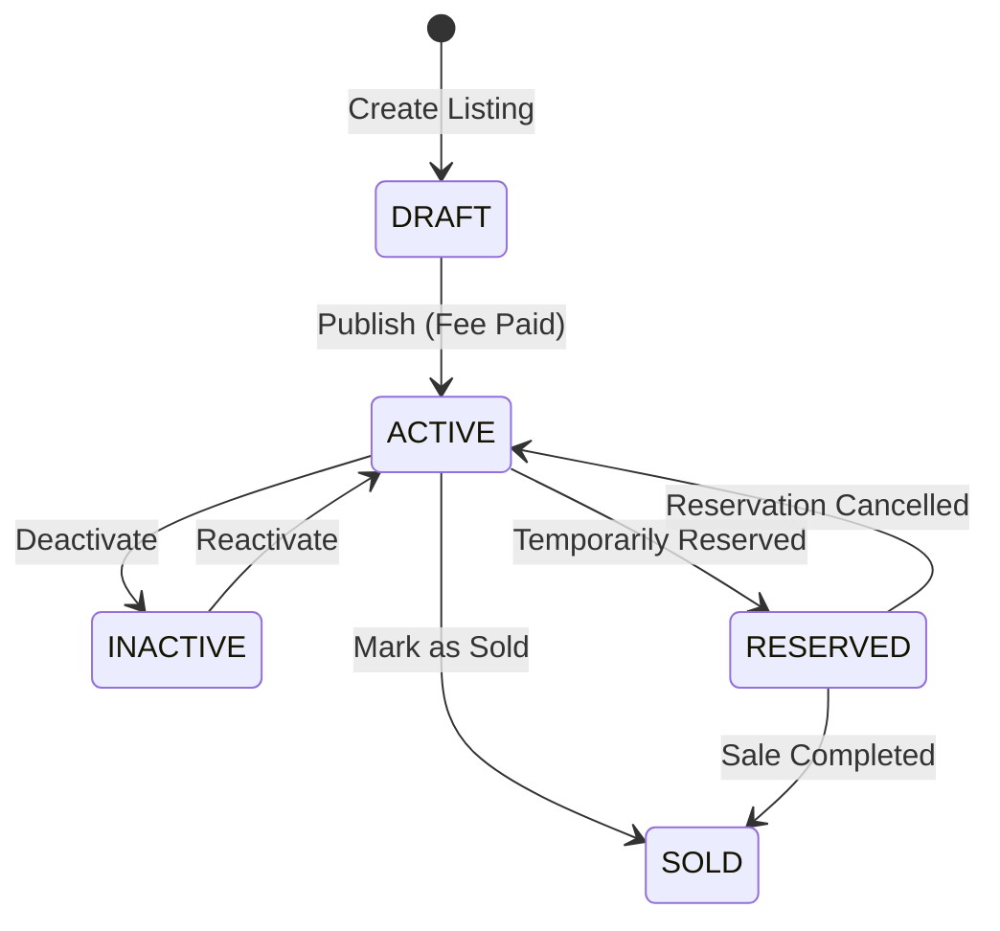

# Listing Domain

## Purpose
The `listing` domain is the core catalog engine. It manages the creation, validation, lifecycle (publish, deactivate, sell), searching, filtering, and statistical tracking of items across 6 distinct categories (Vehicle, Electronics, Books, Clothing, Real Estate, Sports).

## Architecture Overview
- **Rich Domain Model:** `Listing` entity encapsulates state-changing business rules (`publish()`, `deactivate()`, `updatePrice()`).
- **CQRS Separation:** Write operations (`ListingCommandService`) are segregated from complex read operations (`ListingQueryService`, `ListingSearchService`).
- **Ports & Adapters (Hexagonal):** Interactions with `payment` are abstracted through `ListingFeePaymentPort` and `PaymentModuleAdapter`.
- **AOP:** Price history changes are automatically tracked via `@TrackPriceChange` aspects.
- **Asynchronous Execution:** View tracking (`ListingViewService`) and read enrichment (fetching favorites/reviews) are executed asynchronously.

## Business Invariants & Constraints
- **State Validation:** A listing cannot be published unless its status is `DRAFT` or `INACTIVE` and any required listing fees are paid.
- **Polymorphism:** Category-specific data must inherit from the base `Listing` entity using the `JOINED` inheritance strategy.
- **Ownership Security:** Mutations (update, deactivate, mark sold) mandate strict ownership validation (`validateOwnership()`) in the domain logic.
- **Event Emission:** `NewListingCreatedEvent` is published exclusively after a successful transition to the `ACTIVE` state.
- **Decoupling:** `listing` must never directly depend on `payment` implementation details; it relies on ports.

## State Machine

## Integration Points
- **Incoming:** None directly (acts as a core source of truth).
- **Outgoing:** Payment Domain (via Adapter for listing fees), Follow/Notification (publishes events on new listings or price drops).

## Public APIs (Logical)
- CRUD for Base Listings and Specific Categories
- Search & Dynamic Criteria Filtering
- View Tracking & Aggregated Statistics
- Price History Queries

## Catalog Seeds
- Run with `APP_SEED=<key[,key]|listing|all>`; seeds are idempotent upserts from `src/main/resources/data/**`.
- `CatalogLegacyPruner` deletes rows missing from the JSON only if no foreign key references them. Real estate seeds also realign `name` to the JSON key (rows are matched by id).
- After all seeds `CatalogSeedStartupRunner` clears the `catalog:*` caches; `GET /api/v1/enums/all` (gzip, 5 min browser cache) also serves `roomConfigs` and `zoningStatuses`.
- The frontend derives land/residential behavior from `realEstateTypes[].category` and equipment options from `sportEquipmentTypes[].disciplineId`; do not hardcode type names.

## Attributes (shared, all listing types)
- `listing_attribute_definitions` (+ `listing_attribute_options`) declare which extra keys a listing type accepts; `scope_key` narrows a definition (vehicle type name, e.g. `CAR`), `ALL` applies to every scope. Seeded from `data/attributes/<type>.json` with seed key `attributes` (part of `listing`).
- `LISTING`-level values live in `listings.attributes` (JSONB, GIN index). `CATALOG`-level keys describe catalog leaves (e.g. `vehicle_versions.specs`) and are rejected on a listing.
- `ListingValidationEngine` runs `ListingAttributeValidator` after the category validators: unknown key, wrong type, range, option and required checks (`ATTRIBUTE_*` codes in `ListingErrorCodes`); empty values are dropped and accepted values normalized. Definitions are cached in `catalog:attributeDefinitions`.
- Removing a definition from the file deletes it; listings that still carry the key fail validation on their next update.

## Vehicle Catalog
- Vehicle types: `data/vehicles/types.json` defines the only types (CAR Otomobil, COMMERCIAL Hafif Ticari, TRUCK Ağır Vasıta, MOTORCYCLE Motosiklet; bicycles live under sports). Each type lists its allowed `bodyTypes` and a `fields` rule (`REQUIRED`/`OPTIONAL`/`HIDDEN`) for every spec field in `VehicleSpecFields`; stored on `vehicle_types` (V40) and served in `vehicleTypes[]` of `/api/v1/enums/all`. `VehicleTypeRulesValidator` applies them (`VEHICLE_<FIELD>_REQUIRED`, `VEHICLE_BODY_TYPE_NOT_ALLOWED`, hidden fields cleared); the form reads the same rules, so neither side checks type names. Type-specific extras (tramer, payload, axle configuration, cabin, ...) are attribute definitions scoped by type name. The listing form shows them in the "Durum ve geçmiş" section and the detail page in a "Durum" tab (frontend `listing/components/attributes/`).
- Hierarchy: type -> brand -> model -> generation -> version -> (trim). A generation holds body facts (`body_type`, `doors`, `seat_count`, `is_facelift`); a version (`vehicle_versions`) is one engine + gearbox + drivetrain with power, torque, years, list price, `source` (`claude-draft`/`verified`) and CATALOG `specs`.
- When a listing picks `vehicleVersionId`, `VehicleSpecSnapshotter` copies fuel, cc, hp, gearbox, drivetrain (version) and body type, doors, seats (generation) over the client's values; a null catalog value keeps the seller's. Without a version the specs are seller-declared (unverified).
- `VehicleHierarchyValidator`: the version must belong to the selected generation, the model year must be inside the version's years (generation's years when the version has none), and a trim must be one the version lists (no list = any trim of the generation).
- Seed files: `generations[].versions[]` is the full format; legacy `engines[]` (name + fuel) still works; a generation may not list both. Each version shares its id with a `vehicle_engines` row; versions and engines that left a seeded generation are pruned unless a listing points at them. The seed fails if brands.json uses a type types.json does not define, or a model/generation body type its type does not allow. Models a run did not seed are pruned unless a listing points at them; before that, a listing on such a model is moved to the seeded model with the same brand and name (e.g. a van moved from CAR to COMMERCIAL), matching generation, engine/version (name + fuel) and trim by name and clearing what has no match. Types missing from types.json are then pruned.
- Lookups: `GET /api/v1/catalog/vehicle/{types|brands|models|generations|versions|trims|attributes}` (public, cached in `catalog:vehicle`, `year` narrows generations and versions). In `/api/v1/enums/all`, `vehicleGenerations` carry the body facts and `vehicleEngines` carry their same-id version's facts (`versionId`, hp, cc, torque, gearbox, drivetrain, years, `source`).
- Listing form (`secondhand-frontend/src/listing/config/vehicleConfig.js`): picking an engine sends its id as `vehicleVersionId` too, fills the catalog facts and shows them read-only; the model year must fall inside the version's years.

## Electronics Catalog
- Electronic types: `data/electronics/types.json` defines the 19 types (label, `sortOrder`) and a `fields` rule (`REQUIRED`/`OPTIONAL`/`HIDDEN`) for every spec field in `ElectronicSpecFields`; stored on `electronic_types` (V41) and served in `electronicTypes[]` of `/api/v1/enums/all` together with `attributeKeys`. `ElectronicTypeRulesValidator` applies them (`ELECTRONIC_<FIELD>_REQUIRED`, hidden fields cleared, `wireless` derived from the connection type, `ELECTRONIC_YEAR_INVALID`, `ELECTRONIC_ORIGIN_REQUIRED` for warranty proof without origin); no code checks type names. The seed fails if brands.json uses a type types.json does not define.
- Condition and history answers (battery health, replaced parts, Face ID, IMEI, box, invoice, warranty end; consoles: controller count, drift, modded, cables, games; headphones: battery condition, both sides working, charging case, ear pads) are attribute definitions in `data/attributes/electronics.json`, scoped by type name, stored in `listings.attributes`. V41 copied the old `electronic_listings` columns into it and V42 dropped them. Filters on them use `ListingAttributePredicates` (JSONB, integer values cast in SQL).
- Hierarchy: type -> brand -> model -> variant. A model holds `specs` (keys in `ElectronicCatalogSpecs`: copied keys such as chipset, battery mAh, camera, 5G/NFC/dual SIM; display-only keys such as `screenInches`, refresh rate, IP rating), official `colors` (`[{name, color}]`, `color` = `Color` enum) and `source` (`claude-draft`/`verified`). A variant (`electronic_model_variants`) is one storage/RAM (phone) or CPU/GPU/RAM/SSD (laptop) combination.
- When a listing has a model, `ElectronicSpecSnapshotter` copies the model specs, then the picked variant's columns and specs, over the client's values (null catalog values keep the seller's); `colorName` must be one of the model's colors and sets the generic `color`. `Processor` stays the filterable family; `chipset` is the exact chip text. `ElectronicHierarchyValidator` adds `ELECTRONIC_VARIANT_MODEL_MISMATCH` and `ELECTRONIC_COLOR_NOT_IN_MODEL`.
- Seed checks: unknown spec keys, wrong value kinds, facts without `source`, unknown colors, duplicate variant names and variant columns repeated inside variant `specs` fail the seed. Variants that left a model are deleted unless a listing references them. Filled so far: iPhone 13-17, Galaxy S23-S25 and A34-A56, Pixel 6-8, Xiaomi 13-15 and POCO F6/X6 Pro, iPads 2021+, Galaxy Tab S8-S10, MacBook Air/Pro M1-M4, 13 consoles, 25 headphones, 12 Apple/Samsung watches, 55 cameras, 13 OLED TV series (size variants), 20 monitors, 10 speakers (all `claude-draft`; see `data/electronics/SOURCES.md`).
- Lookups: `GET /api/v1/catalog/electronics/models/{id}` (specs, colors, variants) and `/attributes?typeId=` (public). `/api/v1/enums/all` `electronicModels[]` also carry `specs`, `colors`, `variants` and `catalogSource`, so the form works synchronously.
- Listing form (`secondhand-frontend/src/listing/config/electronicsConfig.js`): fields follow the type rules, catalog values are read-only (catalog toggles are hidden), a model with official colors offers those instead of the generic list.

## Related Knowledge
- **Listing Data Flows**
  -> `.docs/knowledge/listing-data-flows.md`

- **Listing Architecture Patterns**
  -> `.docs/knowledge/listing-architecture-patterns.md`
