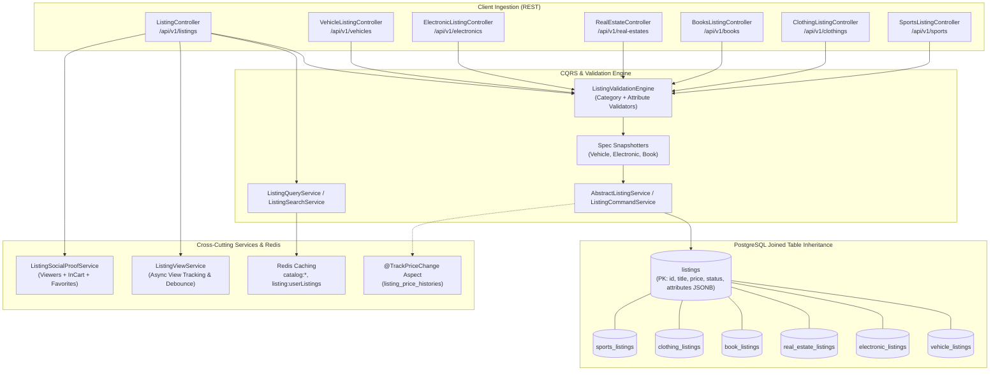
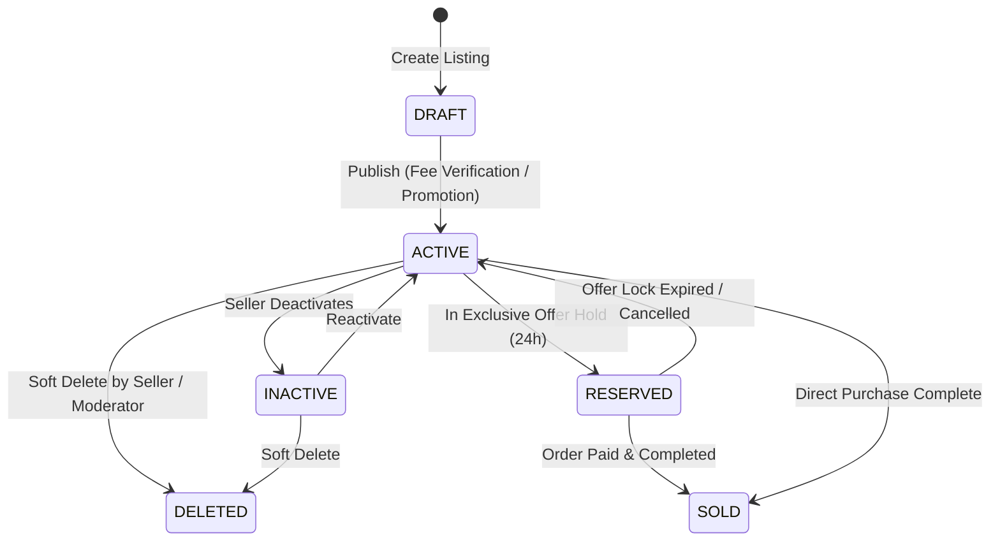

# Listing Domain

## 1. Executive Summary & Purpose
The `listing` domain is the core polymorphic catalog engine of the marketplace. It manages the creation, validation, lifecycle transitions (publish, deactivate, sell, reserve), search indexing, multi-vertical attribute rules, dynamic pricing history, and real-time view/social proof metrics across 6 distinct categories:
1. **Vehicles** (`VehicleListing` -> `vehicle_listings`)
2. **Electronics** (`ElectronicListing` -> `electronic_listings`)
3. **Real Estate** (`RealEstateListing` -> `real_estate_listings`)
4. **Books** (`BooksListing` -> `books_listings`)
5. **Clothing** (`ClothingListing` -> `clothing_listings`)
6. **Sports & Outdoor** (`SportsListing` -> `sports_listings`)

---

## 2. Architecture & Data Flow

---

## 3. Polymorphic Model & Database Architecture

Marketplace listings leverage **JPA Joined Table Inheritance** (`@Inheritance(strategy = InheritanceType.JOINED)`):

### 3.1 Base Entity: `listings`
Common fields shared across all listing categories:
- `id` (UUID, PK)
- `user_id` (BIGINT, FK -> `users.id`, listing seller)
- `category` (VARCHAR, maps to `ListingType`)
- `title` (VARCHAR(150), indexed)
- `description` (TEXT)
- `price` (NUMERIC(12,2), not null)
- `currency` (VARCHAR(3), default `'TRY'`)
- `status` (VARCHAR, maps to `ListingStatus`: `DRAFT`, `ACTIVE`, `INACTIVE`, `RESERVED`, `SOLD`, `DELETED`)
- `stock` (INT, default `1`)
- `city` / `district` / `neighborhood` (Location hierarchy strings)
- `images` (List of photo URLs stored in JSON/collection table)
- `attributes` (JSONB, indexed with GIN: `idx_listings_attributes_gin`)
- `view_count` / `favorite_count` (Denormalized counters)
- `created_at` / `updated_at` / `published_at` (Timestamps)

### 3.2 Category-Specific Tables
1. **`vehicle_listings`:** `brand_id`, `model_id`, `generation_id`, `version_id`, `trim_id`, `model_year`, `kilometer`, `fuel_type`, `transmission`, `body_type`, `engine_power`, `engine_capacity`, `color`, `damage_status`.
2. **`electronic_listings`:** `type_id`, `brand_id`, `model_id`, `variant_id`, `condition`, `color`, `has_box`, `has_invoice`, `warranty_status`.
3. **`real_estate_listings`:** `type_id`, `ad_type` (`FOR_SALE`, `FOR_RENT`), `gross_area_m2`, `net_area_m2`, `room_count`, `floor_number`, `total_floors`, `heating_type`, `building_age`, `furnished`, `approximate_lat`, `approximate_lon`.
4. **`book_listings`:** `work_id`, `edition_id`, `author_id`, `publisher_id`, `genre_id`, `isbn`, `publication_year`, `page_count`, `cover_type`, `language`, `condition`.
5. **`clothing_listings`:** `type_id`, `brand_id`, `audience` (`WOMEN`, `MEN`, `UNISEX`, `GIRL`, `BOY`, `BABY`), `size_system`, `size_key`, `color`, `condition`, `purchase_year`.
6. **`sports_listings`:** `sport_discipline_id`, `sport_equipment_type_id`, `sport_condition_id`.

---

## 4. Lifecycle & State Machine

- **Listing Creation:** Initial creation transitions listing to `DRAFT` or `ACTIVE` depending on whether listing fees are required by current membership tier limits.
- **Publish:** Validates completeness, required attributes, hierarchy integrity, and issues `NewListingCreatedEvent` upon transitioning to `ACTIVE`.
- **Price Tracking:** Any modification to `price` triggers the `@TrackPriceChange` aspect, recording historical records in `listing_price_histories` (`old_price`, `new_price`, `changed_at`).

---

## 5. Attributes Engine & Catalog Snapshotting

### 5.1 Dynamic Attributes (`listing_attribute_definitions`)
- Extra fields configured dynamically per category/type without altering SQL schemas.
- `scope_key` narrows definitions (e.g. `CAR`, `PHONE`, `RESIDENTIAL`), while `ALL` applies globally.
- Validated by `ListingAttributeValidator`: checks data types (INTEGER, DECIMAL, BOOLEAN, STRING, SELECT), allowed options (`listing_attribute_options`), regex patterns, and range boundaries.
- Values are persisted into the `listings.attributes` JSONB column.

### 5.2 Deterministic Snapshotters
When an entity links to a verified catalog item, snapshotters copy canonical specifications into the listing to guarantee immutable facts:
- **`VehicleSpecSnapshotter`:** Copies engine specs (`hp`, `cc`, `torque`, `gearbox`, `fuel`) from `vehicle_versions` and body facts (`doors`, `seat_count`) from `vehicle_generations`.
- **`ElectronicSpecSnapshotter`:** Copies hardware specs (`chipset`, `battery_mah`, `camera`) and official colors from `electronic_models` and `electronic_model_variants`.
- **`BooksEditionSnapshotter`:** Copies ISBN-13, page count, publication year, author, and publisher from `book_editions`.

---

## 6. Real-Time View Tracking & Social Proof

Managed by `ListingViewController` and `ListingViewService`:
- **Asynchronous Tracking:** View events (`POST /api/v1/listings/{id}/view`) are decoupled from reads and executed asynchronously.
- **Debounce Window:** Implements sliding-window debounce per client IP/session/user to prevent artificial view inflation.
- **Active Viewers (24h):** Calculates unique visitors over the past 24 hours (`getActiveViewerCount`).
- **Unified Social Proof:** `ListingSocialProofService.getSocialProof(id)` combines 3 hot metrics in a single lightweight payload:
  $$\text{SocialProof} = \{ \text{activeViewers24h}, \text{inCartUsersCount}, \text{favoriteCount} \}$$

---

## 7. Redis Caching Topology

| Cache Name | Key Pattern | Purpose | Invalidation Event |
|---|---|---|---|
| `catalog:brands` | `catalog:brands:all` | Vehicle brand catalog lookup | Admin catalog mutation |
| `catalog:vehicleTypes` | `catalog:vehicleTypes:all` | Vehicle type definitions | Startup / Seed runner |
| `catalog:clothingTypes` | `catalog:clothingTypes:all` | Clothing category rules & sizes | Catalog seed update |
| `catalog:electronicTypes` | `catalog:electronicTypes:all` | Electronic types and specs | Catalog seed update |
| `catalog:bookGenres` | `catalog:bookGenres:all` | Book genre taxonomy | Book remapper / Seed update |
| `listing:userListings` | `listings:{userId}:{page}:{size}` | User profile listings feed | Create, update, delete, status change |
| `listing:views:seller` | `listing:views:seller:{sellerId}` | Aggregated seller view statistics | Expired hourly |
| `listing:views:listing` | `listing:views:listing:{listingId}` | Specific listing view counters | Expired hourly |

---

## 8. Public REST API Specifications

### 8.1 Base Listing Endpoints (`/api/v1/listings`)
| Method | Endpoint | Auth | Purpose |
|---|---|---|---|
| `GET` | `/api/v1/listings` | Public | Paginated base listing search and filter |
| `GET` | `/api/v1/listings/{id}` | Public | Detailed listing information |
| `POST` | `/api/v1/listings` | Bearer | Create base listing |
| `PUT` | `/api/v1/listings/{id}` | Bearer | Update base listing |
| `DELETE` | `/api/v1/listings/{id}` | Bearer | Soft delete listing |
| `POST` | `/api/v1/listings/{id}/publish` | Bearer | Publish draft listing |
| `POST` | `/api/v1/listings/{id}/deactivate` | Bearer | Deactivate active listing |
| `POST` | `/api/v1/listings/{id}/reactivate` | Bearer | Reactivate inactive listing |
| `POST` | `/api/v1/listings/{id}/sold` | Bearer | Mark listing as sold |
| `POST` | `/api/v1/listings/{id}/view` | Public | Track listing view (debounced) |
| `GET` | `/api/v1/listings/{id}/view-stats` | Bearer | Listing view metrics (owner only) |
| `GET` | `/api/v1/listings/{id}/active-viewers` | Public | Active 24h viewers counter |
| `GET` | `/api/v1/listings/{id}/social-proof` | Public | Consolidated social proof payload |

### 8.2 Category-Specific Endpoints
| Category | Base Endpoint | Create | Update | Detail | Filter |
|---|---|---|---|---|---|
| **Vehicles** | `/api/v1/vehicles` | `POST /create-listing` | `PUT /{id}` | `GET /{id}` | `POST /filter` |
| **Electronics** | `/api/v1/electronics` | `POST /create-listing` | `PUT /{id}` | `GET /{id}` | `POST /filter` |
| **Real Estate** | `/api/v1/real-estates` | `POST /create-listing` | `PUT /{id}` | `GET /{id}` | `POST /filter` |
| **Books** | `/api/v1/books` | `POST /create-listing` | `PUT /{id}` | `GET /{id}` | `POST /filter` |
| **Clothing** | `/api/v1/clothings` | `POST /create-listing` | `PUT /{id}` | `GET /{id}` | `POST /filter` |
| **Sports** | `/api/v1/sports` | `POST /create-listing` | `PUT /{id}` | `GET /{id}` | `POST /filter` |

### 8.3 Price History Endpoints (`/api/v1/price-history`)
| Method | Endpoint | Auth | Purpose |
|---|---|---|---|
| `GET` | `/api/v1/price-history/listing/{listing-id}` | Public | Full chronological price change history |
| `GET` | `/api/v1/price-history/listing/{listing-id}/latest` | Public | Most recent price change |
| `GET` | `/api/v1/price-history/listing/{listing-id}/exists` | Public | Boolean check whether price changed |

---

## 9. Related Knowledge & Runbooks
- **Listing Data Flows**: `.docs/knowledge/listing-data-flows.md`
- **Listing Architecture Patterns**: `.docs/knowledge/listing-architecture-patterns.md`
- **Vehicle Catalog Sources**: `.docs/knowledge/vehicle-catalog-sources.md`
