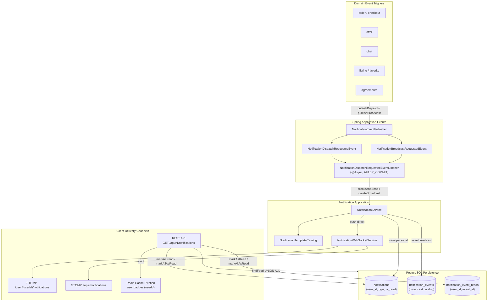

# Notification Domain

## 1. Executive Summary & Purpose
The `notification` domain delivers real-time transactional alerts, system-wide broadcast announcements, and unread badge tracking across web and mobile interfaces.

Instead of traditional high-cost fan-out patterns (inserting $N$ rows for $N$ users on system announcements), this domain implements a **Hybrid Feed Architecture**:
- **Personal Notifications:** High-cardinality, user-specific events (`notifications` table) directly targeted to a single recipient (`userId`).
- **Broadcast Announcements:** Zero-fan-out single-record events (`notification_events` table) fanned out on read via a lightweight join table (`notification_event_reads`).
- **Real-Time Push:** Asynchronous WebSocket STOMP delivery (`NotificationWebSocketService`) to user-specific destinations (`/user/{userId}/notifications`) and public broadcast channels (`/topic/notifications`).
- **Transactional Safety:** Decoupled asynchronous event listening via `@TransactionalEventListener(phase = TransactionPhase.AFTER_COMMIT)` with fallback execution, guaranteeing that notifications are never dispatched for transactions that rolled back.

---

## 2. Architecture & Event Flow

---

## 3. Core Entities & Database Schema

### 3.1 `notifications` (Personal Feed)
Stores targeted alerts for a single user (orders, offers, payments, favorites):
- `id` (UUID, PK)
- `user_id` (BIGINT, FK -> `users.id`, indexed)
- `type` (VARCHAR, maps to `NotificationType`)
- `title` (VARCHAR(255), not null)
- `message` (TEXT, not null)
- `action_url` (VARCHAR(500), nullable navigation link)
- `metadata` (TEXT, serialized JSON key-value pairs)
- `is_read` (BOOLEAN, default `false`, indexed)
- `read_at` (TIMESTAMP, nullable)
- `created_at` (TIMESTAMP, not null)

### 3.2 `notification_events` (Broadcast Catalog)
Single-record system-wide alerts (system maintenance, global announcements, legal policy updates):
- `id` (UUID, PK)
- `type` (VARCHAR, maps to `NotificationType`)
- `title` (VARCHAR(255), not null)
- `message` (TEXT, not null)
- `action_url` (VARCHAR(500), nullable)
- `metadata` (TEXT, serialized JSON)
- `created_at` (TIMESTAMP, not null)

### 3.3 `notification_event_reads` (Broadcast User Read Receipts)
Tracks which users have read which broadcast events to calculate unread counters without row cloning:
- `id` (UUID, PK)
- `event_id` (UUID, FK -> `notification_events.id`)
- `user_id` (BIGINT, FK -> `users.id`)
- `read_at` (TIMESTAMP, not null)
- *Unique Constraint:* `(event_id, user_id)`

---

## 4. Business Invariants & Lifecycle Mechanics

### 4.1 Hybrid Feed Resolution (`NotificationFeedRepository`)
When fetching a user feed (`getUserNotifications`), `NotificationFeedRepository.findFeed` executes a native SQL `UNION ALL` projection:
1. Queries `notifications` where `user_id = :userId` and `type <> 'AGREEMENT_UPDATED'`.
2. Queries `notification_events` left-joined with `notification_event_reads` where `user_id = :userId` and `type <> 'AGREEMENT_UPDATED'`.
3. Resolves dynamic `isRead` flag: `case when r.user_id is null then false else true end`.
4. Applies `unreadOnly` filter conditionally across both branches.
5. Sorts the combined projection by `createdAt DESC` with a unified count query for Spring Data pagination.

> [!NOTE]
> `AGREEMENT_UPDATED` notifications are explicitly filtered out from the standard feed and unread counters because legal agreement acceptance is enforced via the dedicated legal modal and agreement API.

### 4.2 Unread Count Calculation
Unread count is computed dynamically in `NotificationService.getUnreadCount`:
$$\text{Total Unread} = \text{Unread Personal Notifications} + \max(0, \text{Total Broadcast Events} - \text{User Broadcast Reads})$$
Where both components exclude `AGREEMENT_UPDATED`.

### 4.3 Read Status Lifecycle
1. **Single Read (`PUT /api/v1/notifications/{id}/read`):**
   - Checks `notifications` table first: verifies user ownership (`notification.getUser().getId().equals(userId)`), sets `isRead = true`, stamps `readAt = LocalDateTime.now()`.
   - If not found in personal notifications, checks `notification_events`: verifies existence, then inserts a `NotificationEventRead` record `(eventId, userId, readAt)` if not already present.
   - Triggers `@CacheEvict(value = "user:badges", key = "#userId")`.
2. **Mark All As Read (`PUT /api/v1/notifications/read-all`):**
   - Marks all unread records in `notifications` for `userId` as read.
   - Finds unread broadcast event IDs via `notificationEventRepository.findUnreadEventIdsForUser(userId)`.
   - Batch-inserts missing `NotificationEventRead` entities via `notificationEventReadRepository.saveAll(...)`.
   - Triggers `@CacheEvict(value = "user:badges", key = "#userId")`.

### 4.4 Transactional Event Safety
- Producers trigger `NotificationEventPublisher.publishDispatch(...)` or `publishBroadcast(...)`.
- `NotificationDispatchRequestedEventListener` intercepts events with `@TransactionalEventListener(phase = TransactionPhase.AFTER_COMMIT, fallbackExecution = true)`.
- If the outer domain transaction (e.g. order creation or payment capture) rolls back, no notification is dispatched.
- Execution runs asynchronously on the dedicated thread pool `"notificationExecutor"`.

---

## 5. Notification Types & Template System

Defined in `NotificationType`:
- **Offers:** `OFFER_RECEIVED`, `OFFER_ACCEPTED`, `OFFER_REJECTED`, `OFFER_COUNTERED`, `OFFER_EXPIRED`
- **Orders:** `ORDER_CREATED`, `ORDER_STATUS_CHANGED`, `ORDER_CANCELLED`, `ORDER_RECEIVED`, `ORDER_COMPLETED`, `ORDER_REFUNDED`
- **Chat:** `CHAT_MESSAGE_RECEIVED`
- **Listings & Social:** `LISTING_PRICE_DROPPED`, `LISTING_NEW_FROM_FOLLOWED`, `LISTING_SOLD`, `LISTING_FAVORITED`
- **Reviews & Reputation:** `REVIEW_RECEIVED`, `GREAT_SELLER_ACHIEVED`
- **Payments:** `PAYMENT_SUCCESS`, `PAYMENT_FAILED`
- **Legal:** `AGREEMENT_UPDATED`

`NotificationTemplateCatalog` provides centralized factory methods generating standard titles, messages, action URLs, and structured JSON metadata using `NotificationMetadataKeys` (e.g. `orderId`, `orderNumber`, `listingId`, `listingTitle`, `amount`, `currency`).

---

## 6. Real-Time WebSocket Delivery

Managed by `NotificationWebSocketService` using `SimpMessagingTemplate`:
- **Personal Alerts:** Sent to `/user/{userId}/notifications` (client subscribes to user-destined queue).
- **Broadcast Announcements:** Sent to public topic `/topic/notifications`.
- Failures in WebSocket delivery are logged as warnings and do not fail the database transaction or cause HTTP request errors.

---

## 7. Public REST API Specifications

| Method | Endpoint | Auth | Purpose | Response |
|---|---|---|---|---|
| `GET` | `/api/v1/notifications` | Bearer | Paginated feed of unified personal & broadcast alerts | `Page<NotificationDto>` |
| `GET` | `/api/v1/notifications/unread-count` | Bearer | Total unread notification count | `{"unreadCount": number}` |
| `PUT` | `/api/v1/notifications/{id}/read` | Bearer | Mark single notification as read | `Result<Void>` |
| `PUT` | `/api/v1/notifications/read-all` | Bearer | Mark all notifications as read | `200 OK` |

---

## 8. Error Codes & IDOR Prevention

Defined in `NotificationErrorCodes`:
- `NOTIFICATION_NOT_FOUND`: Notification ID does not exist in personal or broadcast tables.
- `NOTIFICATION_NOT_BELONGS_TO_USER`: IDOR attempt; user attempted to mark another user's personal notification as read.
- `USER_NOT_FOUND`: Recipient user does not exist during notification creation.
