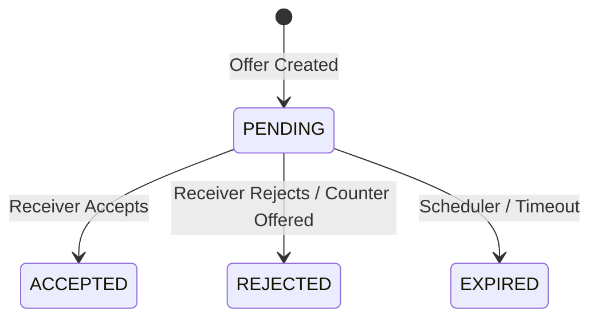

# Offer Domain

## Purpose
The `offer` domain manages buyer-to-seller negotiations (offers) on listings, including creation, acceptance, rejection, counter-offers, and expiration lifecycles.

## Architecture Overview
- **OfferService:** Orchestrates the complex lifecycle, actor validation, and concurrency control.
- **OfferScheduler:** Periodically scans for expired pending offers to transition their state.
- **OfferEmailNotificationService:** Broadcasts lifecycle events (e.g., offer received, accepted) to users via transactional emails.
- **OfferRedisReservationService:** Records temporary Redis keys upon offer acceptance (`v4:offer:lock:{listingId}`).

## Business Invariants & Constraints
- **Concurrency Lock & Redis Reservation:** Accepting an offer requires acquiring a lock on the Listing (`findByIdWithLock`). Double acceptance is prevented by that row lock plus the `existsByListingAndStatusAndIdNot(ACCEPTED)` check. Upon acceptance, `OfferRedisReservationService` also writes a 24-hour Redis key (`v4:offer:lock:{listingId}`); no code reads it, so it does not stop other buyers from purchasing the listing.
- **Offer Chains:** Counter-offers establish a `parentOffer` link to maintain negotiation history. The parent offer must be explicitly rejected before creating the counter.
- **Authorization:** Only the explicitly designated receiver of an offer may accept or reject it.

## State Machine

## Integration Points
- **Incoming:** Triggered by HTTP requests from buyers and sellers via `OfferController`.
- **Outgoing:** Queries the `listing` domain to validate listing status. Sends emails via the notification and email infrastructure.

## Public APIs
- `POST /api/v1/offers`: Creates a new offer for an active listing.
- `GET /api/v1/offers/{offer-id}`: Retrieves a single offer record (buyer or seller only).
- `POST /api/v1/offers/{offer-id}/accept`: Receiver accepts a pending offer.
- `POST /api/v1/offers/{offer-id}/reject`: Receiver rejects a pending offer.
- `POST /api/v1/offers/{offer-id}/counter`: Receiver counters a pending offer (creates a linked counter-offer record).

## Related Knowledge
- **Modify Offer Behavior**
  -> `.docs/runbooks/modify-offer-behavior.md`
