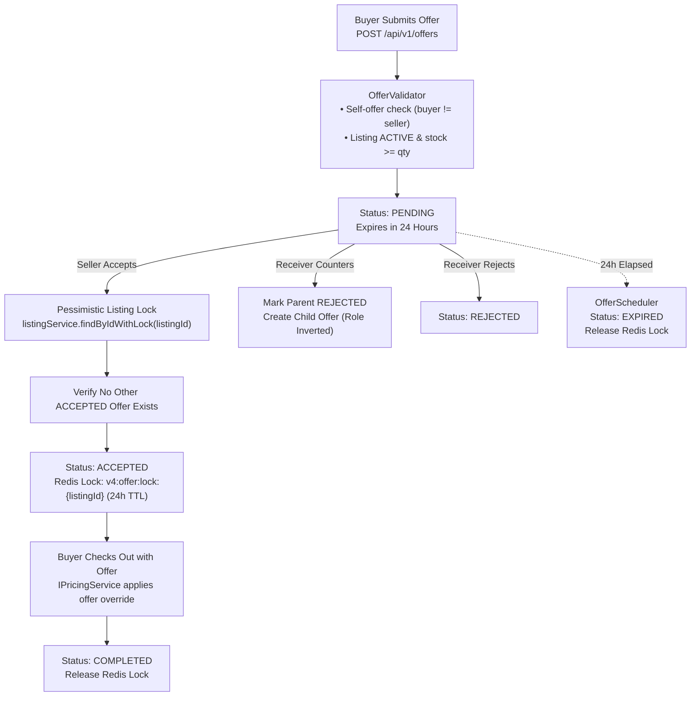

# Offer Domain

## 1. Domain Scope & Purpose
The `offer` domain governs price negotiations (bargaining) between buyers and sellers on active marketplace listings. It manages the multi-turn negotiation state machine (initial offer, acceptance, rejection, and counter-offers), establishes 24-hour exclusive buyer purchase holds via Redis, enforces listing-level concurrency locks to prevent double-acceptance, and handles automated expiration.

---

## 2. Step-by-Step Negotiation Lifecycle

1. **Offer Initiation (`create`):**
   - The prospective buyer submits a `CreateOfferRequest` specifying `listingId`, proposed `unitPrice`, and `quantity`.
   - Validates that buyer is not the seller (`buyer.getId() != listing.getSeller().getId()`).
   - Verifies listing is `ListingStatus.ACTIVE` and available stock $\ge$ requested quantity.
   - Saves `Offer` in `OfferStatus.PENDING` with `createdByActor = OfferActor.BUYER` and sets `expiresAt = NOW() + 24 hours`.
   - Dispatches an asynchronous email notification to the seller (`OfferEmailNotificationService`).
2. **Counter-Offer Negotiation Chain (`counter`):**
   - The recipient (seller or buyer) can counter with a modified price or quantity (`CounterOfferRequest`).
   - The parent offer status is set to `OfferStatus.REJECTED`.
   - A new child `Offer` is created linked to `parentOffer`, inverting the negotiating actor (`BUYER` $\leftrightarrow$ `SELLER`).
3. **Offer Acceptance & Exclusive Purchase Lock (`accept`):**
   - The designated recipient accepts the pending offer via `POST /api/v1/offers/{id}/accept`.
   - **Pessimistic Row Lock:** Acquires a PostgreSQL write lock on the listing (`listingService.findByIdWithLock(listingId)`).
   - **Double-Acceptance Guard:** Ensures `!offerRepository.existsByListingAndStatusAndIdNot(listing, OfferStatus.ACCEPTED, offerId)`. Only one accepted offer may exist simultaneously for a given listing.
   - Status moves to `OfferStatus.ACCEPTED`.
   - **Exclusive 24-Hour Purchase Lock:** `OfferRedisReservationService` establishes an exclusive Redis key (`v4:offer:lock:{listingId}`) binding the listing to the buyer for 24 hours (`app.offer.accepted-hold-ttl-seconds: 86400`).
4. **Checkout Integration & Completion (`markCompleted`):**
   - When the buyer checks out with `offerId`, `CheckoutPricingContextFactory` and `PricingService` apply the agreed total price directly to the line item (bypassing campaign discounts).
   - Once checkout commits, `offerService.markCompleted(acceptedOffer)` transitions status to `OfferStatus.COMPLETED` and releases the Redis lock.
5. **Automated Expiration (`OfferScheduler`):**
   - A scheduled background worker scans for offers where `expiresAt < NOW() && status = PENDING`.
   - Transitions expired records to `OfferStatus.EXPIRED` and removes lingering Redis locks.

---

## 3. Business Invariants & Concurrency Guarantees

* **No Self-Negotiations:** Users cannot submit offers on listings they own (`OFFER_SELF_NOT_ALLOWED`).
* **Single Active Accepted Offer Per Listing:** A seller cannot accept two concurrent offers on the same listing. The first acceptance acquires the database row lock; any concurrent attempt fails with `OFFER_ALREADY_ACCEPTED_FOR_LISTING`.
* **24-Hour Exclusive Buyer Window:** Acceptance grants the winning buyer a 24-hour priority window to complete checkout at the negotiated price.
* **Counter-Offer Immutability:** When an offer is countered, the predecessor offer is permanently sealed as `REJECTED`; negotiation history is preserved via the immutable `parent_offer_id` foreign key.
* **Immunity to Campaigns at Checkout:** Once an offer is accepted, its total price is locked. The pricing engine explicitly exempts offer lines from seller campaign discounts to protect financial agreements.

---

## 4. Redis Keys & In-Memory Locks

| Redis Key Pattern | Type | TTL | Purpose |
| :--- | :--- | :--- | :--- |
| `v4:offer:lock:{listingId}` | Hash | 86400s (24h) | Exclusive reservation lock mapping listing to the accepted buyer and offer ID. |

---

## 5. Database Schema & Flyway Structure

Stored in the `offers` table:
* `id`: UUID primary key.
* `listing_id`: Foreign key to `listings`.
* `buyer_id`: Foreign key to `users` (buyer).
* `seller_id`: Foreign key to `users` (seller).
* `parent_offer_id`: Self-referencing foreign key to predecessor `offers(id)` for counter-offer audit chains.
* `price`: Proposed unit price.
* `total_price`: Computed total (`price * quantity`).
* `quantity`: Quantity negotiated (default: 1).
* `status`: `OfferStatus` enum (`PENDING`, `ACCEPTED`, `REJECTED`, `CANCELLED`, `COMPLETED`, `EXPIRED`).
* `created_by_actor`: `OfferActor` enum (`BUYER`, `SELLER`).
* `expires_at`: Timestamp when the offer lapses.
* `created_at`, `updated_at`: Audit timestamps.

---

## 6. Public REST API Contracts (`OfferController` — `/api/v1/offers`)

* **`POST /`:** Submits a new offer for an active listing (`CreateOfferRequest`).
* **`GET /{id}`:** Retrieves offer details (authorized only for the buyer or seller).
* **`POST /{id}/accept`:** Recipient accepts a pending offer, locking the listing and granting 24-hour checkout priority.
* **`POST /{id}/reject`:** Recipient rejects a pending offer.
* **`POST /{id}/counter`:** Recipient submits a counter-offer (`CounterOfferRequest`), rejecting the parent and opening a new round.
* **`GET /made?page=0&size=10`:** Paginated list of offers submitted by the current authenticated user.
* **`GET /received?page=0&size=10`:** Paginated list of offers received by the current authenticated seller.
