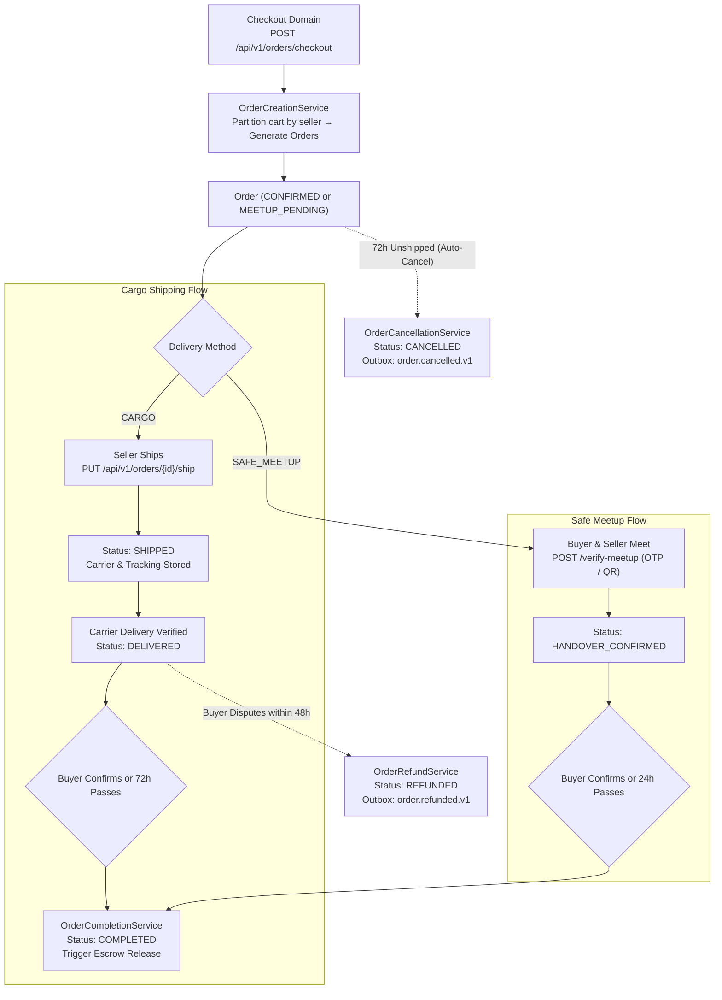
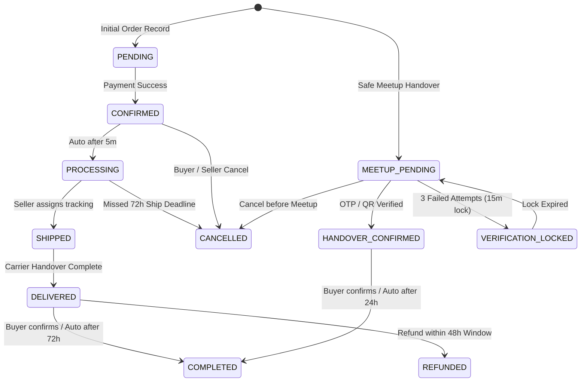

# Order Domain

## 1. Domain Scope & Purpose
The `order` domain manages the complete lifecycle of customer purchases across both standard cargo shipping (`DeliveryMethod.CARGO`) and safe in-person meetups (`DeliveryMethod.SAFE_MEETUP`). It enforces multi-seller partitioning, state transitions governed by explicit policies, item-by-item compensation accounting (cancellations and refunds), automated completion/cancellation schedulers, and transactional outbox event streaming to Kafka.

> [!NOTE]
> **Related Documentation & Runbooks:**
> - **Architecture Deep Dive:** [`docs/order-lifecycle-and-compensation-management.md`](../../../../../../../docs/order-lifecycle-and-compensation-management.md)
> - **Architecture Deep Dive:** [`docs/safe-meetup-delivery-and-verification.md`](../../../../../../../docs/safe-meetup-delivery-and-verification.md)
> - **Architecture Deep Dive:** [`docs/checkout-pipeline-and-distributed-transaction-flow.md`](../../../../../../../docs/checkout-pipeline-and-distributed-transaction-flow.md)
> - **Frontend Module:** [`secondhand-frontend/src/order/README.md`](../../../../../../../secondhand-frontend/src/order/README.md)
> - **Task Runbooks:**
>   - [`add-order-endpoint.md`](.docs/runbooks/add-order-endpoint.md) — Add new order endpoint
>   - [`modify-refund-behavior.md`](.docs/runbooks/modify-refund-behavior.md) — Modify refund compensation rules
>   - [`modify-state-rule.md`](.docs/runbooks/modify-state-rule.md) — Modify order state machine transitions
>   - [`order-feature-runbook.md`](.docs/runbooks/order-feature-runbook.md) — Order feature development playbook

---

## 2. Step-by-Step Execution Lifecycle

### 2.1. Multi-Seller Order Partitioning (`OrderCreationService`)
When `CheckoutOrchestrator` triggers checkout:
1. Effective cart items are partitioned by seller ID. Each seller receives an isolated `Order` entity.
2. An order number is minted (`ORD-` + random alphanumeric hash).
3. Line items (`OrderItem`) are created with pre-calculated post-campaign prices and proportional coupon shares.
4. Total order amounts (`totalAmount`, `shippingAmount`) are calculated and persisted.
5. If `DeliveryMethod.CARGO`, a linked `Shipping` entity is initialized in `ShippingStatus.PENDING`.
6. If `DeliveryMethod.SAFE_MEETUP`, cryptographic SHA-256 OTP codes and QR tokens are generated for in-person verification.

### 2.2. Cargo Order Fulfillment Lifecycle
1. **Confirmation & Processing:** A paid cargo order enters `OrderStatus.CONFIRMED`. After 5 minutes (`STATUS_UPDATE_INTERVAL_MINUTES`), it automatically transitions to `OrderStatus.PROCESSING`.
2. **Seller Shipment (`ship`):** The seller enters the tracking number and carrier name via `PUT /api/v1/orders/{id}/ship`. Order transitions to `OrderStatus.SHIPPED`.
3. **Delivery Handover:** Carrier confirms delivery; order transitions to `OrderStatus.DELIVERED`.
4. **Completion & Escrow Release:**
   - The buyer can manually confirm receipt via `PUT /api/v1/orders/{id}/complete`.
   - Alternatively, if 72 hours (`AUTO_COMPLETION_HOURS = 72`) elapse without buyer action, `OrderCompletionScheduler` automatically completes the order.
   - Transitions to `OrderStatus.COMPLETED` and invokes `EscrowService.releaseEscrowForOrder(order)` to credit the seller's eWallet.

### 2.3. Safe Meetup In-Person Handover Lifecycle
1. **Meetup Pending:** The order is initialized in `OrderStatus.MEETUP_PENDING`.
2. **OTP / QR Handshake (`verifyMeetup`):** During physical handover, the seller scans the buyer's QR code or inputs the 6-digit OTP.
   - **Brute-Force Guard:** 3 failed attempts lock the order for 15 minutes (`VERIFICATION_LOCKED`).
   - On success, status moves to `OrderStatus.HANDOVER_CONFIRMED`.
3. **Completion:** The buyer confirms satisfaction or 24 hours elapse, advancing to `OrderStatus.COMPLETED` and releasing escrow.

---

## 3. Compensation Management: Cancellations & Refunds

All financial rollbacks and returns use an itemized compensation model managed by `OrderItemCompensationPlanner` and `OrderCompensationPersistenceService`:

### 3.1. Order Cancellation (`OrderCancellationService`)
* **When Allowed:** Governed strictly by `OrderCancellationPolicy`. Allowed when the order is in `CONFIRMED`, `PROCESSING`, or `MEETUP_PENDING`. Not permitted once shipped or handed over.
* **Auto-Cancellation on Ship Deadline (`cancelUnshippedOrder`):** If a seller fails to ship a cargo order within 72 hours (`SHIP_DEADLINE_HOURS = 72`), `OrderCompletionScheduler` cancels the order automatically.
* **Actions Taken:**
  - Status transitions to `OrderStatus.CANCELLED`.
  - Creates an audit record in `order_item_cancels` for each cancelled item.
  - Releases held escrow back to the buyer's eWallet / original payment method.
  - Decrements Redis reservation counters and restores stock in PostgreSQL.
  - Emits in-process `OrderCancelledEvent` and persists transactional outbox event to `order_outbox_events` (topic `order.cancelled.v1`).

### 3.2. Order Refund (`OrderRefundService`)
* **When Allowed:** Governed by `OrderRefundPolicy`. Allowed only when order is in `OrderStatus.DELIVERED` within 48 hours (`REFUND_WINDOW_HOURS = 48`) of delivery confirmation.
* **Actions Taken:**
  - Status transitions to `OrderStatus.REFUNDED`.
  - Persists item-level audit rows in `order_item_refunds`.
  - Invokes `EscrowService.refund(order)` to reverse funds to the buyer.
  - Emits in-process `OrderRefundedEvent` and writes transactional outbox event to `order_outbox_events` (topic `order.refunded.v1`).

---

## 4. State Machine & Durations

| Constant | Value | Description |
| :--- | :--- | :--- |
| `SHIP_DEADLINE_HOURS` | 72 hours | Maximum time for seller to ship before automated system cancellation. |
| `AUTO_COMPLETION_HOURS` | 72 hours | Delivery window before unconfirmed cargo orders auto-complete and release escrow. |
| `REFUND_WINDOW_HOURS` | 48 hours | Window post-delivery during which a buyer may request a return/refund. |
| `STATUS_UPDATE_INTERVAL_MINUTES` | 5 minutes | Delay between payment confirmation and automated transition to processing. |

---

## 5. Transactional Outbox & Kafka Event Streaming

Order status mutations publish guaranteed at-least-once domain events via the transactional outbox pattern:

* **Outbox Table:** `order_outbox_events` (`id`, `aggregate_type`, `aggregate_id`, `event_type`, `payload`, `status`, `created_at`, `processed_at`).
* **Scheduled Worker:** `OrderOutboxWorker` (runs every 5000ms with a distributed Redis lock).
* **Published Kafka Topics:**
  - `order.cancelled.v1` (`OrderCancelledKafkaEvent`)
  - `order.refunded.v1` (`OrderRefundedKafkaEvent`)
* **Consumer Idempotency:** Consumers register the event's unique ID into `processed_kafka_events` before executing actions, preventing duplicate processing on retries.

---

## 6. Public REST API Contracts (`OrderController` — `/api/v1/orders`)

### Buyer Operations
* **`POST /checkout`:** Primary checkout creation endpoint.
* **`GET /`:** Paginated orders for the authenticated buyer (filters: `deliveryMethod`, `statuses`, `orderNumber`).
* **`GET /status-counts`:** Badge count matrix for buyer order tabs.
* **`GET /{id}`:** Full buyer order details with items and shipping status.
* **`PUT /{id}/cancel`:** Cancels an unshipped buyer order.
* **`POST /{id}/refund`:** Requests return/refund for a delivered order.
* **`PUT /{id}/complete`:** Buyer confirms delivery, immediately releasing escrow.
* **`PUT /{id}/address`:** Updates delivery shipping address prior to shipment.
* **`PUT /{id}/notes`:** Appends buyer delivery instructions.

### Seller Operations
* **`GET /seller`:** Paginated order ledger for items sold by the current user.
* **`GET /seller/status-counts`:** Badge counts for seller tab navigation.
* **`GET /seller/{id}`:** Detailed seller order view.
* **`GET /seller/pending-escrow-amount`:** Total funds currently held in escrow pending delivery.
* **`PUT /{id}/ship`:** Seller attaches tracking number and carrier name (`OrderShipRequest`).

### Meetup Verification Operations
* **`POST /{orderNumber}/verify-meetup`:** Validates 6-digit OTP code or scanned QR token.
* **`POST /{orderNumber}/confirm-handover-completion`:** Confirms completed in-person exchange.
* **`POST /{orderNumber}/regenerate-meetup-code`:** Generates a fresh OTP/QR code.
