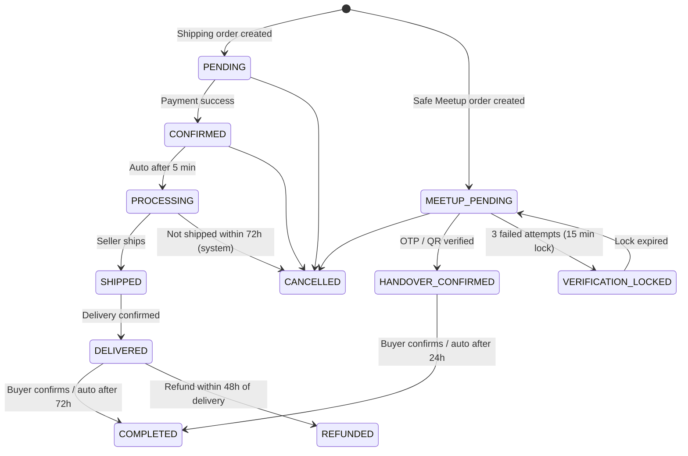

# Order Domain

## Purpose
The `order` domain manages the end-to-end lifecycle of a purchase: order creation, state progression, completion, cancellation, refund, and escrow resolution across both cargo delivery and safe in-person meetup flows.

## Architecture Overview
- **Rich Domain Model:** The `Order` entity centralizes core state transition logic.
- **Policy Engine:** `policy` classes govern the validity of state transitions (e.g., is this order eligible for cancellation?).
- **Service Orchestration:** Application services (`OrderCreationService`, `OrderModificationService`, `OrderCancellationService`, `OrderRefundService`) execute policies and coordinate repositories.
- **Automated Progression:** `OrderCompletionScheduler` automatically advances order states based on time thresholds (e.g. ship deadline, auto-completion).
- **AOP Logging:** `OrderLogAspect` intercepts and logs all API requests and mutations.
- **Transactional Outbox:** Dispatches post-commit events reliably using `OrderOutboxWorker` to Kafka topics.

## Business Invariants & Constraints
- **Policy Centricity:** Invalid state transitions must be rejected by policy rules, not by service-level checks.
- **Escrow Dependency:** Order completion cannot be finalized unless the underlying escrow release operation is successful.
- **Item-Based Compensation:** Order cancellation and refund decisions mandate an item-by-item compensation plan (`OrderItemCompensationPlanner`).
- **Post-Commit Side Effects:** Event emissions (`OrderCancelledEvent`, `OrderRefundedEvent`) happen strictly after the core order transaction has committed.
- **One Seller Per Order:** Checkout creates one order per seller (`OrderCreationService.createOrders`); shipping, status and escrow are per order, so an order never mixes sellers. Order amounts come from the priced items of that seller and are set after the items are added (`Order.addItem` recalculates totals from item prices that are already net of the coupon share).
- **Ship Deadline:** Shipping is the seller's action only. A paid `CARGO` order still `CONFIRMED`/`PROCESSING` `SHIP_DEADLINE_HOURS` (72h) after creation is cancelled by `OrderCompletionScheduler` through `OrderCancellationService.cancelUnshippedOrder` (stock restore, escrow refund, `OrderCancelledEvent` with `shipDeadlineMissed`, outbox event).
- **Payment Orchestration:** `order` makes the decision to refund or cancel, but the execution of fund transfers is delegated to the `payment` orchestrator.

## State Machine

Authoritative rules: `Order` entity methods, `OrderStatus` (cancellable / refundable / completable sets), the `policy` classes and `OrderCompletionScheduler`. Safe Meetup details: `docs/safe-meetup-delivery-and-verification.md`.

## Outbox Tables & Events
- `order_outbox_events`: Dispatched by `OrderOutboxWorker` (every 5s).
  - `ORDER_CANCELLED` -> `order.cancelled.v1`
  - `ORDER_REFUNDED` -> `order.refunded.v1`

## Integration Points
- **Incoming:** Checkout Domain (triggers order creation via `OrderCreationService`).
- **Outgoing:** Payment Domain (called for escrow release/refund execution), Shipping Domain (called for tracking updates).
- **Events:** Publishes `OrderCancelledEvent`, `OrderRefundedEvent` (both Spring ApplicationEvents and transactional outbox Kafka events).

## Public APIs
- `POST /api/v1/orders/checkout`: Place an order, creates child items, holds escrow, and publishes outbox events.
- `GET /api/v1/orders`: Fetches paginated orders for the authenticated buyer (supports `deliveryMethod`, `statuses`, `orderNumber`).
- `GET /api/v1/orders/status-counts`: Status counts for buyer order tabs.
- `GET /api/v1/orders/{order-id}`: Fetches detailed buyer order information.
- `GET /api/v1/orders/seller`: Fetches paginated orders for the authenticated seller.
- `GET /api/v1/orders/seller/status-counts`: Status counts for seller order tabs.
- `GET /api/v1/orders/seller/{order-id}`: Fetches detailed seller order information.
- `GET /api/v1/orders/seller/pending-escrow-amount`: Aggregates total pending escrow funds for seller.
- `GET /api/v1/orders/pending-completion`: Returns delivered orders approaching completion window.
- `GET /api/v1/orders/items/{order-item-id}/review`: Fetches review associated with a specific order item.
- `PUT /api/v1/orders/{order-id}/cancel`: Request cancellation.
- `POST /api/v1/orders/{order-id}/refund`: Request refund.
- `PUT /api/v1/orders/{order-id}/complete`: Confirms delivery and triggers escrow fund release.
- `PUT /api/v1/orders/{order-id}/ship`: Seller assigns carrier and tracking number.
- `PUT /api/v1/orders/{order-id}/name`: Updates delivery recipient name.
- `PUT /api/v1/orders/{order-id}/address`: Updates delivery address.
- `PUT /api/v1/orders/{order-id}/notes`: Updates order notes.
- `POST /api/v1/orders/{order-number}/verify-meetup`: Verifies OTP / QR code during in-person delivery.
- `POST /api/v1/orders/{order-number}/confirm-handover-completion`: Confirms completion of in-person handover.
- `POST /api/v1/orders/{order-number}/regenerate-meetup-code`: Regenerates a new verification code for meetup delivery.

## Related Knowledge
- **Modify State Rule**
  -> `.docs/runbooks/modify-state-rule.md`

- **Modify Refund/Cancellation Behavior**
  -> `.docs/runbooks/modify-refund-behavior.md`

- **Add Order Endpoint**
  -> `.docs/runbooks/add-order-endpoint.md`

- **Order Feature Development**
  -> `.docs/runbooks/order-feature-runbook.md`
