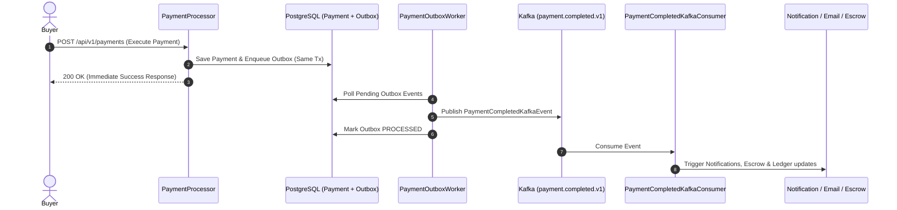

# Payment Domain

## Purpose
The `payment` domain provides the core payment processing engine: pre-check validation, provider selection, payment recording, transactional event publishing, and escrow fund flow orchestration.

## Architecture Overview
- **PaymentProcessor:** Central entry point handling idempotency and dispatching to a `PaymentProviderPort` provider.
- **PaymentPreCheckService:** Validates agreements, user eligibility, and OTP verification codes before transaction execution.
- **PaymentProviderPort:** Port implemented by one adapter per payment method (today only `EWalletPaymentProviderAdapter`); `PaymentProcessor` selects it via `supports(providerName)`.
- **Transactional Outbox + Kafka:** Ensures guaranteed, at-least-once event delivery (`PaymentCompletedKafkaEvent`) by first saving events to the `payment_outbox_events` table within the payment transaction, and then publishing them asynchronously to Kafka via `PaymentKafkaProducer` and `PaymentOutboxWorker`.
- **PaymentCompletedKafkaConsumer:** Asynchronously listens to `payment.completed.v1` topic to trigger notifications, order updates, and escrow operations with zero impact on payment API latency.
- **Escrow Orchestration:** Manages funds held in escrow until order completion or cancellation.

## Business Invariants & Constraints
- **Idempotency:** The combination of `idempotencyKey + fromUserId` guarantees a payment is processed exactly once. Repeat requests safely return the existing `orderId` and `status` without repeating side effects.
- **Idempotency Scope:** Idempotency rules must reside entirely within `PaymentProcessor` and not leak into individual providers.
- **Verification Rule:** A payment requiring OTP verification cannot be finalized until the `verificationCode` is successfully validated during pre-check.
- **Event-Driven Side Effects:** All payment side-effects (e.g., email notifications, ledger updates, escrow holds) execute asynchronously via Kafka consumers consuming from `payment.completed.v1`.
- **Refund Window:** Refunds are only permitted within `REFUND_WINDOW_HOURS=48h` of delivery (`OrderBusinessConstants`).
- **Auto-Completion:** Delivered orders auto-complete (escrow release) after `AUTO_COMPLETION_HOURS=72h`.

## Event-Driven Architecture & Flow

## Statuses
`PaymentStatus` (`payment/entity/PaymentStatus.java`) is authoritative. Escrow-backed payments move `PENDING` -> `ESCROW` -> `COMPLETED` / `REFUNDED`; other statuses: `PAID`, `PARTIALLY_REFUNDED`, `DISPUTED`, `CANCELLED`, `FAILED`. Escrow rules: `docs/escrow-lifecycle-and-state-machine.md`.

## Integration Points
- **Incoming:** Order Domain (initiates escrow payments), Checkout Domain (initiates immediate payments).
- **Outgoing (via Kafka Topic `payment.completed.v1`):** Notification Domain (email/push notifications), User Domain (ledger/wallet updates), Escrow & Order Domain (state transitions).

## Related Knowledge
- **Add Payment Provider**
  -> `.docs/runbooks/add-payment-provider.md`

- **Add Event Handler**
  -> `.docs/runbooks/add-event-handler.md`

- **Payment Feature Development**
  -> `.docs/runbooks/payment-feature-runbook.md`
