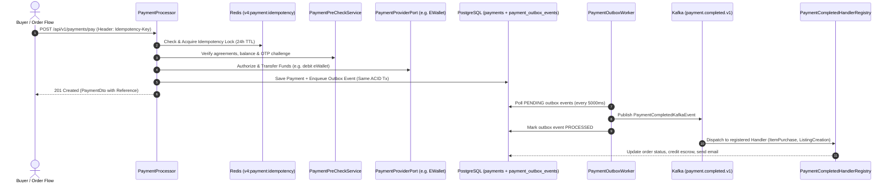

# Payment Domain

## 1. Domain Scope & Purpose
The `payment` domain is the financial transaction execution engine of the marketplace. It handles multi-provider payment authorization, cryptographic and OTP verification challenges, distributed Redis idempotency, payment ledger persistence, and transactional outbox event streaming. All secondary side-effects (e.g. buyer notifications, seller alerts, ledger balance updates, and downstream escrow creation) are decoupled via Apache Kafka.

> [!NOTE]
> **Related Documentation & Runbooks:**
> - **Architecture Deep Dive:** [`docs/payment-strategy-and-provider-extension-guide.md`](../../../../../../../docs/payment-strategy-and-provider-extension-guide.md)
> - **Distributed Checkout Pipeline:** [`docs/checkout-pipeline-and-distributed-transaction-flow.md`](../../../../../../../docs/checkout-pipeline-and-distributed-transaction-flow.md)
> - **Frontend Module:** [`secondhand-frontend/src/payments/README.md`](../../../../../../../secondhand-frontend/src/payments/README.md)
> - **Task Runbooks:**
>   - [`add-payment-provider.md`](.docs/runbooks/add-payment-provider.md) — Step-by-step guide for implementing new payment adapters
>   - [`add-event-handler.md`](.docs/runbooks/add-event-handler.md) — Handling post-payment event callbacks
>   - [`payment-feature-runbook.md`](.docs/runbooks/payment-feature-runbook.md) — End-to-end payment feature checklist



---

## 2. Step-by-Step Payment Execution Lifecycle

1. **Idempotency Guard (`PaymentProcessor`):**
   - Every payment request mandates an `Idempotency-Key` header.
   - `PaymentRedisIdempotencyService` checks `v4:payment:idempotency:{key}:{userId}`. If an identical transaction was already completed, returns the cached result immediately without re-charging the buyer.
2. **Pre-Check & Security Verification (`PaymentPreCheckService`):**
   - Validates user account standing (`AccountStatus.ACTIVE`).
   - Ensures required legal terms/agreements have been acknowledged (`agreementsService`).
   - If the transaction type or amount triggers security rules, enforces OTP verification (`verificationCode`) against the challenge initiated via `POST /api/v1/payments/initiate-verification`.
3. **Provider Execution (`PaymentProviderPort`):**
   - Resolves the requested provider (`supports(providerName)`), such as `EWalletPaymentProviderAdapter` or external card gateways.
   - Executes the fund transfer atomically.
4. **Ledger Record & Transactional Outbox (Same ACID Transaction):**
   - Inserts a record into the `payments` table with `PaymentStatus.COMPLETED` (or `PaymentStatus.FAILED`), `PaymentTransactionType`, `PaymentDirection`, and provider reference.
   - Simultaneously writes a `PaymentCompletedKafkaEvent` JSON payload into `payment_outbox_events` with status `OutboxStatus.PENDING`.
5. **Asynchronous Kafka Event Dispatch:**
   - `PaymentOutboxWorker` polls pending events, transmits them to Kafka topic `payment.completed.v1`, and marks rows as `PROCESSED`.
6. **Consumer Handler Registry (`PaymentCompletedHandlerRegistry`):**
   - `PaymentCompletedKafkaConsumer` receives the event and routes it to the specialized handler based on `PaymentTransactionType`:
     - `ItemPurchasePaymentCompletedHandler`: Updates order payment status, triggers escrow locking, and notifies parties.
     - `ListingCreationPaymentCompletedHandler`: Activates paid listings upon listing fee settlement.
     - `DefaultPaymentCompletedHandler`: Fallback audit logging.

---

## 3. Business Invariants & Concurrency Guarantees

* **Strict Idempotency:** The combination of `(idempotencyKey, fromUserId)` guarantees zero duplicate payments. The lock is held in Redis for 24 hours (`86400s`).
* **Provider Independence:** Idempotency and outbox guarantees reside entirely within `PaymentProcessor`; individual `PaymentProviderPort` adapters remain clean and focused on fund transfer execution.
* **Transactional Outbox Decoupling:** Gateways never block waiting for emails, search index updates, or push notifications. The API returns as soon as the core payment and outbox row are committed.
* **Non-Reversible Direct Crediting:** For product purchases, buyer payments are routed to internal platform escrow accounts. Direct peer-to-peer transfers are prohibited during item purchase checkout.

---

## 4. Redis Keys & Outbox Architecture

| Redis Key Pattern | Type | TTL | Purpose |
| :--- | :--- | :--- | :--- |
| `v4:payment:idempotency:{key}:{userId}` | String (JSON) | 86400s (24h) | Stores serialized `PaymentDto` response to serve duplicate requests. |
| `payment:stats` | Cache | 600s | Caches aggregated monthly payment statistics for user dashboard. |

### Outbox & Kafka Topics:
* **Outbox Table:** `payment_outbox_events`
* **Worker:** `PaymentOutboxWorker` (scheduled every 5000ms with Redis distributed lock).
* **Kafka Topic:** `payment.completed.v1` (`PaymentCompletedKafkaEvent`).

---

## 5. Public REST API Contracts (`PaymentController` — `/api/v1/payments`)

* **`POST /pay`:** Processes a payment against an order or listing fee.
  - **Headers:** `Idempotency-Key: <UUID>` (mandatory)
  - **Request Payload (`PaymentRequest`):**
    ```json
    {
      "orderId": 501,
      "amount": 1450.00,
      "currency": "TRY",
      "paymentMethod": "EWALLET",
      "providerName": "EWALLET",
      "transactionType": "ITEM_PURCHASE",
      "verificationCode": null
    }
    ```
* **`POST /initiate-verification`:** Sends a 6-digit OTP verification code via email for high-value transactions.
* **`GET /my`:** Paginated, filterable payment ledger for the authenticated user (`direction`, `status`, `transactionType`).
* **`GET /statistics`:** Aggregates user metrics (total spent, received, escrow locked, incoming/outgoing volume).
