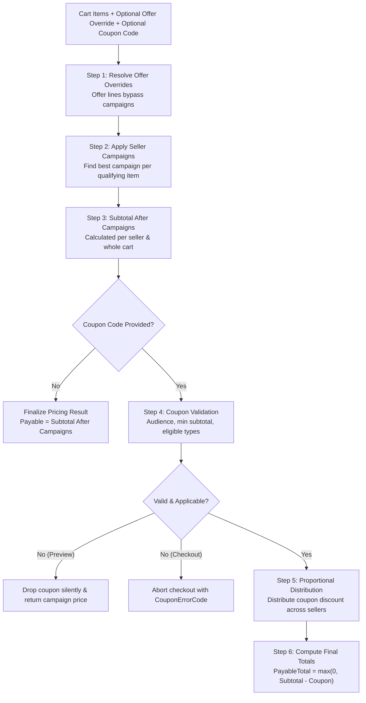

# Pricing Domain

## 1. Domain Scope & Purpose
The `pricing` domain is the deterministic, stateless calculation engine of the platform. It calculates item prices, applies seller-level campaign discounts, resolves accepted offer price overrides, evaluates platform coupons, and proportionally apportions multi-seller deductions to determine buyer payable totals and seller payouts.



---

## 2. Step-by-Step Pricing Calculation Lifecycle

The calculation pipeline is orchestrated by `PricingService` delegating to the pure mathematical `PriceCalculationEngine`:

1. **Offer Line Isolation (`OfferPriceHandler`):**
   - If an accepted offer is present (`offerOverride`), the designated listing line adopts the negotiated total price and quantity directly.
   - **Offer Invariant:** Accepted offer items are strictly immune to further campaign discounts, as their price has already been finalized during mutual negotiation.
2. **Seller Campaign Aggregation (`campaignService`):**
   - Active campaigns for all sellers present in the cart are fetched in batch (`loadActiveCampaignsForSellers`).
   - Grouped by `sellerId` and evaluated against line items.
3. **Best Campaign Selection (`findBestCampaignForListing`):**
   - For each qualifying non-offer line item (excluding `REAL_ESTATE` and `VEHICLE`), all active campaigns of that seller are compared.
   - Verifies whether the cart meets `minQuantity` thresholds for that campaign across matching items.
   - Calculates the net discount (`PERCENTAGE` or `FIXED_AMOUNT`) and selects the single campaign delivering the highest monetary savings to the buyer.
4. **Intermediate Subtotal Calculation:**
   - Computes `originalSubtotal` and `subtotalAfterCampaigns`.
   - Computes each seller's intermediate subtotal (`sellerSubtotalsAfterCampaign`), establishing the financial base for subsequent coupon deductions.
5. **Coupon Evaluation & Validation:**
   - Coupon codes are normalized to uppercase and trimmed.
   - The coupon is validated against:
     - `CouponAudience` (e.g. `ALL_USERS`, `NEVER_ORDERED_FIRST_ORDER`, `USER_ID_LIST`).
     - Expiration dates (`startsAt`, `endsAt`).
     - Minimum cart value (`minSubtotal`), compared against `subtotalAfterCampaigns` (not pre-campaign subtotal).
     - Eligible listing types (excluding `REAL_ESTATE` and `VEHICLE`).
6. **Proportional Multi-Seller Coupon Apportionment:**
   - When a platform coupon applies to a cart containing items from multiple distinct sellers, the coupon discount is apportioned across sellers in exact proportion to their share of the post-campaign subtotal:
     $$\text{SellerShare} = \frac{\text{SellerPostCampaignSubtotal}}{\text{TotalPostCampaignSubtotal}}$$
     $$\text{SellerCouponDiscount} = \text{round}(\text{CouponDiscount} \times \text{SellerShare}, 2)$$
   - Any penny rounding discrepancy is adjusted on the largest seller order.
7. **Payable & Escrow Output Assembly:**
   - `payableTotal = max(0, subtotalAfterCampaigns - couponDiscount)`.
   - Produces `PricingResultDto` containing line-by-line item details (`PricedCartItemDto`), applied campaigns, and exact seller receivable breakdowns.

---

## 3. Business Invariants & Financial Guarantees

* **Dual-Mode Coupon Behavior (Preview vs. Checkout):**
  - **`priceCart` (Cart Preview):** If a user provides an invalid, depleted, or ineligible coupon, the engine gracefully discards the coupon and returns the campaign-adjusted subtotal without throwing an exception.
  - **`priceCartForCheckout` (Checkout Finalization):** If an entered coupon cannot be honored (e.g., reached global limit between preview and checkout), the engine **strictly halts** and returns a `Result.error(CouponErrorCodes...)`. An order is **never created at a higher price than what the buyer approved**.
* **Strict Vertical Exclusions:** `ListingType.REAL_ESTATE` and `ListingType.VEHICLE` listings are legally and policy-wise excluded from all campaigns and platform coupons.
* **Campaign-First Precedence:** Seller campaigns are deducted before platform coupons. A coupon's minimum spending requirement (`minSubtotal`) must be satisfied by the post-campaign amount.
* **Non-Negative Floor Invariant:** Neither line items, seller subtotals, nor buyer payable totals may ever be negative (`Math.max(BigDecimal.ZERO, ...)`).
* **Two-Decimal Financial Precision:** All computations scale to 2 decimal places using `RoundingMode.HALF_UP` via `PricingUtil.scale(...)`.

---

## 4. Public Service Contracts (`IPricingService`)

The pricing domain exposes an internal service interface consumed by `cart`, `checkout`, and `coupon`:

```java
public interface IPricingService {
    PricingResultDto priceCart(User buyer, List<Cart> cartItems, String couponCode);
    
    PricingResultDto priceCart(User buyer, List<Cart> cartItems, String couponCode, 
                               UUID offerListingId, Integer offerQuantity, BigDecimal offerTotalPrice);
    
    Result<PricingResultDto> priceCartForCheckout(User buyer, List<Cart> cartItems, String couponCode,
                                                 UUID offerListingId, Integer offerQuantity, BigDecimal offerTotalPrice);
}
```

### Core Output Model: `PricingResultDto`
* `originalSubtotal`: Total sum of listed catalog prices before discounts.
* `campaignDiscount`: Total monetary savings provided by seller campaigns.
* `subtotalAfterCampaigns`: Net amount after seller campaigns.
* `couponDiscount`: Platform coupon discount amount.
* `payableTotal`: Final net amount charged to buyer via payment gateways.
* `couponCode`: Normalized applied coupon code or `null`.
* `items`: Line item breakdown (`PricedCartItemDto` with `appliedCampaign`).
* `sellerSubtotalsAfterCampaign`: Map of `sellerId -> BigDecimal` used by `order` domain for multi-order creation.
