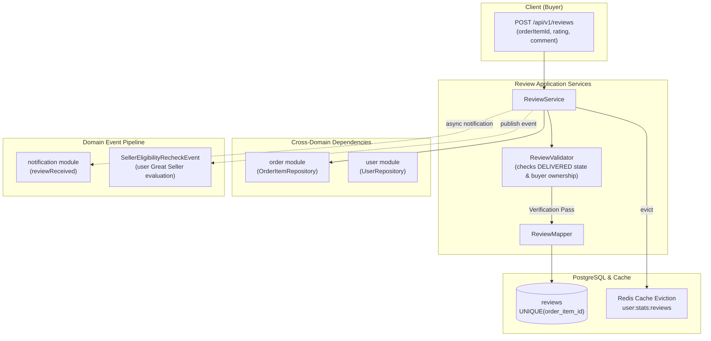

# Review Domain

## 1. Executive Summary & Architecture
The `review` domain governs post-transaction buyer feedback, rating evaluations (1-5 stars), text comments, and reputation metrics calculation for sellers.

> [!NOTE]
> **Related Documentation & Runbooks:**
> - **Architecture Deep Dive:** [`docs/social-proof-and-urgency-metrics-architecture.md`](../../../../../../../docs/social-proof-and-urgency-metrics-architecture.md)
> - **Frontend Module:** [`secondhand-frontend/src/reviews/README.md`](../../../../../../../secondhand-frontend/src/reviews/README.md)
> - **Task Runbooks:**
>   - [`modify-review-behavior.md`](.docs/runbooks/modify-review-behavior.md) — Modify review submission and rating rules

### Architectural Responsibilities
- **Verified Purchase Enforcement:** A review can only be submitted for an order item whose associated order is fulfilled (`ShippingStatus.DELIVERED` for cargo, or `OrderStatus.HANDOVER_CONFIRMED` / `OrderStatus.COMPLETED` for Safe Meetup).
- **Strict Buyer Verification:** Only the actual buyer of the order item can author the review.
- **Single-Review Invariant:** Exactly one review is permitted per `OrderItem`, enforced by a database unique constraint `UNIQUE (order_item_id)`.
- **Prestige Tier Integration:** Successfully submitting a review emits a `SellerEligibilityRecheckEvent` to trigger automated evaluation of the seller's "Great Seller" badge eligibility.
- **High-Throughput Projections:** Uses SQL projection interfaces (`ReviewStatsProjection`, `ListingReviewStatsProjection`, `GreatSellerReviewMetrics`) for sub-millisecond aggregate ratings.
- **Cache Eviction:** Any review submission invalidates `@CacheEvict(value = "user:stats:reviews", allEntries = true)`.

---

## 2. Architecture & Lifecycle Flow

---

## 3. Core Entities & Database Schema

### `reviews` Table
- `id` (UUID, PK)
- `order_item_id` (BIGINT, FK -> `order_items.id`, not null)
- `reviewer_id` (BIGINT, FK -> `users.id`, buyer)
- `seller_id` (BIGINT, FK -> `users.id`, seller)
- `listing_id` (UUID, FK -> `listings.id`, reviewed product)
- `rating` (INT, 1 to 5, not null)
- `comment` (TEXT, optional feedback text)
- `created_at` / `updated_at` (Timestamps)
- *Unique Constraint:* `UNIQUE (order_item_id)`
- *Indexes:* `idx_reviews_seller_id`, `idx_reviews_listing_id`, `idx_reviews_reviewer_id`

---

## 4. Business Invariants & Lifecycle Mechanics

### 4.1 Creation Prerequisites (`ReviewValidator`)
1. **Order Item Existence:** Verifies the `orderItemId` exists.
2. **Delivery Status Verification:** The item's parent order must be fulfilled (`ShippingStatus.DELIVERED` for cargo deliveries, or `OrderStatus.HANDOVER_CONFIRMED` / `OrderStatus.COMPLETED` for Safe Meetup handovers). Items still in transit, processing, or cancelled cannot be reviewed.
3. **Buyer Ownership:** `orderItem.getOrder().getBuyer().getId().equals(reviewerId)`. Sellers cannot review their own items.
4. **Rating Bounds:** Rating value must be an integer between $1$ and $5$ inclusive (`rating >= 1 && rating <= 5`).
5. **Duplicate Prevention:** Enforces uniqueness via `UNIQUE (order_item_id)`. Concurrent duplicate attempts catch `DataIntegrityViolationException` and return `REVIEW_ALREADY_EXISTS`.

### 4.2 Seller Reputation & Prestige Hook
Upon saving a review:
1. Emits an in-app notification to the seller (`reviewReceived`) via `NotificationTemplateCatalog`.
2. Emits `SellerEligibilityRecheckEvent(reviewedUser.getId())`. The `user` domain consumes this event to evaluate if the seller qualifies for the `isGreatSeller` trust badge (requiring rating $\ge 4.5$, completed orders threshold, zero fraud disputes).
3. Evicts the Redis cache: `@CacheEvict(value = "user:stats:reviews", allEntries = true)`.

---

## 5. Public REST API Specifications

| Method | Endpoint | Auth | Purpose | Response |
|---|---|---|---|---|
| `POST` | `/api/v1/reviews` | Bearer | Submit review and rating for delivered order item | `ReviewDto` |
| `GET` | `/api/v1/reviews?orderItemIds={id1,id2}` | Bearer | Fetch reviews matching list of order item IDs (max 100) | `Map<Long, ReviewDto>` |

> [!NOTE]
> Aggregated public seller reviews are served under `/api/v1/users/{user-id}/reviews` and `/api/v1/users/{user-id}/review-stats` (managed by `UserController`). Listing-level reviews are served under `/api/v1/listings/{listing-id}/reviews` (managed by `ListingController`).

---

## 6. Error Codes

Defined in `ReviewErrorCodes`:
- `ORDER_ITEM_NOT_FOUND`: Order item does not exist.
- `ORDER_ITEM_NOT_DELIVERED`: Order item has not been delivered yet.
- `NOT_ORDER_BUYER`: User is not the buyer of this item.
- `REVIEW_ALREADY_EXISTS`: Order item has already been reviewed.
- `INVALID_RATING`: Rating is outside the valid 1-5 range.
- `USER_NOT_FOUND`: Reviewer account could not be found.
