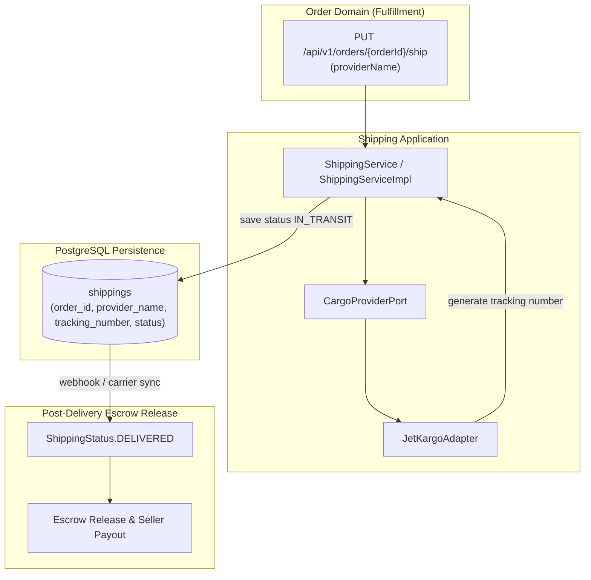

# Shipping Domain

## 1. Executive Summary & Architecture
The `shipping` domain encapsulates logistics carrier integration, shipment state tracking, and tracking number assignment for marketplace purchases delivered via cargo carriers.

> [!NOTE]
> **Related Documentation & Runbooks:**
> - **Architecture Deep Dive:** [`docs/safe-meetup-delivery-and-verification.md`](../../../../../../../docs/safe-meetup-delivery-and-verification.md)
> - **Architecture Deep Dive:** [`docs/external-integrations-cloudinary-and-exchange.md`](../../../../../../../docs/external-integrations-cloudinary-and-exchange.md)
> - **Frontend Module:** [`secondhand-frontend/src/order/README.md`](../../../../../../../secondhand-frontend/src/order/README.md)

### Architectural Highlights
- **Hexagonal Carrier Port:** Logistics providers are decoupled via `CargoProviderPort`. The current reference implementation (`JetKargoAdapter`) integrates mock carrier tracking and generation.
- **Independent State Machine:** Shipping status transitions (`ShippingStatus`) operate orthogonally to financial payments and escrow holdings.
- **Escrow Handshake:** When a shipment transitions to `ShippingStatus.DELIVERED`, it informs the `order` domain to update `OrderStatus.DELIVERED`, triggering the 48-hour buyer confirmation window and downstream escrow release.

---

## 2. Architecture & State Flow

---

## 3. Core Entities & Database Schema

### `shippings` Table
- `id` (BIGINT, PK)
- `order_id` (BIGINT, FK -> `orders.id`, not null, unique)
- `provider_name` (VARCHAR(100), not null)
- `tracking_number` (VARCHAR(100), not null, indexed)
- `status` (VARCHAR(30), maps to `ShippingStatus`: `PENDING`, `IN_TRANSIT`, `DELIVERED`, `CANCELLED`)
- `shipped_at` (TIMESTAMP, nullable)
- `delivered_at` (TIMESTAMP, nullable)
- *Unique Constraint:* `UNIQUE (order_id)`

---

## 4. Lifecycle & Business Invariants

### 4.1 Shipment Creation & Carrier Dispatch
1. When an order is paid and ready for shipment, the seller dispatches the item via `PUT /api/v1/orders/{order-id}/ship`.
2. `ShippingService` invokes `CargoProviderPort.ship(order, providerName)`.
3. The selected adapter assigns a unique carrier tracking number.
4. A `Shipping` record is saved with status `IN_TRANSIT` and `shipped_at = LocalDateTime.now()`.
5. Order status transitions to `OrderStatus.SHIPPED`.

### 4.2 Delivery Confirmation & Escrow Unlocking
1. Upon carrier delivery confirmation, status updates to `DELIVERED` and stamps `delivered_at`.
2. Synchronizes with the `order` domain to set `OrderStatus.DELIVERED`.
3. Starts the 48-hour buyer inspection window. If no disputes are filed, `OrderCompletionScheduler` auto-completes the order and releases escrowed funds to the seller's eWallet.

---

## 5. Public APIs & Access Control
- The shipping domain does not expose standalone public controllers; mutations are mediated through the `order` domain (`OrderController`).
- Supported carrier providers are dynamically listed via `GET /api/v1/enums/all` under `carriers`.
- Only the verified seller of an order can initiate shipment dispatch.
